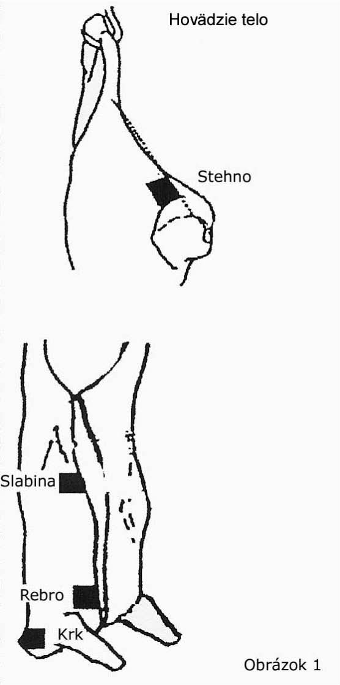
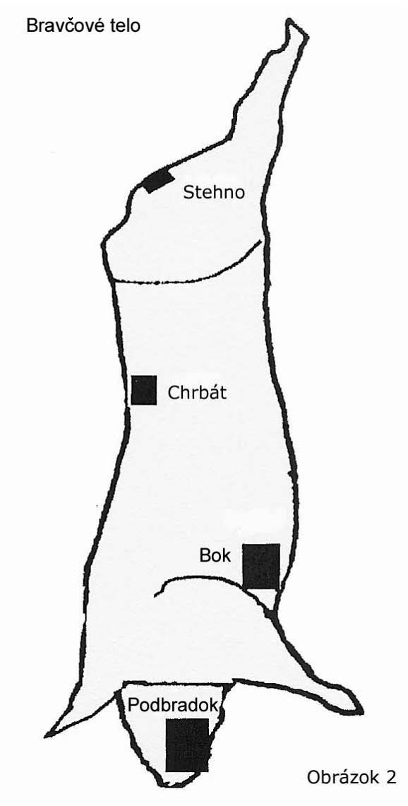

Príloha č. 7 k nariadeniu vlády č. 281/2003 Z. z.

- POŽIADAVKY NA PRAVIDELNÉ VLASTNÉ KONTROLY VŠEOBECNEJ HYGIENY VYKONÁVANÉ V PREVÁDZKARNIACH NA ČERSTVÉ MÄSO

  - ČASŤ A ODBER VZORIEK NA BAKTERIOLOGICKÉ VYŠETROVANIE TIEL HOVÄDZIEHO DOBYTKA, OŠÍPANÝCH, OVIEC, KÔZ A KONÍ NA BITÚNKOCH

    - Táto časť sa vzťahuje na bakteriologické vyšetrovanie povrchu tiel. Vzťahuje sa na odber vzoriek, analyzovanie vzoriek a prezentáciu výsledkov.

    - METÓDA ODBERU VZORIEK

    - Pri deštruktívnej metóde sa musia odobrať z tela po jatočnom opracovaní, ale pred začatím chladenia 4 vzorky tkaniva predstavujúce celkovo 20 cm2. Vzorky tkaniva možno získavať použitím sterilného korkovrtu (2,5 cm2) alebo vyrezaním rezu 5 cm2 s maximálnou hrúbkou 5 mm z tela sterilným nástrojom. Vzorky sa musia na bitúnku asepticky umiestniť do nádoby na vzorky (vzorkovnice) alebo do plastového vrecka s roztokom a musia sa preniesť do laboratória, kde sa musia homogenizovať peristaltickým homogenizátorom (stomacherom) alebo rotačným homogenizátorom.

    - Ak sa použije nedeštruktívna metóda, musia sa pred odberom vzoriek sterové tampóny navlhčiť. Na ich navlhčenie sa musí použiť ako sterilné médium roztok 0,1 % peptónu +0,85 % NaCl. Plocha odberu sterom musí byť najmenej 100 cm2 na jedno miesto odberu. Ster sa musí navlhčovať v roztoku najmenej 5 sekúnd a stierať sa musí najprv vertikálne, potom horizontálne a potom diagonálne najmenej 20 sekúnd po celom povrchu mäsa vymedzenom sterilnou šablónou. Musí sa použiť, pokiaľ možno, čo najväčší možný tlak. Po použití navlhčeného steru sa rovnaký postup stierania zopakuje so suchým sterom. Aby sa dosiahli porovnateľné výsledky, musí sa pri jednotlivých vzorkách, telách a dňoch odberu dôsledne dodržiavať dôkladnosť a konzistentnosť techniky odberu.

    - LOKALIZÁCIA ODBERU VZORIEK PRI TESTOVANÍ TIEL

  - 

  - 

    - Na kontrolu procesov sú zvyčajne vhodné tieto miesta:

    - Hovädzí dobytok: krk, rebro, slabina a stehno (obr.1).

    - Ovce a kozy: slabina, hrudník laterálne, rebro a hruď.

    - Ošípané: chrbát, podbradok (lalok), zadná končatina mediálne (stehno) a bok (obr. 2).

    - Kone: slabina, hruď, chrbát a stehno.

    - Po konzultácii s úradným veterinárnym lekárom možno použiť alternatívne miesta odberu, ak sa preukázalo, že z dôvodov jatočnej technológie na danom bitúnku je pri iných miestach pravdepodobnejšie, že sú viac kontaminované. V tomto prípade sa môžu zvoliť miesta, pri ktorých sa ukáže, že majú vyššiu úroveň kontaminácie.

    - POSTUP ODBERU VZORIEK A POČTY ODOBERANÝCH VZORIEK

    - V priebehu každého týždňa sa v jednom dni odoberajú vzorky z piatich až desiatich tiel. Frekvencia sa môže znížiť na testovanie raz za dva týždne, ak sa dosiahnu v šiestich po sebe idúcich týždňoch vyhovujúce výsledky. Deň odberu vzoriek sa musí každý týždeň meniť, aby sa zabezpečilo, že sa pokryje každý deň týždňa. Frekvenciu testovania tiel na nízkokapacitných bitúnkoch podľa § 4 a pri prevádzkarniach, ktoré nepracujú každý deň v týždni, a ak ide o prevádzkárne, kde nepracujú na plné zmeny, určí pre každú prevádzkareň úradný veterinárny lekár na základe vlastného posúdenia hygienických štandardov a postupov zabíjania v danej prevádzkarni.

    - Vzorky zo štyroch miest z každého tela sa musia odoberať v polovici zabíjania počas pracovného dňa pred začatím chladenia. Na každej vzorke sa musí zaznamenať a označiť identifikácia tela, dátum a čas odberu vzorky. Pred vyšetrením sa vzorky z rôznych miest testovaného tela (t. j. stehno, slabina, hruď a krk) zmiešajú (zlúčia).

    - Ak sa získajú nevyhovujúce výsledky a nápravné opatrenia nevedú k zlepšeniu hygieny, ďalšie vzorky sa nezmiešavajú, kým sa nevyriešia problémy s hygienou jatočného opracovania.

    - MIKROBIOLOGICKÁ METÓDA VYŠETRENIA VZORIEK

    - Vzorky odobraté deštruktívnou metódou alebo stery pri nedeštruktívnej metóde sa musia až do vyšetrenia uchovávať schladené pri teplote +4 oC. Vzorky sa musia homogenizovať v plastovom vrecku s riediacim médiom najmenej 2 minúty v 100 ml riediaceho média (t. j. 0,1 % pufrovaná peptónová voda, 0,9 % roztok chloridu sodného) pri asi 250 cykloch peristaltického stomachera alebo homogenizovať v rotačnom homogenizátore. Alternatívne možno vzorky sterov rázne vytrepať do zrieďovacieho média. Vzorky sa musia vyšetriť do 24 hodín od odberu.

    - Riedenie pred očkovaním na platne sa vykonáva ako 10-násobné riedenie v 0,1 % peptóne +0,85 % NaCl. Suspenzia steru alebo homogenizovaná suspenzia mäsa v plastovom vrecku stomachera sa nepovažujú za riedenie a berú sa do úvahy pri výpočte ako riedenie 10o.

    - Vyšetrenia sa vykonávajú na celkový počet mikróbov a na Enterobacteriaceae. Po schválení príslušným orgánom veterinárnej správy1) a po stanovení vhodných kritérií možno používať namiesto počtu Enterobacteriaceae počty E. coli. Okrem uvedených metód môžu byť základom na vyšetrenie vzoriek aj metódy ISO. Iné kvantitatívne metódy analýz uvedených baktérií možno používať, ak boli schválené CEN alebo uznanou vedeckou inštitúciou, a len po schválení príslušným orgánom veterinárnej správy.1)

    - VEDENIE ZÁZNAMOV

    - Všetky výsledky sa musia vyjadrovať a zaznamenávať ako kolónie tvoriace jednotky KTJ/cm2 plochy povrchu. Záznamy výsledkov sa musia vykazovať v grafoch alebo tabuľkách kontroly procesov, obsahujúcich v postupnom poriadku po sebe výsledky testov najmenej za 13 posledných týždňov. Tieto záznamy musia obsahovať druh, pôvod a identifikáciu vzorky, dátum a hodinu odberu, meno osoby, ktorá vykonala odber, názov a adresu laboratória, ktoré vzorky analyzovalo, dátum vyšetrovania vzoriek v laboratóriu a podrobnosti o použitej metóde vrátane inokulácie rôznych agarových médií, teploty inkubácie, času a výsledkov vyjadrených ako počet KTJ/ jedna platňa použitých na výpočet výsledku v KTJ/ cm2 plochy povrchu.

    - Záznamy musí podpisovať zodpovedná osoba z laboratória.

    - Tieto doklady sa musia uchovávať v prevádzkarni najmenej 18 mesiacov a na požiadanie sa musia predložiť úradnému veterinárnemu lekárovi.

    - POUŽITIE MIKROBIOLOGICKÝCH KRITÉRIÍ NA VÝSLEDKY TESTOV ZO VZORIEK ZÍSKANÝCH EXCÍZIOU (VÝREZOM) (Tabuľka č. 1)

    - Na verifikáciu kontroly procesov sa denný záznam priemerných hodnôt výsledkov zaradí do jednej z troch kategórií: prijateľný, medzný, neprijateľný. „M“ a „m“ znamenajú horné limity pre medzné a prijateľné kategórie vzoriek odobratých deštruktívnou metódou.

    - Kvôli dosiahnutiu štandardizácie priemyslu a uľahčeniu vytvorenia platnej základnej databázy je nevyhnutné používať čo najspoľahlivejšiu dostupnú metódu, a preto treba pamätať na to, že vzorky sterov stierajú len určitý podiel (často 20 % a menej) z celkovej mikroflóry prítomnej na povrchu mäsa. Sú teda len indikátorom hygieny povrchu.

    - Ak sa používajú iné metódy, ako je deštruktívna metóda, musia sa mikrobiologické kritériá stanoviť pre každú jednotlivú používanú metódu jednotlivo, aby sa dali uviesť do vzťahu k deštruktívnej metóde, a musia byť schválené príslušným orgánom veterinárnej správy.

    - VERIFIKAČNÉ KRITÉRIÁ - HLÁSENIE

    - Výsledky testov sa musia kategorizovať podľa príslušných mikrobiologických kritérií v rovnakom poradí, ako boli odobraté vzorky. Po každom novozískanom výsledku testu sa verifikačné kritériá aplikujú znovu, aby sa vyhodnotil stav kontroly procesu vzhľadom na fekálnu kontamináciu a hygienu. Trendy neprijateľného alebo nevyhovujúceho medzného výsledku musia viesť k previerke (revízii) kontroly procesu, ak je to možné, k odhaleniu príčiny a predchádzaniu opakovania sa.

    - SPÄTNÁ VÄZBA

    - Výsledky testov sa musia spätne čo najskôr hlásiť zodpovednému personálu prevádzkarne. Výsledky sa musia používať na dodržanie a zlepšenie štandardu hygieny zabíjania. Prípady zlých výsledkov možno objasňovať pohovormi s personálom bitúnku, pričom možno brať do úvahy okrem iného aj tieto faktory:

    - 1. zlé pracovné postupy,

    - 2. chýbanie alebo nedostatočné školenie alebo inštrukcie,

    - 3. používanie nevhodných alebo nedostatočných čistiacich/alebo dezinfekčných prostriedkov a chemikálií,

    - 4. nevhodná údržba čistiaceho zariadenia,

    - 5. nedostatočný dohľad.

      - Tabuľka č.1

      - Denný záznam priemerných hodnôt pre medzné a neprijateľné výsledky bakteriálnej kontaminácie - mikrobiologické kritériá pre hovädzí dobytok, ošípané, ovce, kozy a kone v jednotkách (KTJ/cm2) pri vzorkách odobratých deštruktívnou metódou.

    - | Prijateľný rozsah | | Medzný rozsah (> m, ale <= M) | Neprijateľný rozsah (>M)

    - | Hovädzí dob. /ovce /kozy/ kone | Ošípané | Hovädzí dobytok/ ošípané/ovce/kozy/ kone | Hovädzí dobytok/ ošípané/ ovce/ kozy/ kone

    - Celkový počet mikróbov (CPM) | < 3,5 log | < 4,0 log | < 3,5 log (ošípané: 4,0 log) - 5,0 log | > 5,0 log

    - Enterobacteriaceae | < 1,5 log | < 2,0 log | 1,5 log (ošípané: 2,0 log) - 2,5 log (ošípané: 3,0 log) | > 2,5 log (ošípané: > 3,0 log)

  - ČASŤ B ODBER VZORIEK NA BAKTERIOLOGICKÉ VYŠETRENIE NA KONTROLY ČISTENIA A DEZINFEKCIE NA BITÚNKOCH A V ROZRÁBKARNIACH

    - Uvedené bakteriologické vyšetrovanie sa musí používať podľa štandardných sanitačných operačných postupov (SSOP), ktorými sa špecifikujú hygienické kontroly pred prevádzkou, ktoré sa musia vykonávať v priestoroch, ktoré majú priamy dosah na hygienu výrobkov.

    - METÓDY ODBERU

    - Ďalej je opísaná technika odberu kontaktnou platňovou metódou a technika odberu stermi. Používanie týchto metód je limitované na testovanie povrchov, ktoré sú vyčistené a vydezinfikované, suché, ploché, dostatočne veľké a hladké.

    - Tieto metódy sa musia používať vždy predtým, ako sa začne výroba, nikdy nie počas výroby. Ak je prítomné viditeľné znečistenie, čistenie sa musí aj bez ďalšieho mikrobiologického vyhodnocovania posúdiť ako neprijateľné.

    - Táto metóda nie je vhodná na odber vzoriek mäsa alebo mäsových výrobkov.

    - Po schválení príslušným orgánom veterinárnej správy možno použiť metódy, ktoré poskytujú rovnocenné záruky.

    - ODTLAČKOVÁ AGAROVÁ PLATŇOVÁ METÓDA

    - Pri odtlačkovej agarovej platňovej metóde sa na každé miesto odberu pritlačia a následne sa inkubujú malé plastové misky s viečkami (t. j. vnútorný priemer 5,0 cm) naplnené agarom na stanovenie celkového počtu mikróbov (podľa aktuálnej verzie ISO) a misky s VČŽG agarom (agar s kryštátovou fialovou, neutrálnou červenou, žlčovými soľami a glukózou podľa aktuálnej verzie ISO). Kontaktný povrch každej platne je 20 cm2.

    - Agar má po príprave trvanlivosť asi 3 mesiace, ak sa uchováva v uzavretých fľašiach pri teplote 2 až 4 oC. Krátko pred prípravou platní sa agar roztaví pri 100 oC a ochladí na 46 až 48 oC. Platne sa umiestnia do boxu s laminárnym prúdením vzduchu a plnia sa agarom, kým sa nedosiahne vypuklý povrch. Pripravené platne sa pred použitím nechajú vysušiť v termostate obrátené hore dnom pri teplote 37 oC cez noc (12 hodín).

    - Je tiež potrebné kontrolovať platne na možnú kontamináciu pri príprave; platne s viditeľnými kolóniami sa musia vyhodiť.

    - Ak sú platne uzavreté v zatavených plastových vreckách, majú trvanlivosť jeden týždeň pri teplote 2 oC až 4 oC.

    - STEROVÁ TECHNIKA

    - Vzorky sa odoberajú vatovými stermi navlhčenými 1 ml 0,1% slaného peptónového roztoku [8,5 g NaCl, 1 g tryptón kazeín-peptónu (enzymaticky natrávený kazeín), 0,1 % agaru a 1 000 ml destilovanej vody] z povrchovej plochy najlepšie 20 cm2 vyznačenej sterilnou šablónou. Ak sa odber vykonáva po čistení a dezinfekcii, do zvlhčovacieho roztoku na stery treba pridať 30g/l Tweenu 80 a 3 g/l lecitínu (alebo iné látky s podobným efektom). Pri vlhkých miestach stačia suché vatové stery.

    - Stery sa musia držať v sterilných peánoch (lekárskych kliešťach) a vzorkovaný povrch sa musí stierať 10x zhora dole s použitím silného tlaku na povrch. Stery sa zhromažďujú do prachovnice (fľaše) so 40 ml pufrovaného peptónu s 0,1 % agarového soľného roztoku. Vzorky sterov sa musia do ďalšieho spracovania chladiť pri teplote 4 oC. Fľašou sa musí silne triasť pred riedením v 10 zrieďovacích krokoch v 40 ml 0,1 % NaCl peptónového roztoku, po ktorom nasleduje mikrobiologické vyšetrenie (napr. kvapkovou platňovou metódou).

    - FREKVENCIA

    - Vždy sa musí vykonať odber najmenej 10 vzoriek alebo až do 30 vzoriek vo veľkých výrobných priestoroch v rámci dvoch týždňov. Z veľkých predmetov sa musia odobrať tri vzorky. Ak počas určitej lehoty výsledky vyhovujú, možno po dohode s úradným veterinárnym lekárom frekvenciu odberu znížiť.

    - Miestami, ktorým sa musí venovať najväčšia pozornosť, sú tie miesta, ktoré sú určené na to, aby prichádzali alebo by mohli prísť do styku s výrobkami. Približne 2/3 z celkového počtu vzoriek treba odoberať z povrchov prichádzajúcich do styku s potravinami.

    - Aby sa zabezpečilo, že sa v priebehu mesiaca otestujú všetky povrchy, musí sa zostaviť harmonogram odberu, ktorým sa určí, ktoré povrchy sa musia v ktorý deň testovať. Výsledky sa musia zaznamenávať a musia sa vypracúvať pravidelné diagramy (grafy), ktorými sa vykazuje priebeh v čase.

    - PREPRAVA

    - Ak sa použijú kontaktné platne, netreba ich počas prepravy a pred inkubovaním chladiť. Vzorky sterov sa musia do ďalšieho spracovania chladiť pri teplote +4 oC.

    - BAKTERIOLOGICKÉ POSTUPY

    - Okrem uvedených možno použiť metódy ISO.

    - Počty baktérií sa musia vyjadrovať a hlásiť ako počty mikroorganizmov na cm2 povrchovej plochy. Naočkované platne na CPM a agarové kontaktné platne sa musia inkubovať na celkový počet mikróbov (CPM) 24 hodín pri teplote 37 oC ± 1 oC za aeróbnych podmienok. Tento postup sa musí uskutočniť do 2 hodín od vzorkovania. Počet bakteriálnych kolónií sa musí spočítať a zaznamenať.

    - Na kvantitatívny odhad Enterobacteriaceae sa musí použiť VČŽG agar. Inkubácia naočkovaných platní a agarových kontaktných platní sa musí začať do dvoch hodín od odberu vzoriek za aeróbnych podmienok. Po 24-hodinovej inkubácii pri teplote 37 oC ± 1 oC sa musia platne vyšetriť na rast Enterobacteriaceae.

    - Musia sa vykonávať analýzy na celkový počet mikróbov. Odber vzoriek na Enterobacteriaceae je dobrovoľný, ak ho nevyžaduje úradný veterinárny lekár.

    - MIESTA ODBERU VZORIEK

    - Na odber vzoriek sa vyberajú napríklad tieto miesta:

    - Sterilizačné zariadenia na nože, nože (spojenie rúčky a čepele), duté vykrvovacie nože, elastické svorky na podväzovanie, pariace vane, stroje na uvoľňovanie a uzatváranie konečníkov do vreciek, oškrabovací stôl/rozperky (ošípané), čepeľ píl a sekáčov, sťahovače kože hovädzieho dobytka, ostatné nástroje na jatočné opracovanie tiel, odštetinovače/oškrabovače, leštiace stroje, háky a kontajnery vyvrhovacích prepravníkov, posuvné pásy, zástery, stoly na rozrábanie, kývavé dvere, ak sa ich dotýkajú prechádzajúce telá, sklzy pre požívateľné orgány, časti liniek, ktorých sa často dotýkajú telá, podstropné konštrukcie, z ktorých môže odkvapkávať vlhkosť, atď.

    - VÝPOČET VÝSLEDKOV

    - Pri agarových kontaktných platniach a pri testovaní sterov na CPM a počty Enterobacteriaceae sa výsledky zapisujú do registračného formulára. Na účel verifikácie kontroly procesov čistenia a dezinfekcie sú stanovené len dve kategórie pre CPM a Enterobacteriaceae: prijateľná a neprijateľná. Prijateľný rozsah pre počet kolónií na agarovej kontaktnej platni a počet kolónií CPM alebo Enterobacteriaceae - výsledky sterov - je uvedený v tabuľke č. 2.

    - Tabuľka č. 2

    - Stredné hodnoty počtov kolónií pri testovaní povrchov

  - | Prijateľný rozsah | Neprijateľné

  - Celkový počet mikróbov | 0 - 10/ cm2 | > 10/ cm2

  - Enterobacteriaceae | 0- 1/ cm2 | > 1 / cm2

    - SPÄTNÁ VÄZBA - HLÁSENIE

    - Výsledky testov sa musia spätne čo najskôr hlásiť zodpovednému personálu prevádzkarne. Výsledky sa musia používať na udržanie a zlepšenie štandardu čistenia a dezinfekcie. Nevyhovujúce výsledky sa musia objasňovať pohovormi so sanitačným personálom.

    - Možno brať do úvahy tieto faktory:

    - 1. absencia alebo nedostatočné školenie alebo inštrukcie,

    - 2. používanie nevhodných alebo nedostatočných čistiacich/alebo dezinfekčných prostriedkov a chemikálií,

    - 3. nevhodná údržba čistiaceho zariadenia,

    - 4. nedostatočný dohľad.
