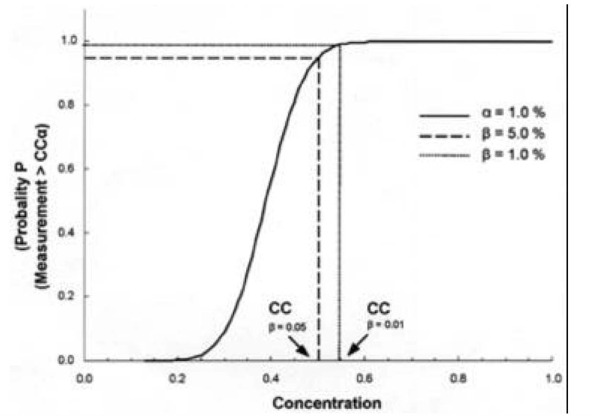
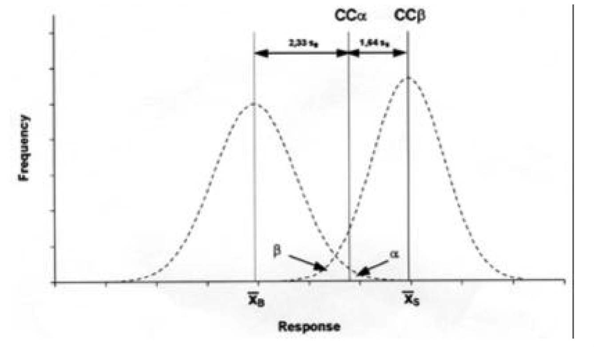
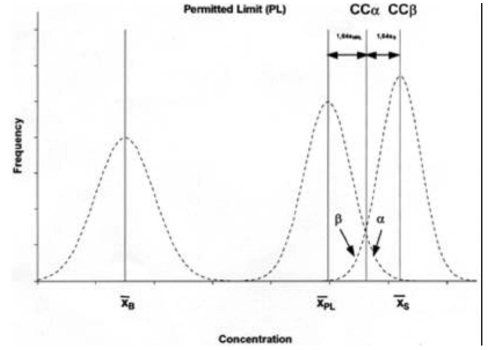
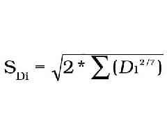

Príloha č. 8 k nariadeniu vlády č. 320/2003 Z. z.

- ANALYTICKÉ METÓDY A INTERPRETÁCIA VÝSLEDKOV ANALÝZ ÚRADNÝCH VZORIEK

  - ČASŤ A VŠEOBECNÉ POŽIADAVKY

    - 1. Predmet a oblasť

      - Požiadavky tejto prílohy sa vzťahujú na analytické metódy, ktoré sa používajú na testovanie úradných vzoriek odobratých podľa § 15 ods. 1 tohto nariadenia, a opisuje všeobecné kritériá na interpretáciu analytických výsledkov úradných kontrolných laboratórií pre tieto vzorky.

      - Táto príloha sa nevzťahuje na látky, pre ktoré sú právnymi predpismi Slovenskej republiky a legislatívou Európskych spoločenstiev ustanovené podrobnejšie požiadavky.

    - 2. Analytické metódy

    - Úradné vzorky odobraté podľa tohto nariadenia sa musia analyzovať metódami, ktoré

      - a) sú dokumentované návodom testov, najlepšie podľa slovenskej technickej normy,1)

      - b) vyhovujú oddielu 2 časti B,

      - c) boli validované v súlade s postupmi opísanými v oddieli 3 časti B,

      - d) vyhovujú príslušnému minimu požadovaných pracovných limitov (MRPL), ktoré sú ustanovené v súlade s bodom 3.

    - 3. Minimum požadovaných pracovných limitov

      - Táto príloha sa bude meniť a dopĺňať tak, aby sa postupne ustanovilo minimum požadovaných pracovných limitov (MRPL) pre analytické metódy, ktoré sa používajú pre látky, pre ktoré nie sú ustanovené povolené limity.

    - 4. Kontrola kvality

      - Kvalita výsledkov analýz vzoriek odobratých v súlade s týmto nariadením sa musí zabezpečovať jednotlivo monitorovaním testov alebo výsledkov kalibrácie podľa slovenskej technickej normy.2)

    - 5. Interpretácia výsledkov

      - Výsledok analýzy sa považuje za nezhodný, ak bol prekročený rozhodujúci limit konfirmačnej metódy pre analyt.

      - Ak je pre látku ustanovený povolený limit, rozhodujúcim limitom je koncentrácia, nad ktorou je možné so štatistickou istotou 1 – α rozhodnúť, že je prítomný určitý analyt.

      - Ak nie je pre látku ustanovený žiadny povolený limit, rozhodujúci limit je najnižšia hladina koncentrácie, pri ktorej môže metóda so štatistickou istotou 1 – α rozhodnúť, že je prítomný určitý analyt.

      - Pre látky uvedené v skupine A prílohy č. 2 je chyba α 1 % a menej. Pre ostatné látky je chyba α 5 % a menej.

  - ČASŤ B PRACOVNÉ KRITÉRIÁ, INÉ POŽIADAVKY A POSTUPY ANALYTICKÝCH METÓD

    - 1. Definície pojmov

      - 1.1. Správnosťou sa rozumie blízkosť zhody medzi výsledkom skúšky a uznanou referenčnou hodnotou3). Je určená výťažnosťou a presnosťou.

      - 1.2. Alfa (α) chybou sa rozumie pravdepodobnosť, že testovaná vzorka je zhodná, aj keď bola získaná nezhodným meraním (falošne nezhodné rozhodnutie).

      - 1.3. Analytom sa rozumie látka, ktorá má byť detekovaná, identifikovaná a/alebo kvantifikovaná, a deriváty, ktoré sa objavujú počas analýzy.

      - 1.4. Beta (ß) chybou sa rozumie pravdepodobnosť, že testovaná vzorka je skutočne nezhodná, aj keď bola získaná zhodným meraním (falošne zhodné rozhodnutie).

      - 1.5. Biasom sa rozumie rozdiel medzi predpokladaným výsledkom testu a uznanou referenčnou hodnotou3).

      - 1.6. Kalibračným štandardom sa rozumie prostriedok na meranie, ktorý predstavuje kvantitu látky, ktorá nás zaujíma tak, že spája svoju hodnotu s referenčným základom.

      - 1.7. Certifikovaným referenčným materiálom (CRM) sa rozumie materiál, ktorý má presne stanovený obsah analytu.

      - 1.8. Co-chromatografiou sa rozumie postup, v ktorom je extrakt pred chromatografickým krokom (krokmi) rozdelený na dve časti. Časť jeden je chromatografovaná ako taká. Časť dva je zmiešaná so štandardným analytom na meranie. Potom je táto zmes tiež chromatografovaná. Množstvo pridaného štandardného analytu má byť rovnaké ako odhadované množstvo analytu v extrakte. Táto metóda je navrhnutá na zlepšenie identifikácie analytu pri používaní chromatografických metód, hlavne ak nemôže byť použitý vhodný interný štandard.

      - 1.9. Porovnávacími štúdiami sa rozumie analyzovanie rovnakej vzorky rovnakou metódou na určenie pracovných charakteristík metódy. Tieto štúdie pokrývajú náhodné chyby merania a laboratórny bias.

      - 1.10. Konfirmačnou metódou sa rozumejú metódy, ktoré poskytujú úplnú alebo doplňujúcu informáciu umožňujúcu látku jednoznačne identifikovať, a ak je potrebné, kvantifikovať na úrovni záujmu.

      - 1.11. Rozhodujúcim limitom (CCα) sa rozumie limit, v ktorom a nad ktorým sa môže s chybou pravdepodobnosti α dospieť k záveru, že vzorka je nezhodná.

      - 1.12. Detekčnou schopnosťou (CCß) sa rozumie najnižší obsah látky, ktorý môže byť vo vzorke detekovaný a/alebo kvantifikovaný s chybou pravdepodobnosti . V prípade látok, pre ktoré nebol ustanovený limit, detekčná schopnosť je najnižšia koncentrácia, pri ktorej je metóda schopná detekovať skutočne kontaminované vzorky so štatistickou istotou 1 – ß. V prípade látok s ustanoveným limitom to znamená, že detekčná schopnosť je koncentrácia, pri ktorej je metóda schopná detekovať stanovený limit so štatistickou istotou 1 – ß.

      - 1.13. Fortifikovaným materiálom vzorky sa rozumie vzorka obohatená známym množstvom detekovaného analytu.

      - 1.14. Medzilaboratórnymi porovnaniami sa rozumie organizácia, vykonanie a vyhodnotenie testov tej istej vzorky dvoma alebo viacerými laboratóriami v súlade s vopred určenými podmienkami určujúcimi skúšobný postup. Podľa zámeru štúdie môžu byť klasifikované ako collaborative study alebo skúšky spôsobilosti.

      - 1.15. Interným štandardom (IS) sa rozumie látka, ktorá nie je neobsiahnutá vo vzorke, s fyzikálno-chemickými vlastnosťami čo najpodobnejšími vlastnostiam analytu, ktorý má byť identifikovaný, a ktorá sa pridá do každej vzorky, ako aj do kalibračného štandardu.

      - 1.16. Laboratórnou vzorkou sa rozumie vzorka pripravená na zaslanie do laboratória za účelom skúmania alebo testu.

      - 1.17. Úrovňou záujmu sa rozumie koncentrácia látky alebo analytu vo vzorke, ktorá je dôležitá na určenie jej zhody s legislatívou.

      - 1.18. Minimom požadovaných pracovných limitov (MRPL) sa rozumie najmenší obsah analytu vo vzorke, ktorý môže byť detekovaný a potvrdený. Je určený na harmonizáciu vykonávania analytických metód pri látkach, pre ktoré nebol ustanovený limit.

      - 1.19. Pracovnými charakteristikami sa rozumie prevádzková kvalita, ktorá sa môže prisúdiť analytickej metóde. Môže to byť napríklad špecifickosť, správnosť, výťažnosť, presnosť, opakovateľnosť, reprodukovateľnosť, detekčná schopnosť a robustnosť.

      - 1.20. Pracovnými kritériami sa rozumejú požiadavky na pracovné kritériá, podľa ktorých možno posúdiť, že analytická metóda je vhodná na účel a tvorí hodnoverné výsledky.

      - 1.21. Stanoveným limitom sa rozumie maximálny limit rezíduí, maximálna úroveň alebo iná maximálna prípustná odchýlka ustanovená iným právnym predpisom Spoločenstva.

      - 1.22. Presnosťou sa rozumie blízkosť zhody medzi nezávislými výsledkami testu získanými za určených (vopred stanovených) podmienok. Miera presnosti sa zvyčajne vyjadruje pojmom nepresnosť a vypočíta sa ako smerodajná odchýlka výsledku. Nižšia presnosť je určená väčšou smerodajnou odchýlkou3).

      - 1.23. Skúškou spôsobilosti sa rozumie analyzovanie rovnakej vzorky, ktoré dovoľuje laboratóriám vybrať si ich vlastné metódy pod podmienkou, že tieto metódy sú použité za bežných podmienok. Skúšky sa musia realizovať podľa ISO guide 43-1 (3) a 43-2 (4) a môžu sa použiť na stanovenie reprodukovateľnosti metód.

      - 1.24. Kvalitatívnou metódou sa rozumie analytická metóda, ktorá identifikuje látku na základe jej chemických, biologických a fyzikálnych vlastností.

      - 1.25. Kvantitatívnou metódou sa rozumie analytická metóda, ktorá určuje množstvo alebo hmotnostný zlomok látky, a teda môže sa vyjadriť ako numerická hodnota v príslušných jednotkách.

      - 1.26. Slepým pokusom sa rozumie úplný analytický postup aplikovaný bez dávky testu alebo použitím ekvivalentného množstva vhodného rozpúšťadla namiesto dávky testu.

      - 1.27. Výťažnosťou sa rozumie percento pravdivej koncentrácie látky získanej počas analytického postupu. Ak nie je dostupný referenčný materiál, určuje sa počas validácie.

      - 1.28. Referenčným materiálom sa rozumie materiál, ktorého jedna alebo viac vlastností sú potvrdené validovanou metódou, a teda môže sa použiť na kalibráciu prístroja alebo na overenie metód merania.

      - 1.29. Opakovateľnosťou sa rozumie presnosť za opakovateľných podmienok3).

      - 1.30. Opakovateľnými podmienkami sa rozumejú podmienky, keď sú nezávislé výsledky testu získané rovnakou metódou, na rovnakých skúšobných predmetoch, v rovnakom laboratóriu, rovnakým operátorom, ktorý používa rovnaké vybavenie.

      - 1.31. Reprodukovateľnosťou sa rozumie presnosť za reprodukovateľných podmienok3).

      - 1.32. Reprodukovateľnými podmienkami sa rozumejú podmienky, keď sú výsledky testu získané rovnakou metódou, na rovnakých skúšobných predmetoch, v rôznych laboratóriách, rôznymi operátormi, ktorí používajú rôzne vybavenie4).

      - 1.33. Robustnosťou sa rozumie schopnosť analytickej metódy prijať zmeny experimentálnych podmienok, ktoré sa môžu vyjadriť ako zoznam materiálov vzorky, analytov, podmienok skladovania, prostredia a/alebo podmienok prípravy vzorky, za ktorých môže byť metóda použitá, ako bolo odporúčané, alebo s malými špecifikovanými modifikáciami. Pre všetky experimentálne podmienky, ktoré môžu byť v praxi predmetom výkyvu (napríklad stabilita reagentov, zloženie vzorky, pH, teplota), majú byť označené akékoľvek odchýlky, ktoré môžu ovplyvniť analytický výsledok.

      - 1.34. Slepou vzorkou sa rozumie úplný analytický postup použitý v dávke testu odobratej zo vzorky, v ktorej chýba analyt.

      - 1.35. Screeningovou metódou sa rozumejú metódy, ktoré sa používajú na detekciu prítomnosti látky alebo skupiny látok v úrovni záujmu. Tieto metódy majú schopnosť vysokej kapacity vzoriek a používajú sa na roztriedenie veľkého počtu vzoriek na potenciálne nezhodné výsledky.

      - 1.36. Vnútrolaboratórnou validáciou sa rozumie analytické štúdium zahŕňajúce jediné laboratórium, ktoré používa jednu metódu na analýzu rovnakých alebo rôznych skúšobných materiálov za rôznych podmienok počas dlhých časových intervalov.

      - 1.37. Špecifickosťou sa rozumie schopnosť metódy rozoznať meraný analyt od ostatných látok. Táto vlastnosť je rozhodujúcou funkciou opísaných techník merania, ale môže sa meniť v závislosti od skupiny zložiek alebo matrice.

      - 1.38. Štandardným prídavkom sa rozumie postup, pri ktorom je vzorka rozdelená do dvoch (alebo viacerých) častí testu. Jedna časť sa analyzuje ako taká a do druhej časti sa pred analýzou pridá známe množstvo štandardného analytu. Množstvo pridaného štandardného analytu má byť dvojnásobkom až päťnásobkom odhadovaného množstva analytu vo vzorke. Tento postup je určený na determináciu obsahu analytu vo vzorke, ktorý počíta s výťažnosťou analytickej metódy.

      - 1.39. Štandardným analytom sa rozumie analyt so známym a certifikovaným obsahom a čistotou používaný ako referenčný v analýze.

      - 1.40. Látkou sa rozumie hmota s presnou alebo definovanou štruktúrou a jej metabolity.

      - 1.41. Dávkou testu sa rozumie kvantita materiálu zo vzorky testu, na ktorej sa uskutočňuje test alebo pozorovanie.

      - 1.42. Vzorkou testu sa rozumie vzorka pripravená z laboratórnej vzorky, z ktorej sa odoberá dávka testu.

      - 1.43. Pravdivosťou sa rozumie blízkosť zhody medzi priemernou hodnotou získanou z veľkých sérií výsledkov testov a prijateľnou referenčnou hodnotou. Pravdivosť sa zvyčajne vyjadruje ako bias3).

      - 1.44. Jednotkami sa rozumejú jednotky podľa slovenskej technickej normy.4)

      - 1.45. Validáciou sa rozumie potvrdenie vyšetrením a poskytnutie skutočného dôkazu, že príslušné požiadavky osobitného určenia sú splnené5).

      - 1.46. Vnútrolaboratórnou reprodukovateľnosťou sa rozumie presnosť získaná v tom istom laboratóriu za určených (vopred stanovených) podmienok (vrátane napríklad metódy, materiálu testu, operátora, prostredia) za dlhý časový úsek.

    - 2. Pracovné kritériá a iné požiadavky na analytické metódy

      - Analytické metódy alebo kombinácie metód iné, ako sú opísané nižšie, sa môžu používať len na screeningové alebo konfirmačné účely, ak môže byť dokázané, že sú splnené doleuvedené požiadavky.

    - 2.1. Všeobecné požiadavky

      - 2.1.1. Manipulácia so vzorkami

        - Vzorky majú byť získavané, manipulované a spracované takým spôsobom, aby bola maximálna možnosť detekcie látky. Postupy zaobchádzania so vzorkou majú zabrániť možnosti náhodnej kontaminácie alebo strate analytu.

      - 2.1.2. Vykonávanie testov

        - 2.1.2.1. Výťažnosť

          - Počas analýzy vzoriek má byť určená výťažnosť pre každú skupinu vzoriek, ak sa používa stály korekčný faktor. Ak je výťažnosť v medzných hodnotách, môže sa použiť stály korekčný faktor. V opačnom prípade sa musí použiť faktor výťažnosti získaný pre špecifickú skupinu, ak nebude potrebné použiť špecifický faktor výťažnosti analytu vo vzorke, a v tom prípade sa na kvantitatívne určenie analytu vo vzorke použije postup štandardného prídavku (pozri 3.5) alebo interný štandard.

        - 2.1.2.2. Špecifickosť

          - Metóda má byť schopná rozlíšiť medzi analytom a ostatnými látkami za experimentálnych podmienok. Má byť poskytnutý odhad, k akému rozsahu to je možné. Majú sa použiť stratégie, aby sa predišlo predvídateľným interferenciám s látkami, ak sa používa opísaná technika, napríklad homológy, analógy, metabolické produkty rezídua záujmu. Je prvotne dôležité, aby bola skúmaná interferencia, ktorá môže vzísť zo zložiek matrice.

    - 2.2. Screeningové metódy

      - Na screeningové účely sa môžu používať len tie analytické metódy, pri ktorých sa môže preukázať dokumentovaným viditeľným spôsobom, že sú validované a majú falošne zhodný pomer < 5 % (ß chyba) v súlade s týmto nariadením. V prípade podozrenia nezhodného výsledku tento výsledok sa potvrdí konfirmačnou metódou.

    - 2.3. Konfirmačné metódy pre organické rezíduá a kontaminanty

      - Konfirmačné metódy pre organické rezíduá a kontaminanty poskytnú informáciu o chemickej štruktúre analytu. Z toho vyplýva, že metódy založené len na chromatografickej analýze bez spektrofotometrickej detekcie nie sú vhodné ako konfirmačné metódy. Aj keď jednotlivá technika nemá dostatočnú špecifickosť, žiadaná špecifickosť sa dosiahne analytickými postupmi pozostávajúcimi z vhodných kombinácií čistenia, chromatografickej separácie (separácií) a spektrometrickou detekciou.

      - Na identifikáciu rezíduí alebo kontaminantov pre uvedené skupiny látok sa považujú za vhodné tieto metódy alebo kombinácie metód:

      - Tabuľka 1

      - Vhodné konfirmačné metódy pre organické rezíduá alebo kontaminanty

    - Meracia technika | Látky prílohy 1 96/23/ES | Limitácie

    - LC alebo GC s hmotnostnou spektrometrickou detekciou | Skupina A a B | Len ak nasleduje buď on-line alebo off-line chromatografická separácia.

    - | | Len ak sa používajú full scan techniky alebo ak sa použijú najmenej 3 (skupina B) alebo 4 (skupina A) identifikačné body pri metódach, ktoré nezaznamenávajú celé hmotnostné spektrum.

    - LC alebo GC s IR spektrometrickou detekciou | Skupina A a B | Musia byť splnené špecifické požiadavky na absorbciu pri IR spektrometrii.

    - LC-full scan DAD | Skupina B | Musia byť splnené špecifické požiadavky na absorbciu pri UV spektrometrii.

    - LC fluorescencia | Skupina B | Len pre molekuly, ktoré vykazujú natívnu fluorescenciu, a pre molekuly, ktoré vykazujú fluorescenciu buď po transformácii, alebo po derivatizácii.

    - 2-D TLC-full scan UV/VIS | Skupina B | Dvojdimenzionálna HPTLC a co-chromatografia sú záväzné.

    - GC detekcia elektrónového záchytu | Skupina B | Používajú sa len dve kolóny rôznej polarity.

    - LC imunogram | Skupina B | Len ak sa použijú najmenej dva rôzne chromatografické systémy alebo druhá, nezávislá metóda detekcie.

    - LC-UV/VIS (jediná vlnová dĺžka) | Skupina B | Len ak sa použijú najmenej dva rôzne chromatografické systémy alebo druhá, nezávislá metóda detekcie.

      - 2.3.1. Všeobecné pracovné kritériá a požiadavky

        - Konfirmačné metódy majú poskytovať informáciu o chemickej štruktúre analytu. Ak viac ako jedna zložka dáva rovnakú odozvu, potom metóda nedokáže rozoznať medzi týmito zložkami. Metódy, ktoré sú založené len na chromatografickej analýze bez použitia spektrometrickej detekcie, nie sú vhodné ako konfirmačné metódy.

        - Kde je v metóde zaužívané, pridá sa na začiatku extrakcie k dávke testu vhodný interný štandard. V závislosti od dostupnosti sa použijú buď stabilné, izotopom značené formy analytu, ktoré sú konkrétne vhodné na hmotnostnú spektrometrickú detekciu, alebo zložky, ktoré sú štruktúrou príbuzné analytu.

        - Ak sa nemôže použiť vhodný interný štandard, identifikácia analytu musí byť potvrdená co-chromatografiou. V takom prípade sa získa len jeden pík, zvýšená výška píku (alebo plocha) je ekvivalentná množstvu pridaného analytu. Pri plynovej chromatografii (GC) alebo kvapalinovej chromatografii (LC) šírka píku v polovici maximálnej výšky bude v 90-110 % rozsahu pôvodnej šírky a retenčný čas bude identický v rozpätí 5 %. Pri metódach tenkovrstvovej chromatografie (TLC) sa zosilní len škvrna, o ktorej sa predpokladá, že ide o analyt; nová škvrna sa neobjaví a vizuálny vzhľad sa nezmení.

        - Referenčné alebo fortifikované materiály obsahujúce známe množstvo analytu buď blízko povoleného limitu, alebo rozhodujúceho limitu (nezhodné kontrolné vzorky), ako aj zhodné kontrolné materiály a slepé pokusy majú byť, ak je to možné, vykonávané počas celého postupu priebežne a s každou analyzovanou skupinou vzoriek. Postup na injikovanie extraktov do analytického prístroja je takýto: slepý pokus, zhodná kontrolná vzorka, vzorky na potvrdenie, znova zhodná kontrolná vzorka a nezhodná kontrolná vzorka. Každá zmena tohto postupu musí byť zdokumentovaná.

      - 2.3.2. Dodatočné pracovné kritériá a iné požiadavky na kvantitatívne analytické metódy

        - 2.3.2.1. Pravdivosť kvantitatívnych metód

          - V prípade opakovaných analýz certifikovaného referenčného materiálu direktívne rozsahy pre odchýlku experimentálne určenej výťažnosti korigované hmotnostným zlomkom z certifikovanej hodnoty sú tieto:

          - Tabuľka 2

          - Minimálna pravdivosť kvantitatívnych metód

        - Hmotnostný zlomok | Rozsah

        - <=1 ug/kg | -50 % až +20 %

        - >1 ug/kg až 10 ug/kg | -30 % až + 10 %

        - >=10 ug/kg | -20 % až + 10 %

          - Ak nie je prístupný taký referenčný materiál, je prijateľné, že pravdivosť meraní je hodnotená cez výťažnosť dodatkov známeho množstva analytu (analytov) k slepej matrici. Korigované údaje s priemernou výťažnosťou sú prijateľné, len ak sú v rozsahoch uvedených v tabuľke 2.

        - 2.3.2.2. Presnosť kvantitatívnych metód

          - Vnútrolaboratórny variačný koeficient (CV) pre opakované analýzy referenčného alebo fortifikovaného materiálu za reprodukovateľných podmienok nesmie presiahnuť úroveň vypočítanú Horwitzovou rovnicou. Rovnica je

          - CV=2(1-0,5log C),

          - kde C je hmotnostný zlomok vyjadrený ako exponent 10 (napríklad 1mg/g = 103). Príklady sú uvedené v tabuľke 3.

          - Tabuľka 3

          - Príklady reprodukovateľnosti CV pre kvantitatívne metódy v rozsahu hmotnostných zlomkov

        - Hmotnostný zlomok | Reprodukovateľnosť (CV)

        - 1 ug/kg | (*)

        - 10 ug/kg | (*)

        - 100 ug/kg | 23

        - 1 000 ug/kg (1 mg/kg) | 16

          - (*) Pre hmotnostné zlomky nižšie ako 100 ug/kg dáva Horwitzova rovnica neprijateľne vysoké hodnoty. Preto CV pre koncentrácie nižšie ako 100 ug/kg majú byť také nízke, ako to je možné.

          - Pre analýzy vykonávané za opakovateľných podmienok vnútrolaboratórny CV by mal byť typicky medzi jednou polovicou a dvoma tretinami nad hodnotami. Pri analýzach vykonávaných za podmienok vnútrolaboratórnej opakovateľnosti vnútrolaboratórny CV nesmie byť väčší než CV reprodukovateľnosti.

          - V prípade látok so stanoveným prípustným limitom metóda musí dosiahnuť reprodukovateľnosť nie vyššiu ako korešpondujúci CV reprodukovateľnosti pri koncentrácii 0,5 % povoleného limitu.

        - 2.3.3. Pracovné kritériá a iné požiadavky na hmotnostnú spektrometrickú detekciu

          - Hmotnostné spektrometrické metódy sú vhodné ako konfirmačné metódy len na základe buď on-line, alebo off-line chromatografickej separácie.

          - 2.3.3.1. Chromatografická separácia

            - Pri GC-MS sa chromatografická plynová separácia vykonáva za použitia kapilárnych kolón. Pri LC-MS sa chromatografická plynová separácia vykonáva za použitia vhodných LC kolón. V každom prípade minimálny prijateľný retenčný čas pre vyšetrovaný analyt je dvojnásobkom retenčného času, ktorý zodpovedá uvoľnenému obsahu z kolóny. Retenčný čas (alebo relatívny retenčný čas) analytu dávky testu sa má porovnať s kalibračným štandardom v špecifikovanom rozmedzí retenčného času. Rozmedzie retenčného času má zodpovedať rozlišovacej schopnosti chromatografického systému. Podiel chromatografického retenčného času analytu k retenčnému času interného štandardu, t. j. relatívny retenčný čas analytu, má zodpovedať relatívnym retenčným časom kalibračného roztoku v tolerancii ±0,5 % pre GC a ±2,5 % pre LC.

          - 2.3.3.2. Hmotnostná spektrometrická detekcia

            - Hmotnostná spektrometrická detekcia sa vykonáva použitím MS techník ako záznam celého hmotnostného spektra (full scan) alebo selektívnym iónovým monitoringom (SIM), ako aj MS-MSn technikami ako selektívny reakčný monitoring (SRM) alebo inými vhodnými MS alebo MS-MSn technikami v kombinácii s vhodnými ionizačnými spôsobmi. Pri hmotnostnej spektrometrii s vysokým rozlíšením (HRMS) má byť rozlíšenie vyššie ako 10 000 pre celý hmotnostný rozsah v 10 % údolia.

            - Záznam celého hmotnostného spektra (full scan): Ak sa vykonáva hmotnostná spektrometrická determinácia záznamom celého spektra, je povinná prítomnosť všetkých meraných rozpoznávacích iónov (molekulárny ión, charakteristický adukt molekulárneho iónu, charakteristický fragment iónov a izotopových iónov) s relatívnou intenzitou vyššou ako 10 % v referenčnom spektre kalibračného štandardu.

            - SIM: Ak sa vykonáva hmotnostná spektrometrická determinácia fragmentografiou, molekulárny ión bude najskôr jeden z vybraných rozpoznávacích iónov (molekulárny ión, charakteristický adukt molekulárneho iónu, charakteristický fragment iónov a všetky ich izotopové ióny). Vybraný rozpoznávací ión nemá pochádzať len z rovnakej časti molekuly. Pomer signálu k šumu pre každý diagnostický ión má byť ≥3:1.

            - Záznam celého hmotnostného spektra (full scan) a SIM: Relatívne intenzity detekovaných iónov vyjadrené ako percento intenzity najintenzívnejšieho iónu alebo prechodu má zodpovedať intenzitám z kalibračných štandardov, buď zo štandardných kalibračných roztokov, alebo z pridaných vzoriek pri porovnateľných koncentráciách meraných za rovnakých podmienok s týmito toleranciami:

            - Tabuľka 4

            - Maximálne povolené tolerancie pre relatívne iónové intenzity použitím rozsahu spektrometrických techník

          - Relatívna intenzita ( % bázy píku) | EI-GC-MS | CI-GC-MS, GC-MSn, LC-MS, LC-MSn

          - > 50 % | ± 10 % | ± 20 %

          - > 20 % až 50 % | ± 15 % | ± 25 %

          - > 10 % až 20 % | ± 20 % | ± 30 %

          - <=10 % | ± 50 % | ± 50 %

            - Interpretácia údajov hmotnostného spektra: Relatívne intenzity rozpoznávacích iónov a/alebo prekurzorov/produktov iónových párov majú byť identifikované porovnaním spektra alebo integrovaním signálov jednotlivých záznamov hmoty. Vždy, keď sa použije korekcia pozadia, musí sa použiť jednotne v celej skupine a musí byť jasne označená.

            - Záznam celého hmotnostného spektra (full scan): Ak sa zaznamenáva celé hmotnostné spektrum v jednotnej hmotnostnej spektrometrii, majú byť prítomné minimálne štyri ióny s relatívnou intenzitou ≥10 % bázy píku. Molekulárny ión má byť zahrnutý, ak je prítomný v referenčnom spektre s relatívnou intenzitou ≥10 %. Najmenej štyri ióny musia ležať v maximálnych povolených toleranciách pre relatívne iónové intenzity (tabuľka 5). Môže sa použiť vyhľadávací systém knižnice počítača. V tomto prípade porovnanie údajov hmotnostného spektra testovaných vzoriek s tými z kalibračného roztoku má presiahnuť kritický porovnávací faktor. Tento faktor musí byť určený počas validačného procesu pre každý analyt na základe spektier, pre ktoré sú splnené kritériá opísané nižšie. Má byť skontrolovaná variabilita v spektre spôsobená matricou vzorky a detektorom.

            - SIM: Ak sú hmotnostné fragmenty merané pomocou iných full scan techník, na interpretáciu výsledkov sa použije systém identifikácie bodov. Na potvrdenie látok zo skupiny A prílohy 1 Smernice 96/23/ES sa požadujú minimálne štyri identifikačné body. Na potvrdenie látok zo skupiny B prílohy 1 Smernice 96/23/ES sa požadujú minimálne tri identifikačné body. Tabuľka 5 ukazuje počet identifikačných bodov, ktoré môže dosiahnuť základná technika hmotnostnej spektrometrie. Avšak aby sa stanovili identifikačné body požadované na konfirmáciu a aby sa mohla vypočítať suma identifikovaných bodov,

            - a) má sa merať najmenej jeden iónový ukazovateľ,

            - b) všetky relevantné iónové ukazovatele majú spĺňať vyššie uvedené kritériá,

            - c) na dosiahnutie minimálneho počtu identifikačných bodov je možné kombinovať maximálne tri separátne techniky.

            - Tabuľka 5

            - Vzťah medzi rozmedzím skupín hmotnostných fragmentov a dosiahnutými identifikačnými bodmi

          - MS technika | Identifikačné body získané na ión

          - Hmotnostná spektrometria s nízkym rozlíšením (LR) | 1,0

          - LR-MSn prekurzor ión | 1,0

          - LR-MSn prechodné produkty | 1,5

          - HRMS | 2,0

          - HR-MSn prekurzor ión | 2,0

          - HR-MSn prechodné produkty | 2,0

          - Poznámky:

            - (1) Každý ión môže byť počítaný len raz.

            - (2) GC-MS, ktorá využíva elektrónovú ionizáciu nárazom, sa považuje za rozdielnu techniku oproti GC-MS, ktorá využíva chemickú ionizáciu.

            - (3) Za účelom zvýšenia počtu identifikačných bodov sa môžu použiť rôzne analyty, len ak deriváty využívajú rôznu reakčnú chémiu.

            - (4) Pre všetky látky zo skupiny A prílohy 1 Smernice 96/23/ES, ak sa použije jeden z analytických postupov: HPLC spojená s full scan diode array spektrometriou (DAD); HPLC spojená s fluorescenčnou detekciou; HPLC spojená s imunogramom, dvojdimenzionálna TLC spojená so spektrometrickou detekciou; maximum z jedného identifikačného bodu zabezpečuje, že sú splnené náležité kritériá.

            - (5) Prechodné produkty zahŕňajú dcérske a pradcérske produkty.

            - Tabuľka 6

            - Príklady počtu identifikačných bodov získaných z rozsahu techník a ich kombinácií

            - (n = celé číslo)

          - Technika(y) | Počet iónov | Identifikačné body

          - GC-MS (EI alebo CI) | N | n

          - GC-MS (EI a CI) | 2(EI) +2(CI) | 4

          - GC-MS (EI alebo CI) 2 deriváty | 2(derivát A)+2(derivát B) | 4

          - LC-MS | N | n

          - GC-MS-MS | 1 prekurzor a 2 dcérske produkty | 4

          - LC-MS-MS | 1 prekurzor a 2 dcérske produkty | 4

          - GC-MS-MS | 2 prekurzorové ióny, každý má 1 dcérsky produkt | 5

          - LC-MS-MS | 2 prekurzorové ióny, každý má 1 dcérsky produkt | 5

          - LC-MS-MS-MS | 1 prekurzor, každý má 1 dcérsky produkt a 2 pradcérske produkty | 5,5

          - HRMS | N | 2n

          - GC-MS a LC-MS | 2+2 | 4

          - GC-MS a HRMS | 2+1 | 4

        - 2.3.4. Pracovné kritériá a iné požiadavky na chromatografiu spojenú s infračervenou detekciou

          - Adekvátne píky: Adekvátne píky sú absorbčné maximá kalibračných štandardov v infračervenom spektre, ktoré spĺňajú tieto požiadavky:

          - 2.3.4.1. Infračervená detekcia

            - Absorbčné maximum: má byť vo vlnočte v pásme 4 000-500 cm-1.

          - Intenzita absorbcie: nemá byť menej ako buď:

            - a) špecifická molárna absorbcia 40 so zreteľom na základnú líniu píku, alebo

            - b) relatívna absorbancia 12,5 % z absorbancie najintenzívnejšieho píku v oblasti 4 000-500 cm-1,

            - ak sú merané obidva so zreteľom na nulovú absorbanciu a 5 % absorbancie najintenzívnejšieho píku v oblasti 4 000-500 cm-1, ak sú merané obidva so zreteľom na základnú líniu píku.

            - Poznámka:

            - Aj keď adekvátne píky podľa písmena a) majú mať prednosť pred teoretickým aspektom, píky podľa písmena b) sú jednoduchšie determinovateľné v praxi.

            - Počet píkov v infračervenom spektre pri analytoch, ktorých frekvencie korešpondujú s adekvátnym píkom spektra kalibračného štandardu, sa určuje v rozpätí ±1 cm-1.

          - 2.3.4.2. Interpretácia údajov infračerveného spektra

            - Absorbcia má byť prítomná vo všetkých oblastiach spektra analytu, ktoré korešponduje s adekvátnym píkom v referenčnom spektre kalibračného štandardu. Požaduje sa minimálne šesť adekvátnych píkov v infračervenom spektre kalibračného štandardu. Ak je menej ako šesť adekvátnych píkov (7), výsledné spektrum sa nemôže použiť ako referenčné spektrum. Skóre, t. j. percento adekvátnych píkov nájdených v infračervenom spektre analytu, má byť najmenej 50. Kde nie je presné vyjadrenie adekvátneho píku, príslušná oblasť spektra analytu sa má porovnávať s prítomnosťou rovnocenného píku. Postup je použiteľný len pri absorbčných píkoch v spektre vzorky s intenzitou najmenej trikrát pík k šumu píku.

        - 2.3.5. Pracovné kritériá a iné požiadavky na determináciu analytu použitím LC s inými detekčnými technikami

          - 2.3.5.1. Chromatografická separácia

            - Ak je dostupný vhodný materiál na tento účel, má sa použiť interný štandard. Najlepšie ak ním je príbuzný štandard s retenčným časom blízkym retenčnému času analytu. Analyt má byť eluovaný v retenčnom čase, čo je typické pre korešpondujúci kalibračný štandard za rovnakých skúšobných podmienok. Minimálny prípustný retenčný čas pre analyt má byť dvojnásobkom retenčného času, ktorý korešponduje s prázdnym obsahom kolóny. Pomer retenčného času analytu k retenčnému času interného štandardu, t. j. relatívny retenčný čas analytu, má byť rovnaký ako retenčný čas kalibračného štandardu vo vhodnej matrici v rozpätí ± 2,5 cm-1.

          - 2.3.5.2. Záznam celého hmotnostného spektra (full scan) UV/VIS detekcia

            - Musia byť splnené pracovné kritériá pre LC metódy.

            - Absorbčné maximum spektra analytu sa má pri rovnakej vlnovej dĺžke rovnať kalibračnému štandardu v rozpätí rozlišovacej schopnosti detekčného systému. Pre detektor diódového poľa je to väčšinou ± 2 nm. Spektrum analytu nad 220 nm pre časti dvoch spektier s relatívnou absorbanciou ≥10 % nemá byť viditeľne rozdielne od spektra kalibračného štandardu. Toto kritérium sa splní, ak po prvé je prítomné rovnaké maximum a po druhé ak rozdiel medzi dvoma spektrami nie je v žiadnom pozorovanom bode väčší než 10 % absorbancie kalibračného štandardu. V prípade použitia vyhľadávacieho systému knižnice počítača a porovnateľného píku porovnanie spektrálnych údajov testovanej vzorky s údajmi kalibračného roztoku má presiahnuť najbližší príbuzný kritický pík. Tento pík má byť stanovený počas procesu validácie pre každý analyt na základe spektra, pre ktoré sú splnené uvedené kritériá. Má byť skontrolovaná variabilita spektra spôsobená matricou vzorky a detektorom.

          - 2.3.5.3. Pracovné kritériá pre fluorimetrickú detekciu

            - Musia byť splnené pracovné kritériá pre LC metódy.

            - Používa sa pre molekuly, ktoré vykazujú natívnu fluorescenciu, a pre molekuly, ktoré vykazujú fluorescenciu buď po transformácii, alebo po derivatizácii. Výber excitačných a emisných vlnových dĺžok v kombinácii s chromatografickými podmienkami má byť vykonaný takým spôsobom, aby sa minimalizoval výskyt zložiek v extraktoch slepej vzorky.

            - Najbližšie maximum píku v chromatograme má byť oddelené od určeného píku analytu najmenej jedným plným píkom v šírke 10 % maximálneho vrcholu píku analytu.

          - 2.3.5.4. Pracovné kritériá na určenie analytu LC imunogramom

            - LC imunogram nie je vhodný na použitie ako konfirmačná metóda.

            - Musia byť splnené príslušné kritériá pre LC.

            - Vopred definované kontrolné parametre kvality, napríklad nešpecifické väzby, relatívne väzby kontrolných vzoriek, absorbančná hodnota blanku, majú byť v limitoch získaných počas validačného postupu.

            - Imunogram má byť zostavený najmenej z piatich frakcií.

            - Každá frakcia má byť menej než polovica šírky píku.

            - Frakcia s maximálnym obsahom analytu má byť rovnaká pre podozrivú vzorku, nezhodnú kontrolnú vzorku a štandard.

          - 2.3.5.5. Determinácia analytu použitím UV/VIS detekcie (jednotná vlnová dĺžka)

            - LC s UV/VIS detekciou (jednotná vlnová dĺžka) nie je vhodná na použitie ako konfirmačná metóda.

            - Najbližšie maximum píku v chromatograme má byť oddelené od určeného píku analytu najmenej jedným plným píkom v šírke 10 % maximálneho vrcholu píku analytu.

        - 2.3.6. Pracovné kritériá a iné požiadavky na determináciu analytu 2-D TLC spojenú so spektrometrickou detekciou so záznamom celého hmotnostného spektra (full scan)

          - Dvojdimenzionálna HPTLC a co-chromatografia sú záväzné.

          - Hodnoty RF analytu sa musia zhodovať s RF hodnotami štandard ± 5 %.

          - Vizuálny vzhľad analytu má byť nerozoznateľný od štandardu.

          - Pre body rovnakej farby má byť oddelený stred najbližšieho bodu od stredu bodu analytu najmenej polovicou hodnoty priemerov bodov.

          - Spektrum analytu nemá byť vizuálne odlišné od spektra štandardu, ako je opísané pri full scan UV/VIS detekcii.

          - V prípade použitia vyhľadávacieho systému knižnice počítača a porovnateľného píku porovnanie spektrálnych údajov testovanej vzorky s údajmi kalibračného roztoku má presiahnuť najbližší príbuzný kritický pík. Tento faktor má byť stanovený počas procesu validácie pre každý analyt na základe spektra, ktoré spĺňa uvedené kritériá. Má byť skontrolovaná variabilita spektra spôsobená matricou vzorky a detektorom.

        - 2.3.7. Pracovné kritériá a iné požiadavky na determináciu analytu pomocou GC v kombinácii s detektorom elektrónového záchytu (ECD)

          - Ak je dostupný vhodný materiál na tento účel, má sa použiť interný štandard. Najlepšie ak ním je príbuzný štandard s retenčným časom blízkym retenčnému času analytu. Analyt má byť eluovaný v retenčnom čase, čo je typické pre korešpondujúci kalibračný štandard za rovnakých skúšobných podmienok. Minimálny prípustný retenčný čas pre analyt má byť dvojnásobkom retenčného času, ktorý korešponduje s prázdnym obsahom kolóny. Pomer retenčného času analytu k retenčnému času interného štandardu, t. j. relatívny retenčný čas analytu, má byť rovnaký ako retenčný čas kalibračného štandardu vo vhodnej matrici v rozpätí ±0,5 %. Najbližšie maximum píku v chromatograme má byť oddelené od určeného píku analytu najmenej jedným plným píkom v šírke 10 % maximálneho vrcholu píku analytu. Na dodatočné informácie sa môže použiť co-chromatografia.

    - 2.4. Konfirmačné metódy pre prvky

      - Konfirmačné metódy pre chemické prvky majú byť založené na spôsobe jednoznačnej identifikácie a správnej, ako aj presnej kvantifikácii na základe fyzikálno-chemických vlastností jedinečných pre chemické prvky (napríklad charakteristická vlnová dĺžka prvku emitovaného alebo absorbovaného radiáciou, atómová hmotnosť) na úrovni záujmu.

      - Na identifikáciu chemických prvkov sa považujú za vhodné tieto metódy alebo kombinácie metód:

      - Tabuľka 7

      - Vhodné konfirmačné metódy pre chemické prvky

    - Technika | Meraný parameter

    - Diferenciálna pulzná anodická stripová voltametria | elektrický signál

    - Atómová absorbčná spektrometria |

    - plameň | absorbčná vlnová dĺžka

    - generovanie hydridov | absorbčná vlnová dĺžka

    - studená para | absorbčná vlnová dĺžka

    - elektrotermálna atomizácia (grafitová pec) | absorbčná vlnová dĺžka

    - Atómová emisná spekrometria |

    - indukčne viazaná plazma | emisná vlnová dĺžka

    - Hmotnostná spektrometria |

    - indukčné viazaná plazma | pomer hmoty a náboja

      - 2.4.1. Všeobecné pracovné charakteristiky a iné požiadavky na konfirmačné metódy

        - Referenčný alebo fortifikovaný materiál s obsahom známeho množstva analytu v blízkosti buď povoleného limitu, alebo rozhodujúceho limitu (nezhodná kontrolná vzorka), ako aj zhodné kontrolné materiály a slepé pokusy by mali byť, ak je to možné, realizované počas celého postupu súčasne s každou skupinou analyzovaných vzoriek testu. Odporúčaný postup injektovania extraktov do analytického prístroja je tento: slepý pokus, zhodná kontrolná vzorka, vzorka, ktorá má byť potvrdená, zhodná kontrolná vzorka a nakoniec nezhodná kontrolná vzorka. Každá zmena tohto postupu má byť zdôvodnená.

        - Vo všeobecnosti si väčšina analytických techník vyžaduje kompletný rozklad organickej matrice za účelom získania roztoku pred determináciou analytu. To sa môže dosiahnuť postupom mikrovlnnej mineralizácie, ktorá minimalizuje riziko straty a/alebo kontaminácie analytu záujmu. Majú sa použiť dekontaminované teflónové nádoby dobrej kvality. Ak sa použije iná, mokrá alebo suchá metóda rozkladu, musí byť dostupný dokumentovaný dôkaz za účelom vylúčenia potenciálneho rizika straty alebo kontaminácie fenoménu. Ako alternatíva rozkladu sa môže vybrať za týchto okolností separačný postup (napríklad extrakcia) na separáciu analytu z komponentov matrice a/alebo koncentrácie analytov za účelom ich zavedenia do analytického zariadenia.

        - Čo sa týka kalibrácie, tá je externá alebo založená na metóde štandardného prídavku, treba dávať pozor, aby sa neprekročilo určené pracovné rozpätie na analýzu. V prípade externej kalibrácie je povinné, aby boli kalibračné štandardy pripravované v roztoku, ktorý je porovnateľne blízky zloženiu roztoku vzorky. Ak to špecifické analytické okolnosti vyžadujú, môže sa použiť korekcia pozadia.

      - 2.4.2. Dodatočné pracovné kritériá a iné požiadavky na kvantitatívne analytické metódy

        - 2.4.2.1. Pravdivosť kvantitatívnych analytických metód

          - V prípade opakovaných analýz certifikovaného referenčného materiálu pre prvky odchýlka experimentálne určeného priemerného obsahu z certifikovanej hodnoty nesmie ležať byť limitu ±10 %. Ak nie je dostupný taký referenčný materiál, je prijateľné, že pravdivosť merania je hodnotená cez výťažnosť prídavkov známych množstiev prvku do neznámych vzoriek. Treba upozorniť na skutočnosť, že na rozdiel od analytu pridaný prvok nie je chemicky viazaný v skutočnej matrici, a preto výsledky získané týmto prístupom majú nižšiu validitu ako tie, ktoré sa získali použitím referenčných materiálov. Údaje o výťažnosti sú prijateľné, len ak sú ±10 % cieľovej hodnoty.

        - 2.4.2.2. Presnosť kvantitatívnych metód

          - V prípade opakovanej analýzy vzorky vzorka za vnútrolaboratórnych podmienok reprodukovateľnosti, vnútrolaboratórny variačný koeficient (CV) priemeru nesmie prekročiť tieto hodnoty:

          - Tabuľka 8

          - CV pre kvantitatívne metódy v rozmedzí hmotnostných zlomkov prvku

        - Hmotnostný zlomok | CV ( %)

        - >=10 ug/kg až 100 ug/kg | 20

        - >100 ug/kg až 1000 ug/kg | 15

        - >=1 000 ug/kg | 10

      - 2.4.3. Špecifické požiadavky na diferenciálnu pulznú anodickú stripovú voltametriu (DPASV)

        - Najdôležitejšia je úplná deštrukcia organickej matrice vo vzorkách pred DPASV. Vo voltamogramoch nemajú byť viditeľné žiadne výrazné signály spôsobené prítomnosťou organických materiálov. Na výšku píku môžu mať vplyv anorganické zložky matrice. Preto sa má kvantifikácia vykonávať metódou štandardného prídavku. Metóda poskytne vzorky typických voltamogramov roztoku vzorky.

      - 2.4.4. Špecifické požiadavky na atómovú absorbčnú spektrometriu (AAS)

        - Metóda je v podstate monoprvková, a preto si vyžaduje optimalizáciu experimentálnych nastavení závislú od jednotlivého kvantifikovaného prvku. Všade, kde je to možné, výsledky skontrolovať kvalitatívne a kvantitatívne použitím alternatívnych absorbčných čiar (ideálne je vybrať dve rôzne čiary). Kalibračné štandardy pripraviť v roztoku matrice, ktorý je porovnateľne blízky zloženiu roztoku meranej vzorky (napríklad koncentrácia kyseliny alebo modifikátor zloženia). Za účelom minimalizácie slepých hodnôt majú byť všetky reagencie najvyššej dostupnej čistoty. V závislosti od zvoleného spôsobu odparovania a/alebo atomizácie vzorky sa môžu rozlišovať rôzne typy AAS.

        - 2.4.4.1. Špecifické požiadavky pre plameňovú AAS

          - Nastavenia prístroja optimalizovať pre každý prvok. Má sa skontrolovať hlavne zloženie plynu a prietoková rýchlosť. Aby sa zabránilo interferenciám spôsobeným pozadím absorbcie, použije sa nepretržitý korektor zdroja. V prípade neznámych matríc má byť vykonaná kontrola, či je potrebná korekcia pozadia.

        - 2.4.4.2. Špecifické požiadavky na AAS s grafitovou pieckou

          - Kontaminácia v laboratóriu často ovplyvňuje správnosť, ak sa pracuje v ultrastopových hladinách v grafitovej peci. Preto sa vyžaduje vysoká čistota reagencií, deionizovanej vody, inertné plastické výrobky na vzorky a štandardné zaobchádzanie. Nastavenia prístroja pre každý prvok majú byť optimalizované. Skontrolovať najmä predbežnú úpravu a podmienky atomizácie (teplota, čas) a modifikáciu matrice.

          - Práca za podmienok izotermálnej atomizácie [napríklad priečny ohrev grafitovej skúmavky s integrovaním Lvovej platformy (8)] zníži vplyv matrice, čo sa týka atomizácie analytu. V kombinácii s modifikáciou matrice a korekciou pozadia podľa Zeemana je povolená kvantifikácia pomocou kalibračnej krivky založenej na meraní vodného štandardného roztoku.

      - 2.4.5. Špecifické požiadavky na atómovú absorbčnú spekrotometriu s generovaním hydridov

        - Organické zlúčeniny s obsahom prvkov ako arzén, bizmut, germánium, olovo, antimón, selén, cín a telúr môžu byť veľmi stabilné a vyžadujú oxidačný rozklad na získanie správnych výsledkov pre celkový obsah prvkov. Preto sa odporúča mikrovlnný rozklad alebo vysokotlaková mineralizácia za vyhranených oxidačných podmienok. Najväčšiu pozornosť venovať úplnej a reprodukovateľnej konverzii ich príslušných hydridov.

        - Tvorba arzénu v roztoku kyseliny chlorovodíkovej s NaBH4 závisí od oxidačného stupňa arzénu (AsIII: rýchla tvorba, AsV: dlhšia doba vzniku). Aby sa zabránilo strate senzitivity pre určenie AsV prietokovou injekčnou technikou zapríčinenej krátkym reakčným časom v tomto systéme, AsV má byť redukovaný na AsIII po oxidačnom rozklade. Na tento účel sú vhodné jodid draslíka/ kyselina askorbová alebo cysteín. Slepé kalibračné roztoky a roztoky vzorky sú ošetrené rovnakým spôsobom. Práca so systémom skupiny umožňuje určenie oboch druhov arzénu bez ovplyvnenia správnosti. Kvôli oneskorenej tvorbe AsV-hydridu sa kalibrácia vykonáva integráciou plochy píku. Nastavenia prístroja majú byť optimalizované. Veľmi dôležitý je prietok plynu, ktorý nesie hydrid do atomizátora, a má byť kontrolovaný.

      - 2.4.6. Špecifické požiadavky na atómovú absorbčnú spektrometriu s generáciou studenej pary

        - Studená para sa používa len v prípade ortuti. Z dôvodu odparovania a adsorbčných strát elementárnej ortuti sa počas celej analýzy vyžaduje osobitná pozornosť. Pozorne predísť kontaminácii reagentmi alebo prostredím.

        - Organické zlúčeniny s obsahom ortuti vyžadujú oxidačný rozklad, aby sa získali výsledky celkového obsahu ortuti. Na rozklad sa používajú uzatvorené systémy z mikrovlnného rozkladu alebo vysokotlaková mineralizácia. Osobitná pozornosť sa vyžaduje pri čistení zariadenia, ktoré malo kontakt s ortuťou.

        - Práca s prietokovými injekčnými technikami je výhodná. Pre nižšie rozhodujúce limity sa odporúča adsorbcia elementárnej ortuti na adsorberi zlato/platina, za ktorou nasleduje desorbcia. Meranie ruší kontakt adsorbera alebo bunky s vlhkosťou a treba mu predísť.

      - 2.4.7. Špecifické požiadavky na emisnú atómovú spektrometriu s indukčne viazanou plazmou (ICP-AES)

        - Atómová emisná spektrometria s indukčne viazanou plazmou (10) je multiprvková metóda, ktorá umožňuje súčasné meranie rôznych prvkov. Vzorky pre ICP-AES sú najprv vylúhované za účelom rozkladu organickej matrice. Použijú sa uzatvorené systémy mikrovlnného rozkladu alebo vysokotlaková mineralizácia. Na účelnú ICP-AES analýzu hrá hlavnú úlohu kalibrácia prístroja a výber prvku alebo vlnovej dĺžky. Pre kalibráciu prístroja v prípade lineárnych kalibračných kriviek je zvyčajne potrebné merať kalibračné roztoky len štyroch koncentrácií, pretože ICP-AES kalibračné krivky sú vo všeobecnosti lineárne v rozsahu štyroch až šiestich poriadkov koncentrácie. Kalibrácia ICP-AES systému sa normálne vykonáva s multiprvkovým štandardom, ktorý je pripravený v roztoku, ktorý má rovnakú koncentráciu kyseliny ako merací roztok. Pre lineárnu krivku skontrolovať koncentrácie prvku.

        - Výber vlnových dĺžok na meranie emisie z analytov je vhodný pre koncentrácie prvkov, ktoré majú byť určené. Ak je koncentrácia analytu mimo pracovného rozsahu emisnej čiary, použijú sa rôzne emisné čiary. Najprv sa vyberie najsenzitívnejšia emisná čiara (nie interferovaná), potom najmenej senzitívna čiara. Ak sa pracuje v limite alebo blízko limitu detekcie, najlepším výberom je najsenzitívnejšia čiara pre príslušný analyt. Interferencie pozadia a spektra je príčinou najväčších ťažkostí ICP-AES. Možné interferencie sú napríklad jednoduchý posun pozadia, posun pozadia so sklonom, priamy prekryv spektier a zložitý posun pozadia. Každá z týchto interferencií má svoje vlastné príčiny a opravné prostriedky. V závislosti od matríc sa použijú korekcie interferencie a optimalizácia pracovných parametrov. Niektorým interferenciám sa dá predísť riedením alebo prispôsobením matríc. S každou skupinou testovaných vzoriek má byť ošetrený rovnakým spôsobom ako testované vzorky referenčný a fortifikovaný materiál so známym obsahom analytu(ov), ako aj slepý materiál. Za účelom testovania odchýlky sa kontroluje štandard po desiatich vzorkách. Všetky reagenty, plyn a plazmy majú byť najvyššej dostupnej čistoty.

      - 2.4.8. Špecifické požiadavky na indukčne viazanú hmotnostnú spekrometriu (ICP-MS)(11)

        - Určenie stopových prvkov strednej molekulovej hmotnosti ako chróm, meď a nikel môže byť predmetom silnej interferencie z ostatných izobarických a polyatomických iónov. Tomu sa dá predísť, len ak je dostupná rozlišovacia schopnosť najmenej 7 000 až 8 000. Ťažkosti spájané s MS technikami zahŕňajú šum prístroja, vplyvy matrice a molekulárnu iónovú interferenciu (m/z < 80). Na korekciu šumu prístroja sa vyžaduje viacnásobná interná štandardizácia pokrývajúca rovnaký hmotnostný rozsah ako prvky, ktoré majú byť determinované.

        - Pre ICP-MS merania sa vyžaduje úplný rozklad organickej matrice vzorky. Ako pri AAS po rozpustení v uzatvorených nádobách prchavé prvky, ako napríklad iód, sú prenesené do stabilného oxidačného štádia. Najvážnejšia interferencia pochádza z kombinácií molekulárnych iónov argónu (plazma, plyn), vodíka, uhlíka, dusíka a kyslíka (rozkladné kyseliny, nečistoty plazmy a plynu a privodené atmosférické plyny) a matrice vzorky. Aby sa predišlo interferenciám, vyžaduje sa úplné vylúhovanie, meranie pozadia, vhodný výber analytických hmotností niekedy spojených s nižším výskytom (horší detekčný limit) a rozkladné kyseliny, napríklad kyselina dusičná.

        - Pre prvky, ktoré majú byť určené, sa vylúčia interferencie vhodným výberom špecifických analytických hmotností vrátane potvrdenia izotopového pomeru. Pre každé meranie sa má použitím interných štandardov skontrolovať odozva prístroja vzhľadom na Fano faktory.

    - 3. Validácia

      - Validácia má dokázať, že analytické metódy sú v zhode s kritériami príslušných pracovných charakteristík.

      - Rôzne kategórie metód si vyžadujú rôzne kontrolné ciele. Nasledujúca tabuľka určuje pracovné charakteristiky, ktoré majú byť verifikované pre príslušný typ.

      - Tabuľka 9

      - Klasifikácia analytických metód pracovnými charakteristikami, ktoré majú byť určené

    - | | Rozhodujúci limit CC β | Rozhodujúci limit CC α | Pravdivosť/ výťažnosť | Presnosť | Selektivita/ špecifikosť | Použiteľnosť/ robustnosť/ stabilita

    - Kvalitatívne metódy | S | + | - | - | - | + | +

    - | C | + | + | - | - | + | +

    - Kvantitatívne metódy | S | + | - | - | + | + | +

    - | C | + | + | + | + | + | +

      - S = screeningová metóda, C = konfirmačná metóda, + determinácia je povinná

      - 3.1. Validačné postupy

        - Táto kapitola poskytuje príklady a/alebo odkazy pre validačné postupy analytických metód. Môžu sa použiť iné prístupy, ktoré dokážu, že dosiahnu rovnakú úroveň kvality informácie a ktoré demonštrujú, že analytická metóda vyhovuje pracovným kritériám pre pracovné charakteristiky.

        - Validácia sa môže tiež vykonať vedením interlaboratórnych štúdií podľa Codex Alimentarius, ISO alebo IUPAC (12), alebo podľa alternatívnych metód, ako sú jednotlivé laboratórne štúdie alebo vnútrolaboratórna validácia (13)(14). Táto časť je zameraná na jednotlivé laboratórne štúdie (na vnútrolaboratórnu validáciu) použitím modulárneho prístupu. Tento prístup pozostáva z

        - 1. ustanovenia všeobecných pracovných charakteristík nezávislých od použitého modelu validácie a

        - 2. viac špecifických model-závislých postupov, ako sú opísané v tabuľke 10.

        - Tabuľka 10

        - Model-nezávislé a model-závislé pracovné parametre

      - Validácia | |

      - Model-nezávislé pracovné charakteristiky | Model-závislé pracovné charakteristiky |

      - Všeobecné pracovné charakteristiky (3.1.1.) | Bežný validačný prístup (3.2.1.) | Vnútrolaboratórny validačný prístup

      - špecifickosť | výťažnosť | výťažnosť

      - pravdivosť | opakovateľnosť | opakovateľnosť

      - robustnosť: menšie zmeny | vnútrolaboratórna reprodukovateľnosť | vnútrolaboratórna reprodukovateľnosť

      - stabilita | reprodukovateľnosť | reprodukovateľnosť

      - | rozhodujúci limit (CCα) | rozhodujúci limit (CCα)

      - | detekčná schopnosť (CCβ) | detekčná schopnosť (CCβ)

      - | kalibračné krivky | kalibračné krivky

      - | robustnosť: väčšie zmeny | robustnosť

        - 3.1.1. Model-nezávislé pracovné charakteristiky

          - Bez ohľadu na vybraný validačný prístup majú byť určené nasledujúce pracovné chakteristiky. Na minimalizáciu pracovného zaťaženia možno použiť starostlivo navrhnutý a štatisticky rozumný prístup na kombináciu pokusov, ktoré slúžia na určenie rôznych parametrov.

          - 3.1.1.1. Špecifickosť

            - Pre analytické metódy je dôležitý potenciál rozlíšenia medzi analytom a blízko príbuznými látkami (izoméry, metabolity, produkty degradácie, endogénne látky, zložky matrice atď.). Na kontrolu interferencií sú potrebné dva prístupy.

          - Z toho dôvodu majú byť vybraté interferujúce látky a majú byť analyzované príslušné slepé vzorky na detekciu prítomnosti možných interferencií a na odhad účinku interferencií

            - a) vybrať rozsah chemicky príbuzných zložiek (metabolity, deriváty atď.) alebo iných látok, ktoré sa pravdepodobne stretli so zložkou záujmu a ktoré môžu byť prítomné vo vzorkách,

            - b) analyzovať vhodný počet slepých vzoriek (n ≥20) a kontrolovať všetky interferencie,

            - c) (signály, píky, stopové ióny) v oblasti záujmu, v ktorej sa očakáva eluovanie cieľového analytu,

            - d) dodatočne fortifikovať reprezentatívne slepé vzorky príslušnou koncentráciou látok, ktoré pravdepodobne interferujú s identifikáciou a/alebo kvantifikáciou analytu,

            - e) po analýze preskúmať, či

            - f) prítomnosť môže viesť k falošnej identifikácii,

            - g) je identifikácia cieľového analytu brzdená prítomnosťou jednej alebo viacerých interferencií alebo

            - h) je obzvlášť ovplyvnená kvantifikácia.

          - 3.1.1.2. Pravdivosť

          - V tejto časti je opísané určenie pravdivosti (zložka správnosti). Pravdivosť môže byť potvrdená len pomocou certifikovaného referenčného materiálu (CRM). Vždy sa použije dostupný CRM. Postup je podrobne opísaný v slovenskej technickej norme.6) Nižšie je uvedený príklad:

            - a) analyzovať šesť replikátov CRM v súlade s návodom metódy,

            - b) určiť koncentráciu prítomného analytu v každej vzorke replikátov,

            - c) vypočítať pre tieto koncentrácie priemer, smerodajnú odchýlku a variačný koeficient (%),

            - d) vypočítať pravdivosť vydelením určenej priemernej koncentrácie certifikovanou hodnotou (meranej ako koncentrácia) a vynásobiť 100 na vyjadrenie výsledku v percentách.

              - Pravdivosť ( %) = priemerná detekovaná výťažnosť korigovaná koncentráciou x 100/ certifikovaná hodnota.

              - Ak nie je dostupný CRM, namiesto správnosti môže sa určiť výťažnosť, ako je opísané v 4.1.2.1.

          - 3.1.1.3. Použiteľnosť/robustnosť (menšie zmeny)

            - Tieto štúdie využívajú úmyselné zavedenie malých primeraných obmien laboratóriom a sledovanie ich následkov.

            - Predvyšetrovacie štúdie sa uskutočňujú výberom faktorov predbežnej úpravy vzorky, čistenia a analýzy, ktoré majú vplyv na výsledky merania. Takéto faktory majú zahŕňať analytika, zdroj a vek reagentov, rozpúšťadlá, štandardy a extrakty vzoriek, rýchlosť zahrievania, teplotu, hodnotu pH, ako aj mnoho iných faktorov, ktoré sa môžu vyskytnúť v laboratóriu.

            - 1. Identifikovať možné faktory, ktoré môžu ovplyvniť výsledok.

            - 2. Mierne meniť každý faktor.

            - 3. Uskutočniť test robustnosti použitím prístupu podľa Youdena (15)(16). (V tomto bode možno použiť iné konfirmačné metódy. Prístup podľa Youdena dodržiava minimum požadovaného času a výkonu.) Prístup podľa Youdena je frakčný faktorový dizajn. Nemôžu byť detekované interakcie medzi dvoma rozličnými faktormi.

            - 4. Kde sa nájde faktor, ktorý významne ovplyvňuje výsledok, riadiť ďalšie pokusy tak, aby sa rozhodlo o prijateľnosti limitov tohto faktora.

            - 5. Faktory, ktoré významne ovplyvňujú výsledky, majú byť jasne identifikované v protokole metódy.

            - Základnou myšlienkou nie je štúdium jednej zmeny v čase, ale zavedenie niekoľkých variácií naraz. Ako príklad označte nominálne hodnoty siedmich faktorov A, B, C, D, E, F, G, ktoré môžu ovplyvňovať výsledok, ak sa ich nominálne hodnoty mierne zmenia. Označte ich obmenené hodnoty malými písmenami a, b, c, d, e, f a g. Výsledkom je 27 alebo 128 rôznych možných kombinácií.

            - Je možné vybrať podskupinu ôsmich týchto kombinácií, ktoré majú rovnováhu medzi veľkými a malými písmenami (tabuľka 11). Má sa urobiť osem determinácií, ktoré využijú kombináciu vybraných faktorov (A – G). Výsledky determinácií ukazuje tabuľka 11 nižšie ako S – Z.

            - Tabuľka 11

            - Experimentálny projekt na štúdium robustnosti (menšie zmeny)

          - Hodnota faktora F | Kombinácia počtu determinácií | | | | | | |

          - | 1 | 2 | 3 | 4 | 5 | 6 | 7 | 8

          - A/a | A | A | A | A | a | a | a | a

          - B/b | B | B | b | b | B | B | b | b

          - C/c | C | c | C | c | C | c | C | c

          - D/d | D | D | d | d | d | d | D | D

          - E/e | E | e | E | e | e | E | e | e

          - F/f | F | f | f | F | F | f | f | F

          - G/g | G | g | g | G | g | G | G | g

          - Pozorovaný výsledok R | S | T | U | V | W | X | Y | Z

            - Pre výpočet pozri príklady testovania robustnosti v 3.3.

          - 3.1.1.4. Stabilita

            - Bolo pozorované, že nedostatočná stabilita analytu alebo zložiek matrice vo vzorke počas skladovania alebo analýzy môže významne zvýšiť odchýlky výsledku analýzy. Ďalej má byť ešte skontrolovaná stabilita kalibračného štandardu v roztoku. Stabilita analytu je zvyčajne dobre charakterizovaná za rôznych podmienok skladovania. Monitoring skladovacích podmienok má tvoriť časť bežného laboratórneho akreditačného systému. Ak to nie je známe, nižšie sú uvedené príklady, ako môže byť determinovaná stabilita.

            - Stabilita analytu v roztoku

            - 1. Pripraviť čerstvé zásobné roztoky analytu(ov) a riediť, ako je určené návodom testu, aby vznikli časti (napr. 40) z každej vybranej koncentrácie v blízkosti minima požadovaného pracovného limitu pre látky, pre ktoré nebol stanovený povolený limit, a v blízkosti povoleného limitu pri ostatných látkach. Pripraviť dva roztoky analytu, jeden sa použije na fortifikáciu a druhý na finálny roztok analýzy a akýkoľvek iný roztok záujmu (napríklad odvodené štandardy).

            - 2. Merať obsah analytu v čerstvo pripravenom roztoku podľa návodov testu.

            - 3. Rozdeliť primerané objemy do vhodných nádob, označiť a skladovať podľa schémy.

            - Tabuľka 12

            - Schéma na určenie stability analytu v roztoku

          - | -20 °C | + 4°C | + 20 °C

          - Tma | 10 častí | 10 častí | 10 častí

          - Svetlo | | | 10 častí

            - 1. Zvolená doba skladovania môže byť jeden, dva, tri a štyri týždne alebo dlhšie, ak to je potrebné, t. j. až kým sa dá pozorovať prvý degradačný jav počas identifikácie a/alebo kvantifikácie. Zaznamená sa maximálna doba skladovania a optimálne skladovacie podmienky.

            - 2. Výpočet koncentrácie analytu(ov) v dávke sa má vykonať tak, že 100 % je roztok čerstvo pripraveného analytu v čase analýzy.

            - Zostávajúci analyt ( %) = Ci x 100/Cčerstvý

            - Ci = koncentrácia v čase merania

            - Cčerstvý = koncentrácia čerstvého roztoku

            - Stabilita analytu(ov) v matrici

            - 1. Vždy, keď je to možné, majú sa použiť zaslané vzorky. Ak nie je dostupný zaslaný materiál, má sa použiť matrica fortifikovaná analytom.

            - 2. Ak je dostupný zaslaný materiál, stanoviť koncentráciu v materiáli, kým je čerstvý. Ďalšie časti materiálu sa majú odobrať po jednom, dvoch, štyroch a dvadsiatich týždňoch a stanoviť koncentráciu. Ak je potrebné, tkanivo sa má skladovať pri teplote najmenej – 20 oC.

            - 3. Ak nie je dostupný zaslaný materiál, zobrať slepý materiál a zhomogenizovať ho. Rozdeliť materiál na päť častí. Fortifikovať každú časť analytom, ktorý má byť pripravený pokiaľ možno v malom množstve vodného roztoku. Ihneď analyzovať jednu časť. Ostatné časti skladovať pri teplote najmenej – 20 oC, alebo ak je potrebné nižšej a analyzovať ich po jednom, dvoch, štyroch a dvadsiatich týždňoch.

          - 3.1.1.5. Kalibračné krivky,

          - Ak sa kalibračné krivky používajú na kvantifikáciu,

            - a) na zostrojenie krivky sa má použiť najmenej päť úrovní (vrátane nuly),

            - b) má byť charakterizovaný pracovný rozsah krivky,

            - c) majú byť charakterizované matematický vzorec krivky a test dobrej zhody údajov krivky,

            - d) má byť charakterizovaná prípustnosť rozsahov pre parametre krivky.

          - Ak je potrebná sériová kalibrácia založená na štandardnom roztoku, má byť vyjadrená prípustnosť rozsahov pre parametre kalibračnej krivky, ktoré sa môžu meniť od série k sérii.

        - 3.1.2. Obvyklé validačné postupy

          - Výpočet údajov v súlade s obvyklými metódami si vyžaduje realizáciu niekoľkých individuálnych experimentov. Každá pracovná charakteristika má byť determinovaná pre každú väčšiu zmenu (pozri použiteľnosť/robustnosť). Pri multianalytových metódach môže byť analyzovaných súčasne viac analytov, ak je to možné, vopred sa vylúčia príslušné možné interferencie. Rovnakým spôsobom je možné určiť niektoré pracovné charakteristiky. Na zníženie pracovného zaťaženia sa odporúča čo najviac možných kombinácií experimentov (napríklad opakovateľnosť a vnútrolaboratórna reprodukovateľnosť so špecifickosťou, analýza slepých vzoriek na určenie rozhodujúceho limitu a testovanie na špecifickosť).

          - 3.1.2.1. Výťažnosť

          - Ak nie je dostupný CRM, výťažnosť sa určuje skúškami za použitia fortifikovanej slepej matrice, napríklad použitím tejto schémy:

            - a) vybrať 18 častí slepého materiálu a fortifikovať šesť častí, každú 1, 1,5 a dvojnásobkom najnižšieho požadovaného pracovného limitu alebo 0,5, 1 a jedenapolnásobkom povoleného limitu,

            - b) analyzovať vzorky a vypočítať koncentráciu prítomnú v každej vzorke,

            - c) použitím doleuvedenej rovnice vypočítať výťažnosť pre každú vzorku,

            - d) vypočítať priemernú výťažnosť a CV zo šiestich výsledkov v každej úrovni,

            - e) % výťažnosti = 100 x nameraný obsah/fortifikačná úroveň.

            - Táto obvyklá metóda determinácie výťažnosti je variantom metódy štandardného prídavku opísanej v 3.5., ak

          - - je vzorka považovaná za slepú vzorku namiesto vzorky na analýzu,

          - - sa predpokladá, že výťažok (1) a výťažnosť (2) sú rovnaké pre obe časti testu,

          - - testované vzorky majú rovnakú hmotnosť a extrakty rovnaký objem,

          - - množstvo kalibračného štandardu, ktorý sa pridá do druhej (s prídavkom) časti testu, je vyjadrený XADD (XADD= ρA . VA),

          - - x1 je nameraná hodnota pre blank a x2 nameraná hodnota pre druhú (s prídavkom) časť testu,

          - - potom % výťažnosti = 100 (x2 – x1)/XADD

            - Ak sa nedosiahne ktorákoľvek z uvedených podmienok alebo je predpoklad, že sa nedosiahne, potom sa vykoná úplný postup na determináciu výťažnosti metódou štandardného prídavku, ako je uvedené v 3.5.

            - Vysvetlivky

            - (1) Výťažok: tá časť hmoty analytu obsiahnutá vo vzorke, ktorá je prítomná vo finálnom extrakte.

            - (2) Výťažnosť (tu): tá časť hmoty analytu pridaná k vzorke, ktorá je prítomná vo finálnom extrakte. Všade vo zvyšku dokumentu sa predpokladá, že výťažok a výťažnosť sú rovnaké, a preto sa používa len termín „výťažnosť“.

          - 3.1.2.2. Opakovateľnosť

            - 1. Pripraviť sadu vzoriek rovnakých matríc, fortifikovať analytom, aby sa získali koncentrácie rovné 1, 1,5 a dvojnásobku najnižšieho požadovaného pracovného limitu a jedenapolnásobku povoleného limitu.

            - 2. V každej hladine analýzy sa má pracovať najmenej so šiestimi replikátmi.

            - 3. Analyzovať vzorky.

            - 4. Vypočítať koncentráciu zistenú pre každú vzorku.

            - 5. Zistiť priemernú koncentráciu, smerodajnú odchýlku a variačný koeficient ( %) fortifikovaných vzoriek.

            - 6. Opakovať tieto kroky pri najmenej dvoch iných príležitostiach.

            - 7. Vypočítať súhrnné priemerné koncentrácie a CV pre fortifikované vzorky.

          - 3.1.2.3. Vnútrolaboratórna reprodukovateľnosť

            - 1. Pripraviť sadu vzoriek špecifického materiálu testu (rovnakých alebo rôznych matríc) fortifikovaných analytom (analytmi) , aby sa získali koncentrácie rovné 1, 1,5 a dvojnásobku najnižšieho požadovaného pracovného limitu alebo 0,5, 1 a jedenapolnásobku povoleného limitu.

            - 2. V každej hladine analýzy sa má pracovať najmenej so šiestimi replikátmi.

            - 3. Ak je to možné, opakovať tieto kroky pri najmenej dvoch iných príležitostiach s rôznymi operátormi a za rôznych podmienok vonkajšieho prostredia, napríklad rôzne výrobné dávky reagentov, rozpúšťadiel atď., rôzna izbová teplota, rôzne prístroje atď.

            - 4. Analyzovať vzorky.

            - 5. Vypočítať koncentráciu zistenú pre každú vzorku.

            - 6. Zistiť priemernú koncentráciu, smerodajnú odchýlku a variačný koeficient ( %) fortifikovaných vzoriek.

          - 3.1.2.4. Reprodukovateľnosť

            - Ak bola overená reprodukovateľnosť, laboratóriá sa môžu zúčastňovať na porovnávacích štúdiách podľa slovenskej technickej normy.7)

          - 3.1.2.5. Rozhodujúci limit (CCα)

            - Rozhodujúci limit má byť zavedený podľa požiadaviek na identifikáciu alebo identifikáciu a kvantifikáciu, ako je definované v Pracovných kritériách a ostatných požiadavkách pre analytické metódy v časti 2.

          - V prípade látok, pre ktoré nie je ustanovený povolený limit, CCα môže byť stanovené:

            - a) buď postupom kalibračnej krivky podľa slovenskej technickej normy8)(tu sa počíta ako kritická hodnota čistej stavovej premennej). V tomto prípade sa má použiť slepý materiál, ktorý je fortifikovaný v najnižšej požadovanej pracovnej hladine a nad najnižšou požadovanou pracovnou hladinou v ekvidistantných krokoch. Analyzovať vzorky. Po identifikácii vniesť do grafu signál oproti pridanej koncentrácii. Korešpondujúca koncentrácia v úseku na osi y plus 2,33 krát smerodajná odchýlka zachytenej vnútrolaboratórnej reprodukovateľnosti sa rovná rozhodujúcemu limitu. Je to vhodné len pre kvantitatívne postupy (α = 1 %), alebo

            - b) analyzovaním najmenej 20 slepých materiálov na matricu, aby bolo možné vypočítať pomer signálu k šumu v časovom okne, v ktorom sa očakáva analyt. Ako rozhodujúci limit možno použiť trojnásobok pomeru signál/šum. Je to vhodné pre kvantitatívne a kvalitatívne postupy.

            - V prípade látok s ustanoveným povoleným limitom CCα môže byť stanovené

            - a) buď postupom kalibračnej krivky podľa slovenskej technickej normy8) (tu sa počíta ako kritická hodnota čistej stavovej premennej). V tomto prípade sa má použiť slepý materiál, ktorý je fortifikovaný približne povoleným limitom v ekvidistantných krokoch. Analyzovať vzorky. Po identifikácii vniesť do grafu signál oproti pridanej koncentrácii. Korešpondujúca koncentrácia v povolenom limite plus 1,64 krát smerodajná odchýlka vnútrolaboratórnej reprodukovateľnosti sa rovná rozhodujúcemu limitu (α = 5 %), alebo

            - b) analyzovaním najmenej 20 slepých materiálov na matricu, fortifikovaných analytom(mi) v limite. Korešpondujúca koncentrácia v povolenom limite plus 1,64 krát smerodajná odchýlka vnútrolaboratórnej reprodukovateľnosti sa rovná rozhodujúcemu limitu (α = 5 %).

          - 3.1.2.6. Detekčná schopnosť (CCß)

            - Detekčná schopnosť sa určí podľa požiadaviek na screening, identifikáciu alebo identifikáciu a kvantifikáciu, ako je uvedené v časti 2.

          - V prípade látok s ustanoveným povoleným limitom CCß môže byť stanovené

            - a) postupom kalibračnej krivky podľa slovenskej technickej normy8) (tu sa počíta ako najnižšia detekovateľná hodnota čistej stavovej premennej). V tomto prípade sa má použiť slepý materiál, ktorý je fortifikovaný v najnižšej požadovanej pracovnej hladine a pod najnižšou požadovanou pracovnou hladinou v ekvidistantných krokoch. Analyzovať vzorky. Po identifikácii vniesť do grafu signál oproti pridanej koncentrácii. Korešpondujúca koncentrácia v rozhodujúcom limite plus 1,64 krát smerodajná odchýlka vnútrolaboratórnej reprodukovateľnosti priemerného nameraného obsahu v rozhodujúcom limite sa rovná detekčnej schopnosti (ß = 5 %),

            - b) analyzovaním najmenej 20 slepých materiálov na matricu, fortifikovaných analytom(mi) v rozhodujúcom limite. Analyzovať vzorky a identifikovať analyty. Hodnota rozhodujúceho limitu plus 1,64 krát smerodajná odchýlka vnútrolaboratórnej reprodukovateľnosti nameraného obsahu sa rovná detekčnej schopnosti (ß = 5 %),

            - c) kde nie sú dostupné kvantitatívne výsledky, detekčná schopnosť sa môže určiť vyšetrením fortifikovaného slepého materiálu v rozhodujúcom limite a nad rozhodujúcim limitom. V tomto prípade hladina koncentrácie, kde zostáva len <= 5 % falošne zhodných výsledkov, sa rovná detekčnej schopnosti metódy. Z toho dôvodu sa má vykonať najmenej 20 vyšetrení v najmenej jednej hladine koncentrácie za účelom zaistenia hodnoverného základu tejto determinácie.

          - V prípade látok, pre ktoré bol ustanovený detekčný limit CCß, môže byť stanovené

            - a) buď postupom kalibračnej krivky podľa slovenskej technickej normy8) (tu sa počíta ako najnižšia detekovateľná hodnota čistej stavovej premennej). V tomto prípade sa použije zástupca slepého materiálu, ktorý je fortifikovaný približne povoleným limitom v ekvidistantných krokoch. Analyzovať vzorky a identifikovať analyt(y). Vypočítať smerodajnú odchýlku priemeru nameraného obsahu v rozhodujúcom limite. Korešpondujúca koncentrácia v hodnote rozhodujúceho limitu plus 1,64 krát smerodajná odchýlka vnútrolaboratórnej reprodukovateľnosti sa rovná detekčnej schopnosti (ß = 5 %), alebo

            - b) analyzovaním najmenej 20 slepých materiálov na matricu, fortifikovaných analytom(mi) v rozhodujúcom limite. Hodnota rozhodujúceho limitu plus 1,64 krát korešpondujúca smerodajná odchýlka sa rovná detekčnej schopnosti (ß = 5 %).

          - 3.1.2.7. Robustnosť (väčšie zmeny)

            - Analytické metódy by mali byť testované za rôznych pokusných podmienok, ktoré zahŕňajú napríklad rôzne druhy, rôzne matrice alebo rôzne podmienky vzorkovania. Vnesené zmeny by mali byť veľké. Môže byť vyhodnotená dôležitosť týchto zmien, napríklad použitím prístupu podľa Youdena (15)(16). Pre všetky väčšie zmeny, pri ktorých sa ukázalo, že majú významný vplyv na prácu so vzorkou, by mala byť determinovaná každá pracovná charakteristika.

        - 3.1.3. Validácia podľa alternatívnych modelov

          - Ak sa používajú alternatívne validačné postupy, vo validačnom protokole sa uvedie základný model a stratégia s príslušnými nutnými potrebami, predpokladmi a vzorcami alebo aspoň odkazy na ich použiteľnosť. Ďalej je uvedený príklad na alternatívny prístup. Ak sa použije napríklad vnútrolaboratórny model validácie, pracovné charakteristiky sú určené spôsobom, ktorý umožňuje validáciu väčších zmien v rovnakom validačnom postupe. To si vyžaduje návrh experimentálneho plánu validácie.

          - 3.1.3.1. Experimentálny plán

            - Experimentálny plán má byť navrhnutý v závislosti od počtu rôznych druhov a rôznych faktorov skúmania. Preto má prvý krok samotného postupu validácie zvážiť počet vzoriek, ktorý bude analyzovaný v budúcnosti v laboratóriu za účelom výberu najdôležitejších druhov a tých faktorov, ktoré môžu mať vplyv na výsledky merania. Následne sa vyberie koncentračný rozsah spôsobom účelu prispôsobeným podľa úrovne záujmu.

            - Príklad:

            - 1. Niektoré analyty sa môžu vyšetrovať súbežne analytickou metódou, ktorá má byť validovaná.

            - 2. Boli identifikované zmeny vedúcich faktorov (A a B). Vedúce faktory tvoria základ, na ktorom sú kombinované hladiny faktorov. Tieto faktory môžu zahŕňať faktory ako druhy alebo matricu. V tomto príklade sa vedúci faktor menil v dvoch hladinách, t. j. boli vzaté do úvahy dva rôzne druhy (druhy A a B). Vo všeobecnosti možno meniť vedúce faktory na viac ako dvoch úrovniach, čo len zvyšuje počet analýz, ktoré majú byť vykonané.

            - 3. Vybrané faktory sa menia v dvoch hladinách (označené ako buď + alebo -).

            - Tabuľka 13

            - Príklady faktorov, ktoré sa považujú za dôležité pri validačnom postupe

          - Pohlavie zvieraťa | (faktor 1)

          - Plemeno | (faktor 2)

          - Transportné podmienky | (faktor 3)

          - Podmienky skladovania | (faktor 4)

          - Čerstvosť vzorky | (faktor 5)

          - Podmienky výkrmu | (faktor 6)

          - Rôzni operátori s rôznymi skúsenosťami | (faktor 7)

            - Tabuľka 14

            - Možný skúšobný plán pre uvedený príklad

          - Druh | Faktor 1 | Faktor 2 | Faktor 3 | Faktor 4 | Faktor 5 | Faktor 6 | Faktor 7 | Č. vzorky

          - A | + | + | + | + | - | + | - | 1

          - A | + | + | - | - | + | - | - | 2

          - A | + | - | + | - | - | - | + | 3

          - A | + | - | - | + | + | + | + | 4

          - A | - | + | + | - | + | + | + | 5

          - A | - | + | - | + | - | - | + | 6

          - A | - | - | + | + | + | - | - | 7

          - A | - | - | - | - | - | + | - | 8

          - Druh | Faktor 1 | Faktor 2 | Faktor 3 | Faktor 4 | Faktor 5 | Faktor 6 | Faktor 7 | Č. vzorky

          - B | + | + | + | + | - | + | - | 9

          - B | + | + | - | - | + | - | - | 10

          - B | + | - | + | - | - | - | + | 11

          - B | + | - | - | + | + | + | + | 12

          - B | - | + | + | - | + | + | + | 13

          - B | - | + | - | + | - | - | + | 14

          - B | - | - | + | + | + | - | - | 15

          - B | - | - | - | - | - | + | - | 16

            - Každá vzorka (každá hladina kombinácie faktora) má byť obohatená štyrmi rôznymi koncentráciami v blízkosti úrovne záujmu, pre každú hladinu sa analyzuje jedna slepá vzorka, 5 x 16 = 80 analytov bude spracovaných v samotnom validačnom pokuse.

            - Výsledky z týchto 80 meraní možno vypočítať (13)(14).

            - Výťažnosť

            - 1. opakovateľnosť per úroveň koncentrácie (sir),

            - 2. vnútrolaboratórna reprodukovateľnosť per úroveň koncentrácie (sir),

            - 3. rozhodujúci limit (CCα),

            - 4. detekčná schopnosť (CCß),

            - 5. silová krivka (miera ß chyby oproti koncentrácii),

            - 6. robustnosť väčších zmien, robustnosť menších zmien môže byť určená podľa odseku 3.1.1.3.

            - 7. 16 kalibračných kriviek vzťahujúcich sa na vzorky,

            - 8. jedna celková kalibračná krivka,

            - 9. predpokladaný interval celkovej kalibračnej krivky,

            - 10. odchýlka indukovaná matricou (smat),

            - 11. odchýlka indukovaná pokusom (srun),

            - 12. vplyv individuálnych faktorov na výsledky merania.

            - Tieto pracovné charakteristiky dovoľujú úplne vyhodnotiť pracovnú hladinu metódy, pretože sa neskúma len vplyv jednotlivých faktorov, ale aj príslušných kombinácií týchto faktorov. Pomocou tohto náčrtu pokusu možno rozhodnúť, či má byť z celkovej kalibračnej krivky vylúčený jeden alebo viac faktorov, pretože sa významne odchyľujú od smerodajných odchýlok ostatných faktorov.

          - 3.1.3.2. Silová krivka

            - Silová krivka poskytuje informácie o detekčnej schopnosti metódy vo vybranom rozsahu koncentrácie. Ak sa použije vyšetrovaná metóda, týka sa ß chyby. Silová krivka umožňuje výpočet detekčných schopností pre príslušné kategórie metód pre určitú ß chybu (napríklad 5 %)

            - (screening, konfirmácia) alebo typy (kvalitatívne alebo kvantitatívne).

            - Obrázok 1

            - Silová krivka

          - 

            - Obrázok 1 ukazuje príklad grafického stanovenia detekčnej schopnosti (CCß) analytickej metódy. Táto príslušná metóda má zostávajúce riziko podávania falošných rozhodnutí 5 % pri koncentrácii 0,50 ug/kg. Pri koncentrácii 0,55 ug/kg riziko podávania falošne zhodných rozhodnutí stúpa na 1 %.

          - 3.1.3.3. Reprodukovateľnosť

            - Určenie reprodukovateľnosti metódy pomocou koncepcie jednotlivých laboratórnych štúdií (vnútrolaboratórna validácia) si vyžaduje opakovanú účasť v skúškach spôsobilosti v súlade s ISO guide 43-1 (3) a 43-2 (4). Laboratóriá si môžu vybrať ich vlastné metódy, tieto metódy sa používajú v rutinných podmienkach. Na vyhodnotenie reprodukovateľnosti sa môže použiť smerodajná odchýlka laboratória.

      - 3.2. Grafická podoba rôznych analytických limitov

        - Obrázok 2

        - Látky, pre ktoré nie je ustanovený povolený limit

      - 

        - XS – priemerná hodnota odozvy kontaminovanej vzorky

        - SB – smerodajná odchýlka slepej vzorky (determinovaná za podmienok vnútrolaboratórnej reprodukovateľnosti)

        - SS – smerodajná odchýlka kontaminovanej vzorky (determinovaná za podmienok vnútrolaboratórnej reprodukovateľnosti)

        - α – miera falošne nezhodných výsledkov

        - ß – miera falošne zhodných výsledkov

        - CCα – odozva s udanou α chybou a 50 % β chybou

        - CCβ – odozva s veľmi malou α chybou a β chybou

        - Obrázok 3

        - Látky s ustanoveným povoleným limitom

      - 

        - XB – priemerná koncentrácia slepej vzorky

        - XPL – priemerná koncentrácia vo vzorke obsahujúcej analyt v povolenom limite

        - XS – priemerná koncentrácia kontaminovanej vzorky

        - SPL – smerodajná odchýlka vzorky obsahujúcej analyt v povolenom limite

        - (determinovaná za podmienok vnútrolaboratórnej reprodukovateľnosti)

        - SS – smerodajná odchýlka kontaminovanej vzorky

        - (determinovaná za podmienok vnútrolaboratórnej reprodukovateľnosti)

        - α – miera falošne nezhodných výsledkov

        - ß – miera falošne zhodných výsledkov

        - CCα – odozva s udanou α chybou a 50 % β chybou

        - CCβ – odozva s veľmi malou α chybou a β chybou

      - 3.3. Príklad výpočtu pre testovanie robustnosti malých zmien podľa prístupu Youdena (16)

        - Porovnanie priemerov A

        - AA = ∑(Ai)/4

        - AB = ∑(Bi)/4

        - AC = ∑(Ci)/4

        - AD = ∑(Di)/4

        - AE = ∑(Ei)/4

        - AF = ∑(Fi)/4

        - AG = ∑(Gi)/4

        - Aa = ∑(ai)/4

        - Ab = ∑(bi)/4

        - Ac = ∑(ci)/4

        - Ad = ∑(di)/4

        - Ae = ∑(ei)/4

        - Af = ∑(fi)/4

        - Ag = ∑(gi)/4

        - Porovnanie priemerov veľkých písmen (AA do AG) s priemermi s nimi korešpondujúcimi malými písmenami (Aa do Ag). Ak má faktor vplyv, rozdiel bude významne väčší než rozdiely ostatných faktorov.

        - Robustná metóda nemá byť ovplyvnená zmenami stretávajúcimi sa takmer určite medzi laboratóriami.

        - Ak nie je významný rozdiel, najrealistickejší stupeň náhodných chýb je daný siedmimi rozdielmi:

        - Rozdiely (Di)

        - Da = A – a = ∑(Ai) – ∑(ai)

        - Db = B – b = ∑(Bi) – ∑(bi)

        - Dc = C – c = ∑(Ci) – ∑(ci)

        - Dd = D – d = ∑(Di) – ∑(di)

        - De = E – e = ∑(Ei) – ∑(ei)

        - Df = F – f = ∑(Fi) – ∑(fi)

        - Dg = G – g = ∑(Gi) – ∑(gi)

        - Druhá mocnina rozdielov (Di2)

        - Da2 = hodnota a

        - Db2 = hodnota b

        - Dc2 = hodnota c

        - Dd2 = hodnota d

        - De2 = hodnota e

        - Df2 = hodnota f

        - Dg2 = hodnota g

        - Smerodajná odchýlka rozdielov Di (SDi)

      - 

        - Ak SDi je významne väčšie ako smerodajná odchýlka metódy uskutočnenej za podmienok vnútrolaboratórnej reprodukovateľnosti (pozri vyššie), čo sa dalo vopred očakávať, že všetky faktory spolu majú vplyv na výsledok, aj keď každý jednotlivý faktor nevykazuje významný vplyv a metóda nie je dostatočne robustná oproti vybraným modifikáciám.

      - 3.4. Príklady výpočtu pre vnútrolaboratórny postup validácie

        - Príklady a výpočty pre vnútrolaboratórny validačný protokol, ako je opísané pod validáciou podľa alternatívnych modelov (3.1.3.) (13)(14)

      - 3.5. Príklady pre metódu štandardného prídavku

        - Testovaná vzorka s obsahom analytu T je rozdelená na dve skúšobné dávky 1 a 2 alebo hmoty m1 a m2. Skúšobná dávka 2 je obohatená objemom V a roztoku s koncentráciou analytu ρA. Po krokoch purifikácie a extrakcie metódy sa získajú dva extrakty skúšobných vzoriek s príslušnými objemami V1 a V2. Predpokladaná výťažnosť analytu je rc. Oba analyty sú skúšané metódou merania citlivosti b a dávajú analytickú odozvu x1 a x2.

        - Ak sa predpokladá, že rc a b sú rovnaké pre analyt v natívnej vzorke a v obohatenej vzorke, potom sa môže obsah T vypočítať ako :

        - T = x1.V1.ρA.VA / (x2.V2.m1-x1.V1.m2)

        - Metóda dovoľuje určenie výťažnosti. Potom prídavok s opísaným postupom, časť extraktu dávky testu 1 (objem V3) je obohatená o známe množstvo ρB . Vb . sa analyzuje. Analytická odozva je x3 a výťažnosť je:

        - rc = x2.V1.V2.ρB.VB/ [x3.V1.V3(T.m2 + ρA.VA) - x2.V2.T.m1(V3-VB)]

        - Okrem toho je možné vypočítať citlivosť b ako :

        - b = x1.V1 / rc.T.m1

        - Boli opísané všetky podmienky použitia a detaily (18).

    - 4. Použité skratky

      - AAS – atómová absorbčná spektrometria

      - AES – atómová emisná spektrometria

      - AOAC–I – Asociácia oficiálnych analytických chemikov - medzinárodná

      - B – viazaná frakcia (imuno postupy)

      - CI – chemická ionizácia

      - CRM – Certifikovaný referenčný materiál

      - CV – variačný koeficient

      - 2 D – dvojrozmerný

      - DAD – detektor diódového poľa

      - DPASV – diferenčná pulzná anodická strippová voltametria

      - ECD – detekcia záchytu elektónu

      - EI – elektónová nárazová ionizácia

      - GC – plynová chromatografia

      - HPLC – vysokoúčinná kvapalinová chromatografia

      - HPTLC – vysokoúčinná tenkovrstvová chromatografia

      - HRMS – vysokorozlišovacia (hmotnostná spektrometria)

      - ICP-AES – atómová emisná spektrometria s indukčne viazanou plazmou

      - ICP-MS – hmotnostná spektrometria s indukčne viazanou plazmou

      - IR – infračervené

      - ISO – Medzinárodná organizácia pre normalizáciu

      - LC – kvapalinová chromatografia

      - LR(MS) – nízkorozlišovacia (hmotnostná spektrometria)

      - MRPL – minimum požadovaných pracovných limitov

      - MS – hmotnostná spektrometria

      - m/z – pomer hmota/náboj

      - RF – relatívna migrácia k čelu rozpúšťadla (TLC)

      - RSDL – relatívne smerodajné odchýlky laboratória

      - SIM – selektovaný monitoring iónov

      - TLC – chromatografia na tenkej vrstve

      - UV – ultrafialové svetlo

      - VIS – viditeľné svetlo
