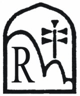
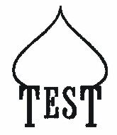

# Čl. I

Nariadenie vlády Slovenskej republiky č. 397/1999 Z. z., ktorým sa ustanovujú podrobnosti o technických požiadavkách a postupoch posudzovania zhody na strelné zbrane a strelivo v znení nariadenia vlády Slovenskej republiky č. 296/2000 Z. z. sa mení a dopĺňa takto:

- 1. V § 2 písm. b) sa za slová „Slovenskej informačnej služby“ vkladajú slová „a Národného bezpečnostného úradu“.

- 2. V § 4 odsek 1 znie:

- „(1)

- Výrobca alebo dovozca zabezpečí posudzovanie zhody vlastností strelných zbraní a streliva prostredníctvom autorizovanej osoby podľa § 11 zákona, uvedenej v prílohe č. 2 bode 1.9, ktorá určí počty, termíny, v ktorých sa budú určené výrobky predkladať na posudzovanie zhody, a miesto, kde sa posudzovanie zhody vykoná.“.

- 3. V § 16 sa vkladajú nové odseky 1 až 3, ktoré znejú:

- „(1)

- Výrobca alebo dovozca predloží autorizovanej osobe každú vyrobenú zbraň podliehajúcu kusovému overeniu podľa § 9 a 11.

- (2)

- Výrobca alebo dovozca predloží autorizovanej osobe zbrane, ktoré podliehajú homologizácii podľa § 7 a 8.

- (3)

- Výrobca alebo dovozca streliva alebo streliviny predloží autorizovanej osobe strelivo alebo strelivinu na typovú kontrolu v množstve určenom autorizovanou osobou, zabezpečujúcom požadovaný rozsah kontroly podľa § 13.“.

- Doterajšie odseky 1 až 3 sa označujú ako odseky 4 až 6.

- 4. V prílohe č. 1 časti Podrobnosti o podmienkach skúšobnej streľby bode 5 písm. k) sa slovo „SK“ nahrádza slovom „Ak“.

- 5. V prílohe č. 1 časti Podrobnosti o podmienkach skúšobnej streľby bode 5 písmeno l) znie:

- „l)

- plynové zbrane sa skúšajú zvýšením úsťovej rýchlosti o 10 % nad odporúčanie výrobcu,“.

- 6. V prílohe č. 1 časti Podrobnosti o podmienkach skúšobnej streľby sa bod 5 dopĺňa písmenom n), ktoré znie:

- „n)

- športové zbrane zhotovené a používané výlučne na športovú streľbu podľa pravidiel medzinárodných športových zväzov biatlonu a športovej streľby (združených v ISSF – medzinárodnej športovej streleckej federácii) sa skúšajú bežnými nábojmi určenými na trh.“.

- 7. V prílohe č. 2 časti 1 sa pôvodný text pri značke označenej číslom 1.9 nahrádza textom:

- „Identifikačná značka Úradnej skúšobne strelných zbraní a streliva SKTC-112 Lieskovec“.

- 8. V prílohe č. 2 časti 1 sa overovacie značky dopĺňajú novou značkou:

- „1.10  Nové kusové overenie všetkých druhov zbraní nabíjaných zozadu, určených na použitie streliva s bezdymovým prachom“.

- 9. V prílohe č. 2 časti 3 sa v texte pri značke označenej číslom 3.1 slová „strelných zbraní“ nahrádzajú slovom „hlavní“.

- 10. V prílohe č. 2 sa časť 3 dopĺňa novou značkou:

- „3.7  Kusové overenie brokovníc – oceľové broky“.

- 11. V prílohe č. 2 časti 4 sa v texte pri značke označenej číslom 4.8 slovo „Kontrola“ nahrádza slovom „Skúška“.

- 12. V prílohe č. 2 sa časť 4 dopĺňa novou značkou:

- „4.9  Kusové overenie brokovníc – oceľové broky“.

- 13. V prílohe č. 2 časti 5 sa v texte pri značke označenej číslom 5.6 slová „dnová skrutka“ nahrádzajú slovom „záver“.

- 14. V prílohe č. 2 časti 5 sa v texte pri značke označenej číslom 5.9 za slovo „hlaveň“ vkladá čiarka a slovo „telo“.

- 15. V prílohe č. 2 časti 5 (za značkou 5.20) sa značka Kontrola streliva označuje číslom „5.21“. Doterajšie čísla 5.21 a 5.22 sa označujú ako čísla 5.22 a 5.23.

- 16. V prílohe č. 2 sa časť 5 dopĺňa novou značkou:

- „5.24  Kusové overenie brokovníc – oceľové broky“.

- 17. V prílohe č. 2 časti 6 sa pôvodný text pri značke označenej číslom 6.4 nahrádza textom:

- „Povinná skúška bezdymovým prachom strelných zbraní s hladkým vývrtom nabíjaných zozadu“.

- 18. V prílohe č. 2 časti 6 sa pôvodný text pri značke označenej číslom 6.5 nahrádza textom:

- „Dodatočná skúška bezdymovým prachom strelných zbraní s hladkým vývrtom nabíjaných zozadu“.

- 19. V prílohe č. 2 časti 6 sa pôvodný text pri značke označenej číslom 6.6 nahrádza textom:

- „Skúška pištolí a terčovníc (s bežne používaným prachom)“.

- 20. V prílohe č. 2 sa časť 6 dopĺňa novou značkou:

- „6.11  Kusové overenie brokovníc – oceľové broky“.

- 21. V prílohe č. 2 časti 7 sa vypúšťa značka označená číslom „7.5“ a doterajšia značka označená číslom „7.6“ sa označuje číslom „7.5“.

- 22. V prílohe č. 2 sa časť 7 dopĺňa novou značkou:

- „7.6  Kusové overenie brokovníc – oceľové broky“.

- 23. V prílohe č. 2 sa časť 8 dopĺňa novou značkou:

- „8.10  Kusové overenie brokovníc – oceľové broky“.

- 24. V prílohe č. 2 časti 9 sa v texte pri značke označenej číslom 9.1 na konci pripájajú slová „určené na trh“.

- 25. V prílohe č. 2 sa časť 9 dopĺňa novou značkou:

- „9.5  Kusové overenie brokovníc – oceľové broky“.

- 26. V prílohe č. 2 časti 10 sa v texte pri značke označenej číslom 10.6 za slová „slepé strelivo“ vkladajú slová „alebo strelivo,“.

- 27. V prílohe č. 2 sa časť 10 dopĺňa novou značkou:

- „10.9  Kusové overenie brokovníc – oceľové broky“.

- 28. V prílohe č. 2 časti 11 sa pôvodný text pri značke označenej číslom 11.4 nahrádza textom:

- „Prístroje vyrobené na princípe zbraní; skúška výberovej vzorky“.

- 29. V prílohe č. 2 sa časť 11 dopĺňa novou značkou:

- „11.18  Kusové overenie brokovníc – oceľové broky“.

- 30. V prílohe č. 2 časti 12 sa pôvodný text pri značke označenej číslom 12.1 nahrádza textom:

- „Skúšky zbraní a kontrola streliva; skúšobňa Iževsk“.

- 31. V prílohe č. 2 časti 12 sa pôvodný text pri značke označenej číslom 12.2 nahrádza textom:

- „Skúšky zbraní a kontrola streliva; skúšobňa Klimovsk“.

- 32. V prílohe č. 2 sa časť 12 dopĺňa novými značkami:

- „12.3  Skúšky zbraní a kontrola streliva; skúšobňa Krasnozavodsk

- 12.4  Kusové overenie brokovníc – oceľové broky“.

- 33. V prílohe č. 2 sa časť 13 dopĺňa novou značkou:

- „13.3  Kusové overenie brokovníc – oceľové broky“.
