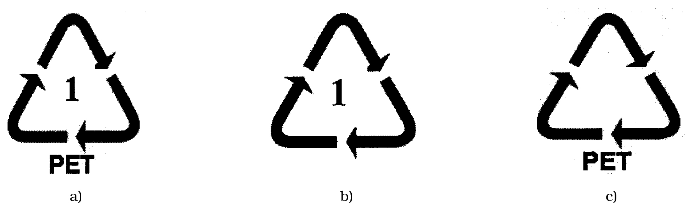
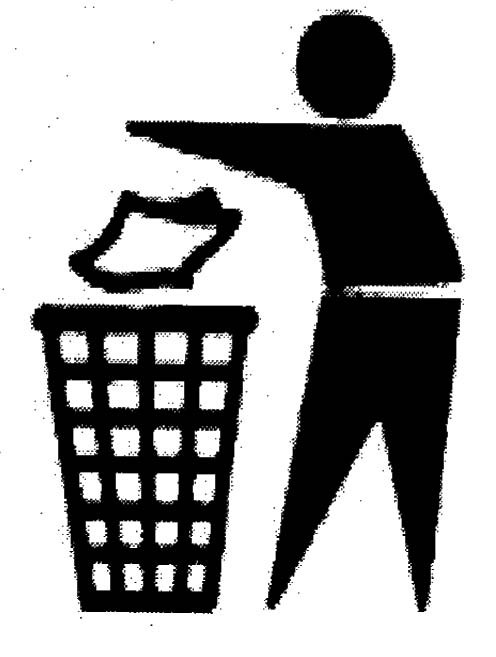

Príloha č. 2 k vyhláške č. 5/2003 Z. z.

- ZNAČKY NA OZNAČOVANIE OBALOV

  - (1) Značka, ktorá znamená, že obal možno zhodnotiť. Súčasťou značky je označenie materiálu, z ktorého je obal vyrobený.

  - 

    - Označenie materiálu, z ktorého je obal vyrobený

  - Materiál | Písomný znak | Číselný znak

  - Materiály z plastov | |

  - Polyetyléntereftalát | PET | 1

  - Polyetylén vysokej hustoty | HDPE | 2

  - Polyvinylchlorid | PVC | 3

  - Polyetylén nízkej hustoty | LDPE | 4

  - Polypropylén | PP | 5

  - Polystyrén | PS | 6

  - Materiály z papiera a lepenky | |

  - Vlnitá lepenka | PAP | 20

  - Hladká lepenka | PAP | 21

  - Papier | PAP | 22

  - Materiály z kovov | |

  - Oceľ | FE | 40

  - Hliník | ALU | 41

  - Materiály z dreva | |

  - Drevo | FOR | 50

  - Korok | FOR | 51

  - Materiály z textilu | |

  - Bavlna | TEX | 60

  - Vrecovina, juta | TEX | 61

  - Materiály zo skla | |

  - Bezfarebné sklo | GL | 70

  - Zelené sklo | GL | 71

  - Hnedé sklo | GL | 72

  - Kompozity | C |

  - Papier a lepenka/rôzne kovy | | 80

  - Papier a lepenka/plasty | | 81

  - Papier a lepenka/hliník | | 82

  - Papier a lepenka/cínový plech | | 83

  - Papier a lepenka/plasty/hliník | | 84

  - Papier a lepenka/plasty/hliník/cínový plech | | 86

  - Plasty/hliník | | 90

  - Plasty/cínový plech | | 91

  - Plasty/rôzne kovy | | 92

  - Sklo/plasty | | 95

  - Sklo/hliník | | 96

  - Sklo/cínový plech | | 97

  - Sklo/rôzne kovy | | 98

    - Obal zložený z viacerých rôznych materiálov, ktoré nemožno od seba ručne oddeliť, je kompozit.

    - Kompozity sa označujú písomným znakom C/skratkou materiálu, ktorý prevažuje.

    - Napríklad obal z vrstevných materiálov - nápojový obal (škatuľa na džús): hlavnou zložkou je papier (PAP), ďalej vrstva polyetylénu (PE) a vrstva hliníka (ALU) - označenie bude C/PAP.

  - (2) Značka, ktorá znamená, že obal je potrebné dať po použití do zbernej nádoby.

  - 
