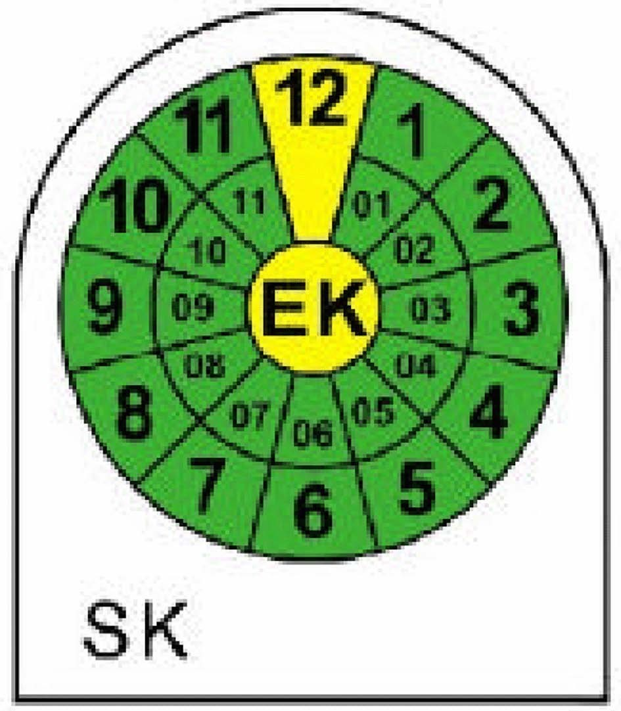
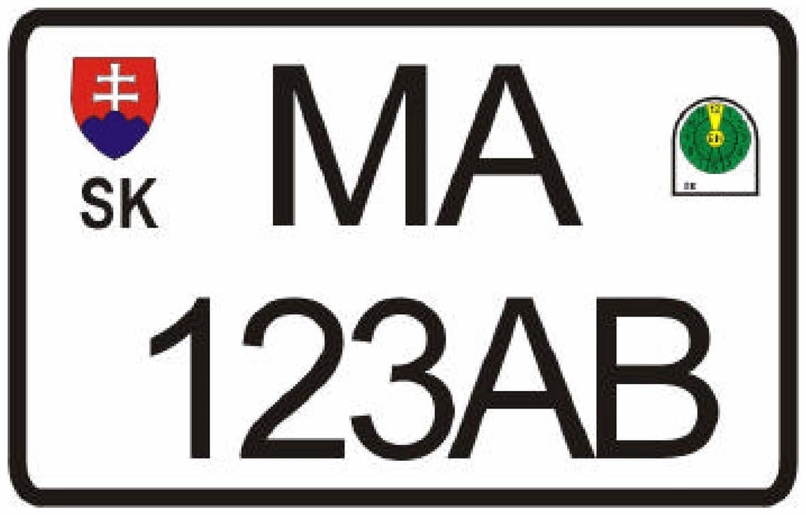

Príloha č. 3 k vyhláške č. 90/2003 Z. z.

- KONTROLNÁ NÁLEPKA 

- POSTUP PRI VYHOTOVOVANÍ KONTROLNEJ NÁLEPKY A VYZNAČOVANÍ EMISNEJ KONTROLY

  - 1. Séria a evidenčné číslo kontrolnej nálepky sa skladá z označenia „SK“ a šesťmiestneho čísla. Po naplnení série „SK“ nasledujú série „SKA“ až „SKZ“. Séria a číslo sú zhodné so sériou a s číslom Osvedčenia o emisnej kontrole.

  - 2. Rozmery: výška kontrolnej nálepky – 37 mm,

    - šírka kontrolnej nálepky – 32 mm,

    - priemery kružníc – 27 mm, 17 mm, 7 mm,

    - výška číslic 1 až 12 (označenie mesiaca) – 3 mm,

    - výška dvojčíslic (označenie roku) – 1,5 mm,

    - výška symbolu „EK“ – 3 mm,

    - výška písmen a číslic označenia série a evidenčného čísla – 3 mm.

  - 3. Farby: podklad (okraj) označenia – biely,

    - pole nálepky – zelené,

    - stredový kruh a veľký kruhový výsek – žlté,

    - kružnice, úsečky, číslice, dvojčíslice a symbol „EK“ – čierne.

  - 4. Čas platnosti emisnej kontroly sa na kontrolnej nálepke vyznačuje podľa času platnosti uvedeného v Protokole o emisnej kontrole takto: na vonkajšom medzikruží sa dierkovacími kliešťami vyznačuje mesiac a na vnútornom medzikruží rok.

  - 5. Perforovanú kontrolnú nálepku nalepí odborne spôsobilá osoba na zadnú tabuľku s evidenčným číslom vozidla, ak je

    - a) jednoriadková – do dolnej polovice medzery za prvou skupinou písmen,

    - b) dvojriadková – v hornom riadku do pravej polovice medzery za prvou skupinou písmen k pravému okraju.

- 

- 
