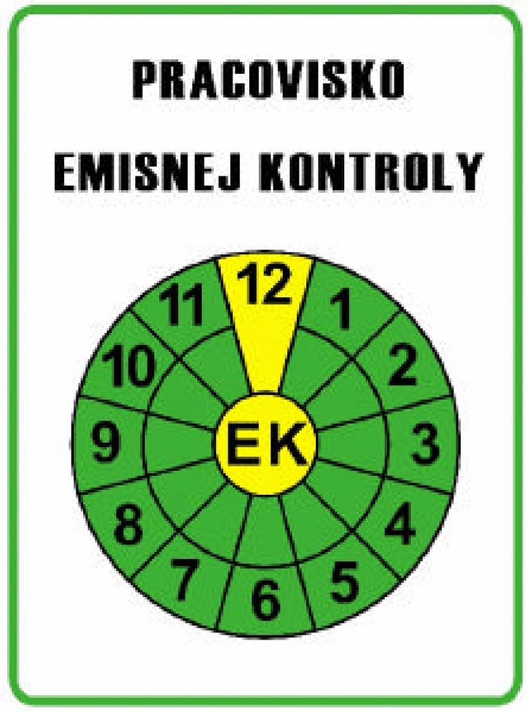

Príloha č. 8 k vyhláške č. 90/2003 Z. z.

- OZNAČENIE PRACOVISKA EMISNEJ KONTROLY 

  - 1. Označenie oprávnenej osoby je vyhotovené na bielom podklade s rozmermi 630 mm x 460 mm.

  - 2. Rozmery: priemery kružníc sú 335 mm, 210 mm, 75 mm,

    - výška číslic je 1 až 12 mm a výška textu „PRACOVISKO EMISNEJ KONTROLY“ je 33 mm,

    - výška symbolu „EK“ je 35 mm.

  - 3. Farby: okraj označenia a pole nálepky sú zelené,

    - stredový kruh a veľký kruhový výsek sú žlté,

    - kružnice, úsečky, číslice a symbol „EK“ sú čierne.
