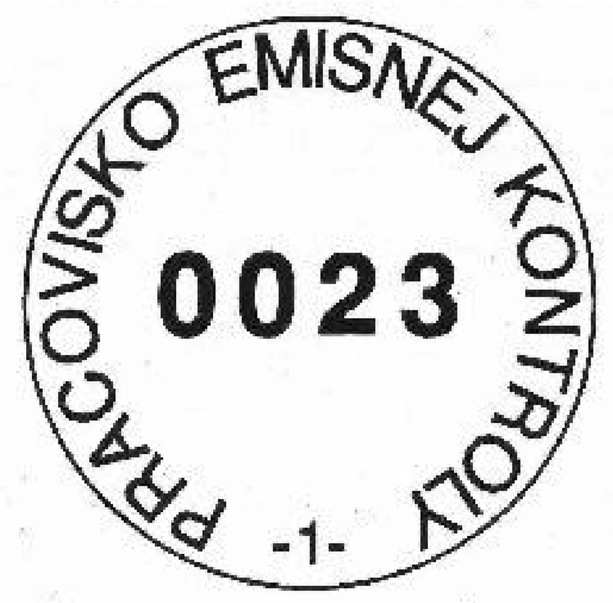

Príloha č. 9 k vyhláške č. 90/2003 Z. z.

- ODTLAČOK PEČIATKY ODBORNE SPÔSOBILEJ OSOBY 

  - 1. Odtlačok pečiatky má priemer 20 mm.

  - 2. Odtlačok pečiatky obsahuje:

    - 2.1 nápis „PRACOVISKO EMISNEJ KONTROLY“,

    - 2.2 číslo oprávnenej osoby – štvormiestne číslo pridelené ministerstvom oprávnenej osobe (napr. 0023),

    - 2.3 číslo pečiatky – poradové číslo pridelené ministerstvom odborne spôsobilej osobe u oprávnenej osoby.

  - 3. Vyhotovenie pečiatky:

    - 3.1 výška písmen nápisu „PRACOVISKO EMISNEJ KONTROLY“ je 2 mm,

    - 3.2 výška číslic čísla oprávnenej osoby je 3 mm,

    - 3.3 výška číslice poradového čísla pečiatky je 1,5 mm.
