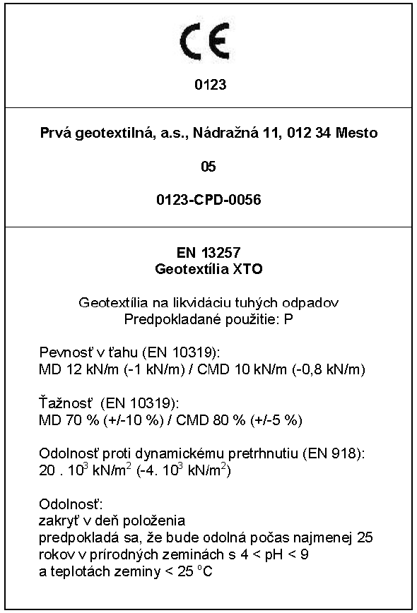
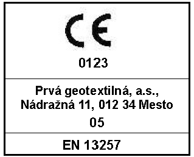
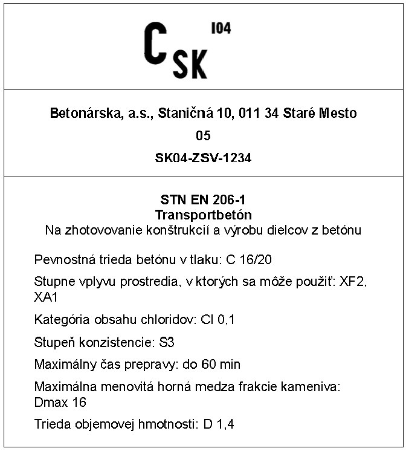
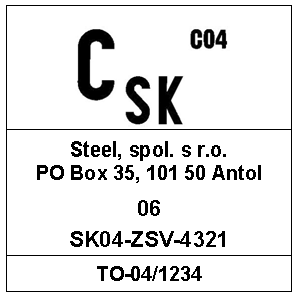
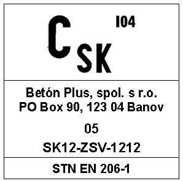
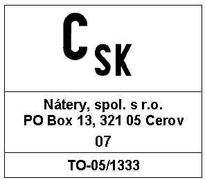

Príloha č. 3 k vyhláške č. 158/2004 Z. z.

- VZORY OZNAČOVANIA STAVEBNÝCH VÝROBKOV ZNAČKAMI ZHODY SPOLU SO SPRIEVODNÝMI ÚDAJMI

  - 1. Označenie CE so všetkými sprievodnými údajmi vyžadovanými harmonizovanou európskou normou

- 

  - 2. Označenie CE s minimálnymi sprievodnými údajmi

- 

  - 3. Slovenská značka zhody CSK so všetkými sprievodnými údajmi podľa tejto vyhlášky a neharmonizovanej slovenskej technickej normy

- 

  - 4. Slovenská značka zhody CSK s minimálnymi sprievodnými údajmi

  - a) na výrobok s preukázanou zhodou v systéme 1+ alebo 1 (s technickým osvedčením č. TO-04/1234)

- 

  - b) na výrobok s preukázanou zhodou v systéme 2+ (s normou STN EN 206-1)

- 

  - c) na výrobok s preukázanou zhodou v systéme 2, 3 alebo 4 (s technickým osvedčením č. TO-05/1333)

- 

- Poznámky:

  - a) Tvar a veľkosť písmen označenia CE a slovenskej značky zhody CSK, spôsoby vyhotovenia a zabezpečenia proti opätovnému použitiu upravuje § 18, § 19, § 21 a príloha k zákonu č. 264/1999 Z. z. o technických požiadavkách na výrobky a o posudzovaní zhody a o zmene a doplnení niektorých zákonov.

  - b) Na označenie CE sa harmonizovaná norma uvádza bez národných prefixov, ako sú STN, ČSN, DIN a pod.

  - c) Kód autorizovanej osoby pri značke CSKpozostáva z písmena C, resp. I a z dvojciferného poradového čísla prideleného autorizovanej osobe ministerstvom, ktorá vydala certifikát zhody v rámci preukazovania zhody systémom 1+ alebo 1, resp. certifikát vnútropodnikovej kontroly v rámci preukazovania zhody systémom 2+. V iných systémoch preukazovania zhody sa kód autorizovanej osoby k značke nepridáva.

  - d) Písmená i číslice v značke CSK vrátane kódu autorizovanej osoby sú typu Gothic No. 13. Veľkosť písmena a čísla kódu autorizovanej osoby je približne 50 % z veľkosti písmen SK.
