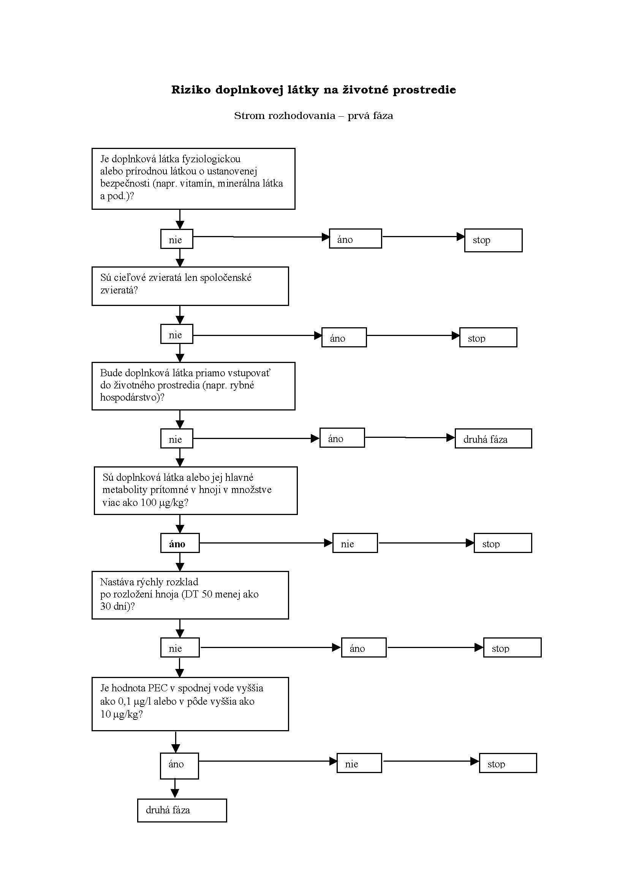

Príloha č. 1 k nariadeniu vlády č. 167/2004 Z. z. PRAVIDLÁ HODNOTENIA DOPLNKOVÝCH LÁTOK

- VŠEOBECNÁ CHARAKTERISTIKA

- Podľa týchto pravidiel sa zostavuje dokumentácia o látkach a prípravkoch, ktorá sa predkladá so žiadosťou o povolenie týchto látok a prípravkov ako doplnkových látok v krmivách alebo o nové používanie už povolenej doplnkovej látky. Dokumentácia musí umožniť vyhodnotenie doplnkových látok na základe súčasného stavu poznatkov a zabezpečiť súlad so základnými princípmi ustanovenými na ich povolenie.1)

- Doplnkové látky podľa časti I tejto prílohy sú chemicky definované látky alebo prípravky obsahujúce tieto látky v takom stave, v akom sa zapracúvajú do premixov a krmív.

- Doplnkové látky podľa časti II tejto prílohy sú mikroorganizmy alebo enzýmy, alebo ich prípravky.

- Ak sa dokumentácia týka doplnkovej látky pozostávajúcej z geneticky upravených organizmov alebo ich obsahuje,2) dokumentácia, okrem informácií vyžadovaných týmito pravidlami, musí obsahovať tieto dodatočné informácie:

- a) kópiu každého písomného súhlasu príslušných orgánov na zámerné uvoľnenie geneticky modifikovaných organizmov do životného prostredia na vedecké a výskumné účely3) a výsledok uvoľnenia so zohľadnením prípadného rizika pre zdravie ľudí a životné prostredie,

- b) kompletnú technickú dokumentáciu, v ktorej sa nachádzajú požadované informácie a hodnotenie rizika na životné prostredie vyplývajúce z tejto informácie a výsledky všetkých skúmaní vykonaných na vedecké účely alebo výskumné účely.4)

- Dokumentácia zahŕňa podrobné správy zo všetkých vykonaných výskumných prác v takom poradí a takým očíslovaním, ako ich navrhujú tieto pravidlá. Tiež zahŕňa odkazy na všetky publikované vedecké údaje a ich kópie, ktoré sú významné pre vyhodnotenie doplnkovej látky. Rovnako sa sprístupňuje elektronická verzia dokumentácie. Výskumy sú určené na preukázanie bezpečnosti použitia doplnkovej látky vo vzťahu k

- a) cieľovým druhom zvierat pri navrhnutých množstvách doplnkovej látky zapracovanej do krmiva,

- b) osobám, ktoré pravdepodobne budú vystavené pôsobeniu doplnkovej látky vdýchnutím alebo kontaktom so sliznicou, s očami alebo s pokožkou počas narábania s doplnkovou látkou alebo pri jej zapracúvaní do premixov alebo krmív,

- c) spotrebiteľom, ktorí požijú potravinové výrobky zo zvierat kŕmených doplnkovou látkou, ktoré by mohli obsahovať rezíduá doplnkovej látky alebo jej metabolity; tento aspekt sa všeobecne zabezpečí stanovením najvyšších prípustných limitov rezíduí (MRLs) a stanovením ochrannej doby,

- d) zvieratám a ľuďom ohľadne výberu a šírenia antimikrobiálne odolných génov,

- e) životnému prostrediu ohľadne účinkov, ktoré vyplývajú z pôsobenia doplnkovej látky alebo produktov z nej odvodených, priamo alebo výlučkami zvierat.

- Spravidla sa musí zabezpečiť výskum na stanovenie identity, podmienok použitia, fyzikálno-chemických vlastností, metód určenia a účinnosti doplnkovej látky, ako aj jej metabolizmu a rezíduí, fyziologických a toxikologických účinkov na cieľové druhy zvierat. Ak je doplnková látka určená pre kategóriu zvierat, ktoré patria do určitého druhu, výskumy účinnosti a rezíduí sa vykonajú na tejto cieľovej kategórii. Výskumy potrebné na vyhodnotenie rizík pre ľudské zdravie alebo životné prostredie závisia hlavne od charakteru doplnkovej látky a okolností jej použitia. Vzhľadom na túto skutočnosť sa neuplatňuje žiadne presne vymedzené pravidlo. Ak je to potrebné, vyžiadajú sa dodatočné informácie. Pri vynechaní akéhokoľvek údaja, ktorý predpisujú tieto pravidlá, sa uvedú dôvody na jeho vynechanie. Najmä výskumy mutagenity, karcinogenity a reprodukčnej toxicity sa môžu vynechať len vtedy, ak chemické zloženie, skúsenosti z praxe alebo iné hľadiská dokážu takéto účinky v zásadnej miere vylúčiť.

- Výskumy sa vykonajú a opíšu podľa vhodných štandardov kvality, napríklad správnej laboratórnej praxe.5)

- Zabezpečuje sa odborný posudok ohľadne kvality, účinnosti a bezpečnosti. Autori týchto posudkov budú v danej oblasti uznanými odborníkmi s príslušnou odbornou kvalifikáciu a nebudú osobne zapojení do výkonu skúšok zahrnutých v dokumentácii. Posudky musia zabezpečiť kritické ohodnotenie dokumentácie, ktorú poskytol žiadateľ; faktické zhrnutie nepostačuje.

- Určenie fyzikálno-chemických, toxikologických a eko-toxikologických vlastností sa vykoná v súlade s metódami ustanovenými v osobitnom predpise6) alebo v súlade s aktualizovanými metódami uznanými medzinárodnou vedeckou obcou. Použitie iných metód sa musí zdôvodniť.

- Každá dokumentácia bude obsahovať adekvátne zhrnutie, priložený návrh a môže obsahovať aj monografiu. Dokumentáciu, ktorá sa týka antibiotík, kokcidiostatík, ostatných liečivých látok a rastových stimulátorov, musí sprevádzať monografia v súlade so vzorom v oddiele V, ktorá umožní identifikáciu a charakteristiku danej doplnkovej látky. Pre všetky doplnkové látky sa musí zabezpečiť identifikačná správa, ktorá je v súlade so vzorom v oddiele VI.

- Nie vždy bude potrebné, aby sa doplnkové látky určené výlučne do krmív pre spoločenské zvieratá podrobili takému náročnému programu skúšania chronickej toxicity, mutagenity, reprodukčnej toxicity a karcinogenity, ako je to potrebné v prípade doplnkových látok určených na kŕmenie hospodárskych zvierat, z ktorých sa vyrábajú výrobky určené na ľudskú spotrebu. Výskumy rezíduí v spoločenských zvieratách nie sú potrebné.

- Výskum metabolickej premeny doplnkovej látky v cieľových zvieratách určených na výrobu potravín a v laboratórnych zvieratách používaných pri skúškach toxicity je potrebný na účely

- a) zabezpečenia adekvátnych údajov o toxicite pôvodnej doplnkovej látky a každého metabolitu vyprodukovaného v cieľových druhoch zvierat, ktorým môže byť spotrebiteľ vystavený. V tomto zmysle je dôležité porovnanie metabolickej premeny doplnkových látok v cieľových a laboratórnych druhoch zvierat použitých pri skúškach toxicity,

- b) identifikácie a kvantifikácie vhodného markera rezídua, ktorý sa použije na stanovenie MRL (najvyšší prípustný limit rezíduí) markerového rezídua a ochrannej doby finálneho výrobku.

- ČASŤ I

- DOPLNKOVÉ LÁTKY INÉ AKO MIKROORGANIZMY A ENZÝMY

- OBSAH

- 1. Oddiel I: Zhrnutie údajov dokumentácie | 1906

- 2. Oddiel II: Identita, charakteristika a podmienky použitia doplnkovej látky; metódy kontroly | 1906

- 2.1. Identita doplnkovej látky | 1906

- 2.2. Charakterizácia účinnej látky | 1906

- 2.3. Charakterizácia doplnkovej látky: Fyzikálno-chemické a technologické vlastnosti | 1906

- 2.4. Podmienky použitia doplnkovej látky | 1906

- 2.5. Kontrolné metódy | 1907

- 3. Oddiel III: Výskum účinnosti doplnkovej látky | 1907

- 3.1. Výskum účinkov na krmivá | 1907

- 3.2. Výskum účinkov na zvieratá | 1907

- 3.3. Výskum kvality živočíšnych produktov | 1909

- 3.4. Výskum účinkov na charakteristiku živočíšnych odpadov | 1909

- 4. Oddiel IV: Výskumy týkajúce sa bezpečnosti používania doplnkovej látky |

- 4.1. Výskum na cieľových druhoch zvierat | 1909

- 4.2. Výskum na laboratórnych zvieratách | 1911

- 4.3. Vyhodnotenie bezpečnosti pre spotrebiteľa | 1912

- 4.4. Vyhodnotenie bezpečnosti pre zamestnancov | 1914

- 4.5. Vyhodnotenie rizík pre životné prostredie | 1915

- 5. Oddiel V: Forma monografie | 1918

- 5.1. Identita doplnkovej látky | 1918

- 5.2. Špecifikácie týkajúce sa účinnej látky | 1918

- 5.3. Fyzikálno-chemické, technologické a biologické vlastnosti doplnkovej látky | 1918

- 5.4. Kontrolné metódy | 1919

- 5.5. Biologické vlastnosti doplnkovej látky | 1919

- 5.6. Podrobnosti o množstve a kvalite rezíduí v cieľových tkanivách, ak sa nejaké vyskytnú v živočíšnych produktoch po predpokladanom použití doplnkovej látky | 1919

- 5.7. Ak je to vhodné, udávajú sa hodnoty ADI, ustanovená hodnota MRL a ochranná doba | 1919

- 5.8. Ostatné charakteristiky vhodné na identifikáciu doplnkovej látky | 1919

- 5.9. Podmienky použitia | 1919

- 5.10. Dátum | 1919

- 6. Oddiel VI: Forma identifikačnej správy | 1919

- 7. Oddiel VII: Obnovenie povolenia doplnkovej látky, ktoré sa viaže na osobu zodpovednú za jej uvedenie do obehu | 1920

- 8. Oddiel VIII: Nový žiadateľ opierajúci sa o prvé povolenie doplnkovej látky, ktoré sa viaže na osobu zodpovednú za jej uvedenie do obehu | 1921

- 1. Oddiel I: Zhrnutie údajov dokumentácie

- Súhrn musí byť usporiadaný podľa pravidiel a jednotlivé časti uvedené s odkazom na príslušné strany dokumentácie. Súhrn obsahuje návrh, ktorý obsahuje všetky podmienky, na ktoré sa žiada povolenie.

- 2. Oddiel II: Identita, charakteristika a podmienky použitia doplnkovej látky; metódy kontroly

- 2.1. Identita doplnkovej látky

- 2.1.1. Navrhnutý obchodný názov

- 2.1.2. Typ doplnkovej látky podľa jej hlavnej funkcie.

- Ak je to možné, priloží sa dôkaz o spôsobe účinkovania. Akékoľvek iné spôsoby používania účinnej látky treba uviesť.

- 2.1.3. Kvalitatívne a kvantitatívne zloženie, ako je účinná látka, ostatné zložky, nečistoty a variabilita šarží.

- Ak je účinná látka zmesou účinných zložiek, kde každá z nich je zreteľne definovateľná, opíšu sa hlavné zložky jednotlivo a ich pomer v danej zmesi.

- 2.1.4. Fyzikálny stav, rozloženie veľkosti častíc, tvar častíc, hustota a objemová hmotnosť; pri kvapalinách viskozita a povrchové napätie.

- 2.1.5. Výrobný proces vrátane každého špecifického postupu spracovania.

- 2.2. Charakterizácia účinnej látky

- 2.2.1. Všeobecný názov, chemický názov podľa IUPAC nomenklatúry (Medzinárodná únia pre teoretickú a aplikovanú chémiu), ostatné všeobecné medzinárodné názvy a skratky. Číslo CAS (Chemical abstracts service).

- 2.2.2. Štrukturálny vzorec, molekulový vzorec a molekulová hmotnosť.

- Pri účinných látkach, ktoré sú produktom fermentácie, ide o mikrobiálny pôvod (názov a miesto zbierky mikroorganizmov, ktorá je uznaným medzinárodným depozitným orgánom predovšetkým v Európskej únii, kde je uložený kmeň, katalógové číslo a všetky príslušné morfologické, fyziologické, genetické a molekulárne charakteristiky na jeho identifikáciu). Pri geneticky upravených kmeňoch sa musia zabezpečiť informácie o genetickej úprave.

- 2.2.3. Čistota

- Identifikácia a kvantifikácia vyskytujúcich sa chemických a mikrobiálnych nečistôt a toxických látok, potvrdenie neprítomnosti produkčných organizmov.

- 2.2.4. Dôležité vlastnosti

- Fyzikálne vlastnosti chemicky definovaných látok ako disociačná konštanta, pKa, elektrostatické vlastnosti, bod topenia, bod varu, hustota, tlak pary, rozpustnosť vo vode a v organických rozpúšťadlách, Kow a Koc, hmotnostné a absorpčné spektrum, NMR údaje, možné izoméry a všetky ostatné vhodné fyzikálne vlastnosti.

- 2.2.5. Výroba, čistiace procesy, použité prostriedky a pri fermentačných produktoch aj variabilita jednotlivých šarží.

- 2.3. Charakterizácia doplnkovej látky: Fyzikálno-chemické a technologické vlastnosti

- 2.3.1. Stabilita každej formy doplnkovej látky pri vystavení podmienkam životného prostredia, ako je svetlo, teplota, pH, vlhkosť, kyslík a obalový materiál. Očakávaná doba použiteľnosti doplnkovej látky pri obchodovaní s ňou.

- 2.3.2. Stabilita každej formy doplnkovej látky počas prípravy a skladovania premixov a krmív, najmä stabilita pri očakávaných podmienkach spracovania/skladovania (teplo, vlhkosť, tlak/rezanie, čas a obalový materiál). Možná degradácia alebo rozklad produktov. Očakávaná doba použiteľnosti doplnkovej látky.

- 2.3.3. Ostatné vhodné fyzikálno-chemické alebo technologické vlastnosti na účel získania a udržania homogénnych zmesí v premixoch a krmivách, anti-prachové a elektrostatické vlastnosti, rozptýlenie v tekutinách.

- 2.3.4. Neznášanlivosť alebo interakcie, ktoré by mohli nastať v spojení s krmivami, nosičmi, ostatnými schválenými doplnkovými látkami alebo liečivami.

- 2.4. Podmienky použitia doplnkovej látky

- 2.4.1. Ak má doplnková látka významné technologické, ako aj zootechnické účinky, musí splniť požiadavky pre obidve takéto tvrdenia. Tvrdenia o každej doplnkovej látke sa musia identifikovať a odôvodniť.

- 2.4.2. Navrhnuté technologické použitie vo výrobe krmív alebo, ak je to vhodné, v surovinách.

- 2.4.3. Navrhnutý spôsob použitia vo výžive zvierat (napríklad druhy alebo kategórie zvierat a vek skupiny/stupeň produkcie zvierat, typ krmiva a kontraindikácie).

- 2.4.4. Navrhnutý spôsob a množstvo zapracovania do premixov a krmív alebo, ak je to vhodné, do surovín, vyjadrený ako hmotnostný podiel doplnkovej látky a chemicky definovaných látok v premixe, v krmive alebo, ak je to vhodné, v surovine s navrhnutou dávkou vo finálnom krmive a navrhnutou dobou podávania a ak je to vhodné, s uvedením ochrannej doby.

- 2.4.5. Musia sa zabezpečiť údaje o ostatných známych spôsoboch používania účinnej látky, napríklad v potravinách, v humánnej alebo veterinárnej medicíne, poľnohospodárstve a priemysle.

- 2.4.6. Návrh bezpečnostnej karty,7) a ak je to potrebné, navrhnuté opatrenia na prevenciu rizík na pracovisku a na ochranné prostriedky počas výroby, manipulácie, používania a odstránenia.

- 2.5. Kontrolné metódy

- 2.5.1. Opis metód použitých pri určení kritérií je uvedený v bodoch 2.1.3., 2.1.4, 2.2.3, 2.2.4, 2.3.1, 2.3.2, 2.3.3 a 2.3.4.

- 2.5.2. Opis kvalitatívnych a kvantitatívnych analytických metód na rutinnú kontrolu účinnej látky v premixoch a krmivách.

- Táto metóda musí byť potvrdená v kruhovom teste, do ktorého sa zapoja aspoň štyri laboratóriá, alebo vo vlastnom laboratóriu pri dodržaní medzinárodných zharmonizovaných smerníc na internú validáciu analytickej metódy vzhľadom na parametre, ako je použiteľnosť, selektívnosť, kalibrácia, správnosť, presnosť, rozsah, medza zistiteľnosti, medza kvantitatívnej citlivosti, robustnosť a praktickosť. Sprístupní sa dôkaz o tom, že tieto charakteristiky boli vyhodnotené (2.5.4).

- 2.5.3. Opis kvalitatívnych a kvantitatívnych analytických metód na určenie markera rezídua účinnej látky v cieľových tkanivách a živočíšnych produktoch.

- Markerové rezíduum je rezíduum, ktorého koncentrácia je v známom vzťahu s mierou, pri ktorej koncentrácia celkového množstva rezíduí v cieľovom tkanive klesne na MRL.

- 2.5.4. Metódy uvedené v bodoch 2.5.2 a 2.5.3 majú sprevádzať informácie o použitej metóde odberu vzoriek, percente návratnosti, špecifickosti, správnosti, presnosti, medziach zistiteľnosti, medziach kvantifikácie a o použitom postupe overovania.

- Sprístupnia sa referenčné štandardy účinnej látky alebo markera rezídua, ako aj informácie o optimálnych podmienkach skladovania týchto referenčných štandardov. Pri navrhovaní metód sa zohľadní fakt, že ich hranice kvantifikácie musia byť pod hranicami MRL. Navyše sa musí zohľadniť ich vhodnosť na rutinnú analýzu.

- 3. Oddiel III: Výskum účinnosti doplnkovej látky

- 3.1. Výskum účinkov na krmivá

- Tento výskum sa týka technických doplnkových látok, ako napríklad antioxidantov, konzervačných látok, viažucich látok, emulgačných látok, stabilizátorov, želírovacích látok, pH modifikátorov, ktoré sú určené na zlepšenie alebo stabilizáciu charakteristík premixov a krmív, ale nemajú žiadny priamy biologický účinok na živočíšnu produkciu. Všetky uvedené druhy pôsobenia alebo účinky doplnkovej látky sa zdôvodňujú vedeckými informáciami.

- Dôkaz účinnosti doplnkovej látky sa zabezpečí pomocou vhodných kritérií podľa uznaných a akceptovateľných metód v podmienkach, ktoré sú navrhované na použitie v porovnaní s vhodnými kontrolnými krmivami. Tieto výskumy sa usporiadajú a vykonajú tak, aby umožnili štatistické vyhodnotenie.

- Zabezpečia sa úplné informácie o preskúmaných účinných látkach, prípravkoch, premixoch a krmivách, referenčné čísla šarží, podrobné podmienky ošetrenia a skúšania. Priaznivé a nepriaznivé technologické účinky, ako aj biologické účinky sa opíšu pri každom pokuse.

- 3.2. Výskum účinkov na zvieratá

- Výskum zootechnických doplnkových látok sa vykoná na cieľových druhoch/ kategóriách zvierat, pre ktoré je doplnková látka určená v porovnaní s negatívnymi kontrolnými skupinami (bez antibiotík, rastových stimulátorov alebo iných liečivých látok) a podľa možnosti aj so skupinami kŕmenými krmivami, ktoré obsahujú doplnkové látky schválené v Európskej únii so známou účinnosťou a v odporúčaných dávkach (pozitívna kontrola).

- Použité zvieratá musia byť zdravé a vybrané pokiaľ možno z homogénnych skupín.

- Výskum musí umožniť vyhodnotenie účinnosti doplnkovej látky podľa podmienok poľnohospodárskej praxe v Európskej únii. Ak je to možné, pre všetky skúšky sa použije obdobná úprava protokolu, aby sa eventuálne mohla otestovať homogenita údajov a aby sa údaje mohli zhrnúť na štatistické vyhodnotenie, ak tak naznačia skúšky.

- Pravidlá nenavrhujú žiadnu jednotnú úpravu. Flexibilita v tomto smere dáva priestor na vedecké uváženie pri úprave a výkone výskumov. Použitá forma experimentu musí byť odôvodnená na preukázanie tvrdenia o použití doplnkovej látky a musí zabezpečiť adekvátne štatistické spracovanie podkladov.

- 3.2.1. Pri kokcidiostatikách a iných liečivých látkach

- Dôraz sa kladie hlavne na dôkaz osobitných účinkov, napríklad potlačené druhy, ovplyvnené štádium životného cyklu a najmä na preventívne vlastnosti, napríklad chorobnosť, úmrtnosť, počet oocytov a lézií.

- Zabezpečia sa informácie o vplyve na účinnosť krmiva a prírastky živej hmotnosti.

- Požadované údaje o účinnosti zahŕňajú tri stupne pokusov na cieľových zvieratách, a to

- a) pokusy v klietkach (zámerné infikovanie jednotlivými druhmi a zmesou oocyst),

- b) pokusy na hlbokej podstielke (simulácia podmienok použitia),

- c) pokusy v prevádzkových podmienkach (skutočné podmienky použitia).

- Zároveň sa v rámci skúšok účinnosti zaznamenávajú doplňujúce údaje, kde je to dôležité, ktoré umožnia vyhodnotiť interferencie s rastom a konverziou krmiva (výkrm hydiny, zámena nosníc a králikov), účinky na oplodnenie vajec a liahnivosť vajec (plemenná hydina).

- 3.2.2. Pri ostatných zootechnických doplnkových látkach

- Poskytujú sa informácie o účinkoch na príjem krmiva, telesnú hmotnosť, účinnosť krmiva (prednostne na báze sušiny), kvalitu produktu, výťažnosť a na akékoľvek iné parametre, ktoré sú prospešné pre zvieratá, životné prostredie, výrobcu alebo spotrebiteľa. Výskumy zahrnú informácie o vzťahu medzi dávkovaním/reakciou naň, ak je to vhodné.

- 3.2.3. Experimentálne podmienky

- Pokusy sa vykonajú aspoň na dvoch rôznych miestach. Vyhodnotia sa jednotlivo pri udaní podrobností o ich vedení a o každom experimentálnom zásahu. Protokol o pokuse sa vypracuje opisom ďalších všeobecných údajov.

- 3.2.3.1. Pri stáde alebo kŕdli umiestnenie a veľkosť, kŕmne a chovné podmienky, metóda kŕmenia; pri vodných druhoch – veľkosť a počet nádrží alebo ohrád na farme a kvalita vody.

- 3.2.3.2. Pri vodných druhoch zvierat určených na ľudskú spotrebu sa vykoná identifikácia podľa ich všeobecného názvu, za ktorým sa v zátvorkách uvedie vedecký názov alebo opis podľa Linneho, plemeno, vek, pohlavie, identifikačný postup, fyziologický stav a všeobecný zdravotný stav.

- 3.2.3.3. Pri počte pokusných a kontrolných skupín počet zvierat v každej skupine. Počet zvierat zahrnutých do pokusu musí umožniť štatistickú analýzu. Uvádzajú sa metódy štatistického vyhodnotenia. Uvedený vplyv má byť preukázaný najmenej v troch nezávislých porovnávacích pokusoch na každej určenej cieľovej kategórii zvierat na úrovni p < 0,05. Ak ide o prežúvavce, môže sa prijať nižšia úroveň pravdepodobnosti p < 0,10. Správa zahrnie všetky zvieratá alebo experimentálne jednotky, ktoré boli zapojené do pokusov. Prípady, ktoré nemožno vyhodnotiť vzhľadom na nedostatok alebo stratu údajov, by mali byť uvedené v správe a ich rozloženie v rámci skupín zvierat klasifikované.

- 3.2.3.4. Pri krmivách opis výroby a kvantitatívneho zloženia krmiva podľa použitých zložiek, príslušných živín (analyzované hodnoty) a energie. Záznamy o príjme krmiva.

- 3.2.3.5. Pri koncentrácii účinnej látky (a ak je to vhodné, látok použitých na účely porovnania) v krmivách sa určuje kontrolnou analýzou pri použití vhodnej uznanej metódy. Referenčné číslo šarží.

- 3.2.3.6. Dátum a presné trvanie pokusu. Dátum a druh vykonaných skúšok.

- 3.2.3.7. Pri výskume na určenie dávky je účelom objasnenie dôvodov výberu dávky alebo rozpätia dávky uvedenej ako optimálne účinná. Určenie dávky sa zakladá na kontrole (bez antibiotík, stimulátorov rastu alebo iných liečivých látok) a aspoň na troch pokusných hladinách odlišných od nuly na cieľových zvieratách.

- 3.2.3.8. Čas prejavu a rozšírenie akýchkoľvek nežiaducich následkov ošetrenia jednotlivých zvierat alebo celých skupín musí byť opísaný (uvádzajú sa podrobnosti pozorovacieho programu použitého vo výskume).

- 3.2.3.9. Všetky doplnkové látky skúmané v prevádzkových podmienkach musia mať dobrý vedecký dôkaz o bezpečnosti pre používateľa, spotrebiteľa, zviera a životné prostredie. Ak doplnková látka nespĺňa požiadavky bezpečnosti pre spotrebiteľa, výskum, ktorý sa vykoná tak, aby sa zabránilo zaradeniu živočíšnych produktov z pokusných zvierat do potravinového reťazca.

- 3.3. Výskum kvality živočíšnych produktov

- Živočíšne produkty, ak je to vhodné, sa preskúmajú, aby sa zistila ich organoleptická, nutričná, hygienická a technologická kvalita.

- 3.4. Výskum účinkov na charakteristiku živočíšnych odpadov

- Ak je doplnková látka určená na úpravu niektorých charakteristík živočíšneho odpadu, napríklad dusíka, fosforu, pachu, objemu, požadujú sa výskumy preukazujúce tieto vlastnosti.

- 4. Oddiel IV: Výskumy týkajúce sa bezpečnosti používania doplnkovej látky

- Výskumy vytýčené v tomto oddiele sú určené na umožnenie vyhodnotenia

- a) bezpečnosti použitia doplnkovej látky v prípade cieľových druhov,

- b) akéhokoľvek rizika spojeného s vyvolaním alebo prenosom odolnosti voči antibiotikám a so zvýšenou trvácnosťou a rozšírením enteropatogénov,

- c) rizík hroziacich spotrebiteľovi, ktoré by mohli vzniknúť z konzumácie potravín obsahujúcich rezíduá doplnkovej látky alebo jej metabolitu,

- d) rizík respiračného, slizničného, očného alebo kožného kontaktu hroziacich osobám, ktoré pravdepodobne budú narábať s doplnkovou látkou alebo s premixami, alebo s krmivami, do ktorých je zapracovaná,

- e) rizík nepriaznivých účinkov na životné prostredie hroziacich z doplnkovej látky alebo produktov z nej odvodených, priamym pôsobením alebo výlučkami zvierat.

- Pozornosť sa venuje známej neznášanlivosti alebo interakciám medzi doplnkovou látkou a veterinárnymi liečivami alebo zložkami krmiva dôležitými pre dané druhy zvierat.

- Tieto výskumy sa bežne vyžadujú v celom rozsahu pre každú doplnkovú látku, ak pravidlá neupresňujú osobitnú výnimku alebo úpravu.

- Predloženie žiadosti v menšom rozsahu údajov sa bežne akceptuje pre navrhované rozšírenie povoleného použitia pre tie druhy zvierat, ktoré sú fyziologicky a metabolicky blízke niektorému druhu, pre ktorý sa použitie doplnkovej látky už povolilo. Také znížené množstvo údajov musí preukázať bezpečnosť pre nové druhy zvierat a neprítomnosť významných rozdielov v látkovom metabolizme a rezíduách v jedlých tkanivách. Navrhnuté MRL a ochranná doba sa odôvodnia pre tieto druhy zvierat.

- Na vyhodnotenie rizík hroziacich spotrebiteľovi a následné určenie MRL a ochrannej doby sa zabezpečia tieto informácie:

- a) chemická štruktúra účinnej látky,

- b) metabolizmus v navrhnutých cieľových druhoch zvierat,

- c) charakter rezíduí v týchto cieľových druhoch zvierat,

- d) výskum odbúravania rezíduí v tkanivách,

- e) údaje o biologických účinkoch účinnej látky spolu s jej metabolitmi.

- Poznatky o biovyužiteľnosti rezíduí (viazaných aj voľných) môžu byť užitočné najmä v prípadoch, keď sa vyprodukuje veľa metabolitov, ale nie sú informácie o markeroch rezíduí (bod 4.1.3.3).

- Navyše sa vyžadujú poznatky o zložení a fyzikálno-chemických a biologických vlastnostiach hlavných vylúčených látok odvodených z doplnkovej látky na určenie rozsahu výskumu potrebného na vyhodnotenie rizík nepriaznivých účinkov na životné prostredie alebo ich pretrvávania v životnom prostredí (bod 4.5).

- 4.1. Výskum na cieľových druhoch zvierat

- 4.1.1. Tolerančné skúšky na cieľových druhoch/kategóriách zvierat

- Účelom skúšok je určiť mieru bezpečnosti, ako je rozpätie medzi maximálnou navrhnutou dávkou v krmivách a minimálnym množstvom, ktoré má za následok nepriaznivé účinky. Miera bezpečnosti s faktorom aspoň 10 sa však považuje za dostatočnú a nevyžaduje žiadne ďalšie skúšky. Taká tolerančná skúška sa vykoná na cieľovom druhu/kategórií zvierat pokiaľ možno počas celého produkčného obdobia, i keď skúšobná doba jedného mesiaca je zvyčajne prijateľná. To vyžaduje aspoň vyhodnotenie klinických príznakov a ostatných parametrov na zistenie účinkov na zdravie cieľového zvieraťa. Zahrnie sa negatívna kontrolná skupina bez antibiotík, stimulátorov rastu alebo iných liečivých látok. Vzhľadom na toxikologický profil možno vyžiadať dodatočné parametre. Akékoľvek negatívne účinky zistené počas skúšok účinnosti sa opíšu v tomto oddiele.

- Ak je produkt určený na kŕmenie zvierat, ktoré možno použiť na plemenný chov, výskum je zameraný na identifikáciu možného zhoršenia všeobecných samčích a samičích reprodukčných funkcií alebo škodlivých účinkov na potomstvo vyplývajúcich z podávania skúmanej doplnkovej látky.

- 4.1.2. Mikrobiologická bezpečnosť doplnkovej látky

- 4.1.2.1. Všetky výskumy sa vykonajú pri najvyššom odporúčanom množstve dávkovania.

- 4.1.2.2. Ak má účinná látka antimikrobiálnu aktivitu v takej koncentrácii, ako sa skrmuje, podľa štandardizovaných postupov sa určí minimálna inhibičná koncentrácia (MIC) na vhodných patogénnych a nepatogénnych, endogénnych a exogénnych baktériách.

- 4.1.2.3. Skúšky určenia schopnosti doplnkovej látky majú

- a) spôsobiť krížovú rezistenciu voči príslušným antibiotikám,

- b) vyselektovať kmene rezistentných baktérií v prevádzkových podmienkach na cieľovom druhu zvierat, a ak sa tak stane, skúmanie genetických mechanizmov prenosu rezistentných génov.

- 4.1.2.4. Skúšky určenia účinku doplnkovej látky sa vykonávajú na

- a) počet príležitostných patogénov prítomných v tráviacej sústave, napríklad enterobaktérií, enterokok a klostrídií,

- b) šírenie alebo vylučovanie príslušných nákazlivých mikroorganizmov, napríklad salmonely spp a campylobacteru spp.

- 4.1.2.5. V prípadoch, keď účinná látka vykazuje antimikrobiálnu činnosť, zabezpečia sa prevádzkové pokusy na monitorovanie bakteriálnej rezistencie voči doplnkovej látke.

- 4.1.3. Výskum metabolizmu a rezíduí

- 4.1.3.1. Účelom výskumu je

- a) stanoviť metabolické cesty účinnej látky ako základ na jej toxikologické vyhodnotenie,

- b) identifikovať rezíduá a stanoviť ich kinetiku v jedlých tkanivách a produktoch, ako sú mlieko a vajcia,

- c) identifikovať vylúčené látky ako predpoklad na vyhodnotenie ich dopadu na životné prostredie.

- Pri doplnkových látkach z fermentačnej výroby sa výskum rozširuje na iné látky pridávané alebo vyprodukované počas fermentačného procesu. Toxicita, ktorá je významná vo vzťahu k toxicite účinnej zložky doplnkovej látky, môže potvrdiť túto skutočnosť.

- 4.1.3.2. Farmakokinetika

- Plánovanie a experimentálne usporiadanie výskumov musia zohľadniť anatomické, fyziologické (vek, typ, pohlavie) a environmentálne osobitosti cieľovej populácie vrátane zootechnických kategórií. Ak je to vhodné, zohľadní sa aj vplyv na črevnú a bachorovú mikroflóru, enterohepatálny obeh alebo atrofiu slepého čreva. Testovaný režim dávkovania musí zodpovedať tomu, ktoré je určené na použitie, alebo násobku tejto dávky, ak je to odôvodnené. Účinná látka vrátane značkovanej látky sa musí zapracovať do krmiva, ak sa nezdôvodní iný postup.

- Vyžadované výskumy sú:

- a) metabolická bilancia a kinetika v plazme/krvi po jednorazovej dávke na účel vyhodnotenia miery a rozsahu absorpcie, rozloženia a vylúčenia močom, výkalmi, žiabrami, žlčou, vydychovaným vzduchom, mliekom alebo vajcami,

- b) identifikácia hlavných metabolitov vo výlučkoch v množstve > 10 % okrem prípadov, keď sa metabolity menšieho množstva (< 10 %) javia ako toxické,

- c) rozloženie značkovanej látky v tkanivách a produktoch po jednorazovej dávke podanej zvieratám, ktoré sa nachádzajú v rovnovážnom stave dosiahnutom pomocou neznačkovanej doplnkovej látky.

- Výskumy uvedené v bodoch 4.1.3.1 a 4.1.3.2 majú zahrnúť metódu izotopového indikátora alebo príslušnú alternatívnu metódu.

- 4.1.3.3. Výskum rezíduí je

- a) identifikácia tých rezíduí, ktoré predstavujú viac ako 10 % celkových rezíduí okrem prípadov, keď sa metabolity menšieho množstva javia ako toxické v jedlých tkanivách a produktoch, ako sú mlieko a vajcia pri metabolickej rovnováhe, a to po podaní niekoľkých dávok značkovanej látky; podiel markera rezídua na celkovom obsahu rezíduí. Ide o rezíduá pôvodnej zlúčeniny, metabolitov, produktov rozkladu aj viazaných rezíduí. Viazané rezíduá predstavujú tkanivové reziduálne frakcie, ktoré sú nevylúčiteľné použitím fyzikálno-chemických alebo biologických prostriedkov. Pochádzajú z kovalentných väzieb metabolitov zlúčeniny s celulárnymi makromolekulami,

- b) výskum kinetiky rezíduí v tkanivách vrátane mlieka a vajec, ak je to vhodné, počas vylučovacej periódy rezíduí po dosiahnutí rovnovážneho stavu a s použitím najvyššej hladiny navrhnutého metabolického profilu, identifikácia cieľového tkaniva, a to jedlého tkaniva vybraného na sledovanie celkových rezíduí v cieľovom zvierati a markera rezídua,

- c) výskum vylučovania markera rezídua z cieľových tkanív vrátane mlieka a vajec, ak je to vhodné, po vynechaní doplnkovej látky po jej opakovanom podávaní podľa navrhnutých podmienok použitia a dostatočne dlho na dosiahnutie rovnovážneho stavu, na účel určenia ochrannej doby na základe stanoveného MRL,

- d) ochranná doba, ktorá nesmie byť kratšia, ako je čas potrebný na pokles koncentrácie markera rezídua určeného v cieľovom tkanive pod hodnotu MRL (95 % hranicou významnosti).

- Za minimálnu požiadavku sa považuje vhodná voľba rozloženia časových bodov podľa štádia klesania účinnej látky a jej metabolitov a aspoň štyri zvieratá na každý bod v závislosti od druhu, veľkosti a genetickej variability.

- Na určenie ochrannej doby sa navrhuje označiť vzorkou najmenší počet zdravých zvierat pri každom jatočnom zabití alebo v každom časovom bode sledovania:

- a) produkčné dojnice – osem zvierat vrátane zvierat počas druhej laktácie alebo následných laktácií, z toho štyri vysokoúžitkové dojnice na začiatku laktácie a štyri nízkoúžitkové dojnice na konci laktácie,

- b) iné veľké zvieratá – štyri zvieratá pri každom vzorkovaní,

- c) hydina – šesť zvierat pri každom vzorkovaní,

- d) hydina v znáške – desať kusov vajec pri každom vzorkovaní,

- e) ryby – desať zvierat pri každom vzorkovaní.

- 4.2. Výskum na laboratórnych zvieratách

- Výskumy na laboratórnych zvieratách sa vykonajú s účinnou látkou podľa medzinárodne uznaných štandardných testovacích metód, ako ich opisujú smernice OECD pre metodologické podklady, alebo podľa testovacích metód na určenie toxikologických a ekotoxikologických vlastností chemických látok8) a podľa princípov správnej laboratórnej praxe. Dodatočné výskumy jednotlivých metabolitov vyprodukovaných cieľovým druhom zvierat môžu byť potrebné, ak sa tieto metabolity nevytvoria vo významnom množstve v laboratórnych pokusných druhoch. Ak sa takéto údaje nachádzajú v prípade človeka, zohľadnia sa pri rozhodovaní o type dodatočných výskumov.

- 4.2.1. Akútna toxicita

- Výskumy akútnej orálnej toxicity sa vykonajú aspoň na dvoch druhoch cicavcov. Jeden laboratórny druh možno nahradiť, ak je to vhodné, cieľovým druhom zvierat. Netreba identifikovať presné LD50; približné určenie minimálnej smrteľnej dávky zvyčajne stačí. Na zníženie počtu a utrpenia pokusných zvierat maximálna dávka nesmie prekročiť 2 000 mg/kg telesnej hmotnosti a odporúčajú sa alternatívne metódy (skúška limitu, metóda pevnej dávky, skupinová metóda akútnej toxicity).

- Riziká hroziace zamestnancom sa zhodnotia v sérií výskumov pri použití produktu (aktívna látka plus nosič vo forme, v akej bude dostupný na trhu). Urobia sa výskumy podráždenia kože, a ak budú výsledky pozitívne, vyhodnotí sa podráždenie slizničnej membrány, napríklad oka. Vyhodnotí sa alergický potenciál – potenciál kožnej citlivosti. Výskumy akútnej inhalácie sa urobia, ak produkt pravdepodobne vytvorí dýchateľný prach alebo hmlu.

- 4.2.2. Výskumy genotoxicity vrátane mutagenity

- Vykoná sa výberová kombinácia aspoň troch rôznych skúšok genotoxicity na identifikáciu účinných látok, a ak je to vhodné, ich metabolitov a produktov rozkladu s mutagénnymi a genotoxickými vlastnosťami. Zostava skúšok bežne zahŕňa prokaryotické a eukaryotické systémy skúšok vrátane systémov skúšok na cicavcoch in vitro a in vivo. Ak je to vhodné, skúšky sa vykonajú bez aktivácie a s metabolickou aktiváciou cicavcov.

- Voľba skúšok sa zdôvodňuje vzhľadom na ich spoľahlivosť pri vyhodnocovaní genotoxických účinkov na rôznych úrovniach genetických koncových bodov génu, chromozómu a genómu. Dodatočné skúšky možno požadovať vzhľadom na konečný výsledok skúšok a pri zohľadnení celkového profilu toxicity látky, ako aj určeného použitia. Skúšky sa musia vykonať podľa platných, aktualizovaných a potvrdených postupov. Ak je cieľom skúšky kostná dreň, v prípade negatívnych výsledkov sa vyžaduje dôkaz vystavenia buniek testovacej látke.

- 4.2.3. Výskumy subchronickej (90 dňovej) perorálnej toxicity

- Skúšky musia trvať aspoň 90 dní. V prípade doplnkových látok určených na použitie pre živočíšne druhy produkujúce potraviny sa výskumy vykonajú na dvoch živočíšnych druhoch, z ktorých jeden nemá byť druhom hlodavca, ktorý môže byť cieľovým druhom. V prípade doplnkových látok určených na použitie pre zvieratá mimo ľudskej spotreby postačujú výskumy na cieľovom druhu: účinná látka sa musí dávkovať orálne aspoň na troch úrovniach v porovnaní s kontrolnou skupinou na účel získania reakcie na dávku.

- Maximálna dávka má bežne preukázať škodlivé účinky. Najnižšia hladina dávky by nemala spôsobovať žiaden prejav toxicity.

- 4.2.4. Výskum chronickej perorálnej toxicity vrátane výskumov karcinogenity

- Výskum chronickej toxicity, ktorý môže zahrnúť preskúmanie karcinogenity, sa vykoná aspoň na jednom druhu hlodavca.

- Výskum karcinogenity nebude potrebný, ak účinná látka a jej metabolity

- a) vykazujú trvalé negatívne výsledky vo vhodnom rozsahu skúšok genotoxicity,

- b) štrukturálne nesúvisia so známymi karcinogénmi a

- c) nevykazujú žiadne účinky naznačujúce možnú (pre)neopláziu v skúškach chronickej toxicity.

- 4.2.5. Výskum reprodukčnej toxicity vrátane teratogenity

- 4.2.5.1. Dvojgeneračný výskum reprodukčnej toxicity

- Výskum reprodukčnej funkčnosti sa vykoná a rozšíri na aspoň dve filiálne generácie (F1, F2) a môže sa skombinovať s výskumom teratogenity. Skúmaná látka sa podá samcom a samiciam vo vhodnom čase pred párením. S podávaním dávky sa pokračuje až do odstavu mláďat F2 generácie.

- Pozorne sa sledujú a opíšu všetky príslušné údaje o plodnosti, gravidite, pôrode, materinskom správaní, dojčení, raste a vývine mláďat F1 generácie od oplodnenia až po zrelosť a vývin mláďat F2 generácie až do ich odstavu.

- 4.2.5.2. Výskum teratogenity

- Výskum teratogenity pokrýva embryo a fetotoxicitu. Vykoná sa aspoň na dvoch druhoch.

- 4.2.6. Výskum metabolizmu a dispozície

- Musí sa vykonať výskum na absorpciu, rozloženie v telesných tekutinách a tkanivách, cesty vylučovania. Metabolický výskum zahrňujúci metabolickú bilanciu a identifikáciu hlavných metabolitov v moči a výkaloch sa vykoná na zvieratách oboch pohlaví a rovnakého druhu, ako boli zvieratá použité pri toxikologických výskumoch. Jednorazová dávka značkovaných molekúl (4.1.3) sa podá pri rovnovážnom stave dosiahnutom s použitím neznačkovanej zlúčeniny pri dávke obdobnej najvyššej hladine navrhnutej na použitie pre cieľové zvieratá.

- 4.2.7. Biovyužiteľnosť rezíduí

- Vyhodnotenie rizika pre spotrebiteľa, ktoré sa vzťahuje na určité rezíduá obsiahnuté v živočíšnych produktoch, najmä na viazané rezíduá, môže zohľadniť dodatočný bezpečnostný faktor založený na určení biovyužiteľnosti týchto rezíduí s použitím vhodných laboratórnych zvierat a uznaných metód.

- 4.2.8. Ostatné osobitné toxikologické a farmakologické výskumy

- Ďalšie výskumy poskytujúce dodatočné informácie potrebné na vyhodnotenie bezpečnosti účinnej látky a jej rezíduí sa vykonajú v prípade akéhokoľvek dôvodu na ich vykonanie.

- 4.2.9. Určenie NOEL (hladiny nespozorovaného účinku)

- Všetky uvedené zistenia so všetkými príslušnými publikovanými údajmi (vrátane vhodných informácií o účinkoch účinnej látky na ľuďoch) a ak je to vhodné, informácie o chemických štruktúrach, ktoré sú v úzkom vzťahu s účinnou látkou, sa zohľadnia pri identifikácií NOEL vyjadrenej v mg/kg telesnej hmotnosti na deň. Zvolí sa najnižšia hodnota NOEL.

- Hodnota NOEL určená na výpočet ADI sa podľa vhodnosti zvolí na základe toxikologických alebo farmakologických účinkov. V prípade niektorých doplnkových látok, ako napríklad doplnkových látok s antibakteriálnym účinkom, ADI možno lepšie stanoviť na základe účinkov na ľudskú črevnú mikroflóru. Ak neexistujú medzinárodne prijaté a potvrdené metódy na opísanie črevnej flóry, postačia účinky na vybrané a citlivé črevné bakteriálne kmene pochádzajúce z človeka.

- 4.3. Vyhodnotenie bezpečnosti pre spotrebiteľa

- 4.3.1. Návrh prípustného denného príjmu (ADI) doplnkovej látky

- ADI sa navrhne, ak je to vhodné.

- ADI (vyjadrená v mg doplnkovej látky alebo látky príbuznej s doplnkovou látkou na osobu a deň) sa vypočíta vydelením NOEL vyjadrenej v mg/kg telesnej hmotnosti vhodným bezpečnostným faktorom a vynásobením priemernou telesnou hmotnosťou človeka 60 kg. Takáto NOEL vyjadrená v mg/kg telesnej hmotnosti na deň sa zvolí na základe toxikologických alebo farmakologických zistení. V niektorých prípadoch môže byť dôležitejšia hodnota ADI založená na mikrobiologických vlastnostiach doplnkovej látky. Výber závisí od vlastnosti, ktorá je najpodstatnejšia vzhľadom na zdravotné ohrozenie spotrebiteľa.

- Bezpečnostný faktor použitý na určenie ADI pre určitú doplnkovú látku sa zvolí pri zohľadnení týchto skutočností:

- a) povahy biologického účinku použitého na identifikáciu NOEL,

- b) významu tohto účinku vo vzťahu k človeku a reverzibilita tohto účinku,

- c) rozsahu a kvality údajov použitých na identifikáciu NOEL,

- d) každého poznatku o účinku zložiek rezídua.

- Pri výpočte ADI sa používa bezpečnostný faktor aspoň 100, a to faktor desať na vytvorenie priestoru pre potenciálne medzidruhové variácie a ďalší faktor desať na vytvorenie priestoru pre možné odlišnosti v reakciách medzi jednotlivými ľuďmi. Ak sú údaje o účinnej látke vzťahujúce sa na ľudí dostupné, potom je prípustný nižší bezpečnostný faktor.

- 4.3.2. Návrh najvyšších prípustných limitov rezíduí (MRLs) doplnkovej látky

- Pri výpočte MRL sa očakáva, že príjem výrobkov z jedlých tkanív, mlieka a vajec je jediným zdrojom potenciálneho vystavenia ľudí. Ak toto neplatí, treba zvážiť aj ostatné zdroje.

- Niektoré z týchto látok sa použili ako kŕmne doplnkové látky aj pri iných aplikáciách. V takom prípade sa očakáva, že vypočítané MRLs budú rovnaké. Taktiež môže nastať situácia, keď sa na základe precízneho vedeckého zváženia vypočítajú rôzne MRLs pre každé použitie osobitne, ak sa spôsob, množstvo, frekvencia a dĺžka doby dávkovania závažne odlišujú od tých, ktoré sú stanovené ako vhodné na použitie kŕmnej doplnkovej látky, a kde existujú dôkazy o tom, že kinetika alebo metabolizmus môže vyústiť do odlišných profilov rezíduí. Za týchto okolností sa odporúča, aby sa uplatnila najprísnejšia hodnota MRL.

- Na určenie MRL sa musí určiť chemická povaha materiálu súvisiaceho s doplnkovou látkou, ktorý je určený na použitie pri určovaní hladín rezíduí v tkanivách. Ten sa označuje ako marker rezídua. Táto zložka rezídua nemusí byť vždy závažná z toxikologického hľadiska, ale musí sa zvoliť ako vhodný ukazovateľ, ktorý zastupuje celkové množstvo významných rezíduí. Pomery markera rezídua/celkových rezíduí v spojení s ADI, a to pomer markera rezídua/celkových rádioaktívnych rezíduí, markera rezídua/celkových biologicky aktívnych rezíduí by sa mal určiť v každom časovom bode počas trvania výskumu vylučovania rezíduí. Tento pomer by sa mal predovšetkým určiť v každom časovom bode potrebnom na presné vypracovanie MRLs. Sprístupní sa aj vhodná analytická metóda pre marker rezídua na zabezpečenie súladu s MRL.

- Pri stanovení MRLs (vyjadrené v g/kg markera rezídua na kg jedlého tkaniva alebo produktu v pôvodnej sušine) na základe ADI sa uplatnia tieto hodnoty ľudskej dennej spotreby potravín:

- | Cicavce | Hydina | Ryby

- Svalovina | 300 g | 300 g | 300 g*

- Pečeň | 100 g | 100 g |

- Oblička | 50 g | ll0 g |

- Tuk | 50 g** | 90 g*** |

- + Mlieko | 1 500 g | |

- +Vajcia | | 100 g |

- * Svalovina a koža v prirodzenom pomere.

- ** Ak ide o ošípané, 50 g tuku a kože v prirodzenom pomere.

- *** Tuk a koža v prirodzenom pomere.

- Jednotlivé MRLs v rôznych tkanivách majú odzrkadliť kinetiku vylučovania rezíduí v tých tkanivách živočíšnych druhov, ktoré sú určené na použitie. Vyžaduje sa analytická metóda s limitom stanovenia pod MRL (oddiel II bod 2.5.3).

- Ak látka môže zanechať rezíduá v tkanivách a v produktoch, MRLs sa navrhnú tak, aby celkové množstvo toxikologicky alebo mikrobiologicky závažných rezíduí požitých denne bolo nižšie ako ADI v tabuľke.

- Na výpočet denne požitých rezíduí sa navrhujú tieto množstvá prijatých potravín: 500 g mäsa, ktoré obsahuje 300 g svaloviny, 100 g pečene, 50 g obličky, 50 g tuku (alebo 500 g hydiny, ktoré obsahuje 300 g svaloviny, 100 g pečene, 10 g obličky, 90 g tuku alebo 300 g ryby) + 1 500 g mlieka + 100 g vajec.

- MRL sa ustanoví len po uvážení a zahrnutí všetkých ostatných potenciálnych zdrojov vystavenia spotrebiteľa zložkám rezíduí.

- Ak ide o určité doplnkové látky, rezíduá sa môžu vyskytnúť pod hodnotou MRL v mlieku, vajciach alebo mäse, ktoré by mohli ovplyvňovať kvalitu potravín pri určitých postupoch spracovania potravín, napríklad pri použití mlieka vo výrobe syrov. Pri týchto doplnkových látkach by mohlo byť vhodné, popri stanovení hodnôt MRL, zvážiť „najvyššie prípustné rezíduum zlúčiteľné so spracovaním potravinových produktov“.

- V niektorých prípadoch sa MRL nevyžaduje, ak

- a) rezíduá nie sú biovyužiteľné a nie sú žiadne škodlivé účinky na tráviacu sústavu ľudí vrátane jeho mikroflóry,

- b) je úplný rozklad na živiny alebo na neškodné látky v cieľových druhoch zvierat,

- c) ADI „nie je určené“ kvôli nízkej toxicite v testoch na zvieratách,

- d) sa použitie obmedzuje len na kŕmenie spoločenských zvierat,

- e) je látka schválená aj ako potravinová doplnková látka,9) MRL sa zvyčajne nevyžaduje, ak marker rezídua je predovšetkým pôvodnou doplnkovou látkou a predstavuje len nevýznamný zlomok ADI potravinovej doplnkovej látky.

- 4.3.3. Návrh ochrannej doby doplnkovej látky

- Ochranná doba doplnkovej látky sa stanoví na základe MRLs. Ochranná doba predstavuje dobu po ukončení podávania doplnkovej látky v navrhovanej forme, ktorá je potrebná na to, aby hladiny rezíduí klesli pod MRLs (95 % hranicou významnosti).

- Pri určovaní ochrannej doby možno identifikovať určité jedlé tkanivo ako zástupcu ostatných tkanív často označované ako cieľové tkanivo.

- 4.4. Vyhodnotenie bezpečnosti pre zamestnancov

- Zamestnanci môžu byť vystavení riziku najmä prostredníctvom inhalácie alebo priamo počas výroby alebo manipulácie, alebo počas používania doplnkovej látky, napríklad poľnohospodári sú potenciálne vystavení riziku pri narábaní alebo miešaní doplnkovej látky. Zabezpečia sa dodatočné informácie o spôsobe narábania s látkami. Zahrnie sa vyhodnotenie rizík hroziacich zamestnancom.

- Skúsenosti vo výrobných podnikoch sú často dôležitým zdrojom informácií pri vyhodnotení rizík z vystavenia doplnkovej látky hroziacich zamestnancom vzdušnou cestou, ako aj priamou cestou. Osobitná pozornosť sa venuje doplnkovým látkam/krmivu s obsahom doplnkovej látky alebo živočíšnym výlučkom, ktoré sa vyskytujú vo forme prášku alebo sa môžu zmeniť na formu suchého prachu, a kŕmnym doplnkovým látkam, ktoré môžu mať alergizujúci potenciál.

- 4.4.1. Vyhodnotenie toxikologických rizík pre bezpečnosť zamestnancov

- 4.4.1.1. Účinky na dýchaciu sústavu

- Zabezpečí sa dôkaz o tom, že hladiny prachu vo vzduchu nepredstavujú nebezpečenstvo pre zdravie zamestnancov. Dôkaz zahŕňa, ak je to potrebné,

- a) inhalačné skúšky na laboratórnych zvieratách, publikované epidemiologické údaje,

- b) vlastné údaje žiadateľov o ich podnikoch alebo skúšky dráždivosti a citlivosti dýchacej sústavy.

- 4.4.1.2. Účinky na oči a kožu

- Ak je to možné, treba zabezpečiť priamy dôkaz o neprítomnosti podráždenia alebo citlivosti na základe známych situácií s ľuďmi. To sa doplní nálezmi z potvrdených skúšok na zvieratách na podráždenie kože a očí a na potenciál citlivosti pri použití vhodnej doplnkovej látky.

- 4.4.1.3. Systémová toxicita

- Údaje o toxicite vytvorené na splnenie bezpečnostných požiadaviek vrátane testov toxicity opakovaných dávok, mutagenity, karcinogenity a reprodukčných testov sa použijú pri vyhodnotení ostatných aspektov bezpečnosti zamestnancov. Kontaminácia kože alebo inhalácia doplnkovej látky sú najčastejšími cestami vystavenia toxicite.

- 4.4.2. Vyhodnotenie vystavenia

- Pri vyhodnotení sa poskytnú informácie o tom, aký spôsob používania doplnkovej látky pravdepodobne spôsobí vznik vystavenia všetkými cestami, a to inhaláciou, cez kožu alebo požitím. Tieto informácie, ak je to možné, zahrnú kvantitatívne vyhodnotenie, napríklad typickej koncentrácie vo vzduchu, kožnej kontaminácie alebo požitia. Ak kvantitatívne informácie nie sú dostupné, musia sa poskytnúť dostatočné informácie umožňujúce primerané vyhodnotenie vystavenia.

- 4.4.3. Opatrenia na kontrolu vystavenia

- S použitím informácií z toxikologického vyhodnotenia a vyhodnotenia vystavenia sa má vypracovať záver o rizikách pre zdravie používateľov (systémové riziko, riziko toxicity, podráždenia alebo citlivosti) pri použití opatrení na kontrolu vystavenia, ktoré sú za daných okolností primerané. Ak je riziko neprijateľné, má sa prijať preventívne opatrenie na kontrolu alebo elimináciu vystavenia. Preformulovanie produktu alebo upravenie výrobných postupov produktu, použitia alebo odstránenia doplnkovej látky sa uprednostňujú riešenia. Používanie prostriedkov osobnej ochrany sa má považovať za opatrenie poslednej možnosti, ako sa chrániť pred akýmkoľvek reziduálnym rizikom, ak už je prijatie ochranných opatrení namieste.

- 4.5. Vyhodnotenie rizík pre životné prostredie

- Zváženie environmentálneho vplyvu kŕmnych doplnkových látok je dôležité, keďže podávanie kŕmnych doplnkových látok je zvyčajne dlhodobé (dokonca počas celého života), môže sa týkať veľkých skupín zvierat a mnoho doplnkových látok je slabo absorbovaných, a preto v značnom množstve vylúčených v nedotknutom stave. V mnohých prípadoch však potreba environmentálneho vyhodnotenia môže byť ohraničená. Nie je vhodné, aby sa stanovili prísne pravidlá. Pri určovaní environmentálneho vplyvu doplnkovej látky v krmivách treba postupovať krokovým prístupom, kde v prvom štádiu môžu byť identifikované doplnkové látky, ktoré nevyžadujú žiadne ďalšie testovanie. V prípade ostatných doplnkových látok je potrebné druhé štádium výskumov (štádium IIA) na zabezpečenie dodatočných informácií, na ktorých základe možno zvážiť, či sú potrebné ďalšie výskumy (štádium IIB). Výskumy, ak je to vhodné, vykonajú sa podľa testovacích metód pre chemické látky a prípravky.10)

- 4.5.1. Vyhodnotenie v štádiu I

- Účelom vyhodnotenia v štádiu I je určenie, či je, alebo nie je pravdepodobný výskyt závažných environmentálnych účinkov doplnkovej látky alebo jej metabolitov; to sa zakladá najmä na údajoch už získaných na iné účely.

- Oslobodenie od vyhodnotenia v štádiu II môže nastať na základe jedného z dvoch kritérií:

- a) chemická povaha a biologický účinok doplnkovej látky a jej použitie naznačujú, že vplyv je zanedbateľný, a to ak doplnková látka a/alebo jej hlavný metabolit, ktorého podiel je vyšší ako 20 % z celkových rezíduí vo výlučkoch, sú:

- 1. fyziologické/prírodné látky, napríklad vitamín alebo minerálna látka, ktoré nezmenia svoju koncentráciu v životnom prostredí, ak nejde o jasný dôvod na obavy, napríklad meď,

- 2. doplnkové látky, ktoré sú určené pre spoločenské zvieratá (okrem koňov),

- b) najhorší prípad odhadovanej environmentálnej koncentrácie (PEC) je príliš nízky na vzbudenie obáv.

- Najhorší prípad PEC v pôde nastane pravdepodobne dôsledkom hnojenia pôdy hnojom vyprodukovaným počas obdobia najvyššej exkrécie hlavných zložiek rezíduí (doplnkovej látky a/alebo jej hlavných metabolitov). PEC sa vyhodnotí pre každú hlavnú zložku rezídua v hnoji a v každej oblasti, ktorej sa to týka. Ak ide o oblasť suchozemskú, kde PEC neprevýši 100 µg/kg celkového obsahu hlavných reziduálnych zložiek v hnoji, alebo ak sa hlavné reziduálne zložky v hnoji rozkladajú ľahko (čas rozkladu DT 50 < 30 dní) (ak sú tieto údaje dostupné) na prírodné zložky alebo na koncentrácie nižšie ako 100 µg/kg, alebo ak hodnota PEC v pôde (5 cm hlbokej) je nižšia ako µg/kg, potom sa žiadne ďalšie vyhodnotenie nevyžaduje.

- Najhorší prípad PEC pre vodu môže nastať buď z priameho prenosu rozsypaného krmiva, alebo z výlučkov obsahujúcich doplnkovú látku a jej metabolity do vodných telies alebo z presakovania materiálu z výlučkov alebo z pôdy do podzemných vôd. Ak sa PEC pre znečistenie vodných telies alebo podzemných vôd spoľahlivo odhadne na menej ako 0,1 µg na liter, potom vyhodnotenie v štádiu IIA environmentálneho vplyvu doplnkovej látky týkajúce sa prostredia vody nie je potrebné.

- Ak žiadateľ nemôže preukázať, že navrhnutá doplnková látka spadá do jednej z týchto kategórií výnimiek, alebo ak sa doplnková látka vypúšťa priamo do životného prostredia, napríklad akvakultúry, zvyčajne sa vyžaduje vyhodnotenie v štádiu II.

- Riziko doplnkovej látky na životné prostredie

- Strom rozhodovania – prvá fáza

- 

- 4.5.2. Vyhodnotenie v štádiu II

- Vyhodnotenie v štádiu II sa vykoná v dvoch fázach: štádium IIA a štádium IIB.

- Vyhodnocuje sa bioakumulačný potenciál doplnkovej látky alebo jej hlavných metabolitov a jej vplyv na odhadovanú mieru bezpečnosti. Bioakumulácia sa nepovažuje za potenciálne závažnú, ak napríklad Kow (koeficient rozpadu) je < 3. Vhodné výskumy v štádiu IIB sú všeobecne potrebné, ak sa také bezpečnostné hranice nedajú určiť.

- 4.5.2.1. Štádium IIA

- Účelom vyhodnotenia v štádiu IIA je identifikácia rizika hroziaceho životnému prostrediu prostredníctvom

- a) spresnenia výpočtu PEC,

- b) určenia vzťahu medzi vystavením, hladinami doplnkovej látky alebo hlavných metabolitov a krátkodobých nepriaznivých účinkov u príslušných zástupcov živočíšnych druhov a rastlinných druhov v jednotlivých oblastiach životného prostredia,

- c) použitia týchto zistení, určenia odhadovaných hodnôt koncentrácií bez účinku (PNEC).

- Pri určovaní tohto rizika sa odporúča tento postup:

- 1. ak sa PEC nedokončí v štádiu I, vypočíta sa presnejšie PEC pre každú oblasť životného prostredia. Pri získavaní PEC sa berú do úvahy nasledujúce body:

- a) koncentrácia doplnkovej látky alebo jej hlavných metabolitov v hnoji po podávaní doplnkovej látky zvieratám v navrhnutej dávke; pri tomto výpočte sa musí vziať do úvahy objem výlučkov a miera dávkovania,

- b) potenciálne zriedenie vylúčeného materiálu súvisiaceho s doplnkovou látkou vzhľadom na bežnú prax spracovania hnoja a jeho uskladnenia pred jeho rozložením na pôdu,

- c) adsorpcia/desorpcia doplnkovej látky a jej metabolitov do pôdy, pretrvávanie rezíduí v pôde (DT50a DT90); usadenie v prípade akvakultúry,

- d) ostatné faktory, ako napríklad fotolýza, hydrolýza, vyparovanie, rozklad v pôde alebo vo vodných sedimentačných systémoch, zriedenie pomocou orby.

- 2. Na účely vyhodnotenia rizík na úrovni IIA sa prijmú najvyššie hodnoty pre PEC dosiahnuté týmito výpočtami pre každú oblasť životného prostredia, ktorej sa to týka.

- 3. Ak sa pri ustálenom stave očakáva vysoké pretrvávanie v pôde (DT90 > 1 rok) pri koncentráciách presahujúcich 10g/kg pôdy, bude potrebné vyhodnotenie na IIB úrovni.

- 4. Ako nasledujúce sa určia hladiny spôsobujúce vážne krátkodobé nepriaznivé účinky na rôznych úrovniach výživy v oblastiach životného prostredia, ktorých sa to týka (pôda, voda). Tieto skúšky postupujú podľa smerníc OECD alebo podobne osvedčených smerníc. Vhodné skúšky suchozemského životného prostredia zahŕňajú: toxicitu vo vzťahu k dážďovkám (50 % letálnej koncentrácie, hodnoty LC50), fytotoxicitu (50 % účinnej koncentrácie, hodnoty EC50) v rastlinách rastúcich na zemi, účinky na pôdne mikroorganizmy (napríklad EC50 pre účinky na metanogenézu a spútavanie dusíka). Pre vodné životné prostredie rýb je 96-hodinový výskum LC50; Daphnia magna 48-hodinový výskum EC50; u rias je výskum LC50 a výskum toxicity na organizmoch usadenín.

- 5. Urobí sa výpočet hodnoty PNEC pre každú oblasť životného prostredia, ktorej sa to týka. Tá sa zvyčajne odvodí tak, že sa zoberie najnižšia zistená hodnota, a to výsledok pri najcitlivejšom druhu pre nepriaznivý účinok v skúškach ekotoxicity, a vydelí sa bezpečnostným faktorom aspoň 100 v závislosti od ukazovateľa a od počtu použitých testovaných druhov.

- 6. Vypočítané hodnoty PEC a PNEC sa porovnajú. Prípustný pomer hodnôt PEC a PNEC závisí od povahy použitých výsledkov testov pri určovaní PNEC. Obyčajne je to medzi 1 a 0,1. Ak sa zistia výrazne užšie pomery ako tieto, pravdepodobne nebude treba urobiť ďalšie ekotoxikologické skúšky okrem prípadov, v ktorých sa očakáva bioakumulácia. Naopak, širšie pomery si vyžadujú niektoré skúšky zo štádia IIB.

- 4.5.2.2. Štádium IIB (podrobnejšie toxikologické výskumy)

- Tie doplnkové látky, pri ktorých po vyhodnotení v štádiu IIA pretrvávajú pochybnosti vzhľadom na ich vplyv na životné prostredie, si vyžadujú podrobnejšie výskumy účinkov na biologické druhy v oblasti životného prostredia, v ktorej výskumy štádia IIA naznačili možné obavy. V tomto prípade sú potrebné ďalšie skúšky na určenie chronických a špecifickejších účinkov na vhodné druhy zvierat, rastlín a mikroorganizmov. Táto situácia môže nastať, keď sa vo vyhodnotení v štádiu IIA nadhodnotia hodnoty PEC. Pri dokazovaní tohto faktu sa pravdepodobne vykonajú merania environmentálnych koncentrácií a pretrvávania doplnkovej látky alebo jej hlavných metabolitov pri použití v prevádzkových podmienkach.

- Vhodné dodatočné skúšky ekotoxicity opisuje niekoľko publikácií, napríklad smernice OECD. Možno bude treba zvážiť tri kategórie environmentálnych druhov, a to zvieratá, rastliny a mikroorganizmy. Treba zabezpečiť starostlivú voľbu týchto skúšok, aby boli vhodné v situácii, v ktorej sa doplnková látka a/alebo jej metabolity môžu vypustiť a rozšíriť do životného prostredia.

- Vyhodnotenie vplyvu na suchozemskú oblasť zahŕňa

- a) subletálny výskum účinkov na dážďovky, ďalšie výskumy vplyvu na pôdnu mikroflóru, skúšky fytotoxicity na škále ekonomicky významných rastlinných druhov, výskum na lúčnych bezstavovcoch vrátane hmyzu a voľne žijúcich vtákov,

- b) NB osobitné vyhodnotenie toxicity na cicavcoch pravdepodobne nebude potrebné, keďže tento aspekt s pravdepodobnosťou pokryjú skúšky toxicity na cicavcoch vykonaných na určenie ADI.

- Vyhodnotenie vplyvu na vodnú oblasť životného prostredia pravdepodobne zahrnie

- a) skúšky chronickej toxicity na najcitlivejších vodných organizmoch identifikovaných vo vyhodnotení v štádiu IIA, napríklad skúška v ranom štádiu života rýb, reprodukčné skúšky na dafniách, 72-hodinové skúšky na riasach a výskumy biologickej akumulácie,

- b) a musí zabezpečiť v prípadoch, keď nemožno stanoviť vhodnú mieru bezpečnosti medzi hodnotami PEC a PNEC, identifikáciu účinných zmierňujúcich opatrení na obmedzenie vplyvu na životné prostredie.

- 5. Oddiel V: Forma monografie

- 5.1. Identita doplnkovej látky

- 5.1.1. Navrhnutý obchodný názov

- 5.1.2. Typ doplnkovej látky podľa jej hlavnej funkcie. Všetky ostatné použitia účinnej látky treba spresniť.

- 5.1.3. Kvalitatívne a kvantitatívne zloženie (účinná látka, ostatné zložky, nečistoty, variabilita šarží). Ak je účinná látka zmesou účinných zložiek, kde každá z nich je zreteľne definovateľná, opíšu sa hlavné zložky jednotlivo a ich pomer v danej zmesi.

- 5.1.4. Fyzikálny stav, rozloženie veľkosti častíc, tvar častíc, hustota, objemová hmotnosť; pri kvapalinách je to viskozita a povrchové napätie.

- 5.1.5. Výrobný proces vrátane každého špecifického výrobného postupu.

- 5.2. Špecifikácie týkajúce sa účinnej látky

- 5.2.1. Všeobecný názov, chemický názov podľa nomenklatúry IUPAC, ostatné všeobecné medzinárodné názvy a skratky. Číslo CAS (Chemical Abstract Service).

- 5.2.2. Štrukturálny vzorec, molekulárny vzorec a molekulárna hmotnosť. Kvalitatívne a kvantitatívne zloženie hlavných zložiek, mikrobiálny pôvod (názov a miesto zbierky kultúry, kde je kmeň uložený), ak je účinná látka fermentačným produktom.

- 5.2.3. Čistota

- Kvalitatívne a kvantitatívne zloženie účinných látok a vyskytujúcich sa sprievodných nečistôt a toxických látok, potvrdenie neprítomnosti produkčných organizmov.

- 5.2.4. Dôležité vlastnosti

- Fyzikálne vlastnosti chemicky definovaných látok sú disociačná konštanta, pKa, elektrostatické vlastnosti, bod topenia, bod varu, hustota, tlak pary, rozpustnosť vo vode a v organických rozpúšťadlách, Kow a Koc, hmotnostné a absorpčné spektrum, údaje NMR, možné izoméry a všetky ostatné vhodné fyzikálne vlastnosti.

- 5.3. Fyzikálno-chemické, technologické a biologické vlastnosti doplnkovej látky

- 5.3.1. Stabilita doplnkovej látky pri vystavení podmienkam životného prostredia, ako sú svetlo, teplota, pH, vlhkosť a kyslík. Návrh doby použiteľnosti.

- 5.3.2. Stabilita počas prípravy premixov a krmív, najmä stabilita pri očakávaných podmienkach spracovania (teplo, vlhkosť, tlak/rezanie a čas). Možná degradácia alebo rozklad produktov.

- 5.3.3. Stabilita počas skladovania premixov a spracovaných krmív v definovaných podmienkach. Návrh doby použiteľnosti.

- 5.3.4. Ostatné vhodné fyzikálno-chemické, technologické alebo biologické vlastnosti, ako napríklad rozptýlenie za priaznivých podmienok, na účely získania a udržania homogénnych zmesí v premixoch a krmivách, antiprachové a elektrostatické vlastnosti, rozptýlenie v tekutinách.

- 5.4. Kontrolné metódy

- 5.4.1. Opis metód použitých pri určení kritérií je uvedený v bodoch 2.1.3., 2.1.4, 2.2.3, 2.2.4, 2.3.1, 2.3.2, 2.3.3 a 2.3.4.

- 5.4.2. Opis kvalitatívnych a kvantitatívnych analytických metód na určenie markera rezídua účinnej látky v cieľových tkanivách a v živočíšnych produktoch.

- 5.4.3. Ak boli uvedené metódy uverejnené, stačia odkazy na literatúru a kópie zodpovedajúceho vydania.

- 5.4.4. Informácia o optimálnych podmienkach skladovania referenčných štandardov.

- 5.5. Biologické vlastnosti doplnkovej látky

- 5.5.1. Podrobnosti o profylaktických účinkoch pri kokcidiostatikách a ostatných liečivých látkach (napríklad chorobnosť, úmrtnosť, počet oocytov a počet lézií).

- 5.5.2. Pre zootechnické doplnkové látky iné ako tie, ktoré sú uvedené v bode 5.5.1, zabezpečia sa podrobnosti o účinkoch na príjem krmiva, telesnú hmotnosť, využiteľnosť krmiva, kvalitu produktu a výťažnosť a každý iný parameter úžitkovosti v prospech zvieraťa, životného prostredia, výrobcu alebo spotrebiteľa.

- 5.5.3. Pri technických doplnkových látkach dôležité technologické účinky.

- 5.5.4. Všetky nepriaznivé účinky, kontraindikácie alebo varovania (cieľové zviera, spotrebiteľ, životné prostredie) vrátane biologických interakcií s podrobnosťami o ich zdôvodnení. Všetky ADI alebo MRLs stanovené na ostatné použitia účinnej látky sa musia uviesť.

- 5.6. Podrobnosti o množstve a kvalite rezíduí v cieľových tkanivách, ak sa nejaké vyskytnú v živočíšnych produktoch po predpokladanom použití doplnkovej látky.

- 5.7. Ak je to vhodné, udávajú sa hodnoty AD1, ustanovená hodnota MRL a ochranná doba

- 5.8. Ostatné charakteristiky vhodné na identifikáciu doplnkovej látky

- 5.9. Podmienky použitia

- 5.10. Dátum

- 6. Oddiel VI: Forma identifikačnej správy

- 1. Identita doplnkovej látky

- 1.1. Druh doplnkovej látky

- 1.2. Fyzikálny stav

- 1.3. Kvalitatívne a kvantitatívne zloženie

- 1.4. Metóda analýzy doplnkovej látky a rezíduí

- 1.5. Registračné číslo spoločenstva (ES číslo)

- 1.6. Balenie

- 2. Požiadavky týkajúce sa účinnej látky

- 2.1. Všeobecný názov, chemický názov, číslo CAS

- – Všeobecný názov

- – Chemický názov (IUPAC)

- – Číslo CAS

- 2.2. Empirický vzorec

- 3. Fyzikálno-chemické, technologické a biologické vlastnosti doplnkovej látky

- 3.1. Stabilita doplnkovej látky

- 3.2. Stabilita počas prípravy premixov a krmív

- 3.3. Stabilita počas skladovania premixov a krmív

- 3.4. Iné vlastnosti

- 4. Podmienky použitia

- 4.1. Druh alebo kategória zvierat, najvyšší prípustný vek, ak je spresnený

- 4.2. Najnižší a najvyšší obsah v krmive

- 4.3. Kontraindikácie, interakcie

- 4.4. Varovania

- 5. Osoba zodpovedná za uvedenie do obehu

- 5.1. Meno

- 5.2. Adresa

- 5.3. Registračné číslo

- 6. Výrobca

- 6.1. Meno

- 6.2. Adresa

- 6.3. Číslo schválenia alebo registrácie pridelené podniku alebo sprostredkovateľovi

- 7. Dátum

- 7. Oddiel VII: Obnovenie povolenia doplnkovej látky, ktoré sa viaže na osobu zodpovednú za jej uvedenie do obehu

- 1. Všeobecne

- Aktualizovaná dokumentácia a monografia sa pripravujú podľa najnovších smerníc a zoznamu všetkých variácií každého typu od udelenia povolenia na uvedenie do obehu alebo od posledného obnovenia tohto povolenia.

- Musí sa potvrdiť adaptácia monografie a bezpečnostných súborov na zahrnutie všetkých nových významných informácií o doplnkovej látke alebo tých, ktoré sa vyžadujú teraz v dôsledku zmeny týchto pravidiel.

- Musia sa zabezpečiť aj informácie o stave schvaľovania a o objeme predaja v celosvetovom meradle.

- 2. Identita účinnej látky a doplnkovej látky

- Predloží sa dôkaz, ktorý preukáže, že zloženie, čistota alebo účinnosť doplnkovej látky sa nezmenili, alebo neupravili vzhľadom na doplnkovú látku, pri ktorej sa pôvodné povolenie udelilo. Opíše sa každá zmena vo výrobnom procese.

- 3. Účinnosť

- Predloží sa dôkaz, ktorý preukáže, že doplnková látka v čase žiadosti o obnovenie povolenia a za podmienok živočíšnej výroby bežnej v Európskej únii si uvedenú účinnosť zachovala. Tento dôkaz zahrnie odpočet všeobecných skúseností z používania doplnkovej látky a monitoring úžitkovosti.

- 4. Mikrobiológia

- Osobitná pozornosť sa musí venovať možnému vývoju antimikrobiálnej rezistencie počas dlhodobého používania doplnkovej látky v praktických podmienkach. Preto sa skúšky musia vykonať v prevádzkových podmienkach v chovoch, kde sa doplnková látka bežne používala čo najdlhšiu dobu. Vybrané bežné črevné baktérie sa použijú ako pokusné organizmy a tento výber zahrnie príslušné endogenické a exogenické, grampozitívne, ako aj gramnegatívne organizmy.

- Ak sa pri skúškach zistia zmeny v rezistencii vzorky v porovnaní s pôvodným stavom, rezistentná baktéria sa vyšetrí na krížovú rezistenciu voči významným antibiotikám používaným na liečenie infekčných ochorení človeka a zvierat. Najdôležitejšie sú antibiotiká patriace do tej istej skupiny ako doplnková látka, ale do testu sa zaradia aj ostatné skupiny antibiotík.

- Uvedú sa výsledky vhodných monitorovacích programov.

- 5. Bezpečnosť

- Predloží sa dôkaz o tom, že na základe súčasných poznatkov je doplnková látka za schválených podmienok stále bezpečná pre cieľový druh, spotrebiteľov, zamestnancov a životné prostredie. Aktualizácia dokumentácie s ohľadom na bezpečnosť za obdobie od udelenia povolenia na uvedenie doplnkovej látky do obehu alebo od jeho posledného obnovenia sa predloží s týmito informáciami:

- a) správa o nepriaznivých účinkoch vrátane náhodných udalostí (predtým neznámych účinkoch, závažných účinkoch akéhokoľvek typu, zvýšenom výskyte známych účinkov) u cieľových zvierat, zamestnancov a v životnom prostredí; správa o nepriaznivom účinku by mala zahŕňať povahu účinku, počet ovplyvnených jednotlivcov/organizmov, záver, podmienky použitia, vyhodnotenie príčin,

- b) správa o predtým neznámych interakciách a krížových kontamináciách,

- c) údaje z pozorovania rezíduí, ak je to vhodné,

- d) ostatné informácie týkajúce sa bezpečnosti doplnkovej látky.

- Ak sa nezabezpečia žiadne ďalšie informácie ani o jednom z týchto faktorov, zreteľne sa identifikujú príčiny tejto situácie.

- 8. Oddiel VIII: Nový žiadateľ opierajúci sa o prvé povolenie doplnkovej látky, ktoré sa viaže na osobu zodpovednú za jej uvedenie do obehu

- Keďže sa možno opierať o vyhodnotenie údajov dodaných k prvému povoleniu, dokumentácia pripravená vo vzťahu k žiadosti musí vytvárať súlad s ďalšími požiadavkami.

- Doplnkovú látku možno na tento účel považovať za identickú, ak kvalitatívne a kvantitatívne zloženie a čistota účinných a neúčinných zložiek sú v podstate obdobné, príprava je rovnaká a podmienky použitia sa tiež zhodujú.

- Pri takýchto produktoch sa zvyčajne nevyžaduje opakovať farmakologické a toxikologické výskumy ani výskum účinnosti a môže sa predložiť skrátená žiadosť. Tá musí obsahovať odborný posudok.

- Musí sa predložiť úplná dokumentácia podľa oddielu II a monografia.

- Musia sa zabezpečiť údaje naznačujúce, že špecifikácia rozsahu fyzikálnych, chemických charakteristík doplnkovej látky je v podstate rovnaká s hodnotami produktu už povoleného.

- Musí sa potvrdiť, že nové vedecké poznatky o doplnkovej látke z dostupnej literatúry nezmenili pôvodné vyhodnotenie účinnosti pôvodnej doplnkovej látky od udelenia povolenia na jej uvedenie do obehu.

- Osobitná pozornosť sa musí venovať možnému vývoju antimikrobiálnej rezistencie počas dlhodobého užívania účinnej látky v praktických podmienkach. Preto sa skúšky musia urobiť v prevádzkových podmienkach v chovoch, kde sa účinná látka bežne používala čo najdlhšiu dobu. Vybrané bežné črevné baktérie sa použijú ako pokusné organizmy a tento výber zahrnie dôležité endogénne a exogénne, grampozitívne, ako aj gramnegatívne organizmy.

- Ak sa pri skúškach zistí zmena v rezistencii vzorky v porovnaní s pôvodným stavom, rezistentná baktéria sa vyšetrí na krížovú rezistenciu voči dôležitým antibiotikám používaným na liečbu infekčných ochorení človeka a zvierat. Najdôležitejšie sú antibiotiká patriace do tej istej skupiny ako doplnková látka, ale do testu sa zaradia aj ostatné skupiny antibiotík.

- Predloží sa dôkaz o tom, že na základe súčasných vedeckých poznatkov z dostupnej literatúry je doplnková látka za schválených podmienok stále bezpečná pre cieľový druh, spotrebiteľov, zamestnancov a životné prostredie.

- Súlad ochrannej doby s MRL sa musí stanoviť.

- ČASŤ II

- MIKROORGANIZMY A ENZÝMY

- OBSAH

- Oddiel I: Zhrnutie údajov dokumentácie | 1923

- Oddiel II: Identita, charakteristika a podmienky použitia doplnkovej látky | 1923

- Kontrolné metódy | 1923

- 1. Identita doplnkovej látky | 1923

- 2. Požiadavky týkajúce sa účinnej látky | 1923

- 3. Fyzikálno-chemické, technologické a biologické vlastnosti doplnkovej látky | 1924

- 4. Podmienky použitia doplnkovej látky | 1924

- 5. Kontrolné metódy | 1924

- Oddiel III: Výskumy týkajúce sa účinnosti doplnkovej látky | 1925

- 1. Výskumy týkajúce sa zlepšení v charakteristike krmív | 1925

- 2. Výskumy týkajúce sa účinkov doplnkovej látky na živočíšnu výrobu | 1925

- 3. Výskumy týkajúce sa kvality živočíšnych produktov | 1925

- Oddiel IV: Výskumy týkajúce sa bezpečnosti používania doplnkovej látky | 1925

- 1. Výskumy na cieľových druhoch zvierat | 1926

- 1.1. Toxikologické výskumy doplnkovej látky | 1926

- 1.2. Mikrobiologické výskumy doplnkovej látky | 1926

- 1.3. Výskumy metabolizmu a rezíduí, ak je účinná látka chemicky definovaná | 1927

- 2. Výskumy vylúčených rezíduí, ak je účinná látka chemicky definovaná | 1927

- 3. Výskumy na laboratórnych zvieratách | 1927

- Oddiel V: Forma monografie | 1929

- 1. Identita doplnkovej látky | 1929

- 2. Špecifikácie týkajúce sa účinnej látky | 1929

- 3. Fyzikálno-chemické, technologické a biologické vlastnosti doplnkovej látky | 1930

- 4. Kontrolné metódy | 1930

- 5. Biologické vlastnosti doplnkovej látky | 1930

- 6. Podrobnosti kvantitatívnych a kvalitatívnych rezíduí zistených v živočíšnych produktoch, ak sa nejaké vyskytnú, po určenom použití doplnkovej látky | 1931

- 7. Ostatné charakteristiky vhodné na identifikáciu doplnkovej látky | 1931

- ODDIEL I

- ZHRNUTIE ÚDAJOV DOKUMENTÁCIE

- ODDIEL II

- IDENTITA, CHARAKTERISTIKA A PODMIENKY POUŽITIA DOPLNKOVEJ LÁTKY

- KONTROLNÉ METÓDY

- 1. Identita doplnkovej látky

- 1.1. Navrhnutý obchodný názov

- 1.2. Typ doplnkovej látky podľa jej hlavnej funkcie

- 1.3. Kvalitatívne a kvantitatívne zloženie (účinná látka, ostatné zložky, nečistoty)

- 1.4. Fyzikálny stav, veľkosť častíc

- 1.5. Výrobný proces vrátane každého osobitného výrobného postupu

- Poznámka: Ak je účinná látka zmesou účinných zložiek, kde každá z nich je zreteľne definovateľná, opíšu sa hlavné zložky jednotlivo a ich pomer v danej zmesi.

- 2. Požiadavky týkajúce sa účinnej látky

- 2.1. Pre chemicky definované látky: všeobecný názov, chemický názov podľa nomenklatúry IUPAC, ostatné všeobecné medzinárodné názvy a skratky. Číslo CAS (Chemical Abstract Service).

- Pre mikroorganizmy je to názov a systematický opis podľa medzinárodného názvoslovného kódexu. Môžu sa použiť aj iné medzinárodne uznané manuály klasifikácie.

- Pre enzýmové prípravky je to názov podľa hlavných enzymatických činností, ako ich opisuje IUB/IUPAC, Einecs a číslo CAS.

- 2.2. Vzorec empirický a štrukturálny a molekulová hmotnosť. Ak účinná látka je produktom fermentácie, uvádza sa kvalitatívne a kvantitatívne zloženie hlavných komponentov. Pri mikroorganizmoch meno a miesto zbierky kultúr uznanej ako medzinárodný depozitný úrad, ak je to možné v Európskej únii, kde je kmeň uložený, a katalógové číslo, genetickú modifikáciu a všetky dôležité vlastnosti na jeho identifikovanie. Okrem toho pôvod, určujúce morfologické a fyziologické vlastnosti, vývojové štádiá, dôležité faktory, ktoré sa môžu podieľať na jeho biologickej aktivite (ako doplnková látka), a iné genetické údaje na identifikáciu. Počet jednotiek tvoriacich kolóniu (CFU) na gram.

- Pri enzýmoch biologický pôvod a v prípade mikrobiologického pôvodu meno a miesto medzinárodne uznanej zbierky kultúry. Ak je to možné v Európskej únii, kde je kmeň uložený, a katalógové číslo, genetickú modifikáciu a všetky dôležité vlastnosti na jeho identifikovanie vrátane genetických údajov, aktivity vzhľadom na príslušné chemicky čisté modelové substráty a iné fyzikálno-chemické vlastnosti.

- Vo všetkých prípadoch sa musí poskytnúť kópia potvrdenia o uložení mikroorganizmu v medzinárodnom depozitnom úrade s uvedením presného mena a taxonomického opisu mikroorganizmu podľa medzinárodných kódov nomenklatúry.

- 2.3. Stupeň čistoty

- Kvalitatívne a kvantitatívne zloženie nečistôt.

- Pre mikroorganizmy je to genetická stabilita a čistota kultivovaných kmeňov.

- Pre enzýmové prípravky je to

- a) čistota prostredníctvom kontroly obsahu kontaminujúcich mikroorganizmov, ťažkých kovov, neprítomnosti toxínov pochádzajúcich zo zdrojového organizmu (napríklad mykotoxíny), preukázané vhodnou metódou,

- b) neprítomnosť antimikrobiálnej aktivity pri množstvách, ako sa skrmujú, preukázaná vhodnou metódou,

- c) zloženie neenzymatických komponentov, najmä celková organická hmota TOS. [TOS % = 100 – (% popola + vody + % riedidiel a/alebo doplnkových látok a zložiek)].

- 2.4. Dôležité vlastnosti

- Pre chemicky definované látky sú to elektrostatické vlastnosti, bod topenia, bod varu, teplota rozkladu, hustota, tlak pary, rozpustnosť vo vode a organických rozpúšťadlách, hmotnostné a absorpčné spektrum a všetky ostatné vhodné fyzikálne vlastnosti.

- Pre mikroorganizmy sú to dôležité vlastnosti na identifikáciu a navrhnuté použitie (napríklad vegetatívna alebo sporulujúca forma, počet živých zárodkov na g).

- Pre enzýmové prípravky je to optimálna PH hodnota, optimálna teplota a ostatné vhodné vlastnosti.

- 2.5. Procesy výroby, čistenia a použité prostriedky

- Variácie v zložení šarží počas výroby.

- 3. Fyzikálno-chemické, technologické a biologické vlastnosti doplnkovej látky

- 3.1. Stabilita pre mikroorganizmy je strata biologickej aktivity, napríklad životaschopnosti pri vystavení podmienkam životného prostredia, ako sú svetlo, teplota, pH, vlhkosť a kyslík. Doba použiteľnosti.

- 3.2. Stabilita pre mikroorganizmy je strata biologickej aktivity, napríklad životaschopnosti počas prípravy premixov a krmív, najmä stabilita vzhľadom na teplo, tlak a vlhkosť. Možný rozklad produktov.

- 3.3. Stabilita pre mikroorganizmy je strata biologickej aktivity, napríklad životaschopnosti počas skladovania premixov a krmív podľa definovaných podmienok. Doba použiteľnosti.

- Pre enzýmové prípravky: podrobnosti o prítomnosti neočakávaných reakčných produktov vytvorených buď enzymatickými, alebo chemickými reakciami enzymatického prípravku so zložkami krmív alebo rozkladom enzýmového prípravku počas skladovania krmiva.

- 3.4. Ostatné vhodné fyzikálno-chemické, technologické alebo biologické vlastnosti, napríklad schopnosť získať homogénnu zmes v premixoch a v krmivách, vlastnosti na tvorbu prachu a pri mikroorganizmoch alebo enzýmových prípravkoch vyhodnotenie odolnosti proti rozkladu alebo strate biologickej aktivity v tráviacej sústave alebo prostredníctvom systémov simulujúcich trávenie in vitro.

- 3.5. Fyzikálno-chemická alebo biologická neznášanlivosť alebo interakcie, napríklad v spojení s krmivami, ostatnými schválenými doplnkovými látkami alebo liečivými produktmi.

- 4. Podmienky použitia doplnkovej látky

- 4.1. Navrhnuté použitie vo výžive zvierat, napríklad druh a kategória zvieraťa, typ krmiva, doba podávania a ochranná doba.

- 4.2. Kontraindikácie

- 4.3. Navrhnuté dávkovanie v premixoch a krmivách vyjadrené ako

- a) hmotnostné percento účinnej látky v premixoch a ako mg/kg krmiva, ak ide o chemicky definované látky,

- b) vhodné jednotky biologickej aktivity, ako je počet živých zárodkov na gram produktu pre mikroorganizmy alebo jednotky príslušnej aktivity pre enzýmové prípravky.

- 4.4. Ostatné známe použitia účinnej látky alebo prípravku napríklad v potravinách, v humánnej alebo veterinárnej medicíne, poľnohospodárstve a priemysle. Pri každom použití sa uvádza obchodný názov, indikácie a kontraindikácie.

- 4.5. Ak je to potrebné, opatrenia prevencie rizík a ochranné prostriedky počas výroby a manipulácie.

- 5. Kontrolné metódy

- 5.1. Opis metód použitých pri určení kritérií je uvedený v bodoch 1.3., 2.3., 2.4., 2.5., 3.1., 3.2., 3.3., 3.4. a 4.3.

- 5.2. Opis kvalitatívnych a kvantitatívnych analytických metód na rutinnú kontrolu doplnkovej látky v premixoch a krmivách.

- 5.3. Opis kvalitatívnych a kvantitatívnych analytických metód na určenie rezíduí doplnkovej látky v živočíšnych produktoch.

- Poznámky: Uvedené metódy a výsledky sprevádzajú informácie týkajúce sa návratnosti, špecifickosti, citlivosti, limitov stanovenia, možných interferencií, reprodukovateľnosti a použitých metód odoberania vzoriek. Referenčné štandardy prípravku a účinnej látky sa sprístupnia.

- V prípade mikroorganizmov treba uviesť metódy stanovenia, výpočtov, identifikácie a vhodného označenia.

- ODDIEL III

- VÝSKUMY TÝKAJÚCE SA ÚČINNOSTI DOPLNKOVEJ LÁTKY

- 1. Výskumy týkajúce sa zlepšení v charakteristike krmív

- Tieto výskumy sa týkajú technologických doplnkových látok, napríklad antioxidantov, konzervačných látok, viažucich látok, emulgačných látok, stabilizátorov a želatínovacích látok, ktoré sú určené na zlepšenie alebo stabilizáciu charakteristík premixov a krmív. Niektoré mikroorganizmy alebo enzýmové prípravky by sa mohli považovať aj za technologické doplnkové látky, ak zlepšujú príslušné charakteristiky krmiva.

- Dôkaz účinnosti doplnkovej látky sa zabezpečí pomocou vhodných kritérií podľa určených podmienok použitia v porovnaní s negatívnou kontrolou krmív a tam, kde je to možné, v porovnaní s krmivami obsahujúcimi technologické doplnkové látky so známou účinnosťou.

- Pri každom experimente sa uvedie presná charakteristika skúmaných účinných látok, prípravkov, premixov a krmív, referenčné čísla šarží, koncentrácia účinných látok v premixoch a krmivách, testovacie podmienky (napríklad teplota a vlhkosť) a tiež dátumy a trvanie testovania, nepriaznivé a negatívne účinky, ktoré sa vyskytli počas testovania.

- 2. Výskumy týkajúce sa účinkov doplnkovej látky na živočíšnu výrobu

- Ide o výskum zootechnických doplnkových látok, ktoré ovplyvňujú živočíšnu výrobu. Nasledujúce výskumy vrátane vzťahu dávky/reakcie sa vykonajú na každom cieľovom druhu zvierat v porovnaní s negatívnymi kontrolnými skupinami, a ak je to možné, skupinami dostávajúcimi krmivá obsahujúce doplnkové látky so známymi účinkami.

- Ak je účinná látka zmesou účinných zložiek, musí sa zdôvodniť prítomnosť každej zložky.

- 2.1. Pre kokcidiostatiká a ostatné zootechnické doplnkové látky sa postupuje podľa časti I.

- 2.2. Pre mikroorganizmy alebo enzýmové prípravky sa zabezpečia informácie o účinkoch na nutričnú účinnosť, rast zvieraťa, charakteristiku a výťažnosť živočíšnych produktov, pohodu zvieraťa a ostatné parametre s pozitívnym vplyvom na živočíšnu výrobu.

- 2.3. Testovacie podmienky

- Vykonané testy sa opíšu a výsledky sa predložia jednotlivo a podrobne. Opíšu sa štatistické vyhodnotenia a použité metódy. Nasledujúce údaje sa musia zabezpečiť.

- 2.3.1. Druh, plemeno, vek a pohlavie zvierat, identifikačný postup.

- 2.3.2. Počet pokusných a kontrolných skupín, počet zvierat v každej skupine. Počet zvierat oboch pohlaví musí byť dostatočný na štatistické účely.

- 2.3.3. Koncentrácia účinnej látky (a látok použitých na účely porovnania, ak sa také látky používajú) v krmivách určených podľa kontrolnej analýzy s použitím vhodnej uznanej metódy. Referenčné čísla šarží. Kvantitatívne a kvalitatívne nutričné zloženie krmiva.

- 2.3.4. Umiestnenie každého experimentu. Zdravie zvieraťa, fyziologické, kŕmne a chovné podmienky zvyčajne prevádzkované v spoločenstve. Kontrola kŕmenia a opatrenia prijaté na účely predchádzania kontaminácie kontrolných skupín počas experimentu, najmä ak ide o mikroorganizmy prostredníctvom krížovej kontaminácie krmiva mikroorganizmami.

- 2.3.5. Dátum a presné trvanie pokusov. Dátum a povaha vykonaných skúšok.

- 2.3.6. Nepriaznivé účinky a ostatné udalosti, ktoré sa vyskytli počas experimentu, a čas ich výskytu.

- 3. Výskumy týkajúce sa kvality živočíšnych produktov

- Výskum organoleptických, nutričných, hygienických a technologických vlastností produktov pochádzajúcich zo zvierat kŕmených krmivami obsahujúcimi doplnkovú látku.

- ODDIEL IV

- VÝSKUMY TÝKAJÚCE SA BEZPEČNOSTI POUŽÍVANIA DOPLNKOVEJ LÁTKY

- Výskumy vytýčené v tomto oddieli sú určené na to, aby umožnili vyhodnotenie

- a) bezpečnosti používania doplnkovej látky na cieľovom druhu zvierat,

- b) rizík z vdýchnutia, z iných slizničných, očných alebo kožných kontaktov hroziacich osobám, ktoré s väčšou pravdepodobnosťou budú narábať so samotnou doplnkovou látkou, alebo s premixami, alebo s krmivami s obsahom doplnkových látok,

- c) rizík hroziacich spotrebiteľovi, ktoré by mohli vzniknúť z konzumácie potravín obsahujúcich rezíduá doplnkovej látky alebo jej metabolity,

- d) rizík zo znečistenia životného prostredia doplnkovými látkami alebo produktmi z nej odvodených a vylúčených zvieratami alebo z pretrvávania týchto látok v životnom prostredí,

- e) možných rizík hroziacich druhom, pre ktoré doplnková látka nie je určená.

- Tieto výskumy sa vyžadujú vo svojej celistvosti alebo v častiach v závislosti od povahy doplnkovej látky a od navrhnutých podmienok používania.

- Všeobecným princípom je, že mikroorganizmy alebo enzýmové prípravky musia byť, alebo sú odvodené z mikroorganizmov, ktoré sú za očakávaných podmienok použitia nepatogénne a netoxikogénne pre cieľové druhy a ľudí.

- V prípade mikroorganizmov alebo enzýmových prípravkov sa musia vykonať vhodné skúšky bezpečnosti, ak nemožno zabezpečiť inú uspokojujúcu dokumentáciu o bezpečnosti používania. Pri mikroorganizmoch sa musí vykonať aspoň skúška tolerancie na cieľovom druhu zvierat.

- V zásade sa nevyžadujú toxikologické skúšky pre enzýmy odvodené z jedlých častí zvierat alebo rastlín; ak sa také produkty všeobecne nepovažujú za bežnú časť použitého krmiva, možno vyžiadať niektoré toxikologické skúšky.

- Ak je účinná látka chemicky definovaná, poznatky z jej metabolizmu v rôznych cieľových druhoch a tiež zo zloženia a biovyužiteľnosti tkanivových rezíduí sú podstatné na určenie rozsahu výskumov na laboratórnych zvieratách na účely vyhodnotenia rizík hroziacich spotrebiteľovi. Navyše, poznatky zo zloženia a fyzikálno-chemických a biologických vlastností vylúčených rezíduí odvodených z doplnkovej látky sú neodmysliteľné pri určení rozsahu výskumov potrebných na vyhodnotenie rizík zo znečistenia alebo pretrvávania v životnom prostredí.

- 1. Výskumy na cieľových druhoch zvierat

- 1.1. Toxikologické výskumy doplnkovej látky

- Testy tolerancie

- Výskumy biologických, toxikologických, makroskopických a histologických účinkov. Určenie miery bezpečnosti medzi najvyššou navrhnutou dávkou a dávkou, ktorá má za následok nepriaznivé účinky. Stačí naznačiť minimálnu alebo približnú hodnotu tohto faktora bezpečnosti, ak možno preukázať, že dávka, ktorá vyvoláva nepriaznivé účinky, vysoko prevyšuje najvyššiu navrhnutú dávku.

- 1.2. Mikrobiologické výskumy doplnkovej látky

- 1.2.1. Ak je účinná látka chemicky definovaná a má antimikrobiálne pôsobenie na úrovni kŕmnej koncentrácie, zabezpečia sa výskumy antibakteriálneho spektra aktivity doplnkovej látky prostredníctvom určenia minimálnej inhibičnej koncentrácie (MIC) na rôznych patogénnych a nepatogénnych gramnegatívnych a grampozitívnych druhoch baktérií.

- 1.2.2. Výskum na krížovú rezistenciu voči antibiotikám určeným na terapeutické účely určením MIL na mutantoch vyprodukovaných in vitro, ktoré vykazujú chromozomálnu rezistenciu voči doplnkovej látke. V prípade mikroorganizmov, ktoré sú rezistentné voči terapeutickým antibiotikám, sa vykáže genetický základ tejto rezistencie.

- 1.2.3. Testy na zistenie, či je doplnková látka schopná selektovať faktory rezistencie. Tieto testy sa vykonajú v prevádzkových podmienkach najmä na tých živočíšnych druhoch, pre ktoré je doplnková látka určená. Potom sa určí, či R faktory, ktoré prípadne boli zistené, sú nositeľmi viacnásobnej rezistencie a či sú prenosné.

- 1.2.4. Skúšky určenia účinku doplnkovej látky sa vykonávajú na

- a) mikroflóru tráviacej sústavy,

- b) kolonizáciu tráviacej sústavy, ak ide o mikroorganizmus alebo zmes niekoľkých kmeňov mikroorganizmov,

- c) šírenie alebo vylúčenie patogénnych mikroorganizmov, ak je účinná látka chemicky definovaná a má antimikrobiálnu aktivitu.

- 1.2.5. Tam, kde účinná látka vykazuje antimikrobiálnu aktivitu, zabezpečia sa prevádzkové výskumy sledujúce percentuálny podiel rezistentných baktérií voči doplnkovej látke. Tie sa vykonajú vo väčších intervaloch pred použitím, počas neho a po použití doplnkovej látky (jeden mesiac).

- 1.2.6. Ak je účinná látka mikroorganizmus, určuje sa, či je rezistentná voči antibiotikám.

- 1.2.7. Ak sa účinná látka, napríklad enzýmové prípravky, produkuje prostredníctvom mikroorganizmu, určí sa množstvo príslušného životaschopného organizmu.

- 1.2.8. Ak doplnková látka obsahuje geneticky upravený organizmus alebo sa skladá z neho, musia sa zabezpečiť tieto informácie:

- a) kópia každého písomného súhlasu príslušných orgánov na zámerné uvoľnenie geneticky modifikovaných organizmov do životného prostredia na vedecké a výskumné účely a výsledok uvoľnenia so zohľadnením prípadného rizika pre zdravie ľudí a životné prostredie,

- b) kompletná technická dokumentácia, v ktorej sa nachádzajú požadované informácie a hodnotenie rizika na životné prostredie vyplývajúce z tejto informácie; výsledky všetkých skúmaní vykonaných na vedecké alebo výskumné účely.

- 1.3. Výskumy metabolizmu a rezíduí, ak je účinná látka chemicky definovaná

- 1.3.1. Pri výskume metabolizmu sa vykonáva

- a) metabolická bilancia, ako je miera a rozsah absorpcie a eliminácie účinnej látky,

- b) identifikácia metabolických ciest a hlavných metabolitov,

- c) rozloženie a vylúčenie (žlčou, močom, výkalmi) metabolitov,

- d) vplyv črevnej alebo bachorovej mikroflóry, enterohepatálneho obehu alebo trávenia v slepom čreve na metabolizmus, ak je to vhodné.

- 1.3.2. Analytické výskumy rezíduí zisťujú kvalitatívne a kvantitatívne zloženie rezíduí (účinná látka, metabolity) v rôznych potravinových produktoch živočíšneho pôvodu pri metabolickej rovnováhe a v praktických podmienkach použitia doplnkovej látky.

- 1.3.3. Výskum kinetiky rezíduí (po opakovanom podaní doplnkovej látky podľa účelu použitia) zisťuje pretrvávanie účinnej látky a hlavných metabolitov v rôznych orgánoch a tkanivách po ukončení podávania krmiva s doplnkovou látkou.

- 1.3.4. Výskumy biovyužiteľnosti rezíduí v potravinových produktoch živočíšneho pôvodu (bod 3.7.).

- 1.3.5. Metódy pozorovania sú kvalitatívnou a kvantitatívnou metódou stanovenia použitou vo výskumoch uvedených v bodoch 1.3.1. až 1.3.4. s informáciami týkajúcimi sa návratnosti, špecifickosti a limitov stanovenia. Metódy stanovenia rezíduí musia byť dostatočne citlivé na umožnenie zistenia rezíduí pri toxikologicky zanedbateľných množstvách.

- Výskumy uvedené pod bodmi 1.3.1., 1.3.3. a 1.3.4. sa vykonajú s označenými molekulami alebo inými vhodnými metódami, v každom prípade sa odôvodní voľba použitej metódy. Označovanie by malo byť vhodné na určený účel. Ak sa účinná látka vyprodukuje fermentáciou, tieto výskumy sa rozšíria na príslušné látky odvodené z výrobného procesu.

- 2. Výskumy vylúčených rezíduí, ak je účinná látka chemicky definovaná

- 2.1. Charakter a koncentrácia rezíduí pochádzajúcich z doplnkovej látky (účinná látka, metabolity) vo výlučkoch.

- 2.2. Pretrvávanie (polčas rozpadu) a kinetika eliminácie týchto rezíduí v močovke, v maštaľnom hnoji a podstielke.

- 2.3. Účinky na metanogenézu.

- 2.4. Rozklad, pretrvávanie (polčas rozpadu) a kinetika eliminácie v pôde (v rôznych pôdnych typoch).

- 2.5. Účinky na pôdnu faunu a mikrobiálne procesy transformácie (napríklad na rozklad rastlinných a živočíšnych rezíduí).

- 2.6. Účinky na suchozemské rastliny (napríklad klíčivosť, rast rastlín a odber živín z pôdy). Tieto výskumy sa vykonajú v experimentálnych a prevádzkových podmienkach s použitím rôznych rastlinných druhov.

- 2.7. Rozpustnosť a stabilita produktov pochádzajúcich z doplnkovej látky (účinná látka, metabolity) vo vode.

- 2.8. Účinky na vodný život

- 2.8.1. Účinky na flóru (napríklad chlorella).

- 2.8.2. Toxicita na bezstavovcoch (napríklad daphnia magna).

- 2.8.3. Toxicita na rybách (aspoň dva divo žijúce druhy vyskytujúce sa na území spoločenstva).

- 3. Výskumy na laboratórnych zvieratách

- Tieto výskumy sa vykonajú s účinnou látkou a jej hlavnými metabolitmi alebo produktmi, ak sa vyskytujú aj v jedlých živočíšnych produktoch a sú biovyužiteľné. Treba sa pokúsiť o výber takých laboratórnych zvierat, pri ktorých sa dá očakávať, že strávia a metabolizujú doplnkovú látku obdobným spôsobom ako človek alebo cieľový druh zvierat.

- Z vykonaných testov sa zabezpečia podrobné opisy. Opisy pokryjú druhy zvierat a použité kmene mikroorganizmov, veľkosť a počet pokusných a kontrolných skupín, podávané dávky, zloženie krmiva a výsledky analýzy krmív, chovné podmienky, presné trvanie testov, dátumy rôznych vykonaných vyšetrení a úhyn. Musia sa poskytnúť úplné detaily o makroskopických patologických a histopatologických nálezoch vo všetkých testovaných zvieratách s označením času výskytu všetkých patologických porúch. Predložia sa všetky podrobné výsledky vrátane štatistického vyhodnotenia.

- 3.1. Akútna toxicita (nevzťahuje sa na mikroorganizmy)

- 3.1.1. Výskumy akútnej perorálnej toxicity sa vykonajú na dvoch živočíšnych druhoch (ak je to možné, jeden z nich je potkan). Dávky nemajú byť vyššie ako 2000 mg/kg telesnej hmotnosti. Podrobné poznatky o biologických účinkoch pozorovaných počas obdobia aspoň dvoch týždňov po požití látky. Tieto výskumy sa nevzťahujú na enzýmové prípravky.

- 3.1.2. Výskumy akútnej inhalačnej toxicity, podráždenia kože, a ak je to potrebné, sliznicových membrán a tiež alergénny potenciál sa vykonajú prostredníctvom vhodných testov na vyhodnotenie možných rizík spojených s manipuláciou s doplnkovou látkou.

- 3.2. Mutagenita

- 3.2.1. Ak je účinná látka chemicky definovaná

- Na účely identifikácie účinných látok a ich metabolitov alebo produktov s mutagénnymi vlastnosťami sa vykoná výberová kombinácia skúšok mutagenity založených na rôznych genetických koncových bodoch. Skúšky na metabolickú aktiváciu sa musia vykonať za prítomnosti aj za absencie mikrosomálnych preparátov z cicavcov.

- Odporúčajú sa tieto skúšky:

- a) skúška mutácie génov v prokaryotickej sústave,

- b) skúška mutácie génov v eukaryotickom systéme in vitro alebo test letality pomocou pohlavne viazaných recesívnych génov na Drosophile melanogaster,

- c) skúška na chromosomálne odchýlky in vitro a in vivo.

- Sústava navrhnutých skúšok však neznamená, že ostatné skúšky sú nevhodné alebo že ostatné skúšky, najmä in vivo testy, sú neprípustné ako ich alternatívy.

- Vo všetkých prípadoch sa poskytnú dôvody na voľbu týchto skúšok. Skúšky sa musia vykonať podľa platných potvrdených postupov. Dodatočné skúšky možno požadovať vo vzťahu ku konečnému výsledku skúšok a pri zohľadnení celkového profilu toxicity látky, ako aj určeného použitia.

- 3.2.2. V prípade enzýmových prípravkov produkovaných mikroorganizmami sa zvyčajne vyžadujú tieto skúšky:

- a) skúška génovej mutácie baktérií,

- b) skúška chromosomálnych odchýlok (najmä in vitro).

- Ak je to možné, toxikologické testy sa vykonajú na šarži finálneho prečisteného fermentačného produktu pred pridaním nosičov, riedidiel alebo iných látok. Vo všeobecnosti sa vykonajú v súlade s uznanými medzinárodnými inštitúciami, hoci z dôvodu účinkov bielkovinového charakteru alebo enzymatickou aktivitou niektorých enzymatických prípravkov na úrovni buniek budú potrebné nejaké úpravy štandardných skúšobných protokolov, najmä ak ide o skúšky in vitro. Odchýlky tohto druhu sú prijateľné, ak ich sprevádza adekvátne podporné odôvodnenie.

- Sústava testov je navrhnutá tak, aby odhalila nešpecifické toxické reakcie a genotoxické účinky. Kombinované informácie zo všeobecných špecifikácií a táto sústava testov umožňujú vyhodnotenie produktu na prítomnosť špecifických známych toxínov, ako aj neznámych toxických zlúčenín.

- Toxikologická správa obsiahne uspokojujúce potvrdenie o tom, že sa testy na materiáli, ktorý tvorí základ výrobku určeného na predaj, vykonali tak, ako je to opísané v technologickej dokumentácii.

- 3.3. Farmakokinetické aspekty

- Ak je účinná látka chemicky definovaná, vykonajú sa bilančné pokusy a identifikácia metabolitov s použitím vhodných značkovaných molekúl alebo iných vhodných techník a tieto výskumy pokryjú jednorazové, ako aj viacnásobné podávanie dávky účinnej látky počas vhodného obdobia. Výskumy metabolizmu musia zahrnúť aj preskúmanie farmakokinetiky účinnej látky a jej hlavných metabolitov. Vezmú sa do úvahy rozdiely v metabolickej premene účinnej látky vo vyťahu k rôznym druhom zvierat pri výbere najvhodnejších druhov na ďalšie toxikologické skúmania.

- 3.4. Subchronická toxicita

- Výskumy sa vo všeobecnosti vykonajú na dvoch živočíšnych druhoch, ak je to možné, jeden z nich je potkan. Druhým druhom v niektorých prípadoch môže byť cieľový druh zvierat. Testovaciu látku možno podať orálne a musí sa stanoviť vzťah medzi dávkou a reakciou na ňu. Skúšky na hlodavcoch musia trvať aspoň 90 dní.

- V určitých prípadoch, keď výskumy na nehlodavcoch trvajú od šiestich mesiacov do dvoch rokov, môže byť vhodné určiť aj variáciu citlivosti rôznych živočíšnych druhov na testovanú látku.

- Tieto výskumy sa nevzťahujú na mikroorganizmy. V prípade enzýmových prípravkov vyprodukovaných mikroorganizmami postačí 90-dňový test na orálnu toxicitu na druhoch hlodavcov.

- 3.5. Chronická toxicita/karcinogenita

- Výskumy chronickej toxicity sa vykonajú na jednom druhu hlodavcov (najlepšie na potkanoch), výskumy karcinogenity sa, ak je to možné, vykonajú na dvoch druhoch hlodavcov. Látka sa podá orálne v niekoľkých množstvách. Kombinovaný výskum chronickej toxicity/karcinogenity metódou in utero je tiež prípustný. Testy musia trvať minimálne 24 mesiacov pri potkanoch a 18 mesiacov pri myšiach. Ak test pokračuje aj po tomto čase, musí sa skončiť, keď prežitie zvierat v ktorejkoľvek skupine okrem skupiny s najvyššou dávkou kleslo na 20 %.

- Úplné vyšetrenie klinickej chémie, hematologické vyšetrenie a vyšetrenie moču sa vykonajú vo vhodných intervaloch počas celého výskumu. Úplné makroskopické a histologické vyšetrenia sa vykonajú na všetkých zvieratách, ktoré uhynuli počas testu, a na tých, ktoré prežili až do konca výskumu.

- Tieto výskumy sa nevzťahujú na mikroorganizmy a enzýmové prípravky.

- 3.6. Reprodukčná toxicita (ak je účinná látka chemicky definovaná)

- Výskumy reprodukcie sa musia vykonať najlepšie na potkanoch. Musia trvať počas aspoň dvoch filiálnych generácií a možno ich kombinovať s embryotoxicitou vrátane výskumov teratogenity. Všetky príslušné parametre plodnosti, gravidity, pôrodu a peri- a postnatálne parametre sa musia dôsledne pozorovať a opísať. Špecifické výskumy teratogenity sa vykonajú aspoň na dvoch vhodných druhoch.

- 3.7. Toxikológia metabolitov (ak je účinná látka chemicky definovaná)

- Informácie na výpočet koncentrácie rezíduí sú potrebné ako základ vyhodnotenia rizika hroziaceho človeku.

- Sprístupnia sa podklady na výpočet navrhnutého ochranného obdobia. Výskumy uvedené v bode 1.3.4 sa vykonajú na laboratórnych zvieratách.

- 3.8. Ostatné dôležité výskumy

- Všetky ďalšie špeciálne výskumy, ktoré zabezpečia dodatočné informácie užitočné pri vyhodnotení testovanej látky, sa môžu sprístupniť (napríklad biovyužiteľnosť, neurotoxicita alebo imunotoxicita).

- ODDIEL V

- FORMA MONOGRAFIE

- 1. Identita doplnkovej látky

- 1.1. Navrhnutý obchodný názov.

- 1.2. Typ doplnkovej látky podľa jej hlavnej funkcie.

- 1.3. Kvalitatívne a kvantitatívne zloženie (účinná látka, ostatné zložky, nečistoty).

- 1.4. Fyzikálny stav, veľkosť častíc.

- 1.5. Možné osobitné postupy spracovania.

- Poznámka: Ak je účinná látka zmesou účinných zložiek, keď každá z nich je zreteľne definovateľná, opíšu sa hlavné zložky jednotlivo a ich pomer v danej zmesi.

- 2. Špecifikácie týkajúce sa účinnej látky

- 2.1. Pre chemicky definované látky je to všeobecný názov, chemický názov podľa IUPAC nomenklatúry, ostatné všeobecné medzinárodné názvy a skratky. Číslo CAS (Chemical Abstracts Service).

- Pre mikroorganizmy je to názov a systematický opis podľa medzinárodného kódexu názvosloví. Môžu sa použiť aj iné medzinárodne uznané manuály klasifikácie.

- Pre enzýmové prípravky je to názov podľa hlavných enzymatických aktivít, ako ich opisuje IUB/IUPAC, Einecs a číslo CAS.

- 2.2. Vzorec, empirický a štrukturálny, a molekulová hmotnosť. Ak aktívna látka je produktom fermentácie, kvalitatívne a kvantitatívne zloženie hlavných zložiek.

- Pri mikroorganizmoch je to názov a miesto zbierky kultúry uznanej medzinárodným depozitným úradom, ak je to možné v Európskej únii, kde je kmeň uložený, a katalógové číslo, genetickú modifikáciu a všetky dôležité vlastnosti na jeho identifikovanie.

- Pri enzýmoch je to biologický pôvod a v prípade mikrobiologického pôvodu je to názov a miesto zbierky kultúry uznanej medzinárodným depozitným úradom, ak je to možné v Európskej únii, kde je kmeň uložený, a katalógové číslo, genetickú modifikáciu a všetky dôležité vlastnosti na jeho identifikovanie vrátane genetických údajov, aktivity vzhľadom na príslušné chemicky čisté modelové štruktúry a iné fyzikálno-chemické vlastnosti.

- 2.3. Stupeň čistoty

- Kvalitatívne a kvantitatívne zloženie nečistôt

- Pri mikroorganizmoch je to genetická stabilita a čistota kultivovaných kmeňov.

- Pri enzýmových prípravkoch ide o

- a) čistotu [prostredníctvom kontroly množstva kontaminujúcich mikroorganizmov, ťažkých kovov, neprítomnosti toxínov (napríklad mykotoxínov) pochádzajúcich zo zdrojového organizmu preukázané vhodnou metódou],

- b) neprítomnosť antimikrobiálnej aktivity pri množstvách, v akých sa skrmujú, stanovená vhodnou metódou,

- c) zloženie neenzymatických zložiek (najmä celková organická hmota T.O.S.).

- 2.4. Dôležité vlastnosti

- Pri chemicky definovaných látkach sú to elektrostatické vlastnosti, bod topenia, bod varu, teplota rozkladu, hustota, tlak pary, rozpustnosť vo vode a v organických rozpúšťadlách, hmotnostné a absorpčné spektrum a všetky ostatné vhodné fyzikálne vlastnosti.

- Pri mikroorganizmoch sú to významné vlastnosti na identifikáciu a navrhované použitie (napríklad vegetatívna alebo sporulujúca forma, počet živých zárodkov na g).

- Pri enzýmových prípravkoch je optimálna hodnota pH, optimálna teplota a ostatné vhodné vlastnosti.

- 3. Fyzikálno-chemické, technologické a biologické vlastnosti doplnkovej látky

- 3.1. Stabilita (pri mikroorganizmoch: strata biologickej aktivity, napr. životaschopnosti) pri vystavení podmienkam životného prostredia, ako je svetlo, teplota, pH, vlhkosť a kyslík. Doba použiteľnosti.

- 3.2. Stabilita pri mikroorganizmoch je strata biologickej aktivity, napríklad životaschopnosti počas prípravy premixov a krmív, najmä stabilita voči teplu, tlaku a vlhkosti. Možný rozklad produktov.

- 3.3. Stabilita pri mikroorganizmoch je strata biologickej aktivity, napríklad životaschopnosti počas skladovania premixov a krmív podľa definovaných podmienok. Doba použiteľnosti.

- 3.4. Ostatné vhodné fyzikálno-chemické, technologické alebo biologické vlastnosti, ako napríklad schopnosť získať homogénnu zmes v premixoch a v krmivách, schopnosť tvorby prachu a pri mikroorganizmoch alebo enzýmových prípravkoch vyhodnotenie odolnosti proti rozkladu alebo strate biologickej aktivity v tráviacej sústave alebo v systéme simulujúcom trávenie in vitro.

- 3.5. Fyzikálno-chemické alebo biologické neznášanlivosti alebo interakcie napríklad s krmivami, ostatnými schválenými doplnkovými látkami alebo liečivými produktmi.

- 4. Kontrolné metódy

- 4.1. Opis metód použitých pri určení kritérií je uvedený v bodoch 1.3, 2.3, 2.4, 3.1, 3.2, 3.3 a 3.4 tohto oddielu.

- 4.2. Opis kvalitatívnych a kvantitatívnych analytických metód na určenie rezíduí doplnkovej látky v živočíšnych produktoch.

- 4.3. Ak boli uvedené metódy uverejnené, postačia odkazy na literatúru a poskytnutie kópie zodpovedajúceho vydania.

- 5. Biologické vlastnosti doplnkovej látky

- 5.1. Podrobnosti o profylaktických účinkoch kokcidiostatík a ostatných liečivých látok napríklad na chorobnosť, počet oocyst a počet lézií.

- 5.2. Pri zootechnických doplnkových látkach, iných, ako sú uvedené v bode 5.1, vrátane mikroorganizmov alebo enzymatických prípravkov, ak je to vhodné: podrobnosti o účinkoch na nutričnú účinnosť, rast zvieraťa, charakteristiky a výťažnosť živočíšnych produktov, zdravie zvieraťa a ostatné parametre s pozitívnym vplyvom na živočíšnu výrobu.

- 5.3. Všetky kontraindikácie alebo varovania vrátane biologických neznášanlivostí s podrobným odôvodnením.

- 6. Podrobnosti kvantitatívnych a kvalitatívnych rezíduí zistených v živočíšnych produktoch, ak sa nejaké vyskytnú, po určenom použití doplnkovej látky.

- 7. Ostatné charakteristiky vhodné na identifikáciu doplnkovej látky.
