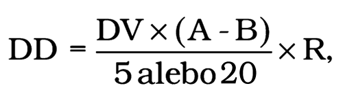

Príloha č. 1 k zákonu č. 222/2004 Z. z.

- POSTUP PRI ÚPRAVE ODPOČÍTANEJ DANE PRI INVESTIČNOM MAJETKU

  - Pri úprave podľa § 54 postupuje platiteľ podľa vzorca

  - 

  - kde

  - DD je výsledok úpravy odpočítanej dane, ktorý v prípade záporného znamienka predstavuje dodatočne odpočítateľnú daň a v prípade kladného znamienka predstavuje dodatočne neodpočítateľnú daň,

  - DV je daň vzťahujúca sa na obstarávaciu cenu investičného majetku alebo vlastné náklady investičného majetku,

  - A je číslo 1, ak platiteľ odpočítal daň v plnej výške, alebo číslo 0, ak platiteľ neodpočítal daň, alebo hodnota koeficientu vypočítaného po skončení kalendárneho roka, ak platiteľ pomerne odpočítal daň,

  - B je číslo, ktoré predstavuje koeficient vypočítaný po skončení kalendárneho roka, v ktorom platiteľ zmenil účel použitia investičného majetku, alebo číslo 0, alebo číslo 1, a to podľa zmeny účelu použitia investičného majetku podľa § 54 ods. 3,

  - R je počet kalendárnych rokov, ktoré zostávajú do skončenia obdobia na úpravu odpočítania dane vrátane roka, v ktorom došlo k zmene účelu použitia investičného majetku.
