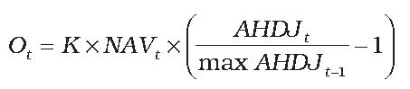

Príloha č. 3 k zákonu č. 43/2004 Z. z. v znení zákona č. 334/2011 Z. z.

- VZOREC NA VÝPOČET VÝŠKY ODPLATY ZA ZHODNOTENIE MAJETKU V DLHOPISOVOM DÔCHODKOVOM FONDE, V ZMIEŠANOM DÔCHODKOVOM FONDE A V AKCIOVOM DÔCHODKOVOM FONDE Vzorec na výpočet výšky odplaty za zhodnotenie majetku v dlhopisovom dôchodkovom fonde, v zmiešanom dôchodkovom fonde a v akciovom dôchodkovom fonde:

- 

- Pri výpočte odplaty za zhodnotenie majetku v dlhopisovom dôchodkovom fonde, v zmiešanom dôchodkovom fonde a v akciovom dôchodkovom fonde sa použijú tieto veličiny, funkcie a ich označenia:

- Ot | výška odplaty za zhodnotenie majetku v dôchodkovom fonde pre deň t

- NAVt | druhá predbežná čistá hodnota majetku v dôchodkovom fonde platná pre deň t

- AHDJt | predbežná aktuálna hodnota dôchodkovej jednotky platná pre deň t

- maxAHDJt-1 | maximálna aktuálna hodnota dôchodkovej jednotky dosiahnutá za tri roky predchádzajúce dňu t, najneskôr od 1. apríla 2012

- K | koeficient na určenie výšky odplaty za zhodnotenie majetku v dlhopisovom dôchodkovom fonde, v zmiešanom dôchodkovom fonde a v akciovom dôchodkovom fonde, ktorý môže byť maximálne vo výške 0,056

- t | pracovný deň bezprostredne predchádzajúci dňu výpočtu odplaty za zhodnotenie majetku v dôchodkovom fonde.
