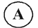
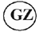
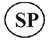

# § 10 Označovanie zdrojov reprodukčného materiálu

(1) Rodičovský - výberový strom sa v teréne označuje číslom stromu podľa uznávacieho listu žltou farbou. Číslo sa umiestňuje vo výške 1,3 m na mieste viditeľnom z najbližšej komunikácie. Od tohto čísla sa vyznačujú žltou farbou po celom obvode kmeňa dva pruhy so šírkou 5 cm a s medzerou medzi pruhmi so šírkou 15 cm.

(2) Uznaný porast kategórie A sa v teréne označuje jedným pruhom zelenej farby po celom obvode kmeňa so šírkou 5 cm vo výške 1,3 m na okrajových stromoch porastu.

(3) Uznaný porast kategórie B sa v teréne označuje znakom „X“ zelenej farby na okrajových stromoch z vonkajšej strany lesného porastu.

(4) Semenný porast sa na rohoch a lomových bodoch označuje hospodárskymi kopcami, ktorými sú špeciálne stabilizácie zameraných lomových bodov jednotiek priestorového rozdelenia lesa, a po odrastení na okrajových stromoch porastu 10 cm širokým žltým pruhom po celom obvode kmeňa vo výške 1,3 m po obvode porastu.

(5) Hranica génovej základne sa v teréne označuje znakom „G“ zelenej farby na okrajových stromoch vonkajšej hranice génovej základne.

(6) Hranice uznaných porastov, semenných porastov a génových základní sa označujú v takej hustote, aby bolo označenie v teréne ľahko identifikovateľné.

(7) Zdroj reprodukčného materiálu vyznačuje v teréne správca lesných pozemkov.

(8) V lesníckych mapách sa zdroje reprodukčného materiálu označujú týmito značkami:

a) uznané lesné porasty kategórie A | 

b) uznané lesné porasty kategórie B | 

c) výberové stromy | 

d) semenné sady | 

e) lesné porasty v génovej základni | 

f) semenné porasty | 

(9) Pri súbehu rôznych fenotypových kategórií viacerých drevín v lesnom poraste sa v lesníckych mapách uvádza označenie vyššej fenotypovej kategórie.
