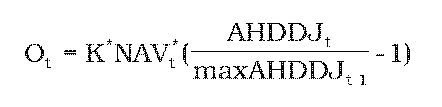

Príloha č. 1 k zákonu č. 650/2004 Z. z.

- VZOREC NA VÝPOČET VÝŠKY ODPLATY ZA ZHODNOTENIE MAJETKU V DOPLNKOVOM DÔCHODKOVOM FONDE

  - Vzorec na výpočet výšky odplaty za zhodnotenie majetku v doplnkovom dôchodkovom fonde:

- 

  - Pri výpočte odplaty za zhodnotenie majetku v doplnkovom dôchodkovom fonde sa použijú tieto veličiny, funkcie a ich označenia:

- Ot | výška odplaty za zhodnotenie majetku v doplnkovom dôchodkovom fonde pre deň t

- NAVt | čistá hodnota majetku v doplnkovom dôchodkovom fonde platná pre deň t

- AHDDJt | aktuálna hodnota doplnkovej dôchodkovej jednotky platná pre deň t

- maxAHDDJt-1 | maximálna aktuálna hodnota doplnkovej dôchodkovej jednotky dosiahnutá po 1. januári 2010 do dňa t-1

- K | koeficient na určenie výšky odplaty za zhodnotenie majetku v doplnkovom dôchodkovom fonde, ktorý

- | môže byť maximálne:

- | v roku 2010 vo výške 0,10,

- | v roku 2011 vo výške 0,11,

- | v roku 2012 vo výške 0,12,

- | v roku 2013 vo výške 0,13,

- | v roku 2014 vo výške 0,14,

- | v roku 2015 vo výške 0,15,

- | v roku 2016 vo výške 0,16,

- | v roku 2017 vo výške 0,17,

- | v roku 2018 vo výške 0,18,

- | v roku 2019 vo výške 0,19,

- | a v roku 2020 a v nasledujúcich rokoch vo výške 0,20,

- t | pracovný deň bezprostredne predchádzajúci dňu výpočtu odplaty za zhodnotenie majetku v doplnkovom dôchodkovom fonde.
