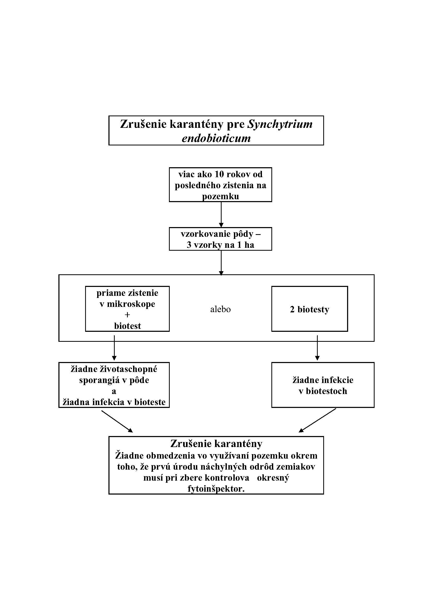

Príloha č. 14 k nariadeniu vlády č. 67/2004 Z. z. ZMENA A ZRUŠENIE KARANTÉNY PRE RAKOVINU A HÁĎATKO

- I. Zmena karantény

- 1. Zmena vymedzenia zamorených pozemkov alebo ohrozeného územia a dosiaľ platných rastlinolekárskych opatrení sa vykoná po zistení zmien vo výskyte rakoviny alebo háďatka, najmä po vykonaní preskúšavania zamorenosti pozemkov a detailného prieskumu alebo pri podstatnej zmene podmienok ovplyvňujúcich možnosti ich šírenia.

- 2. Zmenu navrhuje kontrolný ústav na základe zhodnotenia výskytu rakoviny alebo háďatka, rozsahu a výsledkov preskúšavania a prieskumu zamorenosti pozemkov, ničenia rakoviny alebo háďatka, overovaní agresívnych patotypov, dodržiavania karantény, zmien výrobcov a spôsobu ich hospodárenia a iných zmien vo vzťahu k možnosti šírenia rakoviny alebo háďatka.

- 3. Kontrolný ústav navrhne zmenu vyhlásenia karantény podľa osobitného predpisu1).

- Návrh obsahuje

- a) výsledky skúmania podľa bodu 2,

- b) návrh nového vymedzenia zamorených pozemkov a ohrozeného územia: zamorený pozemok možno v osobitných prípadoch vymedziť samostatne, prípadne s jeho najbližším okolím, ale musí byť pritom preukázané (preskúšavaním zamorených pozemkov a detailným prieskumom), že v uvoľnenej časti územia nie sú pozemky zamorené a že za daných podmienok (terénna izolácia, spôsob hospodárenia, dodržiavanie karantény a pod.) je v podstate vylúčený prenos zárodkov rakoviny alebo háďatka zo zamoreného pozemku do uvoľneného územia; v oblastiach s veľkou hustotou zamorených pozemkov a medzi nimi roztrúsenými nezamorenými pozemkami treba posúdiť eventuálnu účelnosť vymedzenia viacerých katastrov do ohrozeného územia,

- c) návrh nových rastlinolekárskych opatrení.

- 4. Podľa bodu 3 písm. b) vypracuje fytoinšpektor nový situačný plánik zamorených pozemkov a ohrozeného územia.

- II. Zrušenie karantény

- A. Háďatko

- Po preskúšaní zamorenosti pozemkov s negatívnym výsledkom vykoná fytoinšpektor na zamorených pozemkoch a v ohrozenom území detailný prieskum (príloha č. 2 bod II. 3), ktorý možno vykonať najskôr po uplynutí 10 rokov od posledného zistenia výskytu.

- Ak je výsledok detailného prieskumu negatívny, kontrolný ústav navrhne zrušenie karantény podľa osobitného predpisu.1)

- B. Rakovina

- Na pozemku, ktorý bol zamorený rakovinou a bol pod dohľadom kontrolného ústavu, možno zrušiť karanténu v závislosti od času, ktorý uplynul od posledného zistenia rakoviny a od výsledkov pôdnych testov. Pre veľmi dlhé obdobie životnosti sporangií rakoviny v pôde nemožno bez testovania pôdnych vzoriek uvoľniť pozemky z karantény len na základe uplynutia určitého počtu rokov. Počas obdobia karantény by mal byť pozemok obrábaný, nestačí iba zatrávnenie.

- 1. Zrušenie karantény

- Na pozemku, ktorý bol v minulosti zamorený rakovinou, možno zrušiť karanténu najskôr po uplynutí 10 rokov od posledného zistenia infekcie za predpokladu, že z pozemku boli odobraté 3 vzorky pôdy na 1 ha (každú vzorku tvorí 60 čiastkových vzoriek do hĺbky 20 cm) testované podľa prílohy č. 4 bez výskytu živých sporangií a bez potvrdenia infekcie biologickým trubičkovým testom podľa prílohy č. 13 bodu II.

- Ak možno presne určiť polohu infikovaných ohnísk na pozemku, z týchto ohnísk sa odoberajú vzorky osobitne a aj ich testovanie sa vykonáva oddelene od ostatných vzoriek.

- K zrušeniu karantény môže dôjsť vtedy, ak

- a) vo všetkých vzorkách pôdnych suspenzií testovaných pod mikroskopom podľa prílohy č. 4 nie sú žiadne životaschopné sporangiá a zároveň nie je žiadna infekcia v biologických testoch podľa prílohy č. 13 bodu II,

- alebo

- b) vo všetkých vzorkách testovaných na zamorenie dvoma postupnými biologickými testmi podľa prílohy č. 13 bodu II nie je žiadna infekcia. Pôdne vzorky na 2 biologické testy sa odoberajú postupne s určitým časovým odstupom, počas ktorého sa vykoná kultivácia pôdy (napr. orba, rotavátorovanie).

- Negatívny výsledok testovania pôdnych suspenzií nie je dostatočné kritérium na zrušenie karantény. Po tomto teste nasleduje biologický test. Ak sú v pôdnych suspenziách pozorované živé sporangiá rakoviny, celkový výsledok je pozitívny a netreba vykonať biologický test.

- Vo všetkých biologických testoch je dôležité zahrnúť negatívne kontroly zdravých rastlín a pozitívne kontroly z infikovanej vzorky.

- V prípade pozitívneho výsledku pôdnych suspenzií alebo biologického testu ďalšie odbery vzoriek a ich testovanie nasledujú najskôr po 3 rokoch.

- V prípade negatívneho výsledku testovania všetkých vzoriek kontrolný ústav navrhne zrušenie karantény podľa osobitného predpisu.1) Po zrušení karantény nie sú žiadne obmedzenia vo využívaní pozemku okrem toho, že prvú úrodu náchylných odrôd zemiakov musí pri zbere kontrolovať okresný fytoinšpektor na akúkoľvek infekciu.

