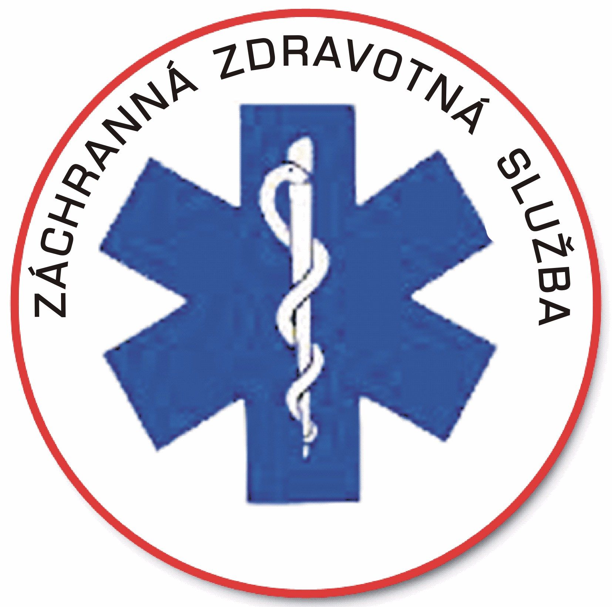

Príloha č. 1 k vyhláške č. 741/2004 Z. z.

- VZOR VYHRADENÉHO ZNAKU ZÁCHRANNEJ ZDRAVOTNEJ SLUŽBY 

- Vyhradený znak záchrannej zdravotnej služby tvorí biely kruh s červeným lemom, v jeho strede je umiestnený symbol modrej hviezdy života s bielym znakom hada na palici umiestneným vo zvislej osi hviezdy. Nad hviezdou v polkruhu je umiestnený červený nápis záchranná zdravotná služba a pod hviezdou v polkruhu je umiestnený názov sídla poskytovateľa.
