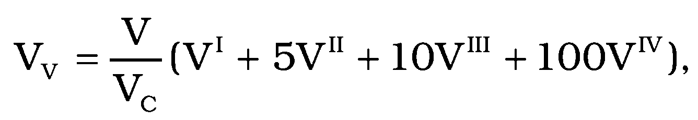

Príloha č. 2 k vyhláške č. 96/2004 Z. z.

- SPÔSOB URČENIA OBJEMU HORĽAVÝCH KVAPALÍN II., III. A IV. TRIEDY NEBEZPEČNOSTI

  - Objem horľavých kvapalín II., III. a IV. triedy nebezpečnosti sa z objemu horľavých kvapalín I. triedy nebezpečnosti určuje podľa vzorca

- 

- kde VV je výsledný povolený skladovaný objem horľavých kvapalín všetkých tried nebezpečnosti v m3,

- V je povolený objem horľavých kvapalín I. triedy nebezpečnosti v m3,

- VI je skutočný objem horľavých kvapalín I. triedy nebezpečnosti v m3,

- VII je skutočný objem horľavých kvapalín II. triedy nebezpečnosti v m3,

- VIII je skutočný objem horľavých kvapalín III. triedy nebezpečnosti v m3,

- VIV je skutočný objem horľavých kvapalín IV. triedy nebezpečnosti v m3,

- VC je celkový skutočný objem horľavých kvapalín všetkých tried nebezpečnosti v m3.
