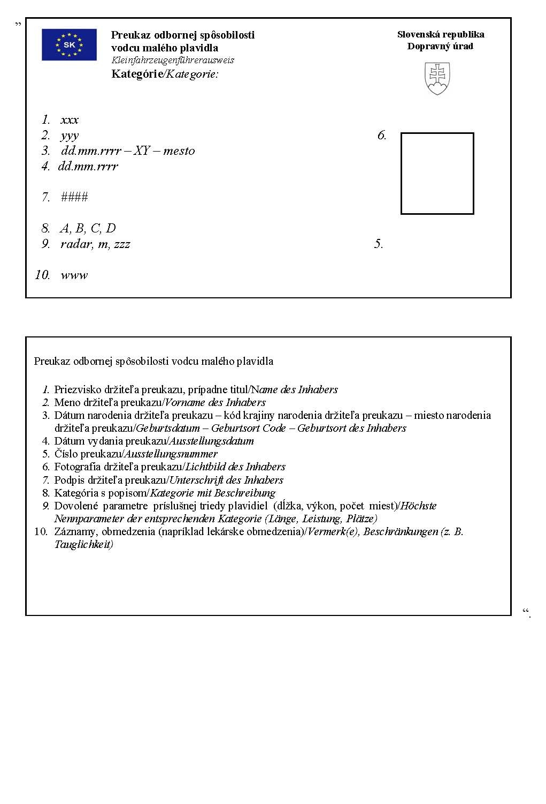
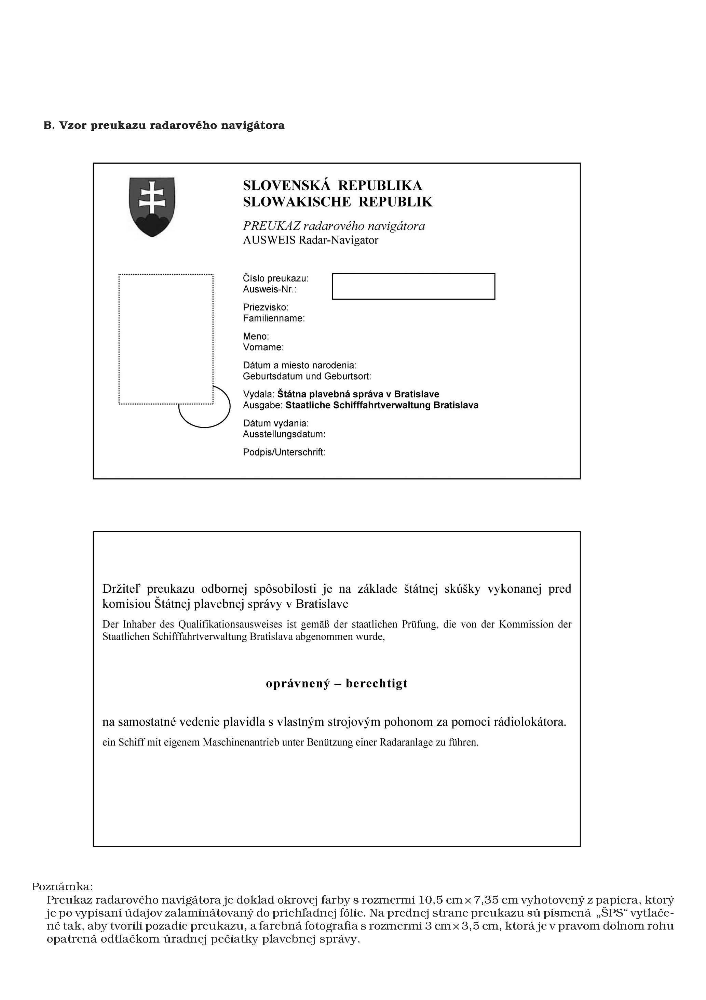

Príloha č. 3 k vyhláške č. 12/2005 Z. z.

- VZORY PREUKAZOV ODBORNEJ SPÔSOBILOSTI ČLENOV POSÁDKY PLAVIDLA

  - A. Vzor preukazu odbornej spôsobilosti člena posádky plavidla

  - [Vzor 03-1](../assets/eb69431b8e5ee36be7cdb22f4d5c71b150ee0235c2827e3751cc31fb06f23494.pdf)

  - B. Vzor preukazu radarového navigátora

  - 

  - C. Vzor preukazu vedúceho plavby na plavebných komorách Slovenskej republiky

  - 
