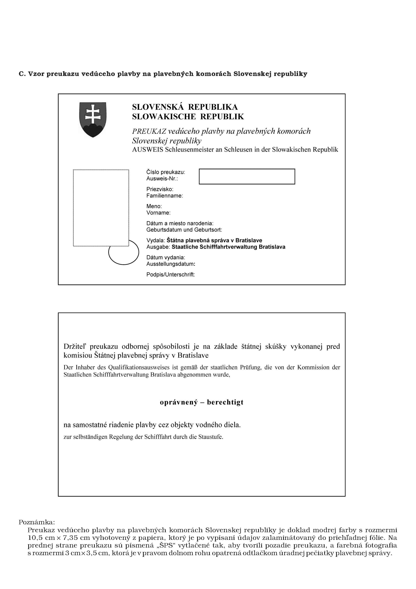

Príloha č. 5 k vyhláške č. 12/2005 Z. z.

- Vzor preukazu odbornej spôsobilosti vodcu malého plavidla 

  - Poznámky:

  - 1. Preukaz odbornej spôsobilosti vodcu malého plavidla je doklad bledozelenej farby s rozmermi 8, 56 cm x 5, 398 cm vyhotovený z plastu (PVC alebo viacvrstvového polykarbonátu) s priehľadnou vrstvou na povrchu s ochrannými prvkami. Na prednej strane preukazu je farebná fotografia s rozmermi 2 cm x 2, 3 cm. Fyzikálne charakteristiky preukazu odbornej spôsobilosti vodcu malého plavidla musia byť v súlade s technickými normami STN ISO /IEC 7810 Identifikačné karty. Fyzikálne vlastnosti.

  - 2. Vodca malého plavidla môže získať odbornú spôsobilosť na vedenie malého plavidla týchto kategórií:

  - 2.1 kategória A - odborná spôsobilosť vodcu malého plavidla kategórie A, ktorý vedie malé plavidlo bez vlastného strojového pohonu s hmotnosťou nad 1 000 kg vrátane dovoleného zaťaženia a malé plavidlo s vlastným strojovým pohonom s výkonom od 4 kW do 20 kW;

  - Kategorie A - Der Befähigungsausweis berechtigt den Inhaber zum Führen von Kleinfahrzeugen ohne eigenen Motorantrieb mit einem Gesamtgewicht von über 1 000 kg einschließlich der zulässigen Belastung, sowie zur Führung von Kleinfahrzeugen mit eigenem Motorantrieb mit einer Leistung von 4 bis 20 KW;

  - 2.2 kategória B - odborná spôsobilosť vodcu malého plavidla kategórie B, ktorý vedie malé plavidlo s vlastným strojovým pohonom s výkonom nad 20 kW;

  - Kategorie B - Der Befähigungsausweis berechtigt den Inhaber zum Führen von Kleinfahrzeugen mit eigenem Motorantrieb mit einer Leistung von über 20 KW;

  - 2.3 kategória C - odborná spôsobilosť vodcu malého plavidla kategórie C, ktorý vedie malé plavidlo plávajúce pomocou plachiet s plochou plachiet nad 12 m2;

  - Kategorie C - Der Befähigungsausweis berechtigt den Inhaber zum Führen von Segelkleinfahrzeugen mit einer Segelfläche von über 12 m2;

  - 2.4 kategória D - odborná spôsobilosť vodcu malého plavidla kategórie D, ktorý vedie plť určenú na prepravu osôb na príslušnom úseku vodnej cesty;

  - Kategorie D - Der Befähigungsausweis berechtigt den Inhaber zum Führen von Flößen für Fahrgästenbefürderung am bestimten Fahrtstreckenabschnit.
