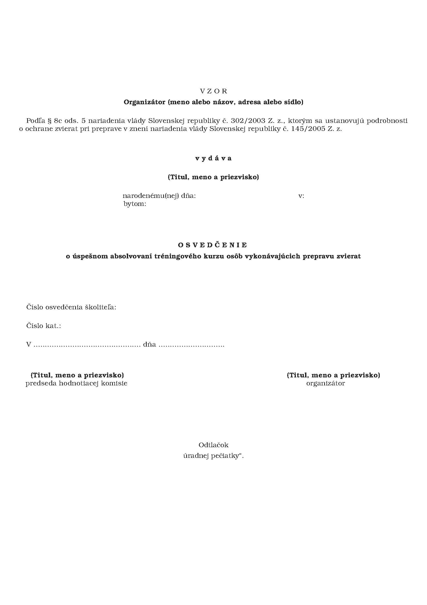
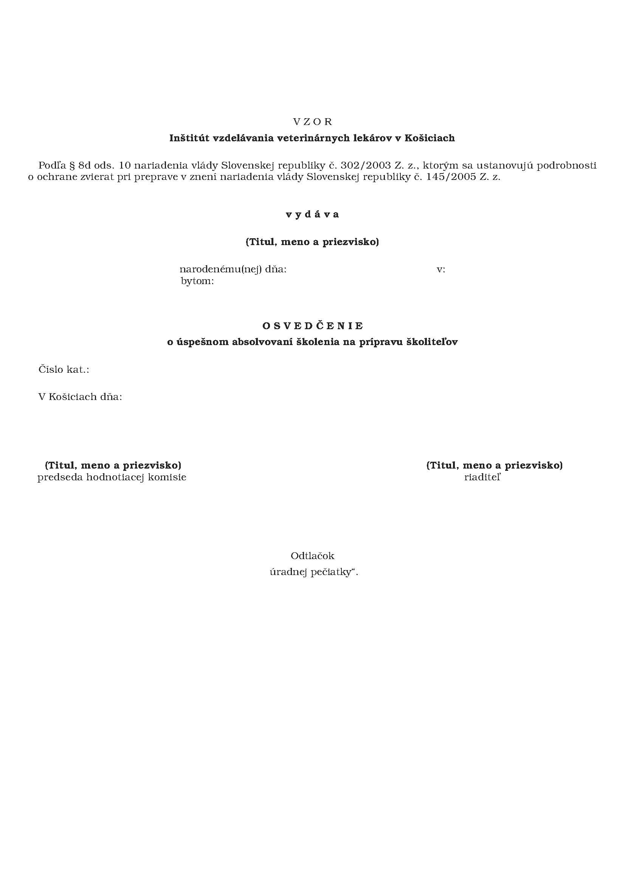

# Čl. I

Nariadenie vlády Slovenskej republiky č. 302/2003 Z. z., ktorým sa ustanovujú podrobnosti o ochrane zvierat pri preprave sa mení a dopĺňa takto:

- 1. V § 1 ods. 1 sa slovo „transponujú“ nahrádza slovom „preberajú“.

- 2. V § 1 sa odsek 2 dopĺňa písmenom h), ktoré znie:

- „h)

- podmienky získavania odbornej spôsobilosti osôb vykonávajúcich prepravu zvierat alebo osôb manipulujúcich so zvieratami v zberných strediskách alebo na trhoch so zvieratami (ďalej len „osoba vykonávajúca prepravu zvierat").“.

- 3. Poznámka pod čiarou k odkazu 1 znie:

- „1)

- Nariadenie vlády Slovenskej republiky č. 293/2003 Z. z. o veterinárnej kontrole pri výmenách živých zvierat a produktov živočíšneho pôvodu s členskými štátmi v znení nariadenia vlády Slovenskej republiky č. 491/2003 Z. z.

- Nariadenie vlády Slovenskej republiky č. 534/2004 Z. z., ktorým sa ustanovujú princípy organizácie veterinárnych kontrol produktov vstupujúcich na územie Európskych spoločenstiev z tretích krajín.

- Nariadenie vlády Slovenskej republiky č. 280/2003 Z. z. o zdravotných problémoch, ktoré ovplyvňujú výmenu s hovädzím dobytkom a ošípanými v znení nariadenia vlády Slovenskej republiky č. 487/2003 Z. z.“.

- 4. V § 2 ods. 2 sa slovo „transponujú“ nahrádza slovom „preberajú“.

- 5. V § 4 sa slová „veterinárnym osvedčením“ nahrádzajú slovami „zdravotným certifikátom“.

- 6. Poznámka pod čiarou k odkazu 5 znie:

- „5)

- Výnos Ministerstva pôdohospodárstva Slovenskej republiky zo 17. decembra 2003 č. 3652/2003-100 o označovaní hovädzieho dobytka, o evidencii hovädzieho dobytka a o vedení centrálneho registra hovädzieho dobytka (oznámenie č. 19/2004 Z. z.).

- Nariadenie Európskeho parlamentu a Rady č. 998/2003 z 26. mája 2003 o veterinárnych požiadavkách uplatniteľných na nekomerčné premiestňovanie spoločenských zvierat a ktorým sa mení a dopĺňa smernica Rady 92/65/EHS (Ú. v. ES L 146, 13. 6. 2003).“.

- 7. § 5 vrátane nadpisu znie:

- 㤠5

- Registrácia prepravcov

- (1)

- Každý prepravca, ktorý má sídlo alebo miesto podnikania v Slovenskej republike, musí mať vydané osvedčenie o spôsobilosti vykonávať prepravu zvierat (ďalej len „osvedčenie prepravcu") a musí byť zapísaný v registri prepravcov vedenom Štátnou veterinárnou a potravinovou správou Slovenskej republiky6) (ďalej len „štátna veterinárna a potravinová správa").

- (2)

- Každý, kto chce vykonávať prepravu zvierat na území Slovenskej republiky a nie je registrovaný podľa odseku 1 alebo v obdobnom registri iného členského štátu, je povinný pred začatím tejto činnosti požiadať štátnu veterinárnu a potravinovú správu o registráciu.

- (3)

- Žiadateľ o registráciu predloží

- a)

- žiadosť o registráciu prepravcu podľa prílohy č. 3,

- b)

- kópiu živnostenského listu alebo výpis z obchodného registra, alebo iný doklad zakladajúci právnu subjektivitu, ktorý preukazuje opodstatnenie vykonávať prepravu zvierat,6a)

- c)

- čestné vyhlásenie podľa prílohy č. 3 o tom, že

- 1.

- je oboznámený s platnými právnymi predpismi vo veterinárnej oblasti, s veterinárnou legislatívou týkajúcou sa prepravy zvierat a má k nej prístup,

- 2.

- osoby, ktoré vykonávajú prepravu zvierat, spĺňajú požiadavku odbornej spôsobilosti alebo praktickej skúsenosti alebo že zabezpečí, že v určenej lehote túto požiadavku splnia,

- 3.

- osoby, ktoré vykonávajú prepravu zvierat, bude pravidelne školiť a informovať o legislatívnych zmenách.

- (4)

- Ustanovenia odsekov 1 až 3 sa vzťahujú aj na prepravcu, ktorý má sídlo v tretej krajine, ak nie je registrovaný ako prepravca v inom členskom štáte.

- (5)

- Prepravca je povinný pri kontrole podľa § 13 na požiadanie predložiť osvedčenie prepravcu alebo jeho kópiu.“.

- Poznámka pod čiarou k odkazu 6a znie:

- „6a)

- § 12a až 12e zákona č. 105/1990 Zb. o súkromnom podnikaní občanov v znení zákona č. 219/1991 Zb.“.

- 8. V § 7 ods. 2 sa na konci pripája táto veta: „Prepravca je povinný pri kontrole podľa § 13 na požiadanie predložiť preukaz o spôsobilosti dopravného prostriedku.“.

- 9. V § 8 odsek 1 znie:

- „(1)

- Každá osoba vykonávajúca prepravu zvierat musí byť odborne spôsobilá na vykonávanie tejto činnosti.“.

- 10. V § 8 odsek 3 znie:

- „(3)

- Preukaz o odbornej spôsobilosti, ktorého vzor je uvedený v prílohe č. 4, vydáva miestne príslušný orgán veterinárnej správy v mieste výkonu činnosti na základe osvedčenia o úspešnom absolvovaní tréningového kurzu.“.

- 11. Za § 8 sa vkladajú § 8a až 8e, ktoré vrátane nadpisov znejú:

- 㤠8a

- Tréningový kurz osôb vykonávajúcich prepravu zvierat

- (1)

- Tréningové kurzy organizuje Inštitút vzdelávania veterinárnych lekárov v Košiciach, právnická osoba alebo fyzická osoba, ktorá je oprávnená vykonávať tréningové kurzy (ďalej len „organizátor").

- (2)

- Tréningový kurz sa vykonáva so zameraním na vybrané druhy zvierat. Tréningový kurz má zameranie na

- a)

- domáce nepárnokopytníky, hovädzí dobytok, ošípané a malé prežúvavce,

- b)

- hydinu, domáce vtáctvo a domáce králiky,

- c)

- mačky a psy,

- d)

- iné cicavce a vtáky alebo

- e)

- iné stavovce a studenokrvné živočíchy.

- (3)

- Tréningový kurz pozostáva najmenej z tematických okruhov uvedených v prílohe č. 5 a je ukončený písomným testom.

- (4)

- Obsah tréningového kurzu a obsah písomného testu predkladá organizátor na schválenie štátnej veterinárnej a potravinovej správe.

- (5)

- Osoba odborne spôsobilá na vykonávanie prepravy zvierat podľa § 8 ods. 2, ktorá chce získať odbornú spôsobilosť na prepravu ďalších druhov zvierat podľa odseku 1, je povinná absolvovať tréningový kurz v plnom rozsahu.

- § 8b

- Tréningový kurz osôb vykonávajúcich prepravu zvierat s praktickou skúsenosťou

- (1)

- Rozsah tréningového kurzu môže byť skrátený, a to v časti

- a)

- výučba právnych predpisov vzťahujúcich sa na prepravu zvierat a ochranu zvierat so zameraním na ich zmeny a najčastejšie zistené porušenia týchto predpisov za obdobie posledných piatich rokov,

- b)

- výučba o správaní sa zvierat, fyziologických požiadavkách zvierat so zreteľom na kŕmenie, napájanie a odpočinok so zameraním na najnovšie poznatky a najčastejšie zistené porušenia týchto potrieb zvierat za obdobie posledných piatich rokov,

- c)

- vysvetlenie rizík prepravy zvierat so zameraním na najčastejšie zistené riziká prepravy.

- (2)

- Obsah tréningového kurzu a obsah písomného testu predkladá organizátor na schválenie štátnej veterinárnej a potravinovej správe.

- (3)

- Osoba vykonávajúca prepravu zvierat s praktickou skúsenosťou podľa § 8 ods. 7, ktorá chce získať odbornú spôsobilosť na prepravu ďalších druhov zvierat podľa § 8a ods. 2, je povinná absolvovať tréningový kurz v plnom rozsahu podľa § 8a ods. 3.

- § 8c

- Organizácia tréningových kurzov

- (1)

- Organizátor je povinný hodnotiacej komisii (§ 8e) vopred oznámiť čas a miesto konania tréningového kurzu a písomného testu.

- (2)

- Osoba je odborne spôsobilá na vykonávanie tréningových kurzov (ďalej len „školiteľ"), ak úspešne absolvovala školenie na prípravu školiteľov (§ 8d).

- (3)

- Školiteľa tréningového kurzu vyberá organizátor zo zoznamu školiteľov, ktorý vedie Inštitút vzdelávania veterinárnych lekárov v Košiciach.

- (4)

- Vyhodnotenie písomných testov vykonáva hodnotiaca komisia (§ 8e ods. 1), ktorá je prítomná aj pri ich vypracúvaní účastníkmi.

- (5)

- Osvedčenie o úspešnom absolvovaní tréningového kurzu osôb vykonávajúcich prepravu zvierat, ktorého vzor je uvedený v prílohe č. 6, vydá organizátor účastníkovi, ktorý úspešne absolvoval tréningový kurz a v písomnom teste dosiahol najmenej 75 % bodov.

- (6)

- Ak účastník tréningového kurzu nedosiahne v písomnom teste najmenej 75 % bodov, organizátor ho o tom písomne upovedomí a umožní mu písomný test raz opakovať v lehote do dvoch mesiacov od neúspešného písomného testu.

- § 8d

- Školenie na prípravu školiteľov

- (1)

- Organizátorom školenia na prípravu školiteľov je Inštitút vzdelávania veterinárnych lekárov v Košiciach (ďalej len „organizátor školenia").

- (2)

- Školenia na prípravu školiteľov sa môže zúčastniť len fyzická osoba alebo zamestnanec právnickej osoby podľa § 8a ods. 1, s ukončeným vysokoškolským vzdelaním v odbore veterinárskeho lekárstva alebo v inom vednom odbore so zameraním na správanie sa zvierat (etológiu) a fyziologické potreby zvierat.

- (3)

- Obsah školenia na prípravu školiteľov a obsah písomného testu predkladá organizátor školenia na schválenie štátnej veterinárnej a potravinovej správe.

- (4)

- Školenie na prípravu školiteľov musí obsahovať najmenej

- a)

- štyri hodiny výučby právnych predpisov so zameraním na ochranu a pohodu zvierat počas prepravy,

- b)

- šesť hodín výučby o správaní sa zvierat, fyziologických požiadavkách zvierat so zreteľom na kŕmenie, napájanie a odpočinok,

- c)

- dve hodiny vysvetlenia rizík prepravy zvierat a pojmu stres,

- d)

- dve hodiny vysvetlenia vplyvu spôsobu jazdy na pohodu zvierat a kvalitu mäsa,

- e)

- štyri hodiny praktickej prípravy manipulácie so zvieratami,

- f)

- štyri hodiny nácviku riešenia kritických situácií.

- (5)

- Školenie na prípravu školiteľov sa vykonáva so zameraním na vybrané druhy zvierat podľa § 8a ods. 2.

- (6)

- Školenie na prípravu školiteľov pozostáva najmenej z tematických okruhov uvedených v prílohe č. 5 a je ukončené písomným testom.

- (7)

- Školiteľ, ktorý chce získať odbornú spôsobilosť vykonávať tréningové kurzy na ďalší druh zvierat podľa § 8a ods. 2, je povinný absolvovať školenie na prípravu školiteľov v plnom rozsahu.

- (8)

- Organizátor školenia je povinný hodnotiacej komisii (§ 8e) vopred oznámiť čas a miesto konania školenia na prípravu školiteľov a písomného testu.

- (9)

- Vyhodnotenie písomných testov vykonáva hodnotiaca komisia (§ 8e ods. 2), ktorá je prítomná aj pri ich vypracúvaní účastníkmi.

- (10)

- Osvedčenie o úspešnom absolvovaní školenia na prípravu školiteľov, ktorého vzor je uvedený v prílohe č. 7, vydá organizátor školenia účastníkovi, ktorý úspešne absolvoval školenie na prípravu školiteľov a v písomnom teste dosiahol najmenej 80 % bodov.

- (11)

- Ak účastník školenia na prípravu školiteľov nedosiahne v písomnom teste najmenej 80 % bodov, organizátor školenia ho o tom písomne upovedomí a umožní mu písomný test raz opakovať v lehote do dvoch mesiacov od neúspešného písomného testu.

- § 8e

- Hodnotiaca komisia

- (1)

- Hodnotiaca komisia podľa § 8c ods. 3 sa skladá z predsedu a z dvoch ďalších členov.

- (2)

- Hodnotiaca komisia podľa § 8d ods. 8 sa skladá z predsedu a zo štyroch ďalších členov.

- (3)

- Členov hodnotiacich komisií vyberá organizátor tréningového kurzu alebo školenia na prípravu školiteľov zo zoznamu, ktorý vedie štátna veterinárna a potravinová správa. Zloženie hodnotiacej komisie oznámi organizátor tréningového kurzu alebo školenia na prípravu školiteľov štátnej veterinárnej a potravinovej správe.

- (4)

- Výdavky spojené so zvolaním a s výkonom činnosti hodnotiacej komisie podľa odseku 1 znáša organizátor.

- (5)

- Výdavky spojené so zvolaním a s výkonom činnosti hodnotiacej komisie podľa odseku 2 znáša organizátor školenia.

- (6)

- V zozname podľa odseku 3 sa vedú osoby vymenované hlavným veterinárnym lekárom12a) z úradných veterinárnych lekárov a navrhnutých zástupcov organizátora školenia, chovateľských združení, združení prepravcov a združení spracovateľov mäsa. Predsedom hodnotiacej komisie môže byť len úradný veterinárny lekár. Predsedom hodnotiacej komisie na vyhodnotenie písomných testov účastníkov školenia na prípravu školiteľov môže byť len úradný veterinárny lekár, ktorý je zamestnancom štátnej veterinárnej a potravinovej správy.

- (7)

- Hodnotiaca komisia vypracuje záznam o vykonaní písomného testu, ktorý obsahuje najmä počet účastníkov, počet úspešných absolventov, určenie, či písomný test bol v súlade s jeho schváleným obsahom, zloženie komisie, dátum a podpisy členov komisie.“.

- Poznámka pod čiarou k odkazu 12a znie:

- „12a)

- § 6 ods. 1 zákona č. 488/2002 Z. z.“.

- 12. V § 9 písm. f) sa za slovo „napájanie“ vkladajú slová „v primeraných intervaloch počas prepravy“.

- 13. V § 9 písm. l) sa slová „1. augusta 2004“ nahrádzajú slovami „1. septembra 2005“.

- 14. V § 9 písm. n) sa slová „prílohy č. 5“ nahrádzajú slovami „osobitného predpisu12b)“.

- Poznámka pod čiarou k odkazu 12b znie:

- „12b) Príloha nariadenia Rady (ES) č. 411/98 zo 16. februára 1998 o dodatočných štandardoch na ochranu zdravia zvierat uplatniteľných na cestné dopravné prostriedky používané na prepravu hospodárskych zvierat pri preprave trvajúcej dlhšie ako osem hodín (Ú. v. ES L 52, 21. 2. 1998, s. 8).“.

- 15. V § 10 ods. 3 písm. b) druhý bod znie:

- „2.

- ktorá na území Európskeho spoločenstva presiahne osem hodín a vykonáva sa na účel ich vývozu do tretích krajín, nechal úradným veterinárnym lekárom po kontrole na schválenej hraničnej inšpekčnej stanici (BIP) potvrdiť plán prepravy, ktorým úradný veterinárny lekár potvrdí odtlačkom pečiatky a podpisom, že zvieratá skontroloval a posúdil ako schopné ďalšej prepravy; prepravca znáša všetky náklady spojené s hraničnou veterinárnou kontrolou,“.

- 16. V § 11 ods. 1 sa slová „prílohy č. 6“ nahrádzajú slovami „podľa osobitného predpisu13a)“.

- Poznámka pod čiarou k odkazu 13a znie:

- „13a) Príloha 1 nariadenia Rady (EH) č. 1255/97 z 25. júna 1997 o kritériách spoločenstva na oddychové miesta a ktorým sa mení plán prepravy uvedený v prílohe smernice 91/628/EHS (Ú. v. ES L 174, 2. 7. 1997, s. 1).“.

- 17. V § 11 ods. 4 sa slová „prílohy č. 6“ nahrádzajú slovami „osobitného predpisu13a)“.

- 18. V § 11 ods. 4 písm. b) sa slová „právnym predpisom Európskych spoločenstiev uvedenom v prílohe č. 1 bode 4“ nahrádzajú slovami „osobitného predpisu13a)“.

- 19. V § 11 ods. 10 písm. h) sa slová „prílohy č. 6 časti C bodu 7“ nahrádzajú slovami „osobitného predpisu13a)“.

- 20. V § 15 ods. 1 sa vypúšťajú slová „bode 1“.

- 21. § 16 sa vypúšťa.

- 22. V § 17 ods. 3 sa slová „1. augusta 2004“ nahrádzajú slovami „1. septembra 2005“.

- 23. Príloha č. 1 znie:

- „Príloha č. 1 k nariadeniu vlády č. 302/2003 Z. z.

- ZOZNAM PREBERANÝCH PRÁVNYCH AKTOV EURÓPSKYCH SPOLOČENSTIEV A EURÓPSKEJ ÚNIE

- Smernica Rady č. 91/628/EHS z 19. novembra 1991 o ochrane zvierat počas prepravy, ktorou sa menia a dopĺňajú smernice 90/425/EHS a 91/496/EHS (Ú. v. ES L 340, 11. 12. 1991, s. 17) v znení

- smernice Rady č. 95/29/ES z 29. júna 1995, ktorá mení smernicu 90/628/EHS týkajúcu sa ochrany zvierat počas prepravy (Ú. v. ES L 148, 30. 6. 1995, s. 52),

- rozhodnutia Rady č. 92/438/EHS z 13. júla 1992 o informatizácii veterinárnych postupov pri dovozoch (Shift project), ktoré mení smernice 90/675/EHS, 91/496/EHS, 91/628/EHS a rozhodnutie Rady 90/424/EHS a ktoré ruší rozhodnutie 88/192/EHS (Ú. v. ES L 243, 25. 8. 1992, s. 27) a

- nariadenia rady (ES) č. 806/2003 zo 14. apríla 2003, ktorým sa k rozhodnutiu 1999/468/ES prispôsobujú ustanovenia týkajúce sa výborov, ktoré pomáhajú Komisii pri uplatňovaní jej vykonávacích právomocí stanovených v predpisoch Rady prijatých v súlade s konzultačným postupom (kvalifikovaná väčšina) (Ú. v. ES L 122, 16. 5. 2003, s. 1).

- Smernica Rady je preložená do slovenského jazyka; do úradného prekladu v slovenskom jazyku možno nahliadnuť v sídle Inštitútu pre aproximáciu práva Úradu vlády Slovenskej republiky, Námestie slobody 1/29, Bratislava.“.

- 24. Prílohy č. 5 a 6 znejú:

- „Príloha č. 5 k nariadeniu vlády č. 302/2003 Z. z.

- Minimálny rozsah tematických okruhov tréningových kurzov a školení na prípravu školiteľov

- Tréningové kurzy podľa § 8a ods. 3 a školenia na prípravu školiteľov podľa § 8d ods. 6 musia mať tento minimálny rozsah tematických okruhov:

- I. Výučba právnych predpisov

- a) právne predpisy vzťahujúce sa na prepravu zvierat a na ochranu zvierat v Slovenskej republike,

- b) povinnosti prepravcu, najmä vo vzťahu k

- 1. registrácii prepravcu,

- 2. spôsobilosti dopravného prostriedku na prepravu zvierat,

- 3. spôsobilosti zvierat na prepravu a jej posúdenie,

- 4. pracovným postupom spojeným s prepravou zvierat a počas prepravy, ako sú nakládka, vykládka a manipulácia so zvieratami, kontrola zvierat a poskytnutie starostlivosti zvieratám počas prepravy,

- 5. dĺžke trvania cesty a jej plánovaniu,

- 6. dodatočným požiadavkám pri preprave na dlhé vzdialenosti,

- 7. hustote nakládky,

- 8. potrebnej sprievodnej dokumentácii a spôsobu jej držania, vypĺňania, predkladania pri kontrole a zasielania,

- c) právne predpisy Európskych spoločenstiev týkajúce sa ochrany zvierat počas prepravy.

- II. Výučba o správaní sa zvierat, fyziologických požiadavkách zvierat so zreteľom na kŕmenie, napájanie a odpočinok vybraného druhu alebo vybraných druhov, podľa zamerania tréningového kurzu alebo školenia

- a) základné prejavy pohody zvierat a porušenia pohody zvierat,

- b) fyziologické požiadavky na zloženie, množstvo a kvalitu krmiva a intervaly kŕmenia,

- c) fyziologické požiadavky na množstvo a kvalitu vody a intervaly napájania,

- d) fyziologické požiadavky na dĺžku a intervaly odpočinku.

- III. Vysvetlenie rizík prepravy zvierat a pojmu stres

- a) pojem stres a najdôležitejšie stresory v súvislosti s prepravou zvierat,

- b) riziko vplyvu mechanických a kinetických faktorov pri preprave,

- c) riziko vplyvu klimatických faktorov pri preprave,

- d) riziko vplyvu sociálnych faktorov pri preprave,

- e) zdravotné riziká pri preprave.

- IV. Vysvetlenie dosahu spôsobu jazdy a manipulácie so zvieratami na ich pohodu, produkciu a reprodukciu a kvalitu mäsa

- a) dosah spôsobu jazdy a manipulácie so zvieratami na pohodu zvierat počas prepravy,

- b) dosah spôsobu jazdy a manipulácie so zvieratami na produkciu a reprodukciu zvierat po skončení prepravy,

- c) dosah spôsobu jazdy a manipulácie so zvieratami na kvalitu mäsa po zabití prepravovaných zvierat.

- V. Praktická príprava manipulácie so zvieratami

- a) nácvik preháňania zvierat,

- b) nácvik nakládky, vykládky a oddeľovania zvierat,

- c) odhad hmotnosti zvierat.

- VI. Nácvik riešenia kritických situácií

- a) simulácia poruchy dopravného prostriedku,

- b) simulácia dopravnej nehody,

- c) simulácia úhynu, poranenia alebo ochorenia prepravovaného zvieraťa.“.

- Príloha č. 6 k nariadeniu vlády č. 302/2003 Z. z.

- 

- 25. Za prílohu č. 6 sa dopĺňa príloha č. 7, ktorá znie:

- „Príloha č. 7 k nariadeniu vlády č. 302/2003 Z. z.“.

- 
