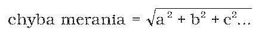

Príloha MI-003 k nariadeniu vlády č. 294/2005 Z. z.

- Elektromery

- Pre elektromery na meranie činnej elektrickej energie v domácnostiach, v ľahkom priemysle a na komerčné účely platia základné požiadavky uvedené v prílohe č. 1, osobitné požiadavky a postupy posudzovania zhody uvedené v tejto prílohe.

- Elektromery sa môžu používať v kombinácii s externými meracími transformátormi podľa použitej meracej techniky. Táto príloha sa týka len elektromerov.

- Definície

- Elektromer je prístroj na meranie činnej elektrickej energie spotrebovanej v elektrickom obvode,

- I elektrický prúd pretekajúci cez elektromer,

- Inšpecifikovaný menovitý prúd, pre ktorý bol elektromer s transformátorom navrhnutý,

- Istnajmenšia hodnota prúdu I, pri ktorej elektromer zaznamenáva činnú elektrickú energiu pri jednotkovom účinníku (pri viacfázových elektromeroch so súmerným zaťažením),

- Iminhodnota prúdu I, nad ktorou musí byť chyba elektromera v hraniciach najväčších dovolených chýb (pri viacfázových elektromeroch so súmerným zaťažením),

- Itrhodnota prúdu I, nad ktorou musí byť chyba elektromera v hraniciach najmenšej hodnoty najväčšej dovolenej chyby zodpovedajúcej označeniu triedy elektromera,

- Imaxmaximálna hodnota prúdu I, pri ktorej je chyba elektromera v hraniciach najväčšej dovolenej chyby,

- U elektrické napätie privádzané do elektromera,

- Unšpecifikované menovité napätie,

- f frekvencia napätia privádzaného do elektromera,

- fnšpecifikovaná menovitá frekvencia,

- PF účinník = cos φ = kosínus fázového posunu φ medzi I a U.

- Osobitné požiadavky

- 1. Presnosť

  - Výrobca musí špecifikovať triedu elektromerov. Triedy sú definované ako trieda A, B a C.

- 2. Predpísané pracovné podmienky

  - Výrobca musí špecifikovať pracovné podmienky pre elektromer, a to

  - hodnoty fn, Un, In, Ist, Imin, Itra Imax, platné pre elektromer; pre stanovené prúdy musí elektromer spĺňať podmienky uvedené v tabuľke č. 1.

  - Tabuľka č. 1

- | Trieda A | Trieda B | Trieda C

- Pre priamo pripojené elektromery | | |

- Ist | ≤ 0,05 . Itr | ≤ 0,04 . Itr | ≤ 0,04 . Itr

- Imin | ≤ 0,5 . Itr | ≤ 0,5 . Itr | ≤ 0,3 . Itr

- Imax | ≥ 50 . Itr | ≥ 50 . Itr | ≥ 50 . Itr

- Pre elektromery pracujúce s transformátorom | | |

- Ist | ≤ 0,06 . Itr | ≤ 0,04 . Itr | ≤ 0,02 . Itr

- Imin | ≤ 0,4 . Itr | ≤ 0,2 . Itr*) | ≤ 0,2 . Itr

- In | 20 . Itr | 20 . Itr | 20 . Itr

- Imax | ≥ 1,2 . In | ≥ 1,2 . In | ≥ 1,2 . In

  - *) Pre elektromechanické elektromery triedy B platí Imin ≤ 0,4 . Itr.

  - Rozsahy napätia, frekvencie a účinníka, v rámci ktorých musí elektromer spĺňať požiadavky na najväčšie dovolené chyby, sú špecifikované v tabuľke č. 2. Tieto rozsahy musia zohľadňovať typické charakteristiky elektrickej energie dodávanej verejnými distribučnými systémami.

  - Rozsah pre napätie a frekvenciu musí byť aspoň

  - 0,9 . Un≤ U ≤ 1,1 . Un,

  - 0,98 . fn ≤ f ≤ 1,02. fn.

  - Rozsah účinníka najmenej od cos φ = 0,5 – indukčný do cos φ = 0,8 – kapacitný.

- 3. Najväčšie dovolené chyby

  - Vplyv rôznych meraných veličín a ovplyvňujúcich veličín (a, b, c...) sa vyhodnocuje samostatne, pričom všetky ostatné merané veličiny a ovplyvňujúce veličiny sa udržujú relatívne konštantné na svojich referenčných hodnotách. Chyba merania, ktorá nesmie prekročiť najväčšiu dovolenú chybu z tabuľky č. 2, sa vypočíta ­po­dľa vzorca:

  - 

  - Ak elektromer pracuje pri kolísavom prúdovom zaťažení, percentuálne chyby nesmú prekročiť medzné hodnoty uvedené v tabuľke č. 2.

  - Tabuľka č. 2

  - Najväčšie dovolené chyby v percentách pri predpísaných pracovných podmienkach, definovaných úrovniach prúdového zaťaženia a pracovnej teplote.

  - | Pracovné teploty | | | Pracovné teploty | | | Pracovné teploty | | | Pracovné teploty | |

  - | +5 °C ...+30 °C | | | -10 °C ... + 5 °C alebo +30 °C ...+40 °C | | | -25 °C ... –10 °C alebo +40 °C ...+55 °C | | | -40 °C ... -25 °C alebo +55 °C ...+70 °C | |

  - Trieda elektromera | A | B | C | A | B | C | A | B | C | A | B | C

  - Jednofázový elektromer, viacfázový elektromer so súmerným zaťažením | | | | | | | | | | | |

  - Imin ≤ I < Itr | 3,5 | 2 | 1 | 5 | 2,5 | 1,3 | 7 | 3,5 | 1,7 | 9 | 4 | 2

  - Itr ≤ I ≤ Imax | 3,5 | 2 | 0,7 | 4,5 | 2,5 | 1 | 7 | 3,5 | 1,3 | 9 | 4 | 1,5

  - Viacfázový elektromer so zaťažením v jednej fáze | | | | | | | | | | | |

  - Itr ≤ I ≤ Imax(pozri výnimku) | 4 | 2,5 | 1 | 5 | 3 | 1,3 | 7 | 4 | 1,7 | 9 | 4,5 | 2

  - Pre elektromechanické viacfázové elektromery je rozpätie prúdu pre jednofázové zaťaženie limitované na 5Itr ≤ I ≤ Imax.

  - Pri elektromere nesmie dochádzať k zneužívaniu najväčšej dovolenej chyby ani k systematickému zvýhodňovaniu niektorej zo strán.

- 4. Prípustný vplyv rušenia

- 4.1 Všeobecné údaje

  - Elektromery sú priamo pripojené na zdroj elektrického prúdu a sieťový prúd je tiež jednou z meraných veličín; pre elektromery platí špeciálne elektromagnetické prostredie.

  - Elektromery musia vyhovovať elektromagnetickému prostrediu triedy E2 a ďalším požiadavkám bodov 4.2 a 4.3.

  - Elektromagnetické prostredie a prípustné vplyvy zohľadňujú stav, keď ide o dlhodobé rušenie, ktoré nesmie ovplyvniť presnosť nad kritickými hodnotami zmeny, a ďalej prechodové javy, ktoré môžu spôsobiť dočasný pokles alebo stratu funkčnosti alebo výkonu, po ktorých ukončení však elektromer musí obnoviť funkčnosť a výkon tak, aby nedošlo k ovplyvneniu presnosti nad kritickými hodnotami zmeny.

  - Ak sa dá predpokladať vysoké riziko nesplnenia podmienky v dôsledku búrok alebo na miestach s prevažujúcim nadzemným elektrickým vedením, musia byť metrologické vlastnosti elektromera chránené.

- 4.2 Vplyv dlhodobého rušenia

  - Tabuľka č. 3 – Kritické hodnoty zmeny pre dlhodobé rušenie

- Rušenie | Kritické hodnoty zmeny v percentách pre elektromery triedy | |

- | A | B | C

- Obrátený sled fáz | 1,5 | 1,5 | 0,3

- Napäťová asymetria (platí len pre viacfázové elektromery) | 4 | 2 | 1

- Harmonické zložky v prúdových obvodoch*) | 1 | 0,8 | 0,5

- Jednosmerné zložky a harmonické zložky v prúdovom obvode*) | 6 | 3 | 1,5

- Rýchle prechodové javy | 6 | 4 | 2

- Magnetické polia; vysokofrekvenčné (vyžarované) elektromagnetické pole; rušenie indukované vysokofrekvenčnými poľami; odolnosť proti oscilačným vlnám | 3 | 2 | 1

  - *) V prípade elektromagnetických elektromerov sa pre harmonické zložky v prúdových obvodoch a jednosmerné zložky v prúdových obvodoch kritické hodnoty zmeny nedefinujú.

- 4.3 Prípustný vplyv prechodových elektromagnetických javov

- 4.3.1 V prípade pôsobenia elektromagnetického rušenia na elektromer môže byť jeho rozsah počas rušenia a tesne po ňom taký,

  - a) aby žiaden výstup určený na skúšanie presnosti elektromeru nevykazoval impulzy alebo signály zodpovedajúce energii väčšej, ako je kritická hodnota zmeny, pričom elektromer musí v primeranom čase po rušení

  - b) začať pracovať v medziach najväčších dovolených chýb,

  - c) musí mať zabezpečené všetky funkcie,

  - d) musia sa dať obnoviť všetky údaje o meraní existujúce pred vznikom rušivého pôsobenia,

  - e) elektromer nesmie vykázať zmeny v zaregistrovanej energii v rozdiele väčšom, ako je kritická hodnota zmeny.

    - Kritická hodnota zmeny vyjadrená v kWh je m . Un . Imax . 10-6, kde m je počet meracích prvkov elektromera, Un vo voltoch a Imax v ampéroch.

- 4.3.2 Pre prúdové preťaženie platí kritická hodnota zmeny 1,5 %.

- 5. Vhodnosť

- 5.1 Pri napätí nižšom, ako je hodnota predpísaného pracovného napätia, nesmie kladná chyba elektromera prekročiť 10 %.

  - 5.2 Indikačné zariadenie musí mať dostatočné množstvo číselných miest na to, aby sa indikácia nevrátila na pôvodnú hodnotu, a to až do 4 000 hodín prevádzky elektromeru pri plnom zaťažení (I = Imax, U = Un a PF = 1). ­Počas používania sa indikačné zariadenie nesmie dať vynulovať.

- 5.3 Po prerušení dodávky elektrického prúdu v sieti musí namerané množstvo elektrickej energie zostať dostupné na odčítanie najmenej štyri mesiace.

- 5.4 Stav pod napätím

  - Ak pri pôsobení napätia je prúdový obvod bez prúdu (elektrický obvod je otvorený), elektromer nesmie zaznamenávať energiu pri žiadnej z napäťových hodnôt od 0,8 . Un až 1,1 . Un.

- 5.5 Nábeh

  - Elektromer musí začať zaznamenávať energiu a pokračovať v jej zaznamenávaní pri Una PF = 1 (viacfázový elektromer so súmerným zaťažením) a prúde, ktorý je rovnaký ako Ist.

- 6. Meracie jednotky

  - Nameraná elektrická energia sa musí udávať v kilowatthodinách alebo megawatthodinách.

- 7. Uvedenie do používania

  - a) Meranie spotreby elektrickej energie v domácnosti sa musí vykonať ľubovoľným elektromerom triedy A. Na osobitné účely možno požadovať ľubovoľný elektromer triedy B.

  - b) Meranie spotreby na komerčné účely a/alebo v rámci ľahkého priemyslu sa musí uskutočniť ľubovoľným elektromerom triedy B. Na osobitné účely možno požadovať ľubovoľný elektromer triedy C.

  - c) Distribútor alebo osoba, ktorá je zo zákona oprávnená inštalovať elektromery, definuje ich vlastnosti tak, aby elektromer bol vhodný na presné meranie predpokladanej alebo predpokladateľnej spotreby.

    - Posudzovanie zhody

    - Pri posudzovaní zhody si môže výrobca vybrať z týchto postupov: B+F alebo B+D, alebo H1.
