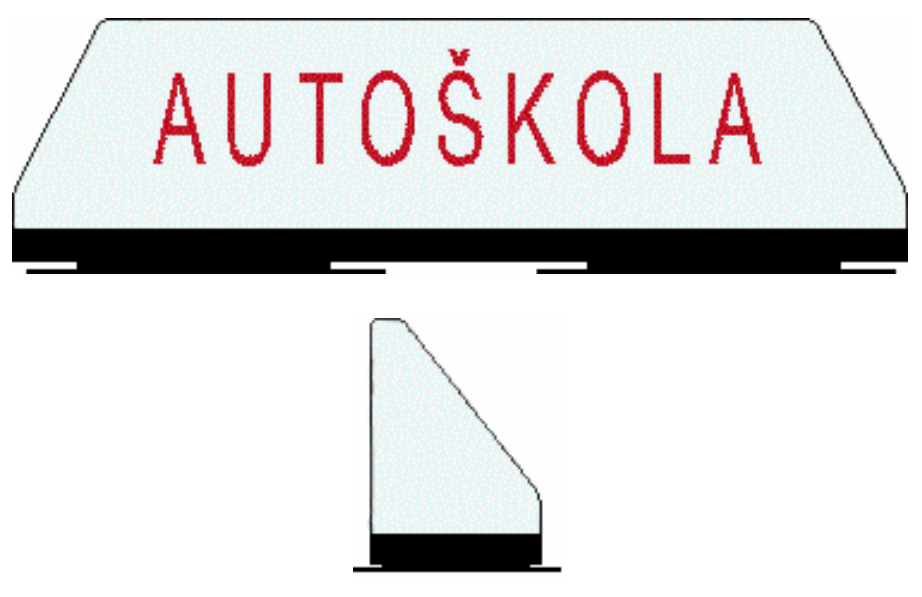
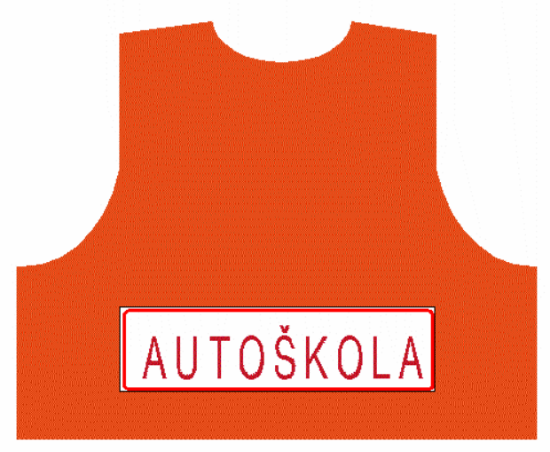
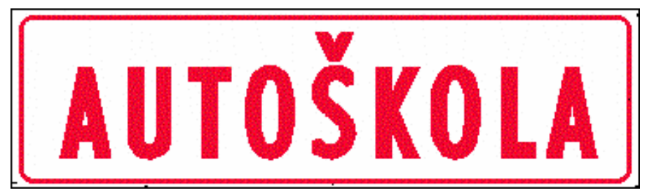

Príloha č. 1 k vyhláške Ministerstva dopravy, pôšt a telekomunikácií Slovenskej republiky č. 349/2005 Z. z.

- Vzory označovania výcvikových vozidiel Odnímateľný transparent určený na označenie výcvikových vozidiel

- 

- Vesta určená na označenie osôb pri výcviku v praktickej jazde v cestnej premávke na výcvikových motocykloch

- 

- Odnímateľná fólia určená na označenie výcvikových vozidiel

- 
