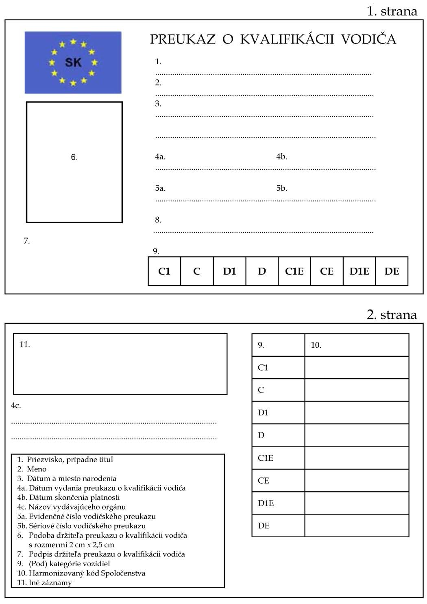

Príloha č. 4 k vyhláške Ministerstva dopravy, pôšt a telekomunikácií Slovenskej republiky č. 349/2005 Z. z.

- Vzor preukazu o kvalifikácii vodiča 

- Informácie špecifické pre vydaný preukaz o kvalifikácii vodiča sú očíslované takto:

  - 1. priezvisko, prípadne titul,

  - 2. meno,

  - 3. dátum a miesto narodenia,

  - 4a. dátum vydania preukazu o kvalifikácii vodiča,

  - 4b. dátum skončenia platnosti,

  - 4c. názov vydávajúceho orgánu,

  - 5a. evidenčné číslo vodičského preukazu,

  - 5b. sériové číslo vodičského preukazu,

  - 6. podoba držiteľa preukazu o kvalifikácii vodiča s rozmermi 2 cm 2,5 cm,

  - 7. podpis držiteľa preukazu o kvalifikácii vodiča,

  - 9. (pod)kategórie vozidiel, pre ktoré vodič spĺňa požiadavky na základnú kvalifikáciu a pravidelný výcvik,

  - 10. harmonizovaný kód Spoločenstva,

  - 11. iné záznamy.
