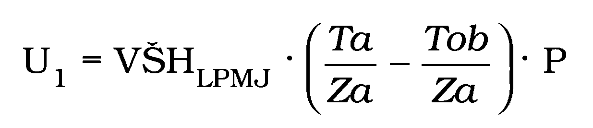
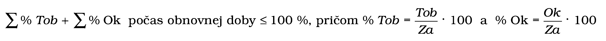
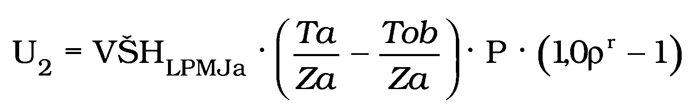
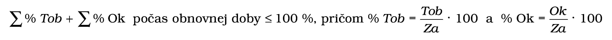
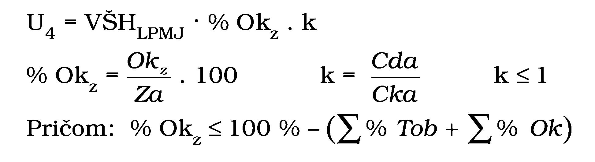

Príloha č. 2 k nariadeniu vlády č. 438/2005 Z. z.

- SPÔSOB VÝPOČTU NÁHRADY ZA OBMEDZENIE BEŽNÉHO OBHOSPODAROVANIA NA LESNOM POZEMKU

  - A. Spôsob výpočtu náhrady za stratu alebo zníženie výnosu z dreva v územiach so zákazom ťažby, prípadne s výnimočným povolením ťažby

- 

- Použije sa pre územia s trvalým zákazom vykonávania hospodárskych činností (5. stupeň ochrany prírody).

- Pri obnovných ťažbách počas obnovnej doby platí:

- 

  - B. Spôsob výpočtu náhrady za zníženie výnosu z dreva v porastoch s obmedzeným predpisom obnovnej ťažby s predĺženou rubnou dobou, dočasným zákazom ťažby, odsunom ťažieb a pod., mimo území s trvalým zákazom ťažby (5. stupeň ochrany prírody) - podľa bodu A

- 

- Použije sa pre územia s požadovanou zníženou intenzitou úmyselných ťažieb alebo s dočasným zákazom zasahovania do porastu.

- Napríklad: Predĺženie obnovnej doby, predĺženie rubnej doby, odsun ťažieb oproti bežnému obhospodarovaniu z dôvodu druhovej ochrany, ochrany biotopov.

- Pri obnovných ťažbách platí:

- 

  - C. Spôsob výpočtu náhrady za zvýšenie nákladov na bežné obhospodarovanie porastu

- U3,1 = (Nob1- Nb1) . Taz

- -

- pre prípady, keď sa zvýšené náklady vypočítavajú cez zrealizovaný objem drevnej hmoty,

- U3,2 =(Nob2- Nb2) . Pz

- -

- pre prípady, keď sa zvýšené náklady vypočítavajú cez plochu na ktorej sa realizoval zásah.

- Pri výpočte sa vychádza z podkladov dokladujúcich skutočné náklady pri požadovanom spôsobe obhospodarovania, prípadne vykonania činnosti. Náklady pri bežnom spôsobe obhospodarovania prípadne, vykonania činnosti sa odvodia z prevádzkových nákladov v podobných podmienkach pri rovnakých činnostiach.

  - D. Spôsob výpočtu náhrady v prípade mimoriadnych okolností prírodných kalamít

- 

  - E. Iné možnosti výpočtu

- Znalec použije iný postup výpočtu, keď možno náhradu stanoviť objektívnejšie inou metodikou presnejšie zodpovedajúcou skutočnosti.

  - F. Spôsob výpočtu celkovej hodnoty náhrady za obmedzenie bežného obhospodarovania

- V opodstatnených prípadoch je možná aj kombinácia jednotlivých čiastkových úhrad vypočítaných podľa vzorcov U1....U4. Suma jednotlivých čiastkových úhrad sa zníži o vyplatené dotácie, príspevky a oslobodenia od daní. K výslednej hodnote náhrady za obmedzenie bežného obhospodarovania sa pripočíta vyúčtovanie nákladov za vypracovanie znaleckého posudku stanovené podľa osobitného predpisu.1)

- U5 = (U1...+...U4) – (Ksp + Da) + Z

- Význam premenných (symbolov) vo vzorcoch

- Un,m – vzorce výpočtu náhrady, n – druh obmedzenia bežného obhospodarovania, m – poradie vzorcov na výpočet daného druhu obmedzenia bežného obhospodarovania,

- VŠHLPMJ – jednotková všeobecná hodnota lesného porastu v Sk/ha v skutočnom veku porastu vypočítaná podľa osobitného predpisu,2)

- Ta - objem plánovaných výchovných alebo obnovných ťažieb podľa bežného obhospodarovania,

- Tob - objem obmedzených výchovných alebo obnovných ťažieb,

- Ok - objem kalamitného dreva v m3,

- Za - zásoba lesného porastu,

- P - plocha lesného porastu v ha,

- ∑%Tob – suma % obnovnej ťažby, ktorú bolo umožnené vykonať (aj v predošlých decéniách obnovnej doby) + percento obnovnej ťažby, ktorú nebolo umožnené vykonať, ale za ktorú bola vyplatená náhrada v predošlých decéniách obnovnej doby,

- ∑%OK – suma % náhodnej ťažby, ktorú bolo umožnené vykonať + percento náhodnej ťažby, ktorú nebolo umožnené vykonať, ale za ktorú bola vyplatená náhrada v predošlých decéniách,

- VŠHLPMJa – jednotková všeobecná hodnota lesného porastu v Sk/ha vo veku v čase schválenia lesného hospodárskeho plánu (ďalej len „LHP“) vypočítaná podľa osobitného predpisu,2)

- ρ – 3-percentná úroková sadzba,

- r - platnosť LHP v rokoch alebo dĺžka obmedzenia v rokoch v rámci LHP (ak obmedzenie netrvalo celé obdobie platnosti LHP),

- Nob1 - celkové jednotkové náklady pri požadovanom (obmedzenom) spôsobe obhospodarovania v Sk/m3,

- Nob2 - celkové jednotkové náklady pri požadovanom (obmedzenom) spôsobe obhospodarovania v Sk/ha,

- Nb1 - celkové jednotkové náklady bežného spôsobu obhospodarovania v Sk/m3,

- Nb2 - celkové jednotkové náklady bežného spôsobu obhospodarovania v Sk/ha,

- Taz - objem ťažby so zvýšenými nákladmi v m3,

- Pz - plocha zásahu so zvýšenými nákladmi v ha,

- % Okz - percento náhodnej ťažby, ktorú nebolo umožnené vykonať,

- Okz - objem náhodnej ťažby v m3, ktorú nebolo umožnené vykonať,

- k - koeficient zníženia hodnoty kalamitného dreva,

- Cda - trhová cena dreva na pni,

- Cka - trhová cena kalamitného dreva na pni,

- Ksp - vyplatené dotácie alebo príspevky z podporných fondov vzťahujúce sa na predmet ujmy a obdobie, na ktoré sa ujma uplatňuje podľa § 1 ods. 2 písm. j) a k) nariadenia vlády,

- Da - oslobodenie od dane z nehnuteľností pozemkov, ktoré sú predmetom náhrady za obmedzenie bežného obhospodarovania, o ktorú bol žiadateľ oslobodený, za obdobie, na ktoré si uplatňuje náhradu ujmy,

- Z - náklady na vyhotovenie znaleckého posudku (v Sk).
