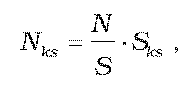

# § 5

Rozpočítavanie množstva dodaného tepla za dodávku tepla na vykurovanie podľa podlahovej plochy bytu a nebytového priestoru

(1) Ak v objekte rozpočítavania nie sú zapojené pomerové rozdeľovače tepla ani určené meradlá1) tepla u konečných spotrebiteľov podľa osobitného predpisu,6) náklady na dodané teplo na vykurovanie sa rozpočítavajú konečným spotrebiteľom v pomere podlahovej plochy bytu, nebytových priestorov a spoluvlastníckeho podielu na spoločných priestoroch konečného spotrebiteľa k celkovej podlahovej ploche všetkých bytov, nebytových priestorov a spoločných priestorov v objekte rozpočítavania podľa vzorca

kde predstavuje

Nks - náklady pre konečného spotrebiteľa [euro],

N - náklady na dodané teplo na vykurovanie za objekt rozpočítavania [euro],

S - celkovú podlahovú plochu bytov, vykurovaných nebytových priestorov a spoločných priestorov [m2],

Sks - podlahovú plochu bytu, vykurovaného nebytového priestoru a spoluvlastníckeho podielu na spoločných priestoroch konečného spotrebiteľa [m2].

(2) Ak sú v objekte rozpočítavania aj byty alebo nebytové priestory s individuálnym vykurovaním, náklady za dodané teplo na vykurovanie sa rozdelia na základnú zložku a spotrebnú zložku, pričom základná zložka tvorí 10 % a spotrebná zložka 90 % z celkových nákladov. Obidve zložky sa rozpočítavajú konečným spotrebiteľom v pomere podlahovej plochy bytu, nebytových priestorov a spoluvlastníckeho podielu na spoločných priestoroch konečného spotrebiteľa k celkovej podlahovej ploche všetkých bytov, nebytových priestorov a spoločných priestorov v objekte rozpočítavania, pričom základná zložka nákladov sa rozpočítava aj medzi užívateľov bytov a nebytových priestorov s individuálnym vykurovaním okrem prípadov, keď byt alebo nebytový priestor s individuálnym vykurovaním má polohu podľa § 7 ods. 3 písm. a).

(3) Náklady na dodané teplo do spoločných priestorov sa rozpočítavajú konečným spotrebiteľom podľa spoluvlastníckeho podielu na spoločných priestoroch podľa odseku 1.

(4) Ustanovenie odseku 3 sa neuplatňuje, ak sa spoločné priestory využívajú inak ako na účel, na ktorý sa zriadili, a nevyužívajú sa v prospech všetkých konečných spotrebiteľov. V takom prípade sa náklady na dodané teplo do spoločných priestorov rozpočítavajú podľa podlahovej plochy bytu a nebytových priestorov tým konečným spotrebiteľom, ktorí spoločné priestory využívajú len na osobnú potrebu na základe dohody s vlastníkmi bytov a nebytových priestorov.

(5) Ak počas zúčtovacieho obdobia došlo k zmene konečného spotrebiteľa, náklady na dodané teplo na vykurovanie a na prípravu teplej úžitkovej vody podľa § 4 ods. 3 sa konečnému spotrebiteľovi rozpočítavajú v pomere nákladov na dodané teplo podľa jednotlivých mesiacov k celkovým nákladom na dodané teplo za zúčtovacie obdobie podľa prílohy č. 1 alebo v pomere počtu dennostupňov v jednotlivých mesiacoch k celkovému počtu dennostupňov za zúčtovacie obdobie, ak sa koneční spotrebitelia nedohodnú inak.

(6) Ak sa vlastníci bytov a nebytových priestorov dohodnú podľa osobitného predpisu7) inak, rozpočítavanie množstva dodaného tepla na vykurovanie podľa odsekov 1 až 5 sa neuplatňuje.
