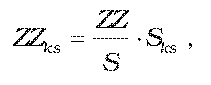
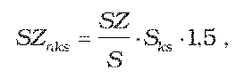
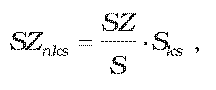
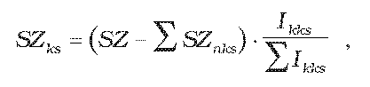

# § 7 Rozpočítavanie množstva dodaného tepla na vykurovanie podľa pomerových rozdeľovačov tepla alebo určených meradiel tepla

(1) Ak sú v objekte rozpočítavania zapojené pomerové rozdeľovače tepla rovnakého typu alebo určené meradlá1) tepla rovnakej triedy presnosti na meranie množstva tepla u konečných spotrebiteľov, náklady na množstvo dodaného tepla na vykurovanie sa rozdelia na základnú zložku a spotrebnú zložku. Základná zložka tvorí 60 % a spotrebná zložka 40 % z celkových nákladov na dodané teplo na vykurovanie.

(2) Základná zložka sa rozpočítava konečným spotrebiteľom podľa podlahovej plochy bytu, nebytových priestorov a spoluvlastníckeho podielu na spoločných priestoroch konečného spotrebiteľa a priemeru základnej zložky na meter štvorcový vypočítaného z podlahovej plochy všetkých bytov, nebytových priestorov a spoločných priestorov v objekte rozpočítavania podľa vzorca

kde predstavuje

ZZks - základnú zložku pre konečného spotrebiteľa [euro],

ZZ - základnú zložku [euro],

S - celkovú upravenú podlahovú plochu bytov, nebytových priestorov a spoločných priestorov [m2],

Sks - upravenú podlahovú plochu bytu, nebytového priestoru a spoluvlastníckeho podielu na spoločných priestoroch konečného spotrebiteľa [m2].

(3) Základná zložka na dodané teplo podľa odseku 2 sa rozpočítava aj medzi užívateľov bytov a nebytových priestorov, ktorí majú individuálne vykurovanie, pričom podlahová plocha bytu alebo nebytového priestoru s individuálnym vykurovaním sa vynásobí koeficientom

- a) 0,0 pri bytoch a nebytových priestoroch v nadstavbách a vstavbách do podkrovia, pri bytoch a nebytových priestoroch alebo ich častiach, ktoré sa nachádzajú na najvyššom podlaží alebo nad priestormi, ktoré nie sú vykurované, alebo v tých bytoch a nebytových priestoroch s individuálnym vykurovaním, cez ktoré neprechádzajú rozvody vykurovacej sústavy centrálneho zásobovania teplom,

- b) 0,25 pri ostatných bytoch a nebytových priestoroch s individuálnym vykurovaním.

(4) Konečnému spotrebiteľovi, ktorý nemá zapojené pomerové rozdeľovače tepla alebo určené meradlo1) tepla, alebo odmietol umožniť vykonať ich odčítanie, alebo neoprávnene do nich zasahoval, čím spôsobil ich nesprávnu funkciu, alebo ich poškodil, sa určí spotrebná zložka ako súčin 1,5 násobku priemeru spotrebnej zložky na meter štvorcový vypočítaný z podlahovej plochy všetkých vykurovaných bytov, nebytových priestorov a spoločných priestorov a podlahovej plochy vykurovaného bytu, nebytového priestoru a spoluvlastníckeho podielu na spoločných priestoroch konečného spotrebiteľa podľa vzorca

kde predstavuje

SZnks - spotrebnú zložku pre konečného spotrebiteľa určenú náhradným výpočtom [euro],

SZ - spotrebnú zložku [euro],

S - celkovú podlahovú plochu vykurovaných bytov, nebytových priestorov a spoločných priestorov [m2],

Sks - podlahovú plochu vykurovaného bytu, nebytového priestoru a spoluvlastníckeho podielu na spoločných priestoroch konečného spotrebiteľa [m2].

(5) V prípade poruchy pomerových rozdeľovačov tepla alebo určeného meradla1) tepla, alebo ak konečný spotrebiteľ neúmyselne neumožnil ich odčítanie, spotrebná zložka sa konečnému spotrebiteľovi určí ako súčin priemeru spotrebnej zložky na meter štvorcový a podlahovej plochy vykurovaného bytu, nebytového priestoru a spoluvlastníckeho podielu na spoločných priestoroch konečného spotrebiteľa podľa vzorca

kde predstavuje

SZnks - spotrebnú zložku pre konečného spotrebiteľa určenú náhradným výpočtom [euro],

SZ - spotrebnú zložku [euro],

S - celkovú podlahovú plochu vykurovaných bytov, nebytových a spoločných priestorov [m2],

Sks - podlahovú plochu vykurovaného bytu, nebytového priestoru a spoluvlastníckeho podielu na spoločných priestoroch konečného spotrebiteľa [m2].

(6) Rozdiel nákladov spotrebnej zložky a nákladov určených náhradným spôsobom podľa odsekov 4 a 5 sa rozpočítava medzi konečných spotrebiteľov podľa indikovaných údajov pomerových rozdeľovačov tepla alebo určených meradiel tepla s použitím korekcií, ktoré zohľadňujú nepriaznivú polohu miestnosti bytu alebo nebytového priestoru konečného spotrebiteľa podľa prílohy č. 2, ak sa koneční spotrebitelia nedohodnú podľa osobitného predpisu7) inak, alebo metódou, ktorá priamo zohľadňuje nepriaznivú polohu miestnosti. Spotrebná zložka pre jedného konečného spotrebiteľa sa určí v pomere súčtu korigovaných indikovaných údajov pomerových rozdeľovačov tepla alebo určených meradiel tepla konečného spotrebiteľa k celkovému súčtu korigovaných indikovaných údajov v objekte rozpočítavania podľa vzorca

kde predstavuje

SZks - spotrebnú zložku pre konečného spotrebiteľa [euro],

SZ - spotrebnú zložku [euro],

∑SZnks - súčet nákladov na spotrebnú zložku určených náhradným spôsobom [euro],

Ikks - korigované indikované údaje pomerových rozdeľovačov tepla alebo určených meradiel tepla konečného spotrebiteľa [–, kWh ],

∑Ikks - súčet všetkých korigovaných indikovaných údajov pomerových rozdeľovačov tepla alebo určených meradiel tepla v objekte rozpočítavania [–, kWh].

(7) Náklady na dodané teplo do spoločných priestorov určené podľa odsekov 2 až 6 sa rozpočítavajú medzi všetkých konečných spotrebiteľov podľa spoluvlastníckeho podielu na spoločných priestoroch.

(8) Ak sa spoločné priestory využívajú inak ako na účel, na ktorý sa zriadili, a nevyužívajú sa v prospech všetkých konečných spotrebiteľov, ustanovenie odseku 7 sa neuplatňuje. V takom prípade sa náklady na dodané teplo do spoločných priestorov rozpočítavajú podľa podlahovej plochy bytu a nebytových priestorov tým konečným spotrebiteľom, ktorí spoločné priestory využívajú len na osobnú potrebu na základe dohody s ostatnými vlastníkmi.

(9) Ak sa v priebehu kalendárneho roka zmení cena tepla, na rozpočítavanie spotrebnej zložky ku dňu účinnosti novej ceny tepla sa použijú pomerné množstvá z celoročných indikovaných údajov pomerových rozdeľovačov tepla alebo určených meradiel tepla podľa prílohy č. 1 alebo sa zabezpečí archivácia údajov alebo odčítanie pomerových rozdeľovačov tepla alebo určených meradiel tepla.

(10) Ak sa vlastníci bytov a nebytových priestorov dohodnú podľa osobitného predpisu7) inak, rozpočítavanie množstva dodaného tepla na vykurovanie podľa odsekov 1 až 9 sa neuplatňuje.
