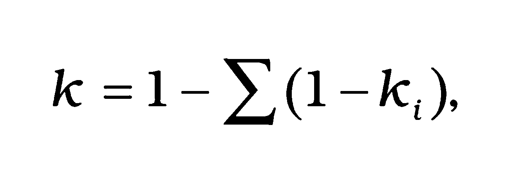

Príloha č. 2 k vyhláške č. 630/2005 Z. z Doporučené koeficienty k. zohľadňujúce nepriaznivú polohu miestnosti v objekte rozpočítavania: |

miestnosť s dvoma vonkajšími stenami (rohová miestnosť) | 0,90

miestnosť s dvoma vonkajšími stenami, z ktorých jedna smeruje na sever alebo východ | 0,82

tretia stena susediaca s vonkajším prostredím | 0,93

najvyššie podlažie - plochá strecha | 0,80

najvyššie podlažie - pod nevykurovanou, neupravenou povalou | 0,85

najnižšie podlažie - nad terénom, nevykurovanou pivnicou | 0,80

Pri prípadnej kombinácii nepriaznivých polôh sa výsledný koeficient k zohľadňujúci nepriaznivú polohu miestnosti vypočíta podľa vzorca

kde

k - výsledný koeficient zohľadňujúci nepriaznivú polohu miestnosti,

ki - koeficient zohľadňujúci jednu nepriaznivú polohu miestnosti.
