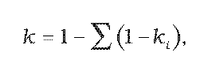

Príloha č. 2 k vyhláške č. 630/2005 Z. z.

- Koeficienty zohľadňujúce nepriaznivú polohu miestnosti

  - (1) Koeficienty ki zohľadňujúce nepriaznivú polohu miestnosti v objekte rozpočítavania:

- a) | miestnosť s dvomi vonkajšími stenami (rohová miestnosť) | 0,90,

- b) | miestnosť s dvomi vonkajšími stenami, z ktorých jedna smeruje na sever alebo východ | 0,82,

- c) | tretia stena susediaca s vonkajším prostredím | 0,93,

- d) | najvyššie podlažie – plochá strecha | 0,80,

- e) | najvyššie podlažie – pod nevykurovanou povalou | 0,85,

- f) | najnižšie podlažie – nad terénom alebo nevykurovanou pivnicou | 0,80.

  - (2) Pri prípadnej kombinácii nepriaznivých polôh sa výsledný koeficient zohľadňujúci nepriaznivú polohu miestnosti vypočíta podľa vzorca

- 

- kde predstavuje

- k - výsledný koeficient zohľadňujúci nepriaznivú polohu miestnosti,

- ki - koeficient zohľadňujúci jednu nepriaznivú polohu miestnosti.
