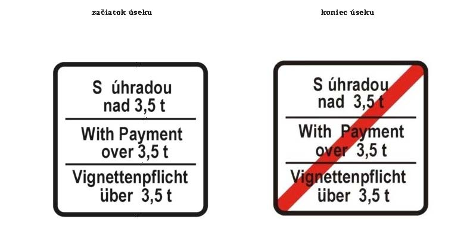
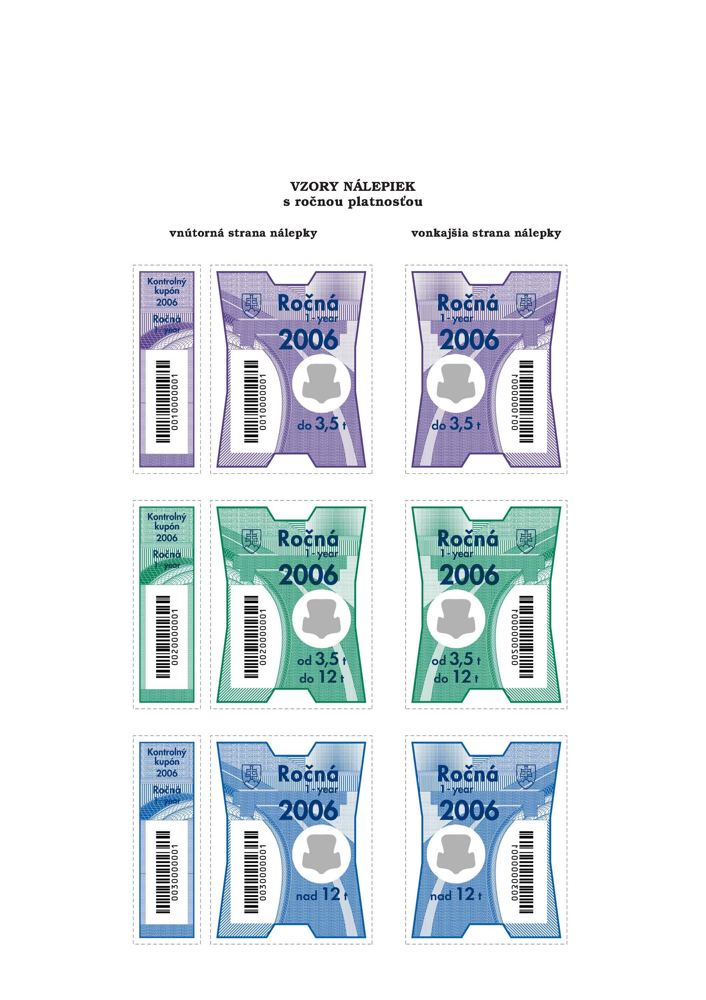
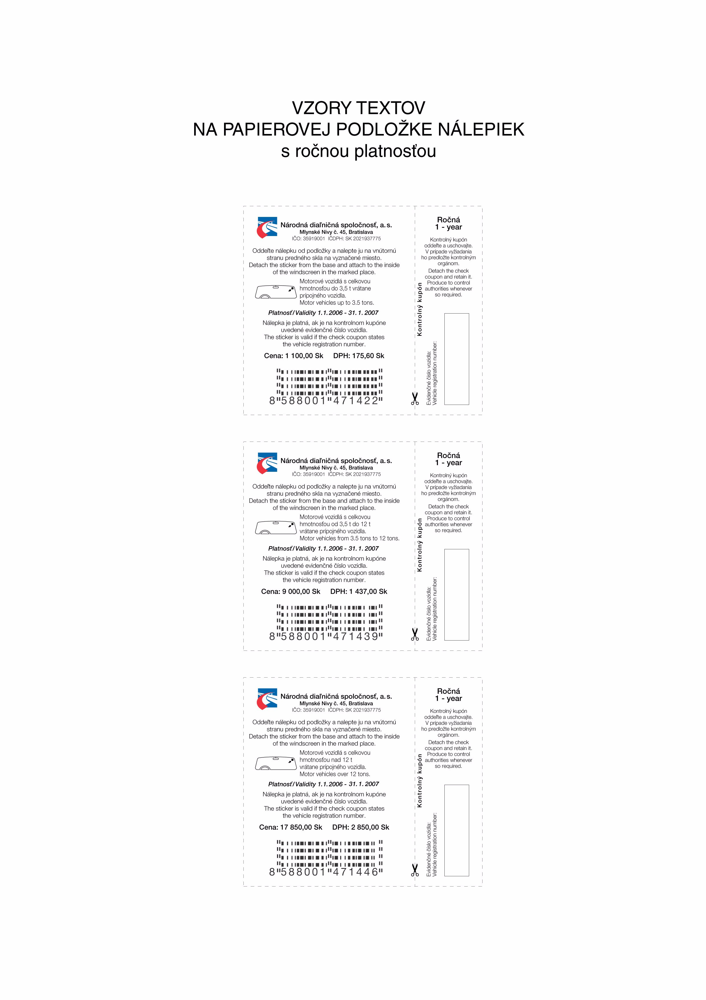
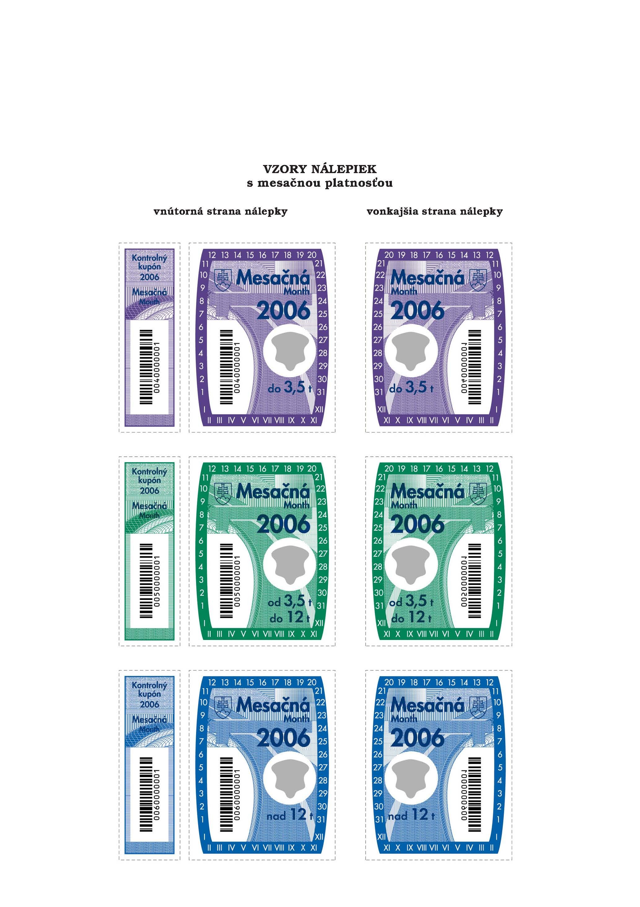
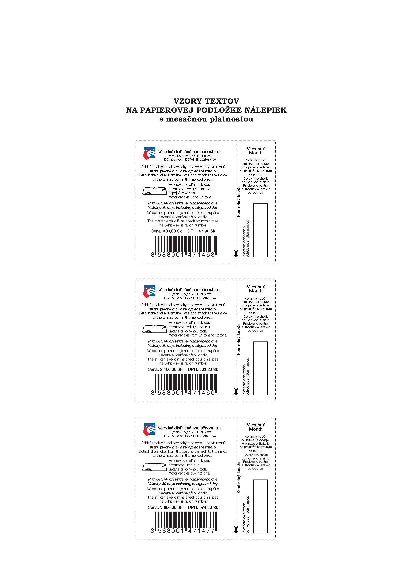
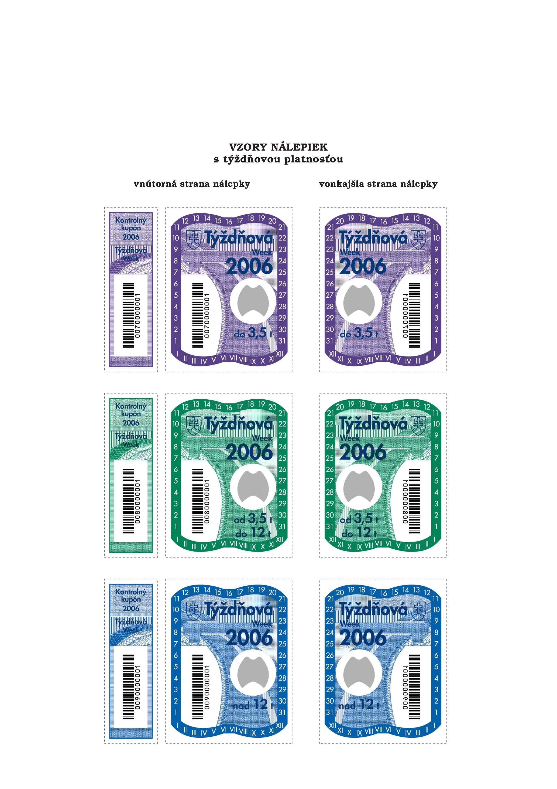
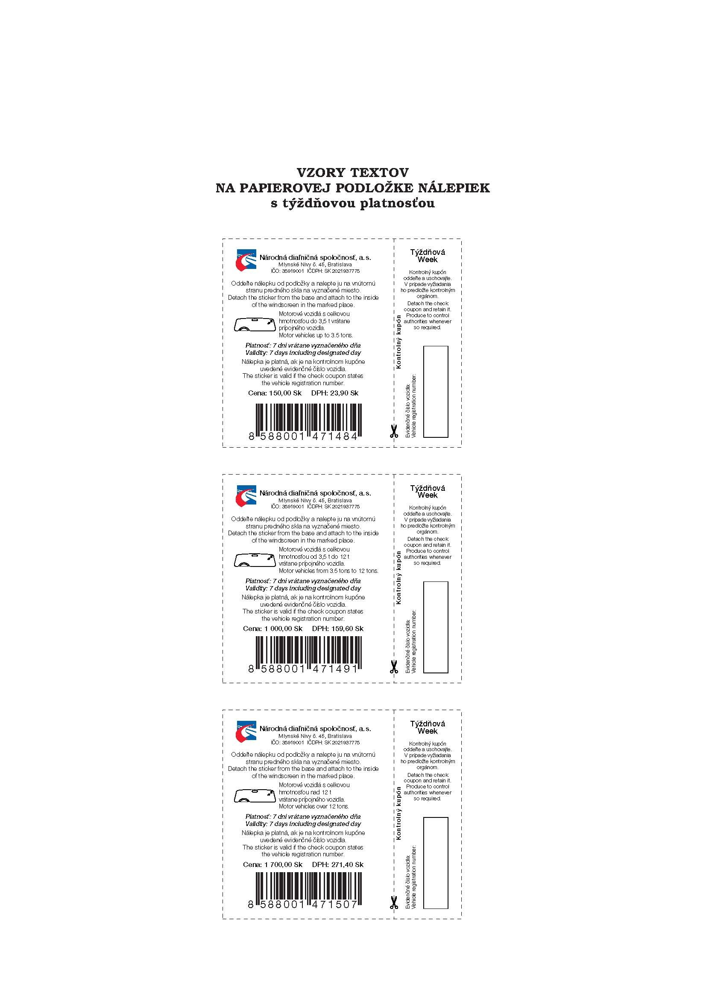
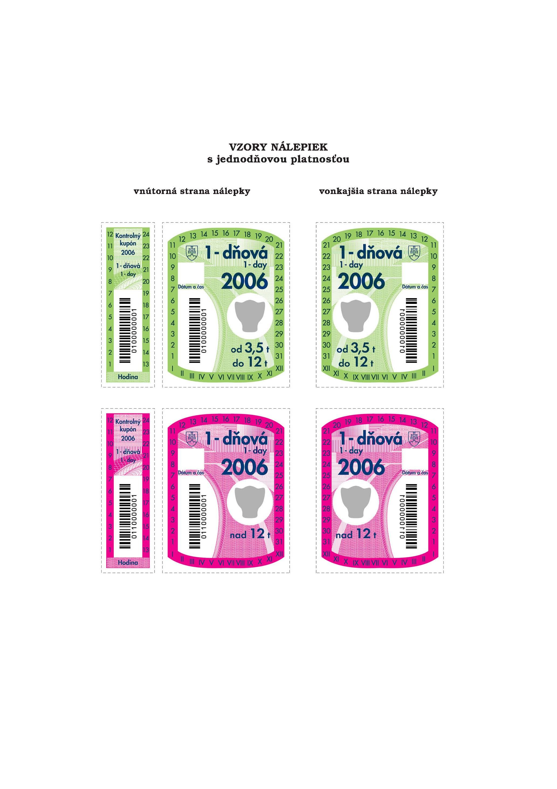
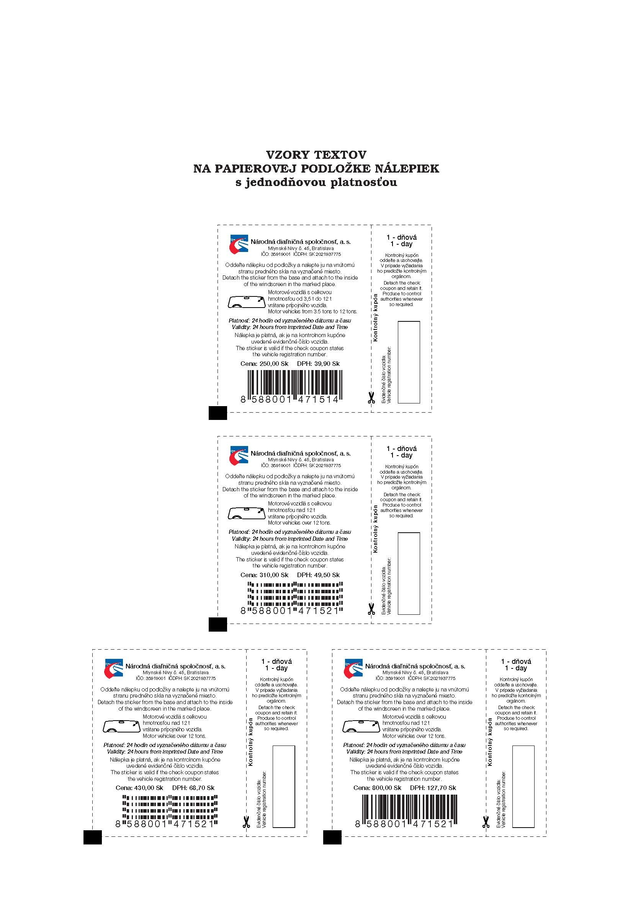

# Čl. I

Vyhláška Ministerstva dopravy, pôšt a telekomunikácií Slovenskej republiky č. 734/2004 Z. z., ktorou sa ustanovuje spôsob označenia úsekov diaľnic, ciest pre motorové vozidlá a ciest I. triedy, ktorých užívanie podlieha úhrade, vzor nálepky a spôsob jej umiestnenia na motorovom vozidle sa mení a dopĺňa takto:

- 1. V § 1 odsek 4 znie:

- „(4)

- Vzor dodatkových tabuliek je uvedený v prílohe č. 1.“.

- 2. V § 4 ods. 2 písmeno a) znie:

- „a)

- miesto na vpísanie evidenčného čísla motorového vozidla,“.

- 3. V § 4 sa za odsek 2 vkladá nový odsek 3, ktorý znie:

- „(3)

- Na podkladovej časti nálepky sú zobrazené

- a)

- logo a názov: Národná diaľničná spoločnosť, a. s.

- Mlynské Nivy č. 45, Bratislava,

- b)

- IČO a IČDPH Sk,

- c)

- cena nálepky a suma dane z pridanej hodnoty,

- d)

- platnosť nálepky,

- e)

- štandardný čiarový kód EAN 13.“.

- Doterajšie odseky 3 až 7 sa označujú ako odseky 4 až 8.

- 4. V § 4 odseky 5 až 8 znejú:

- „(5)

- Vzory nálepiek s ročnou platnosťou a vzory textov na papierovej podložke nálepiek sú uvedené v prílohe č. 2.

- (6)

- Vzory nálepiek s mesačnou platnosťou a vzory textov na papierovej podložke nálepiek sú uvedené v prílohe č. 3.

- (7)

- Vzory nálepiek s týždňovou platnosťou a vzory textov na papierovej podložke nálepiek sú uvedené v prílohe č. 4.

- (8)

- Vzory nálepiek s jednodňovou platnosťou a vzory textov na papierovej podložke nálepiek sú uvedené v prílohe č. 5.“.

- 5. V § 5 ods. 3 sa číslo „20“ nahrádza číslom „68“.

- 6. Prílohy č. 1 až 5 znejú:

- „Príloha č. 1 k vyhláške č. 645/2005 Z. z.

- Vzor dodatkových tabuliek pre spoplatnenie úsekov ciest I. triedy pre vozidlá nad 3,5 t

- 

- Príloha č. 2 k vyhláške č. 645/2005 Z. z.

- VZORY NÁLEPIEK s ročnou platnosťou

- 

- VZORY TEXTOV NA PAPIEROVEJ PODLOŽKE NÁLEPIEK s ročnou platnosťou

- 

- Príloha č. 3 k vyhláške č. 645/2005 Z. z.

- VZORY NÁLEPIEK s mesačnou platnosťou

- 

- VZORY TEXTOV NA PAPIEROVEJ PODLOŽKE NÁLEPIEK s mesačnou platnosťou

- 

- Príloha č. 4 k vyhláške č. 645/2005 Z. z.

- VZORY NÁLEPIEK s týždňovou platnosťou

- 

- VZORY TEXTOV NA PAPIEROVEJ PODLOŽKE NÁLEPIEK s týždňovou platnosťou

- 

- Príloha č. 5 k vyhláške č. 645/2005 Z. z.

- VZORY NÁLEPIEK s jednodňovou platnosťou

- 

- VZORY TEXTOV NA PAPIEROVEJ PODLOŽKE NÁLEPIEK s jednodňovou platnosťou

- 
