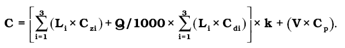
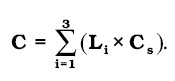
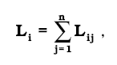

Príloha č. 2 k výnosu č. 654/2005 Z. z.

- MAXIMÁLNE CENY A PODMIENKY REGULÁCIE CIEN ZA POUŽITIE ŽELEZNIČNEJ DOPRAVNEJ CESTY VO VNÚTROŠTÁTNEJ DOPRAVE OSÔB A NÁKLADOV Číselný kód klasifikácie produkcie: | 60.10.1

- | 60.10.2

  - I. Maximálne ceny za použitie železničnej dopravnej cesty vo vnútroštátnej doprave osôb a nákladov

    - A. vlakmi na dopravu osôb

    - | Maximálna cena v eurách bez dane z pridanej hodnoty | |

    - Kategória trate | za vlkm (Cz) | za tis. hrtkm (Cd) | za vlak (Cp)

    - 1. | 1,6179 | 0,7532 | 5,9135

    - 2. | 1,5900 | 0,6695 | 5,9135

    - 3. | 1,4227 | 0,5859 | 5,9135

    - B. vlakmi na dopravu nákladov

    - | Maximálna cena v eurách bez dane z pridanej hodnoty | |

    - Kategória trate | za vlkm (Cz) | za tis. hrtkm (Cd) | za vlak (Cp)

    - 1. | 9,5117 | 0,7811 | 47,4198

    - 2. | 9,4838 | 0,7253 | 47,4198

    - 3. | 6,5273 | 0,6138 | 47,4198

      - Maximálna cena za použitie železničnej dopravnej cesty vo vnútroštátnej doprave vlakmi na dopravu osôb alebo vlakmi na dopravu nákladov sa vypočítava podľa tohto vzorca:

      - 

    - C. samostatnými hnacími dráhovými vozidlami všetkých typov, ktorých pohyb po dráhe súvisí

    - | Maximálna cena v eurách bez dane z pridanej hodnoty za vlkm pre všetky kategórie tratí (Cs)

    - 1. s vlakmi na dopravu osôb | 1,6179

    - 2. s vlakmi na dopravu nákladov | 4,1841

      - Maximálna cena za použitie železničnej dopravnej cesty vo vnútroštátnej doprave pre samostatné hnacie dráhové vozidlá všetkých typov sa pre všetky kategórie tratí vypočítava podľa tohto vzorca:

      - 

      - Vysvetlivky k symbolom použitým v tabuľkách a vo vzorcoch na výpočet maximálnych cien:

    - Vlakové úseky sa zaraďujú do troch kategórií, pričom sa kategórie určujú takto:

    - Číslo vlakového úseku | | Názov | km | Kategória trate

    - 14 | 15 | Čierna nad Tisou štátna hranica – Čierna nad Tisou | 4 | 1

    - 22 | 23 | Čierna nad Tisou – Michaľany | 47 | 1

    - 24 | 25 | Michaľany – Košice (vrátane Barca stavadlo 1 – Košice nákladná stanica – Košice vchodové stavadlo) | 48 | 1

    - 222 | 223 | Košice – Kysak | 16 | 1

    - 224 | 225 | Kysak – Margecany | 19 | 1

    - 226 | 227 | Margecany – Spišská Nová Ves | 40 | 1

    - 232 | 233 | Spišská Nová Ves – Poprad-Tatry | 26 | 1

    - 234 | 235 | Poprad-Tatry – Štrba | 19 | 1

    - 242 | 243 | Štrba – Liptovský Mikuláš | 39 | 1

    - 244 | 245 | Liptovský Mikuláš – Kraľovany | 44 | 1

    - 262 | 263 | Kraľovany – Vrútky | 18 | 1

    - 264 | 265 | Vrútky – Žilina (vrátane odbočka Potok – Žilina – Teplička-odbočka Váh) | 21 | 1

    - 272 | 273 | Žilina – Púchov | 44 | 1

    - 282 | 283 | Žilina – Čadca (vrátane Žilina zriaďovacia stanica – Žilina výhybka č. 144/145) | 30 | 1

    - 312 | 313 | Kysak – Prešov (vrátane odbočka Kysak – Kysak výhybka č. 39/40) | 17 | 1

    - 322 | 323 | Prešov – Plaveč (vrátane odbočka Plaveč – odbočka Orlov) | 55 | 1

    - 332 | 333 | Plaveč – Plaveč štátna hranica | 7 | 1

    - 372 | 373 | Košice – Barca (vrátane Košice vchodová skupina – Barca stavadlo 1) | 5 | 1

    - 382 | 383 | Čaňa – Barca | 8 | 1

    - 394 | 395 | Čaňa štátna hranica – Čaňa | 10 | 1

    - 622 | 623 | Čadca – Skalité | 14 | 1

    - 632 | 633 | Skalité – Skalité štátna hranica | 7 | 1

    - 944 | 945 | Štúrovo štátna hranica – Štúrovo | 14 | 1

    - 952 | 953 | Štúrovo – Nové Zámky | 44 | 1

    - 992 | 993 | Nové Zámky – Palárikovo | 10 | 1

    - 994 | 995 | Palárikovo – Galanta | 32 | 1

    - 996 | 997 | Galanta – Bratislava-Vajnory | 39 | 1

    - 1002 | 1003 | Bratislava-Vajnory – Bratislava hlavná stanica | 10 | 1

    - 1024 | 1025 | Komárno štátna hranica – Komárno | 4 | 1

    - 1032 | 1033 | Komárno – Nové Zámky | 29 | 1

    - 1322 | 1323 | Púchov – Trenčianska Teplá | 27 | 1

    - 1324 | 1325 | Trenčianska Teplá – Trenčín | 8 | 1

    - 1326 | 1327 | Trenčín – Nové Mesto nad Váhom | 25 | 1

    - 1328 | 1329 | Nové Mesto nad Váhom – Leopoldov | 36 | 1

    - 1352 | 1353 | Leopoldov – Trnava | 17 | 1

    - 1354 | 1355 | Trnava – Bratislava-Rača | 39 | 1

    - 1372 | 1373 | Bratislava hlavná stanica – Devínska Nová Ves | 13 | 1

    - 1374 | 1375 | Devínska Nová Ves – Kúty | 51 | 1

    - 1382 | 1383 | Kúty – Kúty štátna hranica | 7 | 1

    - 1442 | 1443 | Bratislava-Rača – Bratislava hlavná stanica | 7 | 1

    - 1454 | 1455 | Rusovce štátna hranica – Rusovce | 4 | 1

    - 1462 | 1463 | Rusovce – Bratislava ústredná nákladná stanica | 17 | 1

    - 1464 | 1465 | Bratislava ústredná nákladná stanica – Bratislava-Nové Mesto | 6 | 1

    - 1474 | 1475 | Bratislava-Petržalka štátna hranica – Bratislava-Petržalka | 2 | 1

    - 1482 | 1483 | Bratislava-Nové Mesto – Bratislava hlavná stanica | 5 | 1

    - 1552 | 1553 | Bratislava-Rača – Bratislava predmestie | 4 | 1

    - 1602 | 1603 | Galanta – Sereď | 13 | 1

    - 1604 | 1605 | Sereď – Leopoldov | 17 | 1

    - 2002 | 2003 | Čadca – Čadca štátna hranica (Mosty u Jablunkova km 286,5) | 7 | 1

    - 2652 | 2653 | Púchov – Lúky pod Makytou | 13 | 1

    - 2654 | 2655 | Lúky pod Makytou – Lúky pod Makytou štátna hranica | 8 | 1

    - 74 | 75 | Maťovce štátna hranica – Maťovce širokorozchodná trať | 3 | 2

    - 82 | 83 | Maťovce – Výhybňa Vojany širokorozchodná trať | 8 | 2

    - 84 | 85 | Výhybňa Vojany – Haniska pri Košiciach širokorozchodná trať | 77 | 2

    - 122 | 123 | Humenné – Strážske | 9 | 2

    - 124 | 125 | Strážske – Bánovce nad Ondavou (vrátane odbočka Hatalov – odbočka Bánovce nad Ondavou) | 24 | 2

    - 126 | 127 | Bánovce nad Ondavou – Trebišov | 11 | 2

    - 142 | 143 | Trebišov – Výhybňa Červený Dvor normálny rozchod | 16 | 2

    - 202 | 203 | Maťovce – Veľké Kapušany | 3 | 2

    - 204 | 205 | Veľké Kapušany – Bánovce nad Ondavou | 26 | 2

    - 302 | 303 | Strážske – Kapušany pri Prešove | 51 | 2

    - 304 | 305 | Kapušany pri Prešove – Prešov | 10 | 2

    - 362 | 363 | Krásna nad Haniskou – Haniska pri Košiciach | 7 | 2

    - 374 | 375 | Barca – Haniska pri Košiciach | 6 | 2

    - 376 | 377 | Haniska pri Košiciach – Rožňava | 60 | 2

    - 378 | 379 | Rožňava – Plešivec | 13 | 2

    - 412 | 413 | Margecany – Červená Skala | 93 | 2

    - 422 | 423 | Červená Skala – Brezno | 43 | 2

    - 424 | 425 | Brezno – Banská Bystrica | 43 | 2

    - 522 | 523 | Plaveč – Výhybňa Studený Potok | 52 | 2

    - 524 | 525 | Výhybňa Studený Potok – Poprad-Tatry | 8 | 2

    - 672 | 673 | Plešivec – Lenartovce | 31 | 2

    - 674 | 675 | Lenartovce – Jesenské | 20 | 2

    - 676 | 677 | Jesenské – Fiľakovo (vrátane Výhybňa Urbanka – Fiľakovo stavad­lo 3) | 29 | 2

    - 682 | 683 | Fiľakovo – Lučenec | 15 | 2

    - 684 | 685 | Lučenec – Zvolen východ | 50 | 2

    - 686 | 687 | Zvolen východ – Zvolen osobná stanica | 4 | 2

    - 704 | 705 | Fiľakovo štátna hranica – Fiľakovo | 12 | 2

    - 852 | 853 | Hronská Dúbrava – Diviaky | 56 | 2

    - 854 | 855 | Diviaky – Martin | 22 | 2

    - 862 | 863 | Banská Bystrica – Diviaky | 46 | 2

    - 872 | 873 | Martin – Vrútky (vrátane Martin – Vrútky nákladná stanica) | 7 | 2

    - 882 | 883 | Zvolen osobná stanica/nákladná stanica – Banská Bystrica | 21 | 2

    - 1062 | 1063 | Zvolen osobná stanica – Hronská Dúbrava | 11 | 2

    - 1064 | 1065 | Hronská Dúbrava – Kozárovce | 54 | 2

    - 1066 | 1067 | Kozárovce – Levice | 12 | 2

    - 1082 | 1083 | Levice – Úľany nad Žitavou | 37 | 2

    - 1084 | 1085 | Úľany nad Žitavou – Šurany | 6 | 2

    - 1086 | 1087 | Šurany – Nové Zámky | 10 | 2

    - 1092 | 1093 | Šurany – Palárikovo | 8 | 2

    - 1132 | 1133 | Prievidza – Chynorany | 34 | 2

    - 1134 | 1135 | Chynorany – Topoľčany | 10 | 2

    - 1142 | 1143 | Topoľčany – Jelšovce | 22 | 2

    - 1144 | 1145 | Jelšovce – Lužianky | 4 | 2

    - 1152 | 1153 | Jelšovce – Zbehy | 5 | 2

    - 1162 | 1163 | Lužianky – Nitra | 7 | 2

    - 1164 | 1165 | Nitra – Šurany | 26 | 2

    - 1212 | 1213 | Kozárovce – Zlaté Moravce | 22 | 2

    - 1214 | 1215 | Zlaté Moravce – Lužianky | 33 | 2

    - 1222 | 1223 | Lužianky – Zbehy | 4 | 2

    - 1224 | 1225 | Zbehy – Leopoldov | 24 | 2

    - 1392 | 1393 | Devínska Nová Ves – Devínska Nová Ves štátna hranica | 4 | 2

    - 1432 | 1433 | Bratislava ústredná nákladná stanica – Bratislava-Pálenisko | 2 | 2

    - 1492 | 1493 | Bratislava-Nové Mesto – Bratislava predmestie | 2 | 2

    - 1494 | 1495 | Bratislava predmestie – Bratislava východ vchodová skupina | 4 | 2

    - 1512 | 1513 | Bratislava-Rača – Bratislava východ vchodová skupina | 2 | 2

    - 1522 | 1523 | Bratislava-Vajnory – Bratislava východ vchodová skupina | 3 | 2

    - 1532 | 1533 | Bratislava-Vajnory – odbočka Močiar – odbočka Vinohrady – Bratislava východ vchodová skupina | 7 | 2

    - 1542 | 1543 | Bratislava-Vajnory – Bratislava predmestie | 5 | 2

    - 1562 | 1563 | Bratislava východ vchodová skupina – Bratislava hlavná stanica | 7 | 2

    - 1572 | 1573 | Bratislava-Vajnory – Bratislava východ odchodová skupina Juh – Bratislava hlavná stanica | 9 | 2

    - 1582 | 1583 | Bratislava-Vajnory – Bratislava východ odchodová skupina Juh – Bratislava predmestie | 6 | 2

    - 1612 | 1613 | Sereď – Trnava | 15 | 2

    - 1622 | 1623 | Trnava – Kúty | 68 | 2

    - 1722 | 1723 | Trenčín – Chynorany | 49 | 2

    - 32 | 33 | Slovenské Nové Mesto – Slovenské Nové Mesto štátna hranica | 1 | 3

    - 104 | 105 | Medzilaborce štátna hranica – Medzilaborce | 15 | 3

    - 112 | 113 | Medzilaborce – Humenné | 41 | 3

    - 132 | 133 | Trebišov – Michaľany | 20 | 3

    - 162 | 163 | Stakčín – Humenné | 27 | 3

    - 172 | 173 | Vranov nad Topľou – Trebišov | 32 | 3

    - 182 | 183 | Bardejov – Kapušany pri Prešove | 35 | 3

    - 432 | 433 | Hronec – Podbrezová | 4 | 3

    - 442 | 443 | Moldava nad Bodvou – Medzev | 15 | 3

    - 472 | 473 | Dobšiná – Rožňava | 26 | 3

    - 482 | 483 | Plešivec – Slavošovce | 24 | 3

    - 492 | 493 | Plešivec – Muráň | 41 | 3

    - 532 | 533 | Tatranská Lomnica – Výhybňa Studený Potok | 9 | 3

    - 542 | 543 | Poprad-Tatry – Starý Smokovec | 13 | 3

    - 544 | 545 | Starý Smokovec – Štrbské Pleso | 16 | 3

    - 552 | 553 | Tatranská Lomnica – Starý Smokovec | 6 | 3

    - 562 | 563 | Štrbské Pleso – Štrba | 5 | 3

    - 582 | 583 | Spišské Podhradie – Spišské Vlachy | 9 | 3

    - 592 | 593 | Levoča – Spišská Nová Ves | 13 | 3

    - 602 | 603 | Trstená – Kraľovany | 56 | 3

    - 642 | 643 | Čadca – Makov | 26 | 3

    - 652 | 653 | Žilina – Rajec | 21 | 3

    - 694 | 695 | Lenartovce štátna hranica – Lenartovce | 1 | 3

    - 732 | 733 | Jesenské – Rimavská Sobota | 11 | 3

    - 734 | 735 | Rimavská Sobota – Tisovec | 38 | 3

    - 742 | 743 | Tisovec – Pohronská Polhora | 16 | 3

    - 744 | 745 | Pohronská Polhora – Brezno | 17 | 3

    - 772 | 773 | Poltár – Rimavská Sobota | 30 | 3

    - 782 | 783 | Veľký Krtíš – Malé Straciny | 4 | 3

    - 792 | 793 | Malé Straciny – Bušince štátna hranica | 10 | 3

    - 804 | 805 | Kalonda štátna hranica – Lučenec | 11 | 3

    - 812 | 813 | Utekáč – Lučenec | 41 | 3

    - 822 | 823 | Breznička – Katarínska Huta | 10 | 3

    - 902 | 903 | Zvolen osobná stanica – Šahy | 74 | 3

    - 912 | 913 | Šahy – Čata | 32 | 3

    - 922 | 923 | Levice – Čata | 32 | 3

    - 924 | 925 | Čata – Štúrovo | 20 | 3

    - 1052 | 1053 | Banská Štiavnica – Hronská Dúbrava | 20 | 3

    - 1112 | 1113 | Horná Štubňa – Handlová | 18 | 3

    - 1114 | 1115 | Handlová – Prievidza (vrátane Prievidza stavadlo 3 – Prievidza nákladná stanica) | 19 | 3

    - 1182 | 1183 | Nitrianske Pravno – Prievidza | 11 | 3

    - 1232 | 1233 | Topoľčianky – Zlaté Moravce | 4 | 3

    - 1242 | 1243 | Zlaté Moravce – Úľany nad Žitavou | 35 | 3

    - 1252 | 1253 | Zbehy – Radošina | 20 | 3

    - 1272 | 1273 | Neded – Šaľa | 19 | 3

    - 1282 | 1283 | Komárno – Dunajská Streda | 53 | 3

    - 1284 | 1285 | Dunajská Streda – Bratislava-Nové Mesto | 42 | 3

    - 1292 | 1293 | Kolárovo – Komárno | 26 | 3

    - 1402 | 1403 | Devínske Jazero – Stupava | 7 | 3

    - 1412 | 1413 | Plavecký Mikuláš – Zohor | 35 | 3

    - 1422 | 1423 | Zohor – Záhorská Ves | 14 | 3

    - 1632 | 1633 | Brezová pod Bradlom – Jablonica | 12 | 3

    - 1652 | 1653 | Nové Mesto nad Váhom – Myjava (vrátane Nové Mesto nad Váhom stavadlo 3 – Nové Mesto nad Váhom stavadlo 4) | 44 | 3

    - 1662 | 1663 | Vrbovce – Vrbovce štátna hranica | 1 | 3

    - 1672 | 1673 | Kúty – Holíč nad Moravou | 19 | 3

    - 1674 | 1675 | Holíč nad Moravou – Skalica na Slovensku | 7 | 3

    - 1682 | 1683 | Holíč nad Moravou – Holíč nad Moravou štátna hranica (km 2,7) | 3 | 3

    - 1692 | 1693 | Skalica na Slovensku – Skalica na Slovensku štátna hranica | 2 | 3

    - 1702 | 1703 | Trenčianska Teplá – Trenčianske Teplice | 6 | 3

    - 1712 | 1713 | Piešťany – Vrbové | 8 | 3

    - 1732 | 1733 | Nemšová – Lednické Rovne | 17 | 3

    - 3232 | 3233 | Trenčianska Teplá – Nemšová | 4 | 3

    - 3234 | 3235 | Nemšová – Horné Srnie štátna hranica | 8 | 3

    - vlkm – vlakové kilometre,

    - hrtkm – hrubé tonové kilometre,

    - C – maximálna cena za použitie železničnej dopravnej cesty vo vnútroštátnej doprave,

    - i – kategória trate, na ktorej sa uskutočňuje doprava, pričom i =1 až 3,

    - Li– celková dĺžka vlakových úsekov na trati príslušnej kategórie trate, pričom platí

    - 

    - n – maximálny počet vlakových úsekov príslušnej kategórie trate, ktorý je

    - – na tratiach 1. kategórie 51,

    - – na tratiach 2. kategórie 64 a

    - – na tratiach 3. kategórie 63,

    - j – počet vlakových úsekov príslušnej kategórie trate, na ktorej sa uskutočňuje doprava,

    - Czi– maximálna cena za vlakový kilometer pre vlaky na dopravu osôb a nákladov na príslušnej kategórii trate,

    - Cdi– maximálna cena za tisíc hrubých tonových kilometrov pre vlaky na dopravu osôb a nákladov na príslušnej kategórii trate,

    - Cp– maximálna cena pre vlaky na dopravu osôb a nákladov za prístup na dopravnú cestu,

    - Cs– maximálna cena pre jazdu samostatných hnacích dráhových vozidiel všetkých typov,

    - V – celkový počet objednaných pravidelných vlakov definovaných číslom, hmotnosťou, dĺžkou a rýchlosťou,

    - Q – hrubá hmotnosť vlaku v tonách,

    - k – koeficient, ktorého maximálna výška sa určuje takto:

    - vlaky na dopravu osôb | | maximálna výška koeficientu

    - 1. | pri zavedení osobitného vlaku, ktorým je vlak, ktorého cestovný poriadok nie je obsiahnutý v grafikone vlakovej dopravy a jeho účelom je uspokojenie požiadavky, ktorá nebola známa pri tvorbe grafikonu | 1,1

    - 2. | pri doprave ostatnými vlakmi | 1,0

    - vlaky na dopravu nákladov | |

    - 1. | pri doprave vlakmi s prekročenou nakladacou mierou | 1,5

    - 2. | pri doprave vlakmi so zásielkami nebezpečného tovaru | 1,5

    - 3. | pri zavedení osobitného vlaku, ktorého cestovný poriadok nie je obsiahnutý v grafikone vlakovej dopravy a jeho účelom je uspokojenie požiadavky, ktorá nebola známa pri tvorbe grafikonu | 1,1

    - 4. | pri doprave ostatnými vlakmi | 1,0

    - II. Podmienky regulácie cien železničnej dopravnej cesty vo vnútroštátnej doprave osôb a nákladov

      - 1. Maximálne ceny za použitie železničnej dopravnej cesty a určené podmienky platia pre prevádzkovateľa železničných celoštátnych a regionálnych dráh podľa osobitného predpisu.1)

      - 2. V maximálnych cenách za použitie železničnej dopravnej cesty vo vnútroštátnej doprave osôb a nákladov podľa časti I tejto prílohy sú zahrnuté náklady dopravnej cesty spojené so zabezpečením riadenia, organizovania dopravy na dráhe, obsluhy a prevádzky dráhy podľa osobitných predpisov,3) a to výkony súvisiace

        - a) s organizovaním vlakovej dopravy vrátane prístupu na sieť, výkonov technickej kancelárie a posunu,

        - b) s prevádzkou, opravami, údržbou a obnovou železničných tratí, stavieb, budov, mostov, tunelov a ostatných objektov, ktoré sú súčasťou dopravnej cesty, vrátane odpisov týchto zariadení, preventívnych opatrení, dohliadacej činnosti a diagnostiky,

        - c) s prevádzkou, opravami, kontrolou, revíziou, údržbou a obnovou oznamovacích a zabezpečovacích zariadení vrátane dispečerských a informačných zariadení, nadzemných a káblových vedení, staničných, traťových a priecestných zabezpečovacích zariadení a spádoviskových zariadení,

        - d) s prevádzkou, opravami, údržbou, obsluhou, kontrolou a revíziami zariadení elektrotechniky a energetiky vrátane obsluhy a prevádzky silnoprúdových a špeciálnych elektrotechnických zariadení, náhradných zdrojov elektriny, trakčného vedenia jednosmernej a striedavej trakčnej prúdovej sústavy, napájacích a spínacích staníc, napájania zabezpečovacích zariadení.

      - 3. V maximálnych cenách za použitie železničnej dopravnej cesty vo vnútroštátnej doprave osôb a nákladov nie sú zahrnuté

        - a) náklady na trakčnú elektrickú energiu (vrátane trakčnej energie spotrebovanej pri posune) a palivo,

        - b) náklady na služby informačných systémov podľa špeciálnych požiadaviek dopravcu,

        - c) nájomné za priestory v budovách a stavbách Železníc Slovenskej republiky užívané dopravcom a náklady na služby súvisiace s užívaním týchto priestorov, a to najmä náklady na dodávku netrakčnej energie spotrebovanej v užívaných priestoroch, vodného a stočného, tepla a upratovania, a

        - d) telekomunikačné služby komerčného charakteru podľa špeciálnych požiadaviek dopravcu.

      - 4. Pre výpočet maximálnej ceny za použitie železničnej dopravnej cesty vo vnútroštátnej doprave osôb a nákladov je rozhodujúci druh vlaku, kategória trate, dĺžka vlakových úsekov, na ktorých sa uskutočňuje doprava, a hrubá hmotnosť vlaku, pričom hrubá hmotnosť vlaku sa vypočíta

        - a) pre vlak na dopravu osôb ako súčet hmotností železničných koľajových vozidiel v tonách a hmotnosti cestujúcich v tonách (počet miest na sedenie vynásobený koeficientom 0,08),

        - b) pre vlak na dopravu nákladov ako súčet hmotností železničných koľajových vozidiel a hmotnosti naloženého tovaru v tonách.

        - Výsledná hmotnosť sa zaokrúhli na celé tony nahor.
