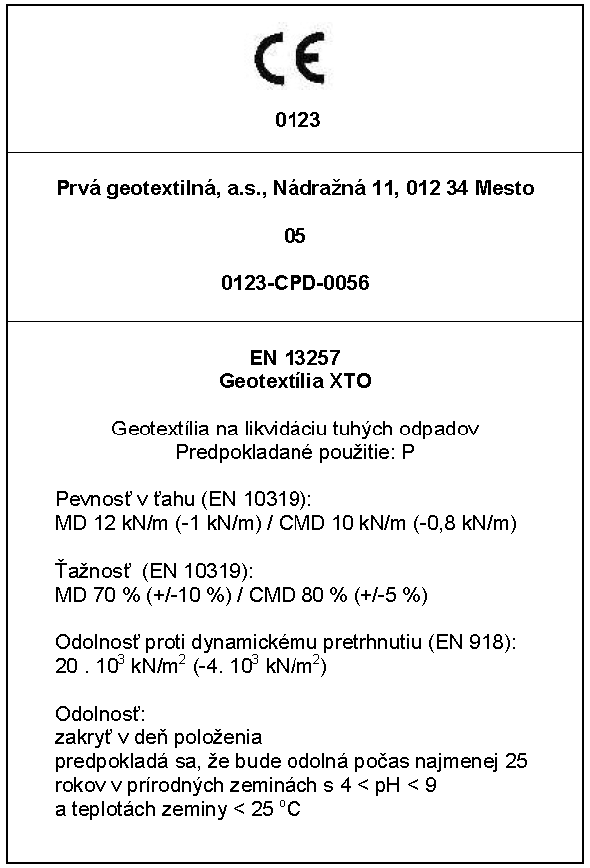
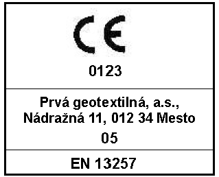
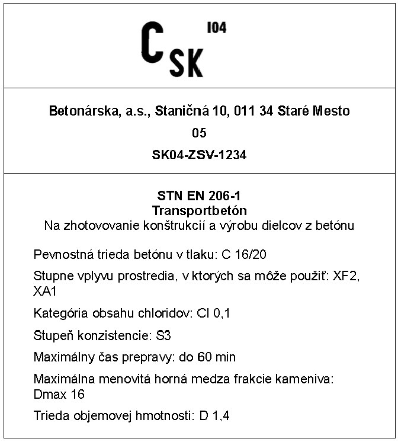
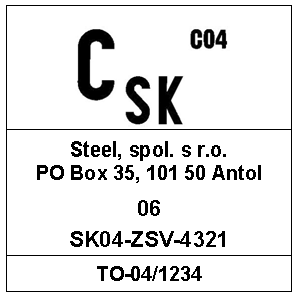
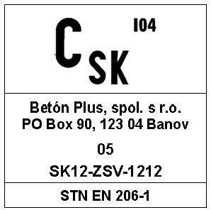
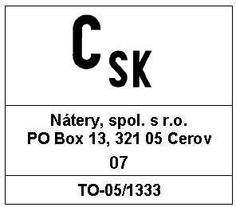

# Čl. I

Vyhláška Ministerstva výstavby a regionálneho rozvoja Slovenskej republiky č. 158/2004 Z. z., ktorou sa ustanovujú skupiny stavebných výrobkov s určenými systémami preukazovania zhody a podrobnosti o používaní značiek zhody sa mení a dopĺňa takto:

- 1. V § 1 sa za odsek 1 vkladá nový odsek 2, ktorý znie:

- „(2)

- Ak sa technická špecifikácia podľa § 3 ods. 1 písm. a) alebo c) zákona vzťahuje na stavebný výrobok, ktorý nie je uvedený v prílohe č. 1, alebo je v prílohe č. 1 preň určený iný systém preukazovania zhody, na takýto výrobok sa uplatňuje systém preukazovania zhody podľa technickej špecifikácie.“.

- Doterajší odsek 2 sa označuje ako odsek 3.

- 2. V § 3 odseky 1 až 3 znejú:

- „(1)

- Klasifikácia požiarnych charakteristík stavebných výrobkov a častí stavieb je nasledujúca:

- a)

- stavebné výrobky, ktoré môžu v stavbe prispievať k tvorbe alebo rozširovaniu ohňa a dymu v priestore vzniku požiaru alebo aj mimo tohto priestoru, sa klasifikujú podľa reakcie na oheň do tried A1, A2, B, C, D, E a F1) okrem výrobkov na podlahy a tepelnoizolačných výrobkov na lineárne potrubia. Výrobky na podlahy sa podľa reakcie na oheň klasifikujú do tried A1fl, A2fl, Bfl, Cfl, Dfl, Efl a Ffl1) a tepelnoizolačné výrobky na lineárne potrubia do tried A1L, A2L, BL, CL, DL, EL a FL,2)

- b)

- strechy a strešné krytiny sa klasifikujú podľa reakcie na vonkajší oheň do tried BROOF(t1), FROOF(t1), BROOF(t2), FROOF(t2), BROOF(t3), CROOF(t3), DROOF(t3), FROOF(t3), BROOF(t4), CROOF(t4), DROOF(t4), EROOF(t4) a FROOF(t4),3) kde t1, t2, t3 alebo t4 označuje jednu zo štyroch skúšobných metód,4)

- c)

- stavebné výrobky a časti stavieb sa klasifikujú podľa požiarnej odolnosti do tried vyjadrujúcich písmenami vlastnosti a údajmi v minútach zachovania vlastnosti alebo kombinácie vlastností.5)

- (2)

- Materiály a stavebné výrobky, ktoré sa podľa reakcie na oheň klasifikujú bez skúšania do niektorej triedy A1, A2, B, C, D, E alebo A1fl, A2fl, Bfl, Cfl, Dfl, Efl, ako aj strešné krytiny, ktoré sa z hľadiska reakcie na vonkajší oheň klasifikujú bez skúšania do triedy BROOF, podľa doteraz vydaných rozhodnutí Európskej komisie, sú uvedené v prílohe č. 2.

- (3)

- Ďalšie materiály a stavebné výrobky, ktoré sa klasifikujú bez skúšania do tried podľa odseku 1, stanovené neskoršími rozhodnutiami Európskej komisie, zverejní ministerstvo vo svojom vestníku podľa § 17 ods. 1 písm. j) bodu 5 zákona.“.

- Poznámky pod čiarou k odkazom 1 až 5 znejú:

- „1)

- STN EN 13501-1:2004 Klasifikácia požiarnych charakteristík stavebných výrobkov a prvkov stavieb. Časť 1: Klasifikácia využívajúca údaje zo skúšok na reakcie na oheň.

- 2) Rozhodnutie Komisie č. 2003/632/ES z 26. augusta 2003, ktorým sa mení a dopĺňa rozhodnutie č. 2000/147/ES, ktorým sa vykonáva smernica Rady 89/106/EHS s ohľadom na klasifikáciu požiarnej odolnosti stavebných výrobkov (Ú. v. EÚ L 220, 3. 9. 2003).

- 3) Rozhodnutie Komisie č. 2001/671/ES z 21. augusta 2001, ktorým sa vykonáva smernica Rady 89/106/EHS, pokiaľ ide o klasifikáciu striech a strešných krytín z hľadiska zaťaženia vonkajším požiarom (Ú. v. ES L 235, 4. 9. 2001) v platnom znení.

- 4)

- STN P ENV 1187:2004 Zaťaženie striech vonkajším požiarom. Skúšobné metódy.

- 5)

- STN EN 13501-2:2005 Klasifikácia požiarnych charakteristík stavebných výrobkov a prvkov stavieb. Časť 2: Klasifikácia využívajúca údaje zo skúšok požiarnej odolnosti (okrem ventilačných zariadení).“.

- 3. V § 4 odsek 2 znie:

- „(2)

- Ak charakter výrobku umožňuje umiestniť na miesta podľa odseku 1 písm. a) až c) značku zhody len s minimálnymi sprievodnými údajmi a technická špecifikácia to umožňuje, potom týmito údajmi musia byť údaje podľa odseku 3 písm. a) až e) a značka zhody so všetkými sprievodnými údajmi podľa odseku 3 sa uvedie ako súčasť sprievodnej dokumentácie.“.

- 4. V § 4 sa za odsek 2 vkladá nový odsek 3, ktorý znie:

- „(3)

- Ak technická špecifikácia nestanovuje inak, umiestnenie značky zhody len podľa odseku 1 písm. d) sa môže využiť len pri nekusových výrobkoch, ktoré sa neprepravujú vo vlastných obaloch.“.

- Doterajšie odseky 3 až 6 sa označujú ako odseky 4 až 7.

- 5. V § 4 ods. 4 písmená b) až f) znejú:

- „b)

- názov a adresa výrobcu alebo registrovaná identifikačná značka výrobcu,

- c)

- posledné dvojčíslo roka, v ktorom sa výrobok označil značkou zhody,

- d)

- označenie zodpovedajúceho certifikátu vydaného notifikovanou osobou v prípade označenia značkou zhody podľa § 8 ods. 2 zákona alebo autorizovanou osobou v prípade označenia značkou zhody podľa § 8 ods. 3 zákona, ak ide o označenie značkou zhody na základe preukázania zhody systémom 1+, 1 alebo 2+,

- e)

- označenie technickej špecifikácie alebo technických špecifikácií, ak výrobok vyhovuje viacerým špecifikáciám. V prípade európskeho technického osvedčenia sa okrem jeho označenia uvádza aj označenie predpisu, na základe ktorého bolo vydané,

- f)

- názov a typ výrobku,“.

- 6. Za § 5 sa vkladá § 5a, ktorý znie:

- 㤠5a

- Táto vyhláška bola prijatá v súlade s osobitným predpisom6) pod číslom notifikácie 2005/0632/SK.“.

- Poznámka pod čiarou k odkazu 6 znie:

- „6) Smernica Európskeho parlamentu a Rady 98/34/ES o postupe pri poskytovaní informácií v oblasti technických noriem a predpisov v platnom znení (Ú. v. ES L 204, 21. 7. 1998).“.

- 7. V celej prílohe č. 1 sa slovo „ROE“ nahrádza slovom „RVO“ a slová „triedy reakcie na oheň“ sa nahrádzajú slovom „TRO“.

- 8. V prílohe č. 1 skupine č. 0103 sa v názve skupiny výrobkov pripájajú slová „vrátane podložia násypu pozemnej komunikácie alebo železničnej trate“.

- 9. V prílohe č. 1 v časti Použité skratky sa slová „ROE – reakcia na oheň v exteriéri“ nahrádzajú slovami „RVO – reakcia na vonkajší oheň“.

- 10. V prílohe č. 1 v časti Použité skratky sa na konci pripájajú slová „TRO – trieda reakcie na oheň“.

- 11. V prílohe č. 1 sa za skupinu výrobkov č. 0405 vkladá skupina výrobkov č. 0406, ktorá znie: „0406 Hydroizolačné náterové látky, malty a tmely pre nadzemné podlažia alebo podzemné priestory stavieb, alebo pod dlažby a obklady“.

- 12. V prílohe č. 1 v skupine č. 0502 a vo všetkých ostatných skupinách sa index „FL“ nahrádza indexom „fl“.

- 13. V prílohe č. 1 skupine č. 0506 sa slová „Dilatačné čapy“ nahrádzajú slovami „Klzné tŕne“.

- 14. V prílohe č. 1 skupine č. 0510 názov skupiny výrobkov znie: „Dlažbové prvky zahŕňajúce dlažbové kocky, dlaždice, obrubníky (okrem výrobkov skupín 0507 až 0509), sklobetónové svetlíky, podlahy z kovových platní, platne z mrežového plechu alebo roštov, tuhé dlážkoviny, bridlice, mozaiky, terazzové dlaždice a vegetačné dielce10a)“.

- Poznámka pod čiarou k odkazu 10a znie:

- „10a)

- Ide o vegetačné dielce podľa STN 73 6131-3 na málo zaťažené dopravné plochy.“.

- 15. V prílohe č. 1 skupine č. 0806 názov skupiny výrobkov znie: „Ostatné prefabrikované stožiare alebo ich prefabrikované konštrukčné časti pre nadzemné elektrické vedenia, telekomunikačné zariadenia, veterné elektrárne a podobné zariadenia“.

- 16. V prílohe č. 1 skupine č. 0901 sa v názve skupiny výrobkov pripájajú slová „na kanalizačné potrubia“.

- 17. V prílohe č. 1 skupine č. 0902 názov skupiny výrobkov znie: „Rúry a tvarovky ostatné a tesnenia na kanalizačné potrubia“.

- 18. V prílohe č. 1 skupiny č. 0903 až 0905 znejú:

- „0903 | Rúry a tvarovky na odpadové potrubia budov | Na základný účel5) | 4

- 0904 | Vstupné šachty a revízne komory kanalizačných potrubí vrátane stúpadiel, rebríkov a zábradlí | Na účel, na ktorý sa vzťahujú PPB, s členením podľa TRO: |

- | | (A1, A2, B, C)7) | 1

- 0905 | Prevzdušňovacie ventily na odpadové potrubia budov | (A1, A2, B, C),8) D, E | 3

- | | (A1 až E),9) F | 4".

- 19. V prílohe č. 1 skupiny č. 0906 až 0907 znejú:

- „0906 | Čerpacie stanice odpadových vôd a spätné klapky na odpadové vody na použitie vnútri budov | Na základný účel5) | 3

- | | Na účel, na ktorý sa vzťahujú PPB, s členením podľa TRO: |

- 0907 | Systémy a prvky domových čistiarní odpadových vôd a nádrže žúmp | (A1, A2, B, C)7) | 1

- | | (A1, A2, B, C),8) D, E | 3

- | | (A1 až E),9) F | 4".

- 20. V prílohe č. 1 skupiny č. 0908 až 0909 znejú:

- „0908 | Lapače a odlučovače (separátory) pre odpadové vody z budov a inžinierskych stavieb vrátane ciest | Na základný účel5) | 4110b)

- 0909 | Vpusty, poklopy a vtokové mreže na použitie na vozovkách, odstavných pruhoch, parkoviskách a spevnených plochách mimo budov | Na účel, na ktorý sa vzťahujú PPB, s členením podľa TRO: |

- | | (A1, A2, B, C)7) | 1

- | | (A1, A2, B, C),8) D, E | 3

- | | (A1 až E),9) F | 4".

- Poznámka pod čiarou k odkazu 10b znie:

- „10b)

- Vzťahuje sa na poklopy a vtokové mreže.“.

- 21. V prílohe č. 1 skupina č. 0911 znie:

- „0911 | Odvodňovacie žľaby na komunikácie a plochy pre vozidlá a chodcov | Na základný účel5) | 3

- | | Na účel, na ktorý sa vzťahujú PPB, s členením podľa TRO: |

- | | (A1, A2, B, C)7) | 1

- | | (A1, A2, B, C),8) D, E | 3

- | | (A1 až E),9) F | 4".

- 22. V prílohe č. 1 skupine č. 1101 sa v stĺpci Členenie skupiny vypúšťajú všetky slová a v stĺpci SPZ sa vypúšťa číslica „4“.

- 23. V prílohe č. 1 skupine č. 1103 sa v stĺpci Členenie skupiny vypúšťajú slová „pevnostných tried C 12/15 až C 100/115, resp. LC 12/15 až LC 80/88“ a slová „betónov nižších tried a“.

- 24. V prílohe č. 1 skupine č. 1202 sa za slová „hlinitano-vápenaté cementy,“ vkladajú slová „s veľmi nízkym hydratačným teplom, vysokopecné cementy s nízkou začiatočnou pevnosťou,“.

- 25. V prílohe č. 1 skupine č. 1204 sa v názve skupiny pripájajú slová „a hydraulické spojivá na výrobu mált“.

- 26. V prílohe č. 1 skupine č. 1301 názov skupiny výrobkov znie: „Betóny všetkých pevnostných tried vyrábané v stabilných alebo mobilných betonárňach“, v stĺpci Členenie skupiny sa vypúšťajú všetky slová a v stĺpci SPZ sa vypúšťa číslica „4“.

- 27. V prílohe č. 1 sa vypúšťa skupina č. 1302.

- 28. V prílohe č. 1 skupine č. 1304 názov skupiny výrobkov znie: „Zmesi na injektážne alebo zálievkové malty“.

- 29. V prílohe č. 1 sa za skupinu č. 1701 vkladá skupina č. 1702, ktorá znie:

- „1702 | Debniace systémy na báze betónových debniacich tvaroviek alebo panelov z betónu prepojených rozperkami | Podľa nosnosti: |

- | | nosné | 2+

- | | nenosné | 4".

- 30. V prílohe č. 1 skupine č. 1801 sa nad slovo „prvkov“ umiestňuje odkaz 13a.

- Poznámka pod čiarou k odkazu 13a znie:

- „13a)

- Vrátane nosných stropných tehlových alebo betónových tvaroviek a dosiek.“.

- 31. V prílohe č. 1 skupinách č. 2002 a 2003 v stĺpci Členenie skupiny sa slová „Na použitie v požiarnych úsekoch“ nahrádzajú slovami „Na delenie požiarnych úsekov“.

- 32. V prílohe č. 1 skupine č. 2101 sa slovo „izolácia“ nahrádza slovom „ochrana“ a slovo „(ETICS)“ sa nahrádza slovami „(kontaktné zatepľovacie systémy – KZS)15a)“.

- Poznámka pod čiarou k odkazu 15a znie:

- „15a)

- KZS zodpovedá anglickej terminológii ETICS – External Thermal Insulation Composite Systems.“.

- 33. V prílohe č. 1 skupine č. 2102 sa slovo „izoláciu“ nahrádza slovom „ochranu“.

- 34. V prílohe č. 1 skupine č. 2103 názov skupiny výrobkov znie: „Priemyselne vyrábané tepelnoizolačné výrobky vo forme dosák, rohoží, rolovaných pásov alebo v inej forme, určené na tepelnú izoláciu budov“.

- 35. V prílohe č. 1 skupine č. 2104 názov skupiny výrobkov znie: „Tepelnoizolačné výrobky formované alebo nanášané na mieste zo sypaných alebo penových materiálov, určené na tepelnú izoláciu budov“.

- 36. V prílohe č. 1 skupine č. 2105 názov skupiny výrobkov znie: „Tepelnoizolačné výrobky v rôznych formách, určené na technické zariadenia budov a priemyselné inštalácie“.

- 37. V prílohe č. 1 sa vypúšťa skupina č. 2701.

- 38. V prílohe č. 1 sa za skupinu č. 3202 vkladá skupina č. 3203, ktorá znie:

- „3203 | Dosky z betónu, terazza a pod. na schodiskové stupne v interiéri alebo v exteriéri | Podľa nosnosti: |

- | | nosné | 3

- | | nenosné | 4".

- 39. V prílohe č. 1 skupina č. 3401 znie:

- „3401 | Sadrové tvarovky a sadrové lepidlá na nenosné priečky, obklady stien a požiarnu ochranu (tvarovky nie sú určené na stropy) | Na základný účel | 4

- | | Na požiarnu ochranu | 3".

- 40. V prílohe č. 1 skupine č. 3402 v stĺpci Členenie skupiny sa slová „do požiarnych úsekov“ nahrádza slovom „delenie požiarnych úsekov“.

- 41. V prílohe č. 1 v oblasti použitia výrobkov nad skupinou č. 4001 sa za slovo „prvky“ vkladajú slová „a materiály“.

- 42. V prílohe č. 1 skupine č. 4003 sa v názve skupiny výrobkov slovo „tŕňmi“ nahrádza slovami „prelisovanými hrotmi“.

- 43. V prílohe č. 1 v riadku nad skupinou č. 4101 sa slovo „Potrubia“ nahrádza slovom „Rúry“ a nad slovo „vodu“ sa umiestňuje odkaz 21a.

- Poznámka pod čiarou k odkazu 21a znie:

- „21a)

- Podľa STN 75 0150.“.

- 44. V prílohe č. 1 skupine č. 4102 sa slová „Tuhé, pružné a tvárne potrubia“ nahrádzajú slovom „Rúry“.

- 45. V prílohe č. 1 skupine č. 4105 sa za slovo „spojky“ vkladá slovo „spájky“.

- 46. V prílohe č. 1 v riadku nad skupinou č. 4201 text oblasti použitia výrobkov znie: „Rúry, nádrže a príslušenstvo na úžitkovú a napájaciu vodu,21a) plyn a tekuté palivá“.

- 47. V prílohe č. 1 skupine č. 4201 sa za slovo „spojky“ vkladá slovo „spájky“, slová „ventily a kohúty“ sa nahrádzajú slovom „armatúry“.

- Poznámka pod čiarou k odkazu 22 znie:

- „22)

- Vzťahuje sa len na držiaky potrubí, armatúry a na bezpečnostné zariadenia.“.

- 48. V prílohe č. 1 skupine č. 4801 sa za slová „kúpacie vane“ vkladá čiarka a slová „vírivé vane“.

- 49. V prílohe č. 1 skupiny č. 5101 až 5106 vrátane oblasti použitia výrobkov znejú:

- Stabilné hasiace zariadenia a ich komponenty | | |

- 5101 | Hadicové zostavy pre prvý zásah, suché a mokré protipožiarne hydrantové systémy | | 1

- 5102 | Sprinklerové a vodné sprchové systémy - zostavy | | 1

- 5103 | Plynové systémy - zostavy | | 1

- 5104 | Práškové systémy - zostavy | | 1

- 5105 | Penové systémy - zostavy | | 1

- 5106 | Samostatné komponenty stabilných hasiacich zariadení uvedených v skupinách 5101 až 5105 - požiarne hydranty, detektory/spínače prietoku vody, tlakové snímače/spínače, uzatváracie armatúry, prívodné potrubia, požiarne čerpadlá a skupiny čerpadiel, hubice, sprinklery a výtokové armatúry, zostavy mokrých ventilových staníc, zostavy suchých ventilových staníc, zostavy zavodňovacích ventilových staníc, riadiace ventily s tepelnou poistkou, ventily vysokotlakových nádob s príslušenstvom a ich spúšťače, neelektrické blokovacie zariadenia, pružné prípojky, manometre a tlakové spínače, mechanické vážiace zariadenia, spätné ventily a spätné klapky". | | 1

- 50. V prílohe č. 1 skupine č. 5208 sa na začiatok vkladajú slová „Systémy na potlačenie výbuchu,“.

- 51. V prílohe č. 1 skupinách č. 5401 a 5402 sa v stĺpci SPZ nahrádza prvá číslica „1“ číslicou „3“.

- 52. V prílohe č. 1 skupine č. 5601 názov skupiny výrobkov znie: „Prefabrikované silá z betónu3) na sypké materiály a kontajnery z betónu3) na pevný odpad ukladané do zeme“.

- 53. V prílohe č. 1 sa za skupinu č. 5607 vkladajú skupiny č. 5608 a 5609, ktoré znejú:

- „5608 | Systémy zasklenia balkónov a lodžií | | 3

- 5609 | Výrobky na povrchy detských ihrísk | Na vnútorné použitie podľa TRO: |

- | | (A1fl, A2fl, Bfl, Cfl)7) | 1

- | | (A1fl, A2fl, Bfl, Cfl),8) Dfl, Efl, (A1fl až Efl,9) Ffl | 3

- | | Na vonkajšie použitie | 4".

- 54. Príloha č. 2 znie:

- „Príloha č. 2 k vyhláške č. 158/2004 Z. z.

- MATERIÁLY A STAVEBNÉ VÝROBKY, KTORÉ SA Z HĽADISKA POŽIARNYCH CHARAKTERISTÍK KLASIFIKUJÚ BEZ SKÚŠANIA

- Tabuľka č. 1 Materiály a stavebné výrobky, ktoré sa z hľadiska reakcie na oheň klasifikujú do tried A1 a A1fl bez skúšania

- Materiály a stavebné výrobky | Poznámky

- Expandovaný íl |

- Expandovaný perlit |

- Expandovaný vermikulit |

- Minerálna vlna |

- Penové sklo |

- Betón | Zahŕňa transportbetón a betónové prefabrikované vystužené a predpäté výrobky.

- Kamenivo do betónu (prírodné hutné a pórovité kamenivo, s výnimkou integrálnej tepelnej izolácie) | Môže obsahovať prísady a prímesi (napr. práškový úletový - elektrárenský popolček), farbivá a iné materiály. Zahŕňa prefabrikované dielce.

- Autoklávované betónové stavebné dielce | Stavebné dielce vyrobené z hydraulického spojiva, ako je cement a/alebo vápno, kombinované s jemnými materiálmi (kremičitanový materiál, práškový úletový - elektrárenský popolček, vysokopecná troska) a s napeňovacími prísadami. Zahŕňa prefabrikované dielce.

- Vláknocement |

- Cement |

- Vápno |

- Vysokopecná troska a práškový úletový - elektrárenský popolček |

- Prírodné kamenivo |

- Železo, oceľ a nehrdzavejúca oceľ | Nie v jemnej podobe

- Meď a medené zliatiny | Nie v jemnej podobe

- Zinok a zinkové zliatiny | Nie v jemnej podobe

- Hliník a hliníkové zliatiny | Nie v jemnej podobe

- Olovo | Nie v jemnej podobe

- Sadra a malty na báze sadry | Môžu zahŕňať prísady (retardéry, plnivá, vlákna, farbivá, vápno, látky viažuce vodu a vzduch a plastifikátory - zvláčňovadlá, hutné plnivo (napr. prírodný alebo drvený piesok) alebo ľahčené plnivo (napr. perlit alebo vermikulit).

- Malta s anorganickými spojivami | Omietkové malty, podlahové potery a murovacie malty zložené z jedného alebo viacerých anorganických spojív, ako sú napr. cement, vápno, murovací cement a sadra

- Tehliarske výrobky | Prvky z ílu alebo iných ílovitych materiálov s pieskom alebo bez piesku, alebo s inými prímesami. Zahŕňa tehly, škridle, obkladové a šamotové stavebné dielce (napr. komínové vložky).

- Vápenopieskové výrobky | Prvky vyrobené zo zmesi vápna a prírodných kremičitých materiálov (piesok, kremičitý piesok alebo drvina, alebo ich zmesi). Môžu obsahovať aj farbiace pigmenty.

- Výrobky z prírodného kameňa a bridlice | Opracované alebo neopracované dielce z prírodného kameňa (magmatickej, sedimentovanej alebo premenenej horniny) alebo bridlice

- Sadrové výrobky | Zahŕňajú tvarovky a iné dielce zo síranu vápenatého a vody, ktoré môžu obsahovať vlákna, plnivá a iné prímesy a môžu byť farbené pigmentmi.

- Terazzo | Zahŕňa prefabrikované terazzové prvky a liatu terazzovú zmes na podlahy.

- Sklo | Zahŕňa teplom spevnené sklo, sklo s chemickými spevňovacími prímesami, laminované (lepené, vrstvené) a drôtené sklo.

- Sklená keramika |

- Keramika | Zahŕňa lisované a extrudované výrobky glazované alebo neglazované.

- Interpretácia a spresnenie pojmov v tabuľke č. 1

- – Stavebné výrobky možno z hľadiska reakcie na oheň klasifikovať do tried A1 a A1flbez skúšania vtedy, keď sú vyrobené z jedného alebo z viacerých materiálov uvedených v tabuľke. Výrobky zhotovené zlepením týchto materiálov možno takto klasifikovať, ak použité lepidlo nepredstavuje viac ako 0,1 % z hmotnosti alebo objemu výrobku, podľa toho, čo je nepriaznivejšie.

- – Na výrobky v tvare dosiek (napr. izolačné materiály) s jednou alebo viacerými organickými vrstvami, ako aj na výrobky obsahujúce organický materiál, ktorý nie je homogénne rozptýlený (s výnimkou lepidla), sa klasifikácia do tried A1 a A1flbez skúšania nevzťahuje.

- – Výrobky zhotovené z materiálov uvedených v tabuľke č. 1 a pokryté vrstvou z anorganických materiálov (napr. kovové výrobky s povlakom) sa môžu tiež klasifikovať do tried A1 a A1fl bez skúšania.

- – Žiadny z materiálov alebo výrobkov uvedených v tabuľke nesmie obsahovať homogénne rozptýleného organického materiálu viac ako 1 % hmotnosti alebo objemu výrobku, podľa toho, čo je nepriaznivejšie.

- Tabuľka č. 2 Stavebné výrobky, ktoré sa z hľadiska reakcie na oheň klasifikujú do ďalších tried bez skúšania

- 2a. Dosky na báze dreva | Minimálna hustota kg/m3 | Minimálna hrúbka mm | Trieda1) okrem dlážko- vín | Trieda1) - dlážkoviny

- Dosky z orientovaných triesok OSB2) | 600 | 9 | D-s2, d0 | Dfl -sl

- Trieskové dosky3) | 600 | 9 | D-s2, d0 | Dfl-sl

- Vláknité dosky, tvrdé4) | 900 | 6 | D-s2, d0 | Dfl -sl

- Vláknité dosky polotvrdé5) | 600 | 9 | D-s2, d0 | Dfl -sl

- | 400 | 9 | E, trvalý | Efl

- Vláknité dosky mäkké6) | 250 | 9 | E, trvalý | Efl

- Vláknité dosky MDF7) | 600 | 9 | D-s2, d0 | Dfl -sl

- Cementovotrieskové doskyb)8) | 1000 | 10 | B-s1, d0 | Bfl -sl

- Preglejované dosky9) | 400 | 9 | D-s2, d0 | Dfl -sl

- Dosky z prírodného dreva10) | 400 | 12 | D-s2, d0 | Dfl -sl

- a) Dosky na báze dreva namontované bez vzduchových medzier priamo na materiál triedy A1 alebo A2-sl. d0 s minimálnou hustotou 10 kg/m3 alebo aspoň triedy D-s2. d0 s minimálnou hustotou 400 kg/m3. b) Obsah cementu najmenej 75 hmotnostných %. | | | |

- 2b. Sadrokartónové doskya) | Nominálna hrúbka dosky mm | Sadrové jadro | | Plošná hmot- nosť papierab) g/m2 | Trieda okrem dlážkovín

- | | Hustota kg/m3 | Trieda reakcie na oheň | |

- Sadrokartónové dosky11) okrem dierovaných dosiek | ≥ 9,5 | ≥ 600 | A1 | ≤ 220 | A2-sl, d0

- | ≥ 12,5 | ≥ 800 | | > 220 ≤ 300 | B-sl, d0

- a) Sadrokartónové dosky sa inštalujú upevňovaním skrutkami alebo klincami na opornú konštrukciu, alebo ako suchý obkladový systém upevňovaním skrutkami alebo klincami, alebo lepením na pevný podklad. Detaily, ktoré sa pri inštalácii musia dodržať, vo vzťahu k uvedenej klasifikácii bez skúšania, sú ustanovené rozhodnutím Komisie č. 2003/593/ES zo 7. augusta 2003, ktorým sa mení a dopĺňa rozhodnutie 2003/43/ES o ustanovení tried požiarnej odolnosti určitých stavebných výrobkov (Ú. V. ES L 201, 8. 8. 2003. b) Papier nemôže obsahovať viac ako 5 % organických prímesí.12) | | | | |

- 2c. Vysokotlakové laminátové (HPL) dekoratívne doskya) | Špecifikácia výrobkov | Minimálna hustota kg/m3 | Minimálna cel- ková hrúbka mm | Trieda okrem dlážkovín

- Interiérové kompaktné HPL dosky bez retardérov horenia13) | Kompaktný HPL typ CGS14) | 1350 | 6 | D-s2, d0

- Interiérové kompozitné HPL dosky s podkladom na báze dreva bez retardérov horenia13) | Kompozitné dosky pozostávajúce z HPL bez retardérov horenia15) nalepenom na obidvoch stranách jadra na báze dreva bez retardérov horenia s minimálnou hrúbkou 12 mm16) polyvinylacetátovým (PVAc) alebo termosetovým lepidlom aplikovaným v rozsahu od 60 do 120 g/m2 | Jadro na báze dreva s minimál- nou husto- tou 600 | 12 mm jadro na báze dreva s HPL ≥ 0,5 mm nalepeným na obidvoch stranách | D-s2, d0

- a) Upevnené priamo bez vzduchovej medzery na materiál s triedou reakcie na oheň A2-sl, d0 alebo lepšou a s hustotou najmenej 600 kg/m3, alebo montované na drevenú alebo kovovú opornú konštrukciu s nevetranou vzduchovou medzerou (t. j. so štrbinou len v hornej časti) šírky najmenej 30 mm, pričom protiľahlá strana vzduchovej medzery má triedu reakcie na oheň A2-s 1, d0 alebo lepšiu. | | | |

- | Špecifikácia výrobkov | Minimálna hustota17) kg/m3 | Minimálna celková hrúbka mm | Trieda okrem dlážkovín

- 2d. Konštrukčné drevoa) | Vizuálne alebo strojovo triedené konštrukčné drevo s pravouhlým prierezom získaným rezaním, hobľovaním alebo ináč, alebo s kruhovým prierezom | 350 | 22 | D-s2, d0

- a) Vzťahuje sa na všetky druhy podľa výrobkových noriem. | | | |

- Tabuľka č. 3 Strešné krytiny alebo materiály, ktoré sa podľa reakcie na vonkajší oheň klasifikujú do triedy BROOF bez skúšania

- Strešná krytina (resp. materiál) | Špecifické podmienky

- Bridlicové typy: prírodné bridlice, kamenné bridlice | Vyhovujú požiadavkám v tabuľke č. 1.

- Škridle: kamenné, betónové, hlinené, keramické alebo oceľové | Vyhovujú požiadavkám v tabuľke č. 1.Vonkajší povlak je z anorganického materiálu alebo má PCSc) ≤ 4,0 MJ/m2 alebo s plošnou hmotnosťou ≤ 200 g/m2.

- Vláknocement: ploché alebo profilované tabule alebo bridlicového typu | Vyhovujú požiadavkám v tabuľke č. 1 alebo majú PCSc) ≤ 3,0 M J/kg.

- Ploché alebo profilované kovové tabule: hliníkové, zo zliatin hliníka, medené, zo zliatin medi, zinkové, zo zliatin zinku, oceľové bez povlakov, z nehrdzavejúcej ocele, z pozinkovanej ocele, oceľové s povlakom „zvitkovou" technológiou,a) oceľové so sklovitým smaltomb) | Hrúbka ≥ 0,4 mm.Vonkajší povlak je z anorganického materiálu alebo má PCSc) ≤ 4,0 MJ/m2 alebo s plošnou hmotnosťou ≤ 200 g/m2.

- Výrobky, ktoré sa úplne zakryjú (anorganickými výrobkami uvedenými vpravo) | Voľne položeným štrkom s hrúbkou najmenej 50 mm alebo s plošnou hmotnosťou ≥ 80 kg/m3 (s frakciami najmenej 4 mm a najviac 32 mm).Cementopieskovým poterom s hrúbkou najmenej 30 mm.Doskami z umelého kameňad) alebo minerálnymi doskami s hrúbkou najmenej 40 mm.

- a) Angl. „Coil coated steel", b) angl. „vitreous enameľ', c) spalné teplo, d) angl. „cast stone". |

- “.

- 55. Poznámky pod čiarou k odkazom 1 až 17 znejú:

- „1)

- Triedy uvedené v tabuľke platia pre nespojené dosky, pre spojené dosky T&G a dosky s úplne podopretými spojmi inštalovanými podľa STN P ENV 12872: 2001 Dosky na báze dreva. Návod na používanie nosných dosiek na podlahy, steny a stropy.

- 2)

- STN EN 300: 1999 Dosky z orientovaných triesok (OSB). Definície, triedenie a požiadavky.

- 3)

- STN EN 312: 2004 Trieskové dosky. Špecifikácie.

- 4)

- STN EN 622-2: 2004 Vláknité dosky. Špecifikácie. Časť 2: Požiadavky na tvrdé dosky.

- 5)

- STN EN 622-3: 2004 Vláknité dosky. Špecifikácie. Časť 2: Požiadavky na polotvrdé dosky.

- 6)

- STN EN 622-4: 2000 Vláknité dosky. Špecifikácie. Časť 2: Požiadavky na mäkké dosky.

- 7)

- STN EN 622-5: 2000 Vláknité dosky. Špecifikácia. Časť 5: Požiadavky na dosky vyrobené suchým spôsobom (MDF).

- 8)

- STN EN 634-2: 1999 Cementovotrieskové dosky. Špecifikácia. Časť 2: Požiadavky na trieskové dosky spojené obyčajným portlandským cementom na použitie v suchom, vlhkom a vonkajšom prostredí.

- 9)

- STN EN 636: 2004 Preglejované dosky. Špecifikácie.

- 10)

- STN EN 13353: 2005 Dosky z prírodného dreva (SWP). Požiadavky.

- 11)

- STN EN 520: 2005 Sadrokartónové dosky. Definície, požiadavky a skúšobné metódy.

- 12)

- STN EN ISO 536: 1999 Papier a lepenka. Určenie plošnej hmotnosti.

- 13)

- STN EN 438-7: 2005 Dekoratívne vysokotlakové lamináty (HPL). Dosky na báze reaktoplastových živíc (lamináty). Časť 7: Kompaktné laminátové a HPL zložené dosky na vnútorné a vonkajšie steny a konečnú úpravu stropov.

- 14)

- STN EN 438-4: 2005 Dekoratívne vysokotlakové lamináty (HPL). Dosky na báze reaktoplastových živíc (lamináty). Časť 4: Klasifikácia a špecifikácia kompaktných laminátov s hrúbkou 2 mm a väčšou.

- 15)

- STN EN 438-3: 2005 Dekoratívne vysokotlakové lamináty (HPL). Dosky na báze reaktoplastových živíc (lamináty). Časť 3: Klasifikácia a špecifikácia laminátov s hrúbkou menšou ako 2 mm určených na nalepenie na podklad.

- 16)

- STN EN 13986: 2005 Dosky na báze dreva na používanie v konštrukciách. Vlastnosti, preukazovanie zhody a označovanie.

- 17)

- Kondicionované podľa STN EN 13238: 2003 Skúšky reakcie stavebných výrobkov na oheň. Postupy kondicionovania a všeobecné pravidlá pre výber podkladov.“.

- 56. Príloha č. 3 znie:

- „Príloha č. 3 k vyhláške č. 158/2004 Z. z.

- VZORY OZNAČOVANIA STAVEBNÝCH VÝROBKOV ZNAČKAMI ZHODY SPOLU SO SPRIEVODNÝMI ÚDAJMI

- 1. Označenie CE so všetkými sprievodnými údajmi vyžadovanými harmonizovanou európskou normou

- 

- 2. Označenie CE s minimálnymi sprievodnými údajmi

- 

- 3. Slovenská značka zhody CSK so všetkými sprievodnými údajmi podľa tejto vyhlášky a neharmonizovanej slovenskej technickej normy

- 

- 4. Slovenská značka zhody CSK s minimálnymi sprievodnými údajmi

- a) na výrobok s preukázanou zhodou v systéme 1+ alebo 1 (s technickým osvedčením č. TO-04/1234)

- 

- b) na výrobok s preukázanou zhodou v systéme 2+ (s normou STN EN 206-1)

- 

- c) na výrobok s preukázanou zhodou v systéme 2, 3 alebo 4 (s technickým osvedčením č. TO-05/1333)

- 

- Poznámky:

- a)

- Tvar a veľkosť písmen označenia CE a slovenskej značky zhody CSK, spôsoby vyhotovenia a zabezpečenia proti opätovnému použitiu upravuje § 18, § 19, § 21 a príloha k zákonu č. 264/1999 Z. z. o technických požiadavkách na výrobky a o posudzovaní zhody a o zmene a doplnení niektorých zákonov.

- b)

- Na označenie CE sa harmonizovaná norma uvádza bez národných prefixov, ako sú STN, ČSN, DIN a pod.

- c)

- Kód autorizovanej osoby pri značke CSKpozostáva z písmena C, resp. I a z dvojciferného poradového čísla prideleného autorizovanej osobe ministerstvom, ktorá vydala certifikát zhody v rámci preukazovania zhody systémom 1+ alebo 1, resp. certifikát vnútropodnikovej kontroly v rámci preukazovania zhody systémom 2+. V iných systémoch preukazovania zhody sa kód autorizovanej osoby k značke nepridáva.

- d)

- Písmená i číslice v značke CSK vrátane kódu autorizovanej osoby sú typu Gothic No. 13. Veľkosť písmena a čísla kódu autorizovanej osoby je približne 50 % z veľkosti písmen SK.“.
