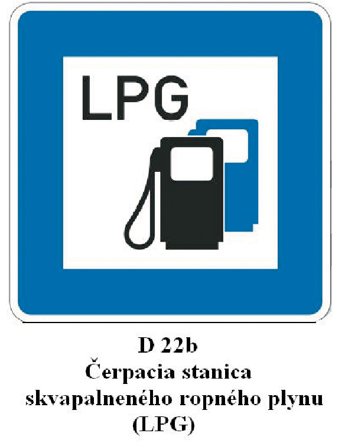
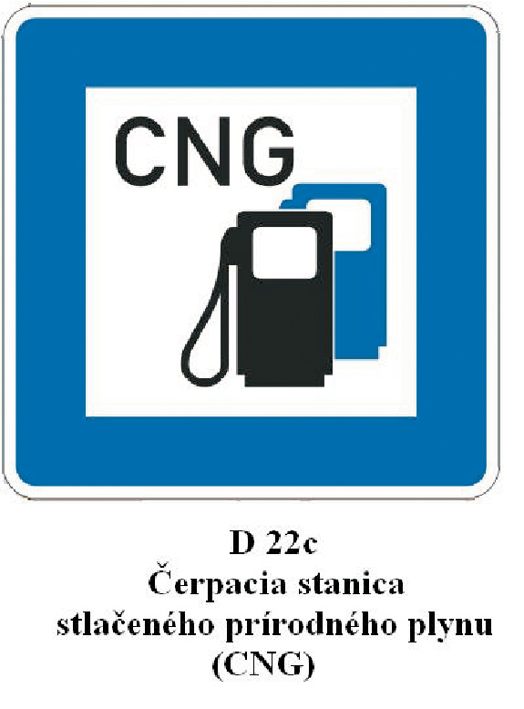
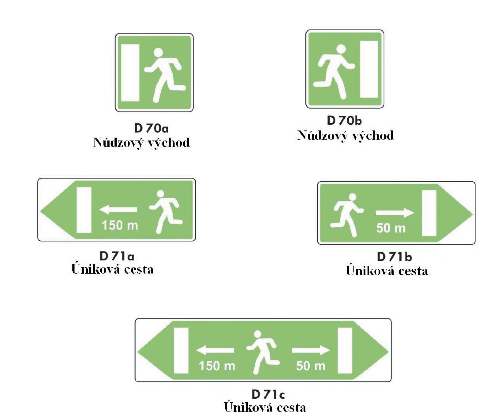

# Čl. I

Vyhláška Ministerstva vnútra Slovenskej republiky č. 225/2004 Z. z., ktorou sa vykonávajú niektoré ustanovenia zákona Národnej rady Slovenskej republiky o premávke na pozemných komunikáciách v znení neskorších predpisov sa mení a dopĺňa takto:

- 1. V § 5 ods. 1 písm. d) sa označenie „D 69c“ nahrádza označením „D 71c“.

- 2. V § 16 písmená a) až c) znejú:

- „a)

- skupiny A oprávňuje viesť motorové vozidlá skupiny A, ako aj motorové vozidlá skupiny AM a podskupiny A1,

- b)

- podskupiny A1 oprávňuje viesť motorové vozidlá podskupiny A1, ako aj motorové vozidlá skupiny AM,

- c)

- skupiny B oprávňuje viesť motorové vozidlá skupiny B, ako aj motorové vozidlá skupiny AM a podskupiny B1,“.

- 3. V § 20 ods. 1 sa za slová „30 dní“ vkladá čiarka a slová „a ak treba vykonať dožiadanie do zahraničia v súvislosti s udelením vodičského oprávnenia, do 60 dní“.

- 4. V § 20 ods. 2 sa vypúšťa písmeno f).

- Doterajšie písmeno g) sa označuje ako písmeno f).

- 5. V § 20 ods. 2 písm. f) sa dopĺňajú tretí bod a štvrtý bod, ktoré znejú:

- „3.

- čestné vyhlásenie podľa odseku 4,

- 4.

- osvedčenie vydané prevádzkovateľom autoškoly.1a)“.

- Poznámka pod čiarou k odkazu 1a) znie:

- „1a)

- § 6 ods. 1 písm. e) zákona č. 93/2005 Z. z. o autoškolách a o zmene a doplnení niektorých zákonov.“.

- 6. § 20 sa dopĺňa odsekom 4, ktorý znie:

- „(4)

- Skúška z odbornej spôsobilosti sa vykoná, ak žiadateľ o udelenie vodičského oprávnenia čestným vyhlásením preukáže, že

- a)

- nie je držiteľom iného vodičského preukazu s udeleným vodičským oprávnením tej skupiny alebo podskupiny motorových vozidiel, na ktorú žiada udeliť vodičské oprávnenie a

- b)

- že má v Slovenskej republike pobyt ustanovený v zákone a zdržiava sa na území Slovenskej republiky viac ako 185 dní v kalendárnom roku.“.

- 7. V § 26 ods. 6 sa slová „Skúška z vedenia motorových a prípojných vozidiel“ nahrádzajú slovami „Druhá časť skúšky z vedenia motorových vozidiel podľa odseku 3“.

- 8. V § 28 ods. 2 písmeno e) znie:

- „e)

- podskupiny B1 na trojkolesovom motorovom vozidle alebo štvorkolesovom motorovom vozidle podskupiny B1, ktorého konštrukčná rýchlosť je najmenej 60 km.h-1,“.

- 9. V § 28 ods. 2 písmená g) až k) znejú:

- „g)

- skupiny B+E na jazdnej súprave s konštrukčnou rýchlosťou najmenej 100 km.h-1, ktorá nepatrí do skupiny B a ktorá je zložená z motorového vozidla skupiny B a prípojného vozidla, ktorého celková hmotnosť je najmenej 1 000 kg a okamžitá hmotnosť je najmenej 800 kg a ktorého nákladný priestor tvorí uzatvorená karoséria široká a vysoká minimálne ako kabína vodiča; uzatvorená karoséria môže byť o trochu užšia ako motorové vozidlo, ak výhľad z miesta vodiča dozadu je možný len s použitím vonkajších spätných zrkadiel motorového vozidla,

- h)

- podskupiny C1 na motorovom vozidle podskupiny C1 s celkovou hmotnosťou najmenej 4 000 kg, s dĺžkou najmenej 5 m a konštrukčnou rýchlosťou najmenej 80 km.h-1, vybavenom brzdami s antiblokovacím zariadením a ustanoveným záznamovým zariadením2a) a s nákladným priestorom tvoreným uzatvorenou karosériou širokou a vysokou minimálne ako kabína vodiča,

- i)

- skupiny C1+E na jazdnej súprave zloženej z motorového vozidla podskupiny C1 a prípojného vozidla s dĺžkou jazdnej súpravy najmenej 8 m, s konštrukčnou rýchlosťou najmenej 80 km.h-1 a nákladným priestorom tvoreným uzatvorenou karosériou širokou a vysokou minimálne ako kabína vodiča; uzatvorená karoséria môže byť o trochu užšia ako motorové vozidlo, ak výhľad z miesta vodiča dozadu je možný len s použitím vonkajších spätných zrkadiel motorového vozidla; okamžitá hmotnosť prípojného vozidla je najmenej 800 kg a celková hmotnosť najmenej 1 250 kg,

- j)

- skupiny C na motorovom vozidle skupiny C, s celkovou hmotnosťou najmenej 12 000 kg, okamžitou hmotnosťou najmenej 10 000 kg, dĺžkou najmenej 8 m, širokou najmenej 2,4 m, konštrukčnou rýchlosťou najmenej 80 km.h-1, vybavenom brzdami s antiblokovacím zariadením, prevodovkou s minimálne ôsmimi prevodovými stupňami vpred a ustanoveným záznamovým zariadením,2a) s nákladným priestorom tvoreným uzatvorenou karosériou širokou a vysokou minimálne ako kabína vodiča,

- k)

- skupiny C+E na jazdnej súprave zloženej z motorového vozidla skupiny C a prípojného vozidla s celkovou hmotnosťou jazdnej súpravy najmenej 20 000 kg, okamžitou hmotnosťou najmenej 15 000 kg, dĺžkou najmenej 14 m, šírkou najmenej 2,4 m a konštrukčnou rýchlosťou najmenej 80 km.h-1, vybavených brzdami s antiblokovacím zariadením, prevodovkou s minimálne ôsmimi prevodovými stupňami vpred a ustanoveným záznamovým zariadením,2a) nákladným priestorom, ktorý tvorí uzatvorená karoséria, ktorá je široká a vysoká minimálne ako kabína motorového vozidla; prípojné vozidlo je dlhé najmenej 7,5 m,“.

- Poznámka pod čiarou k odkazu 2a) znie:

- „2a)

- Nariadenie Rady (EHS) č. 3821/85 z 20. decembra 1985 o záznamovom zariadení v cestnej doprave (Mimoriadne vydanie Ú. v. EÚ 07/zv. 1.) v znení nariadenia Rady (ES) č. 2135/98 z 24. septembra 1998, ktorým sa mení a dopĺňa nariadenie (EHS) č. 3821/85 o záznamovom zariadení v cestnej doprave a smernica 88/599/EHS, ktorá sa týka uplatňovania nariadení (EHS) č. 3820/85 a (EHS) 3821/85 (Mimoriadne vydanie Ú. v. EÚ 07/zv. 4.).“.

- 10. V § 28 ods. 2 písmená m) až o) znejú:

- „m)

- skupiny D1+E na jazdnej súprave s konštrukčnou rýchlosťou najmenej 80 km.h-1; zloženej z motorového vozidla podskupiny D1 a prípojného vozidla, ktorého celková hmotnosť je najmenej 1 250 kg a okamžitá hmotnosť je najmenej 800 kg, s nákladným priestorom, ktorý tvorí uzatvorená karoséria vysoká najmenej 2 m a široká najmenej 2 m,

- n)

- skupiny D na motorovom vozidle skupiny D s dĺžkou najmenej 10 m, šírkou najmenej 2,4 m a konštrukčnou rýchlosťou najmenej 80 km.h-1; vybavenom brzdami s antiblokovacím zariadením a ustanoveným záznamovým zariadením,2a)

- o)

- skupiny D+E na jazdnej súprave s konštrukčnou rýchlosťou najmenej 80 km.h-1 a šírkou najmenej 2,4 m zloženej z motorového vozidla skupiny D a prípojného vozidla, ktorého celková hmotnosť je najmenej 1 250 kg a okamžitá hmotnosť je najmenej 800 kg, s nákladným priestorom, ktorý tvorí uzatvorená karoséria vysoká najmenej 2 m a široká najmenej 2 m,“.

- 11. V § 38 ods. 1 písm. g), § 51 ods. 5 a 7, § 55 ods. 1 a § 56 sa slová „osvedčenie o evidencii vozidla“ vo všetkých tvaroch nahrádzajú slovami „osvedčenie o evidencii“ v príslušnom tvare.

- 12. § 46 sa vypúšťa.

- 13. V § 48 ods. 2, 3 a ods. 4 písm. d) a § 51 ods. 1 písm. a) a b) sa slová „za pomlčkou“ nahrádzajú slovami „za štátnym znakom Slovenskej republiky“.

- 14. V § 50 ods. 1 sa na konci bodka nahrádza čiarkou a pripájajú sa tieto slová: „a štátny znak Slovenskej republiky podľa § 57 ods. 3, ktorý je umiestnený za prvou dvojicou písmen, za písmenom P, ak ide o osobitné evidenčné číslo, alebo za písmenom C, ak ide o zvláštne evidenčné číslo.“.

- 15. V § 50 odsek 6 znie:

- „(6)

- Iné umiestnenie tabuľky s evidenčným číslom je možné, len ak to povolil orgán oprávnený schváliť technickú spôsobilosť vozidla a okresný dopravný inšpektorát o tom urobil zápis do osvedčenia o evidencii.“.

- 16. V § 50 sa vypúšťa odsek 7.

- Doterajšie odseky 8 a 9 sa označujú ako odseky 7 a 8.

- 17. V § 52 ods. 5 druhej vete sa slovo „pravom“ nahrádza slovom „ľavom“.

- 18. V § 53 ods. 1 prvej vete sa na konci vkladá čiarka a pripájajú tieto slová: „vývoj alebo výroba súčastí, výstroja a výbavy vozidiel“.

- 19. V § 55 sa vypúšťa odsek 2. Súčasne sa zrušuje označenie odseku 1.

- 20. Nadpis pod § 57 znie:

- „Poznávacia značka Slovenskej republiky, rozlišovací znak Slovenskej republiky a štátny znak Slovenskej republiky

- (k § 98 ods. 6 zákona)“.

- 21. § 57 sa dopĺňa odsekom 3, ktorý znie:

- „(3)

- Štátny znak Slovenskej republiky podľa § 50 ods. 1 je na tabuľke s evidenčným číslom s rozmermi 52 cm x 11 cm vysoký 4,9 cm a široký 3,8 cm, na tabuľke s evidenčným číslom s rozmermi 24 cm x 15 cm je vysoký 3,6 cm a široký 3 cm a na tabuľke s evidenčným číslom s rozmermi 14,5 cm x 11 cm je vysoký 2,4 cm a široký 2 cm.“.

- 22. Za § 59 sa vkladá nový § 59a, ktorý vrátane nadpisu znie:

- 㤠59a

- Prechodné ustanovenia účinné od 29. apríla 2006

- (1)

- Tabuľky s evidenčným číslom podľa predpisov účinných do 28. apríla 2006 zostávajú v platnosti.

- (2)

- Tabuľky s evidenčným číslom podľa predpisov účinných do 28. apríla 2006 sa vydávajú držiteľom vozidiel do vyčerpania ich skladových zásob.“.

- 23. Slová „výcvikové zariadenie“ vo všetkých tvaroch sa v celom texte vyhlášky nahrádzajú slovom „autoškola“ v príslušnom tvare.

- 24. V prílohe č.1 I. diele I. časti Zvislé dopravné značky podčasti 4. Informatívne značky sa označenie dopravnej značky Čerpacia stanica „D 22“ nahrádza označením „D 22a“ a za vyobrazenie dopravnej značky D 22a sa vkladajú vyobrazenia nových dopravných značiek D 22b a D 22c:

- 

- 

- 25. V prílohe č.1 I. diele I. časti Zvislé dopravné značky podčasti 4. Informatívne značky sa na konci pripájajú vyobrazenia nových dopravných značiek D 70a až D 71c:

- 

- 26. V prílohe č.1 II. diele prvej časti Čl. 4 ods. 22 sa na konci pripája táto veta: „Ak ide o tunel dlhší ako 3 000 m, zostávajúca dĺžka tunela sa uvedie každých 1 000 m.“.

- 27. V prílohe č.1 v II. diele prvej časti sa Čl. 4 dopĺňa odsekmi 57 a 58, ktoré znejú:

- „(57)

- K značkám č. D 70a a D 70b:

- Značky Núdzové východy sa používajú na označenie núdzových východov v tuneloch, rovnaké značky sa použijú pre všetky druhy núdzových východov.

- (58)

- K značkám č. D 71a až D 71c:

- Značky Únikové cesty sa použijú na označenie smeru k dvom najbližším núdzovým východom v tuneli, dva najbližšie núdzové východy musia byť označené na bočných stenách vo vzdialenosti najviac 25 m, vo výške 1 m až 1,5 m nad úrovňou únikovej cesty vyznačením vzdialenosti k východom.“.

- 28. V prílohe č. 2 sa na konci pripája nový bod 95, ktorý znie:

- „95.

- Vodič, ktorý je držiteľom OOS a spĺňa požiadavky odbornej spôsobilosti uvedené v článku 3 Smernice 2003/59/ES do...(napr. 95.01.01.2012).“.

- 29. Príloha č. 3 znie:

- „Príloha č. 3 k vyhláške č. 225/2004 Z. z.

- ZOZNAM PREBERANÝCH PRÁVNYCH AKTOV EURÓPSKYCH SPOLOČENSTIEV A EURÓPSKEJ ÚNIE

- 1. Smernica Rady 91/439/EHS z 29. júla 1991 o vodičských preukazoch v platnom znení (Mimoriadne vydanie Ú. v. EÚ, 07/zv. 1.) v znení smernice Rady 2004/66/ES z 26. apríla 2004, ktorou sa z dôvodu pristúpenia Českej republiky, Estónska, Cypru, Lotyšska, Litvy, Maďarska, Malty, Poľska, Slovinska a Slovenska upravujú smernice Európskeho parlamentu a Rady 1999/45/ES, 2002/83/ES, 2003/37/ES a 2003/59/ES a smernice Rady 77/388/EHS, 91/414/EHS, 96/26/ES, 2003/48/ES a 2003/49/ES v oblastiach voľného pohybu tovaru, slobody poskytovania služieb, poľnohospodárstva, dopravnej politiky a daní (Ú. v. EÚ L 168, 1. 5. 2004).

- 2. Smernica Európskeho parlamentu a Rady 2004/54/ES z. 29. apríla 2004 o minimálnych bezpečnostných požiadavkách na tunely v transeurópskej cestnej sieti (Mimoriadne vydanie Ú. v. EÚ, 07/ zv. 8.).

- 3. Smernica Európskeho parlamentu a Rady 2003/59/ES z 15. júla 2003 o základnej kvalifikácii a pravidelnom výcviku vodičov určitých cestných vozidiel nákladnej a osobnej dopravy, ktorou sa mení a dopĺňa nariadenie Rady (EHS) č. 3820/85 a smernica Rady 81/439/EHS a zrušuje smernica Rady 76/914/EHS (Mimoriadne vydanie Ú. v. EÚ, 7/zv. 7.).“.
