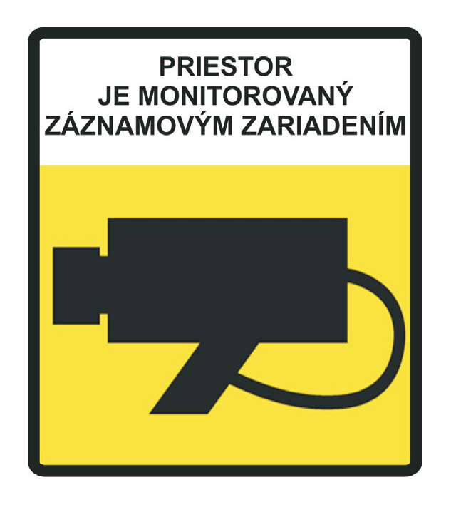

Príloha č. 21a k vyhláške č. 29/2006 Z. z.

- VZOR OZNAČENIA STANICE TECHNICKEJ KONTROLY O MONITOROVANÍ MONITOROVACÍM ZÁZNAMOVÝM ZARIADENÍM 

- Výška označenia je minimálne 300 mm a šírka označenia je minimálne 200 mm.

- Označenie sa umiestňuje pri vstupe na kontrolnú linku a pri výstupe z kontrolnej linky stanice technickej kontroly z obidvoch strán.
