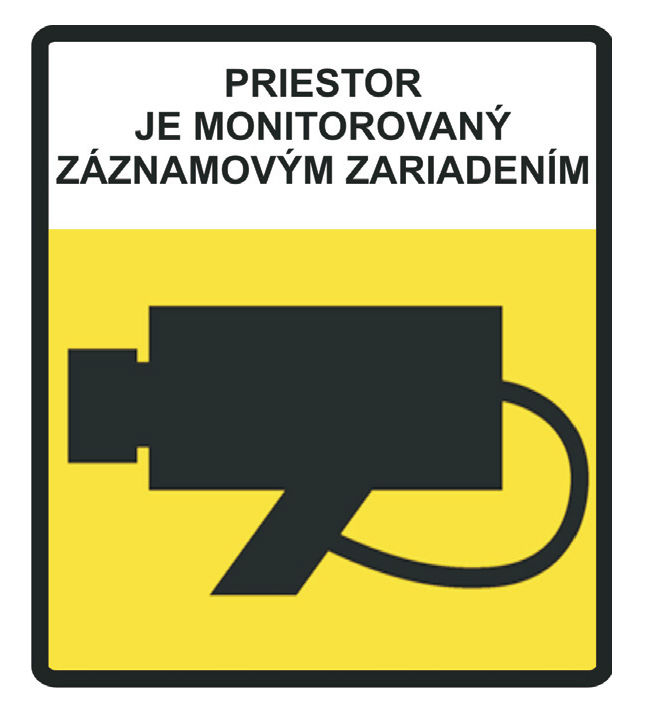

Príloha č. 22a k vyhláške č. 29/2006 Z. z.

- VZOR OZNAČENIA PRACOVISKA EMISNEJ KONTROLY O MONITOROVANÍ MONITOROVACÍM ZÁZNAMOVÝM ZARIADENÍM 

- Výška označenia je minimálne 300 mm a šírka označenia je minimálne 200 mm.

- Označenie sa umiestňuje pri vstupe na pracovisko emisnej kontroly, prípadne pri výstupe z pracoviska emisnej kontroly z obidvoch strán.
