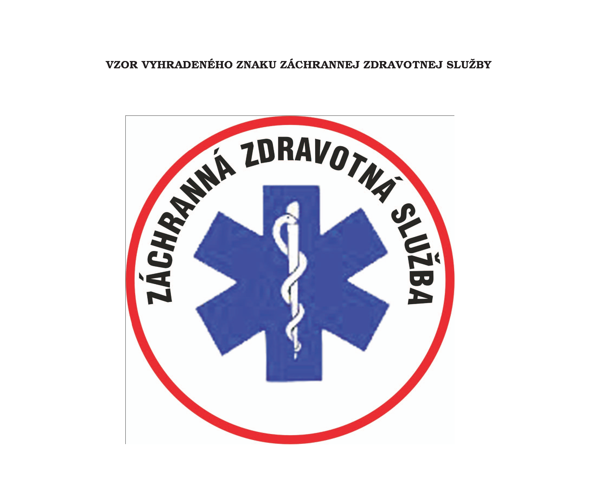

Príloha č. 6 k vyhláške č. 30/2006 Z. z.

- OZNAČOVANIE

  - Operačné strediská, zásahové strediská, ambulancie a ochranné odevy sa jednotne označujú vyhradeným znakom záchrannej zdravotnej služby, ktorého vzor je uvedený v bode 8 tejto prílohy.

  - 1. Označenie operačného strediska obsahuje

    - a) vyhradený znak záchrannej zdravotnej služby,

    - b) nápis „Operačné stredisko záchrannej zdravotnej služby“,

    - c) názov a sídlo pracoviska,

    - d) titul, meno a priezvisko vedúceho pracovníka.

  - 2. Označenie zásahového strediska obsahuje

    - a) vyhradený znak záchrannej zdravotnej služby,

    - b) nápis „Zásahové operačné stredisko záchrannej zdravotnej služby“,

    - c) názov a sídlo pracoviska,

    - d) názov poskytovateľa,

    - e) titul, meno a priezvisko vedúceho pracovníka.

  - 3. Označenie stanice obsahuje

    - a) vyhradený znak záchrannej zdravotnej služby,

    - b) nápis „Stanica záchrannej zdravotnej služby“,

    - c) názov a sídlo pracoviska,

    - d) názov poskytovateľa,

    - e) titul, meno a priezvisko vedúceho pracovníka.

  - 4. Pozemné dopravné prostriedky záchrannej zdravotnej služby majú

    - a) karosériu farby polárna biela,

    - b) po obvode vozidla jeden pás so šírkou najmenej 100 mm vo farbe signálna červená,

    - c) na bočných stranách vozidla nápis „ZÁCHRANNÁ ZDRAVOTNÁ SLUŽBA“ s výškou písma najmenej 100 mm,

    - d) vyhradený znak záchrannej zdravotnej služby s priemerom kruhu minimálne 300 mm,

    - e) symbol telefónu a číslo 155 modrej farby a symbol SOS 112 červenej farby na bočnej strane vozidla,

    - f) logo prevádzkovateľa alebo názov a sídlo prevádzkovateľa s výškou písma najmenej 100 mm,

    - g) na prednej kapote nápis „AMBULANCIA“, ktorý môže byť aj zrkadlovo obrátený,

    - h) ak vozidlo nemá nad zadnými dverami svetelnú výstražnú rampu žltej farby, má na vnútornej ploche zadných dverí reflexný pás so šírkou 100 mm so striedajúcimi sa bielymi a červenými šikmými pásmi.

  - 5. Letecké dopravné prostriedky záchrannej zdravotnej služby majú

    - a) výsostné označenia ustanovené predpismi o civilnom letectve,

    - b) označenie vyhradeným znakom záchrannej zdravotnej služby,

    - c) nápis „AIR MEDICAL SERVICE“ alebo „AEROMEDICAL SERVICE“ v hornom polkruhu a „LETECKÁ ZÁCHRANNÁ ZDRAVOTNÁ SLUŽBA“ v dolnom polkruhu okolo hviezdy. Veľkosť a umiestnenie označenia určujú možnosti používaného dopravného prostriedku.

  - 6. Vodné dopravné prostriedky záchrannej zdravotnej služby majú

    - a) označenia ustanovené predpismi o vnútrozemskej plavbe,

    - b) označenie vyhradeným znakom záchrannej zdravotnej služby,

    - c) nápis „WATER MEDICAL SERVICE“ v hornom polkruhu a „VODNÁ ZÁCHRANNÁ ZDRAVOTNÁ SLUŽBA“ v dolnom polkruhu okolo hviezdy. Veľkosť a umiestnenie označenia určujú možnosti používaného dopravného prostriedku.

  - 7. Označenie ochranných odevov zásahových skupín záchrannej zdravotnej služby

    - Na vrchnom ochrannom odeve zdravotníckych pracovníkov záchrannej zdravotnej služby sú označenia

    - a) na hrudníku vpredu na ľavej strane je umiestnená menovka s menom a priezviskom alebo identifikačná karta s menom a priezviskom, pracovným zaradením a názvom poskytovateľa,

    - b) na chrbte nápis „ZÁCHRANNÁ ZDRAVOTNÁ SLUŽBA“,

    - c) dva reflexné vodorovné pásy so šírkou 5 až 10 cm, s dĺžkou najmenej 25 cm, vzdialené od seba 5 až 10 cm a umiestnené súmerne na strednú zvislú os tejto plochy, pričom poloha ani jedného z pásov na stojacej osobe nesmie byť nižšie ako 90 cm nad úrovňou vozovky.

  - 8. VZOR VYHRADENÉHO ZNAKU ZÁCHRANNEJ ZDRAVOTNEJ SLUŽBY

  - 

  - Vyhradený znak záchrannej zdravotnej služby tvorí biely kruh s červeným lemom, v jeho strede je umiestnený symbol modrej hviezdy života s bielym znakom hada na palici umiestneným vo zvislej osi hviezdy. Nad hviezdou v polkruhu je umiestnený nápis Záchranná zdravotná služba a pod hviezdou v polkruhu je umiestnený názov sídla pracoviska.
