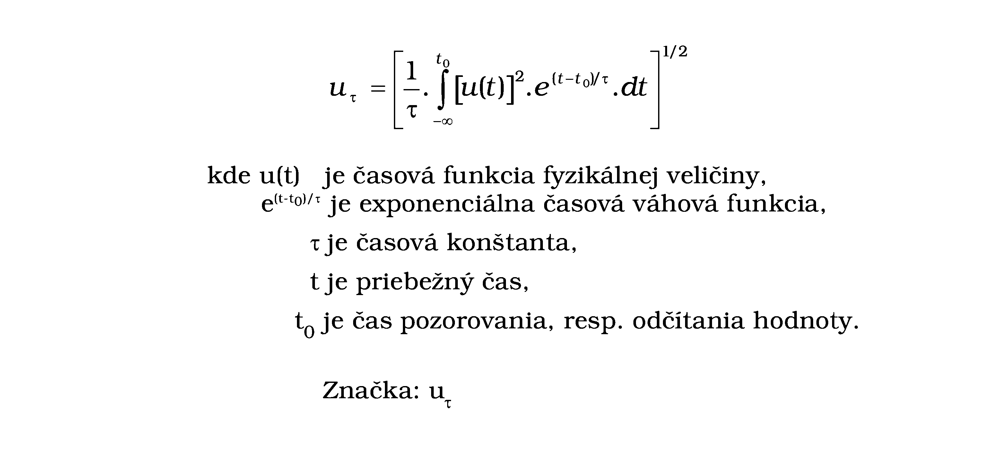
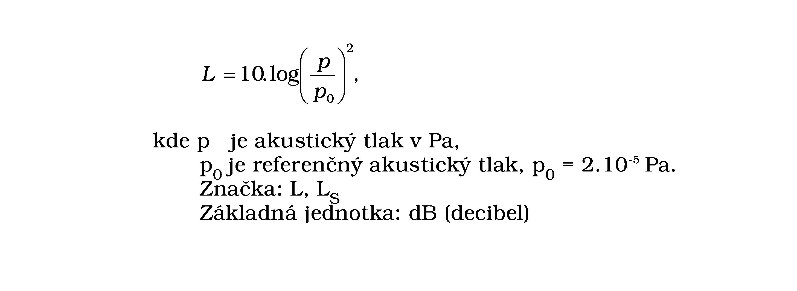
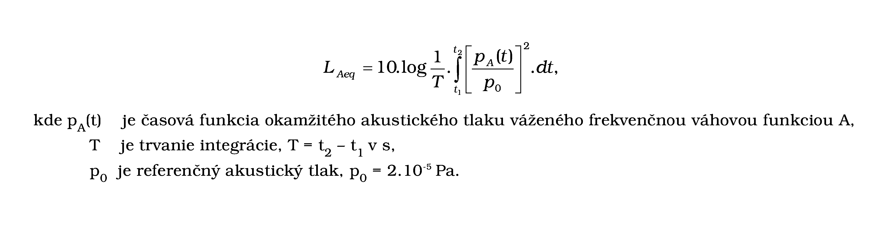
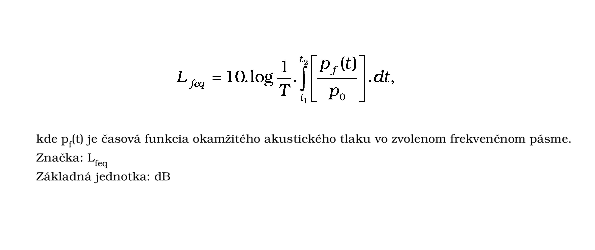
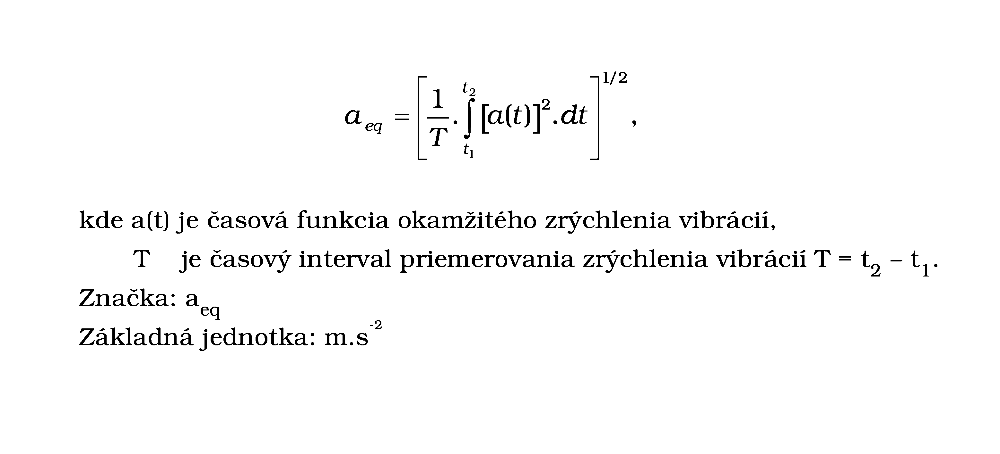

Príloha č. 1 k nariadeniu vlády č. 339/2006 Z. z.

- Definície pojmov

  - 1. Zvuk je akustické vlnenie schopné vyvolať u človeka vnem.

  - 2. Hluk je každý rušivý, obťažujúci, nepríjemný, nežiaduci, neprimeraný alebo škodlivý zvuk.

    - Poznámka 1: vo vonkajšom prostredí sa rozlišuje hluk najmä z nasledujúcich zdrojov:

    - a) hluk z dopravy na pozemných komunikáciách a vodných plochách vrátane miestnej hromadnej dopravy,

    - b) hluk z koľajovej dopravy na železničných dráhach,

    - c) hluk z leteckej dopravy a hluk v okolí letísk,

    - d) hluk z iných zdrojov, t. j. hluk stacionárnych zdrojov, hluk z priemyselnej, stavebnej a výrobnej činnosti a hluk z mimopracovných aktivít človeka.

    - Poznámka 2: vo vnútornom prostredí budov sa rozlišuje hluk najmä z nasledujúcich zdrojov:

    - a) hluk z vnútorných zdrojov v budove, t. j. hluk z technických zariadení budov a iných inštalácií v budove, hluk z aktivít človeka v budove,

    - b) hluk prenikajúci z vonkajšieho prostredia, t. j. hluk z dopravy a z iných zdrojov.

  - 3. Frekvenčné pásmo je oblasť frekvencií ohraničená dolnou hraničnou frekvenciou a hornou hraničnou frekvenciou (STN EN 61260 Elektroakustika. Oktávové a zlomkovo-oktávové filtre, STN EN ISO 266 Akustika. Normalizované frekvencie).

    - Rozloženie zvuku do frekvenčných pásiem tvorí frekvenčné spektrum zvuku.

    - Poznámka: Frekvenčné pásmo charakterizuje menovitá stredná frekvencia fs.

  - 4. Počuteľný zvuk je zvuk vo frekvenčnom rozsahu tretinooktávových pásiem s menovitými strednými frekvenciami od 20 Hz do 20 kHz.

  - 5. Infrazvuk je zvuk vo frekvenčnom rozsahu tretinooktávových pásiem s menovitými strednými frekvenciami do 16 Hz.

  - 6. Vibrácie (mechanické kmitanie) je pohyb mechanickej sústavy alebo jej časti, pri ktorom veličina opisujúca jej polohu, zrýchlenie, rýchlosť alebo stav je striedavo väčšia a menšia ako rovnovážna alebo vzťažná hodnota tejto veličiny.

  - 7. Otras je náhla jednorazová alebo opakovaná zmena veličiny opisujúcej vibrácie.

  - 8. Vibrácie pôsobiace na celé telo sú vibrácie, ktoré sa v budovách prenášajú na stojacu, sediacu alebo ležiacu osobu cez kontaktný povrch a predstavujú riziko pre zdravie človeka alebo pôsobia rušivo.

  - 9. Priebežná efektívna hodnota fyzikálnej veličiny je hodnota tejto veličiny určená podľa vzťahu

- 

  - Poznámka: Uplatnenie exponenciálnej funkcie priemerovania je násobenie druhej mocniny časovej funkcie fyzikálnej veličiny exponenciálnou funkciou s definovanou časovou konštantou τ. Pri meraní zvuku má časová váhová funkcia F (Fast) konštantu 0,125 s. Časová váhová funkcia S (Slow) má časovú konštantu 1,0 s. Použitie časových váhových funkcií sa vyjadruje v značke indexom alebo použitou časovou konštantou, napríklad 10 s.

  - Uvedenie veličiny bez indexu znamená použitie časovej váhovej funkcie F pri meraní zvuku a časovej váhovej funkcie S pri meraní vibrácií.

  - 10. Okamžitý akustický tlak je rozdiel medzi celkovým tlakom a statickým tlakom v danom časovom okamihu tia v danom bode prostredia.

    - Značka: p(ti)

    - Základná jednotka: Pa (pascal)

    - Poznámka: Závislosť okamžitého tlaku od času udáva časová funkcia akustického tlaku p(t).

  - 11. Akustický tlak je priebežná efektívna hodnota tlaku určená z časovej funkcie akustického tlaku p(t) v súlade s definícou podľa bodu 9.

    - Značka: p, pS

    - Základná jednotka: Pa

  - 12. Hladina akustického tlaku; priebežná hladina akustického tlaku je veličina určená vzťahom

- 

- Poznámka: Index v značke sa riadi poznámkou v bode 9.

  - 13. Hladina akustického tlaku vo frekvenčnom pásme je priebežná hladina akustického tlaku určená podľa bodu 12, pričom sa použije akustický tlak z príslušného frekvenčného pásma.

    - Značka: Lo,fspre hladiny v oktávových frekvenčných pásmach s menovitou strednou frekvenciou pásma fS (napr. Lo, 250 pre fS = 250 Hz)

    - Lt,fs pre hladiny v tretinooktávových frekvenčných pásmach s menovitou strednou frekvenciou pásma fS (napr. Lt, 250 pre fS = 250 Hz)

    - Základná jednotka: dB

  - 14. Hladina A zvuku; hladina zvuku s frekvenčným vážením A je priebežná hladina akustického tlaku podľa bodu 12, ktorý je korigovaný frekvenčnou váhovou funkciou A (STN IEC 61672-1: 2005 Elektroakustika. Zvukomery. Časť 1: Technické požiadavky).

    - Pri použití frekvenčnej váhovej funkcie C (STN IEC 61672-1: 2005) sa písmeno A mení na písmeno C.

    - Značka: LA, LC(pri časovom vážení S bude LAS, LCS)

    - Základná jednotka: dB

    - Poznámka: Akustický tlak korigovaný frekvenčnou váhovou funkciou A(C) sa skrátene nazýva A (C) – vážený akustický tlak.

    - Značka: pA, pC

  - 15. Hladina G infrazvuku; hladina infrazvuku s frekvenčným vážením G je priebežná hladina akustického tlaku podľa bodu 12, ktorý je korigovaný frekvenčnou váhovou funkciou G (STN ISO 7196: 2001 Akustika. Frekvenčná váhová funkcia na meranie infrazvuku).

    - Značka: LG

    - Základná jednotka: dB

  - 16. Ekvivalentná hladina A zvuku je veličina definovaná vzťahom

- 

- Obdobne je definovaná ekvivalentná hladina C zvuku a ekvivalentná hladina G infrazvuku.

- Značka: LAeq, LCeq, LGeq

- Základná jednotka: dB

- Poznámka: Index v značke sa môže doplniť časovým údajom T, napr. LAeq,30min, LAeq,12h,LAeq,d.

  - 17. Ekvivalentná hladina akustického tlaku vo frekvenčnom pásme je veličina určená vzťahom

- 

- Poznámka: Index v značke sa riadi podľa bodu 13, napr. Lt,250eq.

  - 18. Maximálna hladina A zvuku je najvyššia hodnota hladiny A zvuku v sledovanom časovom intervale pri použití časovej váhovej funkcie F; použitie inej časovej váhovej funkcie sa uvedie v značke, napr. LASmax.

    - Značka: LAmax

    - Základná jednotka: dB

  - 19. Ustálený hluk je súvislý zvuk, ktorého hladina akustického tlaku sa v mieste a v čase pozorovania významne nemení.

  - 20. Premenný hluk je súvislý zvuk, ktorého hladina akustického tlaku sa v mieste a v čase pozorovania významne mení, ale nie je impulzový.

  - 21. Prerušovaný hluk je zvuk, ktorý sa v mieste pozorovania vyskytuje v pravidelných alebo nepravidelných časových intervaloch, pričom trvanie každého intervalu je spravidla dlhšie ako 5 s, napr. prejazd motorových vozidiel, vlaku, prelet lietadla, prerušovaná činnosť kompresora a pod.

  - 22. Zvlášť rušivý hluk je zvuk, ktorý individuálne silne obťažuje človeka, napr. výrazné rytmické alebo tónové zložky vo zvuku, hlasitá reč, hudba, intenzívne a opakujúce sa zvukové impulzy, prerušovaný alebo premenný hluk s veľkým rozdielom hladín.

  - 23. Tónový hluk je zvuk, ktorému možno subjektívne prisúdiť výšku. Zvuk sa považuje za tónový, ak je tónová zložka počuteľná a pôsobí rušivo.

    - Prítomnosť tónovej zložky vo frekvenčnom spektre zvuku sa preukazuje tretinooktávovou frekvenčnou analýzou tak, že hladina akustického tlaku v niektorom pásme prevyšuje hladiny v oboch susedných pásmach viac ako o 5 dB. V niektorých prípadoch je potrebné použiť analýzu pomocou užších frekvenčných pásiem.

  - 24. Zvukový impulz je jednorazový akustický dej charakterizovaný náhlym nárastom akustického tlaku a krátkym trvaním.

  - 25. Impulzový hluk je rušivý alebo nepríjemný zvuk, ktorý vzniká v dôsledku jedného alebo viacerých zvukových impulzov. Impulzový hluk v závislosti od druhu zdroja sa primerane posudzuje podľa technickej normy STN ISO 1996-1: 2006 Akustika. Opis, meranie a posudzovanie hluku vo vonkajšom prostredí. Časť 1: Základné veličiny a postupy posudzovania.

  - 26. Okamžité zrýchlenie vibrácií je hodnota časovej funkcie zrýchlenia vibrácií v danom časovom okamihu tia na danom mieste.

    - Značka: a(ti)

    - Základná jednotka: m.s-2

    - Poznámka: Závislosť okamžitého zrýchlenie vibrácií od času udáva časová funkcia okamžité zrýchlenie vibrácií a(t).

  - 27. Zrýchlenie vibrácií je priebežná efektívna hodnota zrýchlenia vibrácií určená z časovej funkcie okamžitého zrýchlenia vibrácií podľa definície v bode 9.

    - Značka: a, aτ

    - Základná jednotka: m.s-2

  - 28. Vážené zrýchlenie vibrácií je zrýchlenie vibrácií korigované frekvenčnou váhovou funkciou podľa druhu prenosu a smeru pôsobenia vibrácií [STN ISO 2631-1:1999 Mechanické kmitanie a otrasy. Hodnotenie expozície človeka kmitaniu na celé telo. Časť1: Všeobecné požiadavky, STN ISO 2631-2:2004 Mechanické kmitanie a otrasy. Hodnotenie expozície človeka kmitaniu na celé telo. Časť 2: Kmitanie v budovách (od 1Hz do 80 Hz)].

    - Značka: aw

    - Základná jednotka: m.s-2

  - 29. Ekvivalentné zrýchlenie vibrácií je efektívna hodnota zrýchlenia definovaná vzťahom

- 

  - 30. Ekvivalentné vážené zrýchlenie vibrácií je ekvivalentné zrýchlenie vibrácií získané použitím frekvenčnej váhovej funkcie podľa bodu 28 na časovú funkciu okamžitého zrýchlenia vibrácií.

    - Značka: aweq

    - Základná jednotka: m.s-2

    - Poznámka: Index v značke sa môže doplniť časovým údajom T, napr. aweq,1h.

  - 31. Maximálne vážené zrýchlenie vibrácií je najvyššia hodnota váženého zrýchlenia vibrácií v sledovanom časovom intervale a v danom mieste pri časovej váhovej funkcii S.

    - Značka: awmax

    - Základná jednotka: ms-2

  - 32. Určujúca veličina je fyzikálna veličina, ktorá kvantitatívne a kvalitatívne charakterizuje hluk, infrazvuk alebo vibrácie a používa sa na hodnotenie nepriaznivých účinkov hluku, infrazvuku alebo vibrácií z hľadiska ochrany verejného zdravia.

  - 33. Referenčný časový interval je časový interval, na ktorý sa vzťahuje posudzovaná alebo prípustná hodnota.

    - Referenčný časový interval pre deň je od 6.00 do 18.00 hod. (12 hod.), pre večer od 18.00 do 22.00 hod. (4 hod.) a pre noc od 22.00 do 6.00 hod. (8 hod.).

    - V odôvodnených prípadoch sa použije aj iná dĺžka referenčného časového intervalu, napr. ak je pre ňu definovaná prípustná hodnota.

  - 34. Posudzovaná hodnota je hodnota, ktorá sa porovnáva s prípustnou hodnotou.

    - Je to nameraná hodnota určujúcej veličiny zväčšená o neistotu merania alebo predpokladaná hodnota určujúcej veličiny upravená korekciami a stanovená vzhľadom na referenčný časový interval.

    - Poznámka: V značke veličiny sa uvádza index R, napr. LR,Aeq,d, LR,Aeq,v, LR,Aeq,n, LR,Amax,aR,weq.

  - 35. Prípustné hodnoty určujúcich veličín sú dohodnuté limity, ktorých neprekračovanie sa považuje za dostatočné zabezpečenie ochrany verejného zdravia.

    - Poznámka: V značke veličiny sa uvádza index p, napr. LAeq,d,p, LAmax,p, aweq,p.

  - 36. Neistota merania je interval hodnôt okolo nameranej hodnoty, ktoré možno odôvodnene priradiť k výsledku merania (TPM 0051- 93 Stanovenie neistôt pri meraniach).

    - Poznámka: Rozšírená neistota merania sa pripočíta k nameranej hodnote.

  - 37. Hluk pozadia, šum pozadia je hluk alebo iné vplyvy registrované meracími prístrojmi aj vtedy, ak zvuk, infrazvuk alebo vibrácie, ktoré sa majú na základe merania posudzovať, nepôsobia.

    - Ak je rozdiel hladiny meraného zvuku a hladiny hluku pozadia menší ako 3 dB, nemožno jednoznačne určiť zvuk alebo infrazvuk, ktorý sa má na základe merania posudzovať. Obdobne to platí aj pre vibrácie.

  - 38. Chránený priestor je vnútorné alebo vonkajšie prostredie, v ktorom sa zdržujú ľudia trvale alebo opakovane a pre ktoré sú stanovené prípustné hodnoty hluku, infrazvuku a vibrácií, napr. chránená miestnosť.

  - 39. Hlukový indikátor vo vonkajšom prostredí je celoročná priemerná hladina A zvuku vo vonkajšom prostredí určená počas všetkých dní kalendárneho roka, charakteristická pre celkové obťažovanie hlukom a slúži na účely strategického posudzovania hluku podľa osobitných predpisov.7)

    - Značka: Ldvn,Lnoc

  - 40. Akčná hodnota je taká hodnota hlukového indikátora vo vonkajšom prostredí,7) ktorej prekročenie je dôvodom na návrh opatrení na zníženie hluku alebo vibrácií.

  - 41. Objektivizácia je stanovenie posudzovanej hodnoty určujúcej veličiny.

  - 42. Hodnotenie je porovnanie posudzovanej hodnoty určujúcej veličiny s prípustnou hodnotou.
