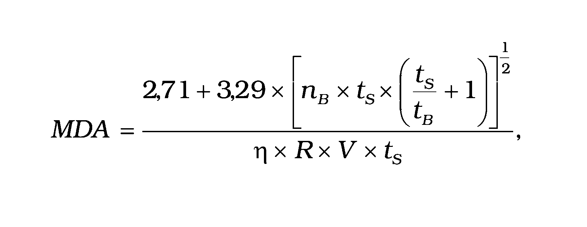
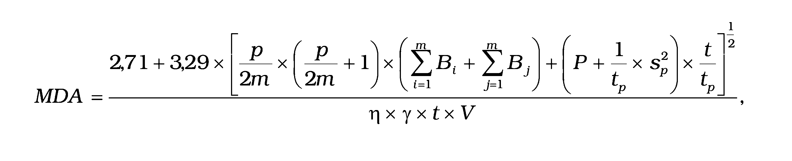

Príloha č. 1 k nariadeniu vlády č. 347/2006 Z. z.

- POŽIADAVKY NA MONITOROVANIE PRI NORMÁLNEJ RADIAČNEJ SITUÁCII Monitorovaná položka | Meraná veličina | Metóda merania, sledovaný rádionuklid | Minimálny počet miest | Minimálny počet meraní za rok | Požadovaná citlivosť merania

- Externé ožiarenie | Príkon priestorového dávkového ekvivalentu | Kontinuálne meranie a hodnotenie | 20 | Kontinuálne, hodinové a desať minútové priemery | Rozsah merania od 50 nSv/h

- Externé ožiarenie | Príkon priestorového dávkového ekvivalentu | Kontinuálne meranie a hodnotenie | 3 | Kontinuálne, hodinové a desať minútové priemery | Rozsah merania od 50 nSv/h

- Externé ožiarenie | Príkon priestorového dávkového ekvivalentu | Vyhľadávacie (screeningové) monitorovanie | Meranie na trase minimálne 50 km | 4 | Rozsah merania od 50 nSv/h

- Externé ožiarenie | Priestorový dávkový ekvivalent | kontinuálne meranie, periodické vyhodnocovanie, TLD | 50 | 4, štvrťročné vyhodnocovanie | Fotónový dávkový ekvivalent od 100mikroSv

- Aerosóly v ovzduší | Objemová aktivita rádionuklidov | Kontinuálny odber, periodické vyhodnocovanie, gamaspektrometrické meranie, K-40 | 5 | 26 - 52,týždenné až dvojtýždenné vy- hodnocovanie | MDA<1x10-4 Bq/m3 pre Cs-137

- Aerosóly v ovzduší | Objemová aktivita rádionuklidov | Kontinuálny odber, periodické vyhodnocovanie,gamaspektrometrické merania (vrátane Be-7 a Cs-137), analýza Sr-90 | 1 až 2 | 52,týždenné vyhodnocovanie prí- rodných rádionuklidov a Cs-137,štvrťročné vyhodnocovanie Sr-90 | MDA<1x10-4 Bq/m3 pre prírodné rádionuklidy,MDA<1x10-5 Bq/m3 pre Cs-137,MDA<5x10-7 Bq/m3 pre Sr-90

- Atmosférický spad | Plošná aktivita rádionuklidov | Kontinuálny odber, periodické vyhodnocovanie, gamaspektrometria | 3 | 12, mesačné vyhodnocovanie | MDA<1 Bq/m2 pre Cs-137

- Pôda, tráva a iné porasty | Plošná aktivita rádionuklidov | Gamaspektrometrické meranie | 5 | 1 | MDA< 10 Bq/m2 pre Cs-137

- Pôda | Plošná aktivita rádionuklidov | Gamaspektrometrické meranie in situ | 5 | 1 | MDA< 1000 Bq/m2 pre Cs-137

- Povrchová voda | Objemová aktivita rádionuklidov | Gamaspektrometrické meranie (Cs-137), prípadne celková beta aktivita, K-40, H-3 | 5 | 1-4, štvrťročné odbery až ročné | MDA<10 Bq/dm3 pre H-3, MDA<1 Bq/dm3 pre Cs-137, MDA<0,1 Bq/dm3 pre Sr-90

- Povrchová voda | Objemová aktivita rádionuklidov | Gamaspektrometrické meranie (Cs-137), H-3 | 2 | 12, mesačné odbery | MDA<10 Bq/dm3 pre H-3,MDA<0,1 Bq/dm3 pre Cs-137,MDA< 0,05 Bq/dm3 pre Sr-90

- Pitná voda | Objemová aktivita rádionuklidov | Prírodné rádionuklidy, H-3, Sr-90, Cs-137 | 3 | 12, mesačné odbery | MDA<10 Bq/dm3 pre H-3,MDA pre celkovú alfa aktivitu 0,04 Bq/m3, MDApre prírodné rádionuklidy na úrovni desatiny najvyššej prípustnej hodnoty,MDA< 0,05 Bq/dm3 pre Cs-137,MDA<0,01 Bq/dm3 pre Sr-90

- Pitná voda | Objemová aktivita rádionuklidov | Prírodné rádionuklidy, H-3, Sr-90, Cs-137 | 10 | 4, štvťročne | MDA< 10 Bq/dm3 pre H-3,MDA pre prírodné rádionuklidy na úrovni desatiny odvodenej zásahovej úrovne,MDA<0,1 Bq/dm3 pre Cs-137,MDA< 0,05 Bq/dm3 pre Sr-90

- Vodárenský kal | Hmotnostná aktivita rádionuklidov | Gamaspektrometrické meranie | 1 | 1 | MDA<1 Bq/kg pre Cs-137

- Riečne sedimenty | Hmotnostná aktivita rádionuklidov | Gamaspektrometrické meranie | 2 | 1 | MDA<1 Bq/kg pre Cs-137

- Mlieko | Objemová aktivita rádionuklidov | Gamaspektrometrické meranie (Cs-137),Sr-90 | 5 | 4 | MDA< 0,5 Bq/dm3 pre Cs-137,MDA< 0,2 Bq/dm3 pre Sr-90

- Mlieko | Objemová aktivita rádionuklidov | Gamaspektrometrické meranie (Cs-137),Sr-90, K-40 | 1 | 12 | MDA<0,1 Bq/dm3 pre Cs-137,MDA< 0,05 Bq/dm3 pre Sr-90

- Mäso bravčové | Hmotnostná aktivita rádionuklidov | Gamaspektrometrické meranie (Cs-137),Sr-90 | 1 | 1 | MDA< 0,5 Bq/kg pre Cs-137, MDA<0,1 Bq/kg pre Sr-90

- Mäso hovädzie | Hmotnostná aktivita rádionuklidov | Gamaspektrometrické meranie (Cs-137),Sr-90 | 1 | 1 | MDA< 0,5 Bq/kg pre Cs-137, MDA<0,1 Bq/kg pre Sr-90

- Mäso baranie | Hmotnostná aktivita rádionuklidov | Gamaspektrometrické meranie (Cs-137), Sr-90 | 1 | 1 | MDA< 0,5 Bq/kg pre Cs-137, MDA<0,1 Bq/kg pre Sr-90

- Mäso hydinové | Hmotnostná aktivita rádionuklidov | Gamaspektrometrické meranie (Cs-137), Sr-90 | 1 | 1 | MDA<0,5 Bq/kg pre Cs-137, MDA<0,1 Bq/kg pre Sr-90

- Divina | Hmotnostná aktivita rádionuklidov | Gamaspektrometrické meranie (Cs-137), Sr-90 | 1 | 1 | MDA<0,5 Bq/kg pre Cs-137, MDA<0,1 Bq/kg pre Sr-90

- Ryby | Hmotnostná aktivita rádionuklidov | Gamaspektrometrické meranie (Cs-137), Sr-90 | 1 | 1 | MDA< 0,5 Bq/kg pre Cs-137, MDA<0,1 Bq/kg pre Sr-90

- Vajcia | Hmotnostná aktivita rádionuklidov | Gamaspektrometrické meranie (Cs-137), Sr-90 | 1 | 1 | MDA< 0,5 Bq/kg pre Cs-137, MDA<0,1 Bq/kg pre Sr-90

- Pšenica | Hmotnostná aktivita rádionuklidov | Gamaspektrometrické meranie (Cs-137), Sr-90 | 4 | 1 | MDA< 0,5 Bq/kg pre Cs-137, MDA<0,1 Bq/kg pre Sr-90

- Jačmeň | Hmotnostná aktivita rádionuklidov | Gamaspektrometrické meranie (Cs-137), Sr-90 | 4 | 1 | MDA< 0,5 Bq/kg pre Cs-137, MDA<0,1 Bq/kg pre Sr-90

- Ovos | Hmotnostná aktivita rádionuklidov | Gamaspektrometrické meranie (Cs-137), Sr-90 | 4 | 1 | MDA< 0,5 Bq/kg pre Cs-137, MDA<0,1 Bq/kg pre Sr-90

- Kukurica | Hmotnostná aktivita rádionuklidov | Gamaspektrometrické meranie (Cs-137),Sr-90 | 4 | 1 | MDA< 0,5 Bq/kg pre Cs-137, MDA<0,1 Bq/kg pre Sr-90

- Zemiaky | Hmotnostná aktivita rádionuklidov | Gamaspektrometrické meranie (Cs-137),Sr-90 | 4 | 1 | MDA< 0,5 Bq/kg pre Cs-137, MDA<0,1 Bq/kg pre Sr-90

- Listová zelenina | Hmotnostná aktivita rádionuklidov | Gamaspektrometrické meranie (Cs-137),Sr-90 | 4 | 1 | MDA< 0,5 Bq/kg pre Cs-137, MDA<0,1 Bq/kg pre Sr-90

- Koreňová zelenina | Hmotnostná aktivita rádionuklidov | Gamaspektrometrické meranie (Cs-137),Sr-90 | 4 | 1 | MDA< 0,5 Bq/kg pre Cs-137, MDA<0,1 Bq/kg pre Sr-90

- Plodová zelenina | Hmotnostná aktivita rádionuklidov | Gamaspektrometrické meranie (Cs-137),Sr-90 | 4 | 1 | MDA< 0,5 Bq/kg pre Cs-137, MDA<0,1 Bq/kg pre Sr-90

- Ovocie | Hmotnostná aktivita rádionuklidov | Gamaspektrometrické meranie (Cs-137),Sr-90 | 4 | 1 | MDA< 0,5 Bq/kg pre Cs-137, MDA<0,1 Bq/kg pre Sr-90

- Lesné plody | Hmotnostná aktivita rádionuklidov | Gamaspektrometrické meranie (Cs-137),Sr-90 | 2 | 1 | MDA< 0,5 Bq/kg pre Cs-137, MDA<0,1 Bq/kg pre Sr-90

- Huby | Hmotnostná aktivita rádionuklidov | Gamaspektrometrické meranie (Cs-137),Sr-90 | 2 | 1 | MDA< 0,5 Bq/kg pre Cs-137, MDA<0,1 Bq/kg pre Sr-90

- Čajoviny a liečivé rastliny | Hmotnostná aktivita rádionuklidov | Gamaspektrometrické meranie (Cs-137),Sr-90 | 4 | 1 | MDA< 0,5 Bq/kg pre Cs-137, MDA<0,1 Bq/kg pre Sr-90

- Múka | Hmotnostná aktivita rádionuklidov | Gamaspektrometrické meranie (Cs-137),Sr-90 | 2 | 2 | MDA< 0,5 Bq/kg pre Cs-137, MDA<0,1 Bq/kg pre Sr-90

- Ryža | Hmotnostná aktivita rádionuklidov | Gamaspektrometrické meranie (Cs-137),Sr-90 | 2 | 2 | MDA< 0,5 Bq/kg pre Cs-137, MDA<0,1 Bq/kg pre Sr-90

- Rastlinné oleje a tuky | Hmotnostná aktivita rádionuklidov | Gamaspektrometrické meranie (Cs-137),Sr-90 | 2 | 2 | MDA< 0,5 Bq/kg pre Cs-137, MDA<0,1 Bq/kg pre Sr-90

- Mixovaná denná strava | Hmotnostná aktivita rádionuklidov | Gamaspektrometrické meranie (Cs-137),Sr-90 | 2 | 2 | MDA<0,1 Bq/ deň pre Cs-137,MDA< 0,05 Bq/deň pre Sr-90

- Importované potraviny | Hmotnostná aktivita rádionuklidov | Gamaspektrometrické meranie (Cs-137), | | Podľa potreby | MDA< 100 Bq/kg pre Cs-137

- Vnútorná kontaminácia osôb rádionuklidmi | Aktivita rádionuklidov v tele | Gamaspektrometrické meranie (Cs-137) | 5 | 1 | MDA< 200 Bq pre Cs-137

- Vnútorná kontaminácia osôb rádionuklidmi | Aktivita rádionuklidov v dennom moci | Gamaspektrometrické meranie (Cs-137) | 5 | I | MDA<0,05 Bq/deň pre Cs-137

- Vysvetlivky:

- Ak sa v prílohe č. 1 a v prílohe č. 2 na meranie aktivity v monitorovanej položke používa ako kritérium požadovanej citlivosti merania minimálna detegovateľná aktivita (MDA), stanovuje sa pre hladinu spoľahlivosti 95 % podľa vzťahu

- a) pre nespektrometrické merania:

- 

- kde:

- MDA je minimálna detegovateľná aktivita [ Bq, Bq/kg],

- nBje početnosť impulzov pozadia,

- tB je doba merania pozadia,

- tSje doba merania vzorky,

- ç je detekčná účinnosť,

- R je chemická výťažnosť,

- V je množstvo vzorky (objem, hmotnosť...),

- b) pre spektrometrické merania:

- 

- kde:

- MDA je minimálna detegovateľná aktivita [ Bq, Bq/kg...],

- p je počet kanálov v oblasti, z ktorej sa stanovila plocha píku,

- P je plocha interferujúceho píku, t. j. plocha píku na energii E stanovená pri meraní pozadia bez prítomnosti

- vzorku,

- Bi,Bjje počet impulzov v i-tom kanáli na ľavej strane píku a j-tom kanáli na pravej strane píku v oblasti, z ktorej sa od-

- haduje pozadie pod píkom, je variancia charakterizujúca chybu odhadu plochy P interferujúceho píku,

- tB je doba merania pozadia,

- tSje doba merania vzorky,

- ç je detekčná účinnosť fotónov s energiou E,

- a je zastúpenie fotónov s energiou E v rozpadovej schéme daného rádionuklidu,

- m je počet kanálov na každej strane píku slúžiacich na určenie pozadia,

- V je množstvo vzorky (objem, hmotnosť...).
