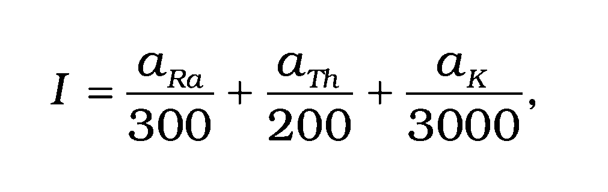

Príloha č. 2 k nariadeniu vlády č. 350/2006 Z. z.

- SPÔSOB STANOVENIA INDEXU HMOTNOSTNEJ AKTIVITY PRE OBSAH PRÍRODNÝCH RÁDIONUKLIDOV V STAVEBNÝCH VÝROBKOCH

  - Index hmotnostnej aktivity je bezrozmerná veličina určená vzťahom:

- 

  - kde aRa, aTh, aK sú namerané hmotnostné aktivity 226Ra, 232Th a 40K v stavebnom výrobku. Ak je obsah niektorého rádionuklidu menší ako najmenšia detegovateľná hmotnostná aktivita, tak sa pri výpočte indexu hmotnostnej aktivity použije pre takýto rádionuklid hodnota najmenšej detegovateľnej aktivity.
