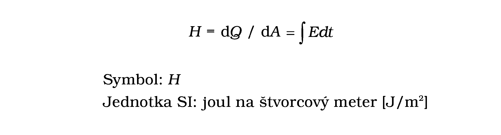
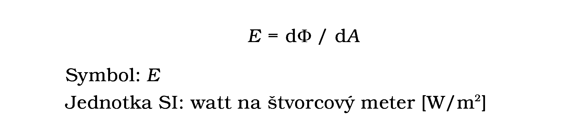
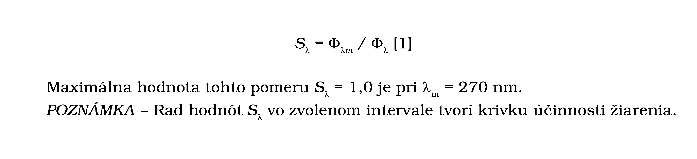

Príloha č. 1 k nariadeniu vlády č. 351/2006 Z. z.

- DEFINÍCIE POJMOV

  - 1. Optické žiarenie je ultrafialové, infračervené a laserové žiarenie.

  - 2. Ultrafialové (UV) žiarenie je nekoherentné optické žiarenie, ktorého vlnová dĺžka je kratšia ako vlnová dĺžka viditeľného svetla.

  - Poznámka – Pre ultrafialové žiarenie sa obyčajne rozdeľuje oblasť vlnových dĺžok od 100 nm do 400 nm na

  - UV-A 315 nm až 400 nm,

  - UV-B 280 nm až 315 nm,

  - UV-C 100 nm až 280 nm.

  - 3. Infračervené (IR) žiarenie je nekoherentné optické žiarenie, ktorého vlnová dĺžka je dlhšia ako vlnová dĺžka viditeľného svetla.

  - Poznámka – Pre infračervené žiarenie sa obyčajne rozdeľuje oblasť vlnových dĺžok od 780 nm do 106 nm na

  - IR-A 780 nm až 1400 nm,

  - IR-B 1400 nm až 3000 nm (1 µm),

  - IR-C 3000 nm až 106 nm (1 mm).

  - 4. Dávka ožiarenia je podiel žiarivej energie, ktorá dopadá na element povrchu s daným bodom a plochy tohto povrchu.

- 

  - 5. Intenzita ožiarenia; ožiarenosť je podiel žiarivého toku dopadajúceho na elementárnu plochu s daným bodom a veľkosti plochy.

- 

  - 6. Pomerná spektrálna účinnosť žiarenia je podiel žiarivého toku pri referenčnej vlnovej dĺžke λm a žiarivého toku pri vlnovej dĺžke λ, pričom oba žiarivé toky vyvolávajú rovnaký biologický účinok.

- 

  - 7. Krivka účinnosti žiarenia je spektrálny priebeh pomernej účinnosti Sλ, ktorý slúži na odhad rizika akútnych biologických účinkov UV žiarenia na oči a kožu pracovníkov.

    - POZNÁMKA – na hodnotenie zdrojov UV žiarenia podľa bodu 1.1 d) prílohy č. 2 tohto nariadenia vlády sa používa krivka účinnosti ACGIH/ICNIRP, odporúčaná Svetovou zdravotníckou organizáciou.

    - (ACGIH – American Conference of Governmental Industrial Hygienists, ICNIRP – International Commission on Non-ionizing Radiation Protection)

  - 8. Laser je zariadenie vyrobené na generovanie alebo zosilňovanie elektromagnetického žiarenia v rozsahu vlnových dĺžok od 180 nm do 1 mm, riadené stimulovanou emisiou žiarenia.

  - 9. Laserové zariadenie je zariadenie alebo výrobok, ktoré laser ako zdroj žiarenia využíva.

  - 10. Laserové žiarenie je koherentné elektromagnetické žiarenie emitované laserom alebo laserovým zariadením s vlnovou dĺžkou spravidla od 180 nm do 1 mm produkované ako výsledok riadenej stimulovanej emisie.

  - 11. Najvyššia prípustná hodnota (NPH) je hodnota dávky laserového žiarenia, ktorej môžu byť osoby za normálnych okolností vystavené bez toho, aby mali následky v dôsledku škodlivých účinkov laserového žiarenia. NPH predstavuje maximálnu hranicu, ktorej môžu byť vystavené oči a koža bez následkov poranenia priamo po ožiarení alebo po dlhšom čase; je v priamom vzťahu s vlnovou dĺžkou žiarenia, dĺžkou impulzu, expozičnou dobou a veľkosťou zasiahnutej plochy. Tkanivo človeka je ohrozené predovšetkým viditeľným a infračerveným žiarením v rozsahu od 400 nm do 1 400 nm.

  - 12. Hranica dovolenej emisie (AEL) je najvyššia prípustná hodnota emisie dovolená v rámci určitej triedy.

  - 13. Hranica fotochemického nebezpečenstva je najvyššia prípustná dávka ožiarenia alebo hranica dovolenej emisie, ktoré boli odvodené na účely ochrany osôb proti nepriaznivým fotochemickým vplyvom.

  - 14. Hranica tepelného nebezpečenstva je najvyššia prípustná dávka ožiarenia alebo hranica dovolenej emisie, ktoré boli odvodené na účely ochrany osôb proti nepriaznivým tepelným vplyvom.

  - 15. Zväzok je laserové žiarenie, ktoré môže byť charakterizované smerom, rozbiehavosťou, priemerom alebo špecifikáciou rozkladu. Rozptýlené žiarenie z nezrkadlových odrazov sa nepovažuje za zväzok.

  - 16. Kolimovaný zväzok lúčov je paralelný zväzok lúčov žiarenia s veľmi malou uhlovou divergenciou alebo konvergenciou.

  - 17. Zoslabovač lúča je zariadenie na znižovanie laserového žiarenia na špecifikovanú úroveň alebo pod ňu.

  - 18. Priemer lúča du v určitom bode v priestore je priemer najmenšieho kruhu, ktorý obsahuje u % celkového laserového výkonu alebo energie.

  - 19. Difúzny odraz je zmena priestorového rozdelenia zväzku radiačných lúčov pri jeho plošnom rozptyle do viacerých smerov po určitom povrchu alebo v určitom prostredí.

  - 20. Zrkadlový odraz je odraz od povrchu, ktorý udržiava vzájomnú uhlovú koreláciu medzi dopadajúcim a odrazeným zväzkom radiačných lúčov ako pri odrazoch od zrkadla.

  - 21. Pozorovanie vnútri zväzku sú všetky pozorovania, pri ktorých je oko vystavené laserovému žiareniu, iné, ako sú podmienky na pozorovanie rozšíreného zdroja – napríklad pozorovanie kolimovaných lúčov a zdrojov bodového typu.

  - 22. Menovitá nebezpečná vzdialenosť pre oko je vzdialenosť, v ktorej sa intenzita ožiarenia lúčom alebo dávka ožiarenia rovná najvyššej prípustnej hodnote.
