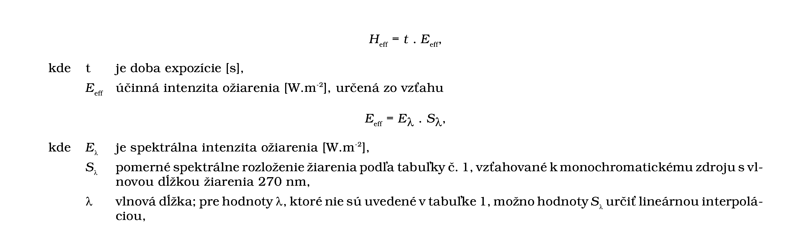
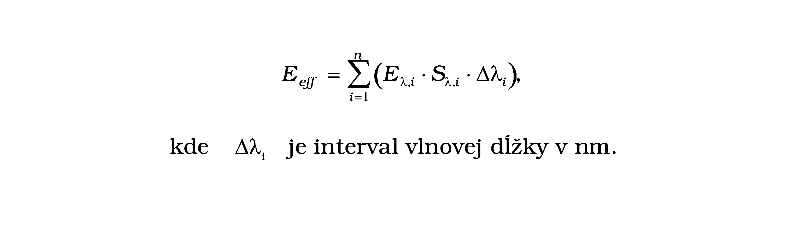

Príloha č. 2 k nariadeniu vlády č. 351/2006 Z. z.

- NAJVYŠŠIE PRÍPUSTNÉ HODNOTY ŽIARENIA PRI POUŽÍVANÍ ZDROJOV NEKOHERENTNÉHO ŽIARENIA

  - 1. Najvyššie prípustné hodnoty ultrafialového žiarenia

  - 1.1. Najvyššia prípustná hodnota ultrafialového žiarenia pre zamestnancov

    - a) v spektrálnej oblasti 315 nm až 400 nm a pre dobu ožiarenia kratšiu ako 1000 s je dávka ožiarenia oka Hp =10 kJ.m-2,

    - b) v spektrálnej oblasti 315 nm až 400 nm a pre dobu ožiarenia dlhšiu ako 1000 s počas 8 hodín, resp. počas pracovnej zmeny je intenzita ožiarenia oka Ep =10 W.m-2,

    - c) v spektrálnej oblasti 180 nm až 400 nm je účinná dávka ožiarenia oka alebo nechránenej kože monochromatickým zdrojom Heff,max = 30 J.m-2

- 

  - d) v spektrálnej oblasti 180 nm až 400 nm pre širokopásmové zdroje ultrafialového žiarenia alebo pre zdroje ultrafialového žiarenia vyžarujúce vo viacerých vlnových dĺžkach je najvyššia prípustná účinná dávka ožiarenia dopadajúca na oko alebo na nechránenú kožu Heff,max = 30 J.m-2. Účinná intenzita ožiarenia Eeff sa v tomto prípade určí podľa vzťahu

- 

  - 1.2. Najvyššia prípustná hodnota ultrafialového žiarenia zo žiaričov určených na ošetrovanie pokožky v domácnosti a v zariadeniach služieb verejnosti, ako sú soláriá, kozmetické salóny a podobne, sa posudzuje podľa osobitného predpisu.1)

  - Tab. 1

  - Pomerné spektrálne rozloženie ultrafialového žiarenia pre zdroje v spektrálnej oblasti 180 nm až 400 nm

- | Vlnová dĺžka λ [nm] | Pomerné spektrálne rozloženie žiarenia Sλ[l] | Vlnová dĺžka λ[nm] | Pomerné spektrálne rozloženie žiarenia Sλ [l]

- 180 | 0,012 | 290 | 0,640

- 185 | 0,015 | 295 | 0,540

- 190 | 0,019 | 300 | 0,300

- 195 | 0,023 | 305 | 0,060

- 200 | 0,030 | 310 | 0,015

- 205 | 0,051 | 315 | 0,003

- 210 | 0,075 | 320 | 0,001

- 215 | 0,095 | 325 | 0,0005

- 220 | 0,120 | 330 | 0,000410

- 225 | 0,150 | 335 | 0,000334

- 230 | 0,190 | 340 | 0,000280

- 235 | 0,240 | 345 | 0,000240

- 240 | 0,300 | 350 | 0,00020

- 245 | 0,360 | 355 | 0,00016

- 250 | 0,430 | 360 | 0,00013

- 255 | 0,520 | 365 | 0,00011

- 260 | 0,650 | 370 | 0,000093

- 265 | 0,810 | 375 | 0,000077

- 270 | 1,000 | 380 | 0,000064

- 275 | 0,960 | 385 | 0,000053

- 280 | 0,880 | 390 | 0,000044

- 285 | 0,770 | 395 | 0,000036

- 290 | 0,640 | 400 | 0,000030

  - 2. Najvyššie prípustné hodnoty infračerveného žiarenia

  - 2.1. Najvyššia prípustná hodnota ožiarenosti infračerveným žiarením na pracovnom mieste alebo na mieste dlhodobého pobytu osôb je 200 W.m-2.

  - 2.2. Najvyššia prípustná hodnota ožiarenosti infračerveným žiarením pri dlhodobom pôsobení na zrak je 100 W.m-2.

  - 2.3. Najvyššia prípustná hodnota ožiarenosti infračerveným žiarením pri krátkodobej expozícii, napríklad pri prechode okolo horúcich predmetov, pri kontrole zariadení a podobne, je 1000 W.m-2, ak počas 8 hodín, resp. počas pracovnej zmeny dávka ožiarenia neprekročí 2000 W.h.m-2.
