Príloha č. 2 k nariadeniu vlády č. 354/2006 Z. z.

- ROZSAH ROZBOROV A POČET ODBEROV VZORIEK PITNEJ VODY

  - 1. Minimálny ročný počet odberov vzoriek pitnej vody

    - Ak objem vyrábanej vody nezodpovedá počtu obyvateľov podľa hodnôt uvedených v tabuľke č. 1, považuje sa za rozhodujúci počet obyvateľov zásobovaných pitnou vodou.

    - Príklad výpočtu pre objem dodávanej vody 5 200 m3/deň: počet minimálnych rozborov 22 [4 + (6 x 3)] a počet úplných rozborov 3 [1 + (2 x 1)].

    - Tabuľka č. 1

  - Počet obyvateľov v zásobovanej oblasti (pri dennej spotrebe 200 l na osobu) | Objem vyrábanej alebo dodávanej pitnej vody v zásobovanej oblasti (m3/deň) | Ročný počet vzoriek minimálnych rozborov | Ročný počet vzoriek úplných rozborov

  - 50 | 10 | 2 | 1 za 10 rokov

  - > 50 100 | > 10 20 | 2 | 1 za 5 rokov

  - > 100 500 | > 20 100 | 3 | 1 za 2 roky

  - > 500 5 000 | > 100 1 000 | 4 | 1

  - > 5 000 50 000 | > 1 000 10 000 | 4 +3 na každých 1 000 m3 z celkového objemu vrátane začatých | 1 +1 na každých 3 300 m3/deň

  - > 50 000 500 000 | > 10 000 100 000 | | 3 +1 na každých 10 000 m3/deň (vrátane začatých) z celkového objemu

  - > 500 000 | > 100 000 | | 10 +1 na každých 25 000 m3/deň (vrátane začatých) z celkového objemu

    - Pri prerušovanej krátkodobej dodávke o frekvencii monitorovania vody distribuovanej v cisternách rozhodne regionálny úrad verejného zdravotníctva. Regionálny úrad verejného zdravotníctva môže znížiť počet vzoriek pre jednotlivé ukazovatele, ak

    - a) hodnoty výsledkov získaných zo vzoriek odobratých počas aspoň dvoch rokov nasledujúcich po sebe sú stále a podstatne lepšie než limity určené v prílohe č. 1 a

    - b) nie je pravdepodobné, že by niektorý faktor spôsobil zhoršenie kvality vody, pričom najnižšia použitá frekvencia nesmie byť menšia ako 50 % z počtu vzoriek špecifikovaného v tabuľke č. 1 vzoriek pitnej vody okrem prípadu, keď frekvenciu určí regionálny úrad verejného zdravotníctva.

  - 2. Rozsah rozborov pitnej vody

  - 2.1. Minimálny rozbor

    - Minimálny rozbor je určený na kontrolu a získavanie pravidelných informácií o stabilite vodného zdroja a účinnosti úpravy vody, najmä na kontrolu dezinfekcie (ak sa vykonáva), mikrobiologickej kvality a senzorických vlastností pitnej vody.

    - Minimálny rozbor pozostáva z ukazovateľov kvality pitnej vody podľa tabuľky č. 2. Ak sa voda ponúka na predaj vo fľašiach alebo v nádobách, do rozsahu minimálneho rozboru pitnej vody sa zahŕňa aj ukazovateľ Pseudomonas aeruginosa.

    - Ukazovateľ č. 13 v tabuľke č. 2 sa zisťuje len pri pitnej vode upravovanej priamo z povrchových vôd alebo pri podzemných vodách ovplyvnených povrchovými vodami.

    - Ukazovateľ č. 19 v tabuľke č. 2 sa zisťuje len pri použití koagulantu na báze hliníka.

    - Ukazovateľ č. 20 v tabuľke č. 2 sa zisťuje pri používaní prostriedkov obsahujúcich chlór. Pri využívaní viazaného aktívneho chlóru (napríklad vo forme chloramínov) na dezinfekciu sa stanovuje celkový aktívny chlór. Pri použití iného chemického dezinfekčného prostriedku sa stanoví reziduálne množstvo príslušnej aktívnej látky.

    - Ukazovateľ č. 22 sa zisťuje len v odôvodnených prípadoch.

    - Tabuľka č. 2: Rozsah minimálneho rozboru pitnej vody

  - Por. čís. | Ukazovateľ

  - 1. | Escherichia coli

  - 2. | Koliformné baktérie

  - 3. | Enterokoky (fekálne streptokoky)

  - 4. | Kultivovateľné mikroorganizmy pri 22 oC

  - 5. | Kultivovateľné mikroorganizmy pri 36 oC

  - 6. | Bezfarebné bičíkovce

  - 7. | Živé organizmy (okrem bezfarebných bičíkovcov)

  - 8. | Vláknité baktérie (okrem železitých a mangánových baktérií)

  - 9. | Železité a mangánové baktérie

  - 10. | Mikromycéty

  - 11. | Mŕtve organizmy

  - 12. | Abiosestón

  - 13. | Clostridium perfringens

  - 14. | Absorbancia (254 nm, 1 cm)

  - 15. | Amónne ióny

  - 16. | Farba

  - 17. | Dusičnany

  - 18. | Dusitany

  - 19. | Hliník

  - 20. | Voľný chlór

  - 21. | Chemická spotreba kyslíka manganistanom

  - 22. | Chuť

  - 23. | Vodivosť

  - 24. | Mangán

  - 25. | Pach

  - 26. | Reakcia vody

  - 27. | Zákal

  - 28. | Železo

  - 29. | Teplota

  - 2.2 Úplný rozbor

    - Cieľom úplného rozboru je získavať informácie o dodržaní limitov ukazovateľov kvality pitnej vody ustanovených v prílohe č. 1 alebo určených orgánom verejného zdravotníctva.

    - Úplný rozbor pozostáva z ukazovateľov kvality pitnej vody podľa prílohy č. 1 vrátane rádiologických ukazovateľov č. 83 až 85. Stanovenie rádiologických ukazovateľov č. 86 až 101 sa vyžaduje pri prekročení IH ukazovateľov č. 83 až 85 podľa obrázku č. 1. Stanovenie rádiologického ukazovateľa č. 86 je zahrnuté v požiadavke 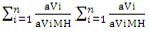 ≤ 1.

    - Obrázok č. 1

    - Posúdenie výsledkov stanovení rádiologických ukazovateľov

    - 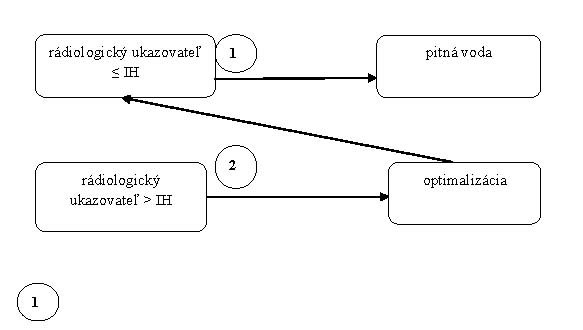

    - Pri posudzovaní rádiologický ukazovateľ neprekračuje limit, ak rádiologický ukazovateľ ≤ IH, rádiologický ukazovateľ ≤ MH a 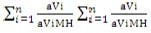 ≤ 1, kde aVi je objemová aktivita i–teho rádionuklidu, aViMH je medzná hodnota objemovej aktivity i–teho rádionuklidu.

    - 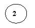

    - Pri posudzovaní rádiologický ukazovateľ prekračuje limit, ak rádiologický ukazovateľ > IH, rádiologický ukazovateľ > MH a 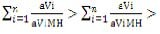 1.

    - Postup optimalizácie pri riešení týchto situácií zahrňuje overenie alebo spresnenie situácie opakovaným odberom a následným stanovením rádiologických ukazovateľov v ďalších vzorkách, identifikáciu zdroja vody, ktorý je zodpovedný za zvýšený obsah rádionuklidov, analýzu situácie, návrh a realizáciu opatrení na zníženie obsahu rádionuklidov v pitnej vode.

    - Postup optimalizácie pri prekročení IH pre aVRn222 v pitnej vode

    - Opakovaný odber a následné stanovenie aVRn222. Ak priemerná aVRn222 z dvoch stanovení neprekračuje IH postupuje sa v monitorovaní podľa prílohy č. 2 obrázku č. 1.

    - Ak priemerná aVRn222 z dvoch stanovení prekračuje IH, ale neprekračuje MH pre aVRn222 v pitnej vode v nasledujúcich troch rokoch sa vykoná opakovaný odber a následné stanovenie aVRn222 tak, aby odbery vzoriek zahŕňali štyri rôzne štvrťroky. Ak priemerná aVRn222 zo štyroch stanovení prekračuje IH, ale neprekračuje MH pre aVRn222 pokračuje sa v optimalizácii tak, že sa zváži možnosť vyradenia vodného zdroja zo zásobovania obyvateľstva pitnou vodou a technologická úprava na odstránenie 222Rn, pričom sa berie do úvahy aj výsledok stanovenia aVcα, aVcβ a ich porovnanie s príslušnými IH. Ak priemerná aVRn222 zo štyroch stanovení prekračuje MH pre aVRn222 pokračuje sa v optimalizácii tak, že sa zváži možnosť vyradenia vodného zdroja zo zásobovania obyvateľstva pitnou vodou a/alebo technologická úprava na odstránenie 222Rn.

    - Postup optimalizácie pri prekročení IH pre aVcα v pitnej vode

    - Opakovaný odber a následné stanovenie aVcα. Ak priemerná aVcα z dvoch stanovení neprekračuje IH postupuje sa v monitorovaní podľa prílohy č. 2 obrázku č. 1.

    - Ak priemerná aVcα z dvoch stanovení prekračuje IH pokračuje sa bezodkladne v stanovení konkrétnych rádionuklidov emitujúcich alfa častice v nasledovnom poradí: aVRa226, aVU238,U234, aVPo210 a ďalších prírodných rádionuklidov alebo umelých rádionuklidov.

    - Pri stanovení konkrétnych rádionuklidov sa postupuje podľa nasledovného kritéria:

    - ak (aVcα - aVi ) ≤ IH nie je potrebné stanovenie ďalších rádionuklidov podľa poradia,

    - ak (aVcα - aVi) > IH je potrebné stanovenie ďalších rádionuklidov podľa poradia.

    - Ak výsledok stanovení konkrétnych rádionuklidov vyhovuje

    - 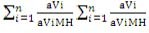 ≤ 1 a aVi neprekročí 20 % príslušnej MH, postupuje sa v monitorovaní podľa prílohy č. 2 obrázku č. 1.

    - Ak výsledok stanovení konkrétnych rádionuklidov nevyhovuje

    - 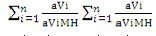 ≤ 1 a/alebo aVi prekročí 20 % príslušnej MH, v nasledujúcich troch rokoch sa vykoná opakovaný odber a následné stanovenia aVi tak, aby odbery vzoriek zahŕňali štyri rôzne štvrťroky. Ak priemerné aVi zo štyroch stanovení vyhovujú

    - 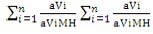 ≤ 1 a aVi neprekročí 20 % príslušnej MH, postupuje sa v monitorovaní podľa prílohy č. 2 obrázku č. 1.

    - Ak priemerné aVi zo štyroch stanovení nevyhovujú

    - 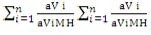 ≤ 1 a/alebo aVi prekročí 20 % príslušnej MH pokračuje sa v optimalizácii tak, že sa zváži možnosť vyradenia vodného zdroja zo zásobovania obyvateľstva pitnou vodou a/alebo technologická úprava na odstránenie konkrétnych rádionuklidov.

    - Postup optimalizácie pri prekročení IH pre avcβv pitnej vode

    - Opakovaný odber a následné stanovenie avcβ. Ak priemerná avcβ z dvoch stanovení neprekračuje IH postupuje sa v monitorovaní podľa prílohy č. 2 obrázku č. 1.

    - Ak priemerná avcβ z dvoch stanovení prekračuje IH pokračuje sa bezodkladne v stanovení konkrétnych rádionuklidov emitujúcich beta častice v nasledovnom poradí: aVK40, aVRa228, aVPb210 a ďalších prírodných rádionuklidov alebo umelých rádionuklidov.

    - Pri stanovení konkrétnych rádionuklidov sa postupuje podľa nasledovného kritéria:

    - ak (avcβ - aVi) ≤ IH nie je potrebné stanovenie ďalších rádionuklidov podľa poradia,

    - ak (avcβ - aVi) > IH je potrebné stanovenie ďalších rádionuklidov podľa poradia.

    - Ak výsledok stanovení konkrétnych rádionuklidov vyhovuje

    - 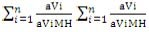 ≤ 1 a aVi neprekročí 20 % príslušnej MH, postupuje sa v monitorovaní podľa prílohy č. 2 obrázku č. 1.

    - Ak výsledok stanovení konkrétnych rádionuklidov nevyhovuje

    - 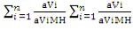 ≤ 1 a/alebo aVi prekročí 20 % príslušnej MH, v nasledujúcich troch rokoch sa vykoná opakovaný odber a následné stanovenia aVi tak, aby odbery vzoriek zahŕňali štyri rôzne štvrťroky.

    - Ak priemerné aVi zo štyroch stanovení vyhovujú

    - 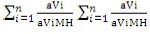 ≤ 1 a aVi neprekročí 20 % príslušnej MH, postupuje sa v monitorovaní podľa prílohy č. 2 obrázku č. 1.

    - Ak priemerné aVi zo štyroch stanovení nevyhovujú

    - 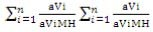 ≤ 1 a/alebo aVi prekročí 20 % príslušnej MH, pokračuje sa v optimalizácii tak, že sa zváži možnosť vyradenia vodného zdroja zo zásobovania obyvateľstva pitnou vodou a/alebo technologická úprava na odstránenie konkrétnych rádionuklidov.

    - Postup optimalizácie pri prekročení IH pre ID v pitnej vode

    - Do úvahy sa berie naraz súčasná optimalizácia pri prekročení IH pre aV,cα a aV,cβ. V prípade potreby sa vypočítajú MH ďalších prírodných rádionuklidov a umelých rádionuklidov na úrovni ročného úväzku efektívnej dávky 0,1 mSv a ročnom objeme pitnej vody prijatého ingesciou 730 litrov.

    - Postup optimalizácie pri prekročení IH pre 3H v pitnej vode

    - Opakovaný odber a následné stanovenie objemovej aktivity 3H. Ak priemerná objemová aktivita 3H z dvoch stanovení neprekračuje IH postupuje sa v monitorovaní podľa prílohy č. 2 obrázku č. 1.

    - Ak priemerná objemová aktivita 3H z dvoch stanovení prekračuje IH pokračuje sa bezodkladne v stanovení konkrétnych umelých rádionuklidov.
