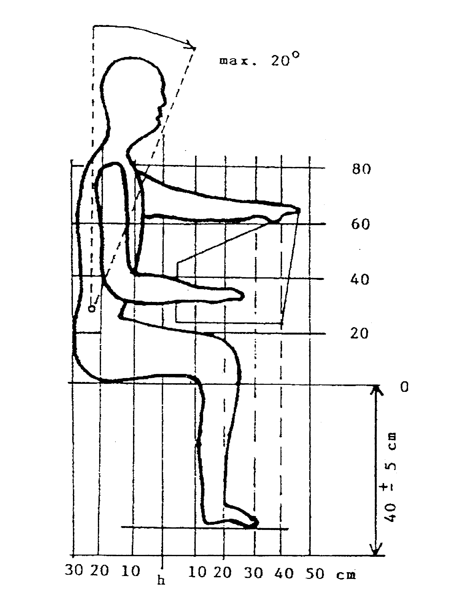
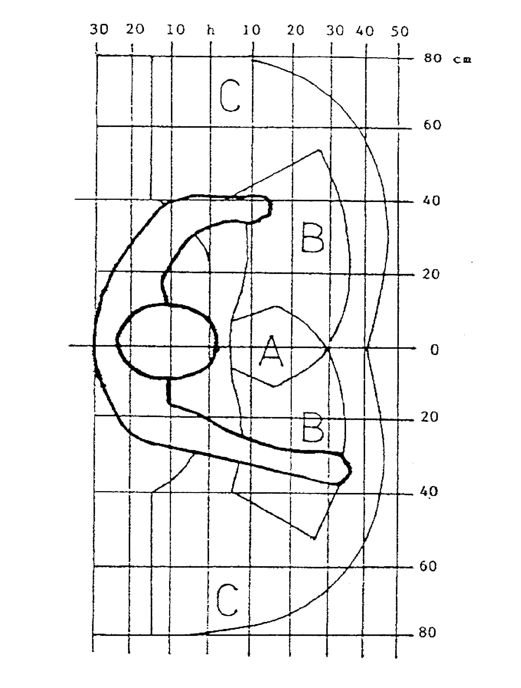
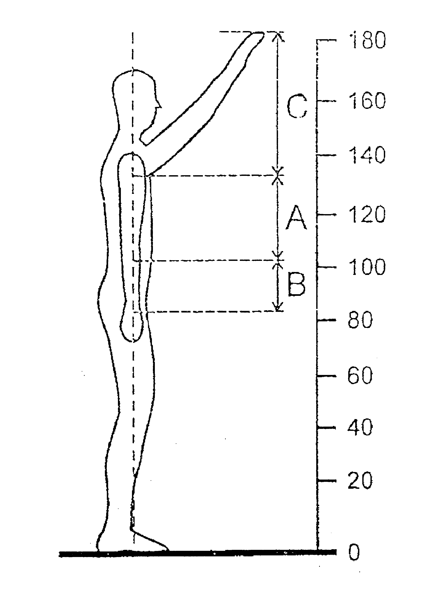

Príloha č. 1 k nariadeniu vlády č. 359/2006 Z. z.

- POŽIADAVKY NA MIESTO VÝKONU PRÁCE V SÚVISLOSTI S OBMEDZOVANÍM NADMERNEJ FYZICKEJ ZÁŤAŽE PRI PRÁCI

  - 1. Výška pracovnej manipulačnej roviny musí zodpovedať telesným rozmerom zamestnanca, základnej pracovnej polohe, hmotnosti predmetov, bremien a podobne, ktoré sú používané pri práci, ako aj zrakovým nárokom na prácu. Optimálna výška pracovnej roviny je pri práci v stoji u mužov v rozmedzí 1020 až 1180 mm, u žien 930 až 1080 mm. Pri práci v sede je optimálna výška pracovnej roviny u mužov 220 až 310 mm, u žien 210 až 300 mm nad sedadlom. Výška sedadla nad podlahou sa predpokladá v rozsahu 400 50 mm. Ak sú pri práci používané nástroje (napríklad zveráky) a iné technické zariadenia, výškou pracovnej roviny je miesto, na ktorom sú najčastejšie vykonávané pohyby.

  - 2. Pri práci, ktorá vyžaduje zvýšené nároky na zrak, napríklad drobné predmety, súčiastky a podobne, sa výška pracovnej roviny zväčšuje približne o 100 až 200 mm. Pri práci, pri ktorej sa manipuluje s predmetmi ťažšími ako 2 kg, pri práci v stoji, sa manipulačná rovina znižuje približne o 100 až 200 mm.

  - 3. Dosahy horných končatín vo vertikálnej a horizontálnej pracovnej rovine pri práci v sede a vo vertikálnej rovine pri práci v stoji sa upravujú podľa údajov na obrázkoch č. 1, 2 a 3.

  - 4. Miesto výkonu práce musí byť usporiadané tak, aby manipulačné roviny, pohybové priestory a vynakladané sily zodpovedali telesným rozmerom a prirodzeným dráham pohybov končatín zamestnancov a aby nedochádzalo k zaujatiu fyziologicky neprijateľných pracovných polôh.

  - 5. Pracovné sedadlo a priestor pre dolné končatiny

    - a) miesto výkonu práce, kde je základná pracovná poloha trvalo v sede, musí byť vybavené pracovným sedadlom s nastaviteľnou výškou sedadla a s opierkou chrbta,

    - b) miesto výkonu práce, kde je základná pracovná poloha trvalo v stoji a nevyžaduje trvalé sledovanie chodu zariadenia, musí byť vybavené sedadlom s jednoduchou konštrukciou na krátkodobý odpočinok,

    - c) konštrukcia sedadiel musí zabezpečovať ich stabilitu, prípadne ľahko nastaviteľnú výšku sedadla i sklonu chrbtovej opierky. Povrch sedadla a chrbtovej opierky má zodpovedať podmienkam práce z hľadiska poréznosti, umývateľnosti a podobne,

    - d) miesto výkonu práce, na ktorom je zvýšená pracovná rovina, musí byť vybavené pracovnými sedadlami s výškou sedadla zodpovedajúcou výške pracovnej roviny nad podlahou a zrakovým požiadavkám. Musí byť vybavené kruhovou alebo inou opierkou pre dolné končatiny,

    - e) na montážnych linkách v pásovej výrobe s trvalým i prerušovaným sedením a v prípadoch, keď sú pracovné úkony spojené s otáčaním trupu alebo s úkonmi mimo maximálny dosah rúk podľa obrázka č. 2, sa miesto výkonu práce vybavuje otočnými, prípadne pojazdnými sedadlami,

    - f) priestor pre dolné končatiny na mieste výkonu práce s trvalým i prerušovaným sedením musí byť dostatočne veľký a má umožňovať pohodlnú pracovnú polohu a pohyb dolných končatín dopredu aj do strán,

    - g) rozmery pohybového priestoru pre dolné končatiny

      - 1. najmenšia výška nad podlahou 600 mm,

      - 2. najmenšia celková šírka 500 mm,

      - 3. najmenšia hĺbka (od prednej hrany stola, zariadení) 500 mm,

      - 4. optimálna hĺbka (od prednej hrany stola, zariadení) 700 mm,

      - 5. najmenšia vzdialenosť roviny sedadla od dolnej plochy pracovného stola 200 mm,

    - h) pohybový priestor pre nožné ovládače

      - 1. maximálne 400 mm od zvislej roviny h preloženej miestom najviac vystupujúcej hrany pracovnej roviny a kolmej na vodorovnú rovinu, podlahu,

      - 2. minimálne 200 mm od roviny h dopredu,

      - 3. maximálne 250 mm nad základňou a

      - 4. maximálne 350 mm do strán od zvislej roviny prechádzajúcej stredom sedadla, kolmej na rovinu h.

        - Uvedené hodnoty sú platné v prípade, že predná hrana sedadla je asi 100 mm vzdialená od roviny h. V prípade inej vzdialenosti medzi prednou hranou sedadla a rovinou h sa musí pohybový priestor pre nožné ovládače posunúť dopredu alebo dozadu.

    - i) sily prípustné pre ovládače sú uvedené v tabuľke č. 1,

    - j) pri základnej polohe v stoji je možné použitie nožných ovládačov len vo výnimočných prípadoch, ak ich frekvencia nie je väčšia ako 5 pohybov.min-1 a ich prevedenie umožňuje striedavú obsluhu pravou a ľavou nohou. Ovládače obsluhované iným spôsobom ako rukami a chodidlami, napríklad lakťové a kolenové ovládače, sa nesmú používať.

- Tabuľka č. 1 Ovládače – typy, tvary, polohy, spôsob ovládania, ovládacie sily

- Typ ovládača | Tvar, polohy a frekvencie ovládania | Spôsob ovládania, minimálne a maximálne sily (N) |

- Tlačidlo | kruhové, štvorcové, obdĺžnikové, hríbové | jedným prstom dlaňou | min. 2,5 max. 8 min. 2,5 max. 50

- Prepínač páč- kový | valcový, kužeľový, hranolový dvojpolohový: min. 30° do strán od zvislej osi,trojpolohový: min. 30° do strán od zvislej osi a kolmo na zá- kladňu | prstami | min. 2,5 max. 10

- Prepínač otoč- ný | kruhová základňa, úchopová časť kužeľová, obdĺžnikovápri zrakovej kontrole: max. počet polôh 24, min. uhol me- dzi polohami 15°,pri hmatovej kontrole max. počet polôh 8, min. uhol medzi polohami 45° | prstami | min. 2,5 max. 15

- Točidlo, točka | valcová, kuželbvá priemer do 2,5 cm priemer väčší ako 2,5 cm | prstami | min. 2,5 max. 4 min. 2,5 max. 15

- Koleso ručné | vonkajší priemervenca sa volí podľa rýchlosti otáčania, pri väčšej rýchlosti menší priemer | jednou rukou oboma rukami | min. 10 max. 100 min. 10 max. 200

- Volant | a) stacionárne technické zariadenia b) mobilné technické zariadenia c) všetky technické zariadenia pri zlyhaní posilňovača ria- denia (pri núdzovom riadení) Poľnohospodárske a lesné stroje: a) stacionárne stroje b) mobilné stroje c) všetky stroje pri zlyhaní posilňovača riadenia (núdzové riadenie) | oboma rukami jednou alebo oboma rukami oboma rukami oboma rukami jednou alebo oboma rukami oboma rukami | max. 115 max. 80 max. 350 max. 120 max. 120 max. 490

- Ručná páka | rukoväť: valcová, kuželová, gulová používaná trvalo používaná často používaná zriedka | hornou končatinou pohyb páky: dopredu a dozadudo strán dopredu a dozadu do strán nahor a nadol (núdzová a parkovacia brzda) Poľnohospodárske a lesné stroje núdzová a parkovacia brzda | min. 10 max. 60 min. 10 max. 40 min. 10 max. 120 min. 10 max. 80 min. 10 max. 300 max. 250 max. 295

- Nožná páka (pedál) | obdĺžniková, kruhová, štvorcová používaná trvalo používaná často Poľnohospodárske a lesné stroje pedál spojky pedál akcelerátora pedál prevádzkovej a núdzovej brzdy ostatné pedále | pohybom celej nohy pedál prevádzkovej núdzovej brzdy pedál ovládaný po- hybom nohy v člen- ku | min. 10 max. 90 min. 40 max. 400 min. 20 max. 60 max. 245 max. 60 max. 580 max. 150

- Poznámka: Trvalo používané ovládače sú ovládače, ktoré sa používajú viac ako 40-krát počas pracovnej zmeny.

- Často používané ovládače sú ovládače, ktoré sa používajú viac ako 20 až 40-krát počas pracovnej zmeny.

  - Zriedkavo používané ovládače sú ovládače, ktoré sa používajú menej ako 20-krát počas pracovnej zmeny.

  - Obrázok č. 1 Dosahy horných končatín vo vertikálnej rovine pri práci v sede

- 

- Obrázok č. 2 Dosahy horných končatín v horizontálnej rovine pri práci v sede

- 

  - Vysvetlivky k obrázku č. 2:

  - Oblasť A – časté a presné pohyby, uchopovanie drobných predmetov prstami obidvoch rúk

  - Oblasť B – pohyby obidvoch predlaktí pri manipulácii s predmetmi a nástrojmi bez nutnosti zmeny základnej pracovnej

  - polohy – mierny predklon, pohyb do strán

  - Oblasť C – maximálny dosah – menej časté a pomalšie pohyby, nutnosť otáčania trupu

  - Obrázok č. 3 Dosahy horných končatín vo vertikálnej rovine pri práci v stoji

- 
