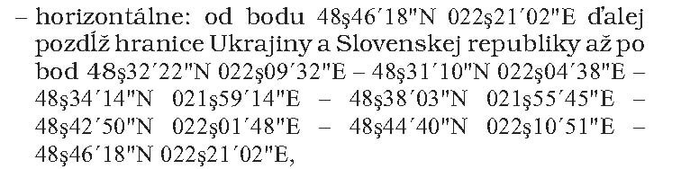
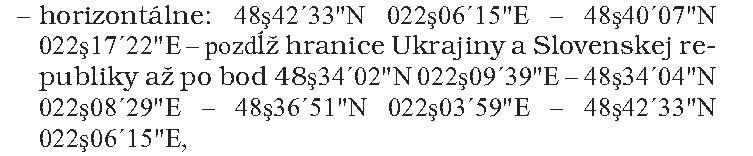

K oznámeniu č. 398/2006 Z. z.

- DOHODA medzi vládou Slovenskej republiky a Kabinetom ministrov Ukrajiny o delegovaní zodpovednosti za poskytovanie letových prevádzkových služieb a o prevádzke Medzinárodného letiska Užhorod

  - Vláda Slovenskej republiky a Kabinet ministrov Ukrajiny (ďalej len „zmluvné strany“)

  - ako účastníci Dohovoru o medzinárodnom civilnom letectve otvoreného na podpis v Chicagu 7. decembra 1944,

  - vychádzajúc z ustanovení príslušných štandardov a odporúčaní Medzinárodnej organizácie civilného letectva (ďalej len „ICAO SARPS“),

  - majúc v úmysle rozvíjať vzájomne výhodnú spoluprácu medzi oboma krajinami,

  - riadiac sa snahou o ďalšie prehĺbenie spolupráce v oblasti civilného letectva a tiež s cieľom zvýšiť bezpečnosť letov civilných lietadiel,

  - dohodli sa takto:

    - Článok 1

      - 1. Slovenská strana deleguje ukrajinskej strane a ukrajinská strana prijíma dočasnú zodpovednosť za poskytovanie letových prevádzkových služieb (ďalej len „ATS“) v časti letovej informačnej oblasti (ďalej len „FIR“) uvedenej v článku 2 ods. 1 tejto dohody.

      - 2. Slovenská strana deleguje ukrajinskej strane právo na dočasné umiestnenie nevyhnutných rádionavigačných a svetelných zabezpečovacích zariadení (ďalej len „zariadenia“) na pozemkoch ležiacich na území Slovenskej republiky. Príloha č. 1 k tejto dohode obsahuje schému umiestnenia zariadení a údaje o pozemkoch. Príloha č. 2 k tejto dohode obsahuje zoznam zariadení a ich technické údaje. Prílohy č. 1 a 2 sú neoddeliteľnou súčasťou tejto dohody.

      - 3. Na požiadanie ukrajinskej strany slovenská strana poskytne s cieľom zaistenia bezpečnosti prevádzky Medzinárodného letiska Užhorod všetky potrebné informácie o prekážkach a teréne pre výpočet prekážkových rovín, ako aj ochranných priestorov podľa ICAO SARPS a vnútroštátnych právnych predpisov Slovenskej republiky.

  - Článok 2

    - 1. Slovenská strana deleguje ukrajinskej strane dočasnú zodpovednosť za poskytovanie ATS prilietajúcim lietadlám na Medzinárodné letisko Užhorod a lietadlám odlietajúcim z neho po štandardných prístrojových tratiach vedúcich cez vzdušný priestor Slovenskej republiky publikovaných v Leteckej informačnej príručke Ukrajiny.

      - Zodpovednosť za poskytovanie ATS sa vzťahuje na vymedzenú časť FIR Bratislava ustanovenú ako obmedzené priestory LZ R 49 a LZ R 50.

      - Obmedzené priestory majú tieto súradnice WGS 84:

      - LZ R 49:

      - 

      - – vertikálne: horná hranica: letová hladina 70, dolná hranica 1 300 ft nad morom (400 m),

      - LZ R 50:

      - 

      - – vertikálne: horná hranica: 1 300 ft nad morom (400 m), dolná hranica: povrch zeme.

    - 2. Povolenie na využívanie časti vzdušného priestoru Slovenskej republiky sa nevzťahuje na lety štátnych lietadiel.*) Lety ukrajinských štátnych lietadiel vo vzdušnom priestore Slovenskej republiky podliehajú povoleniu Ministerstva zahraničných vecí Slovenskej republiky.

    - 3. Subjektmi poskytujúcimi letové prevádzkové služby sú Ukrajinský štátny podnik na poskytovanie letových prevádzkových služieb (ďalej len „UkSATSE“) na ukrajinskej strane a štátny podnik Letové prevádzkové služby Slovenskej republiky (ďalej len „LPS SR“) na slovenskej strane. Postupy spolupráce a vymedzenie zodpovednosti za služby poskytované lietadlám letiacim v priestoroch LZ R 49 a LZ R 50 podľa odseku 1 tohto článku sú ustanovené v dohodách o riadení a koordinácii uzatvorených medzi týmito subjektmi.

    - 4. Na účely spolupráce subjektov podľa odseku 3 tohto článku sa medzi príslušnými stanovišťami týchto subjektov zriadi priama telefónna linka, ktorá sa zriadi a bude sa prevádzkovať na náklady UkSATSE.

  - Článok 3

    - Ukrajinská strana zabezpečí, aby najneskôr do troch mesiacov odo dňa nadobudnutia platnosti tejto dohody ukrajinské právnické osoby, ktoré vlastnia alebo prevádzkujú zariadenia umiestnené na území Slovenskej republiky, uzavreli nájomné zmluvy s vlastníkmi alebo užívateľmi pozemkov, na ktorých sa zariadenia nachádzajú.

  - Článok 4

    - 1. Zariadenia umiestnené podnikom UkSATSE na území Slovenskej republiky sú vo vlastníctve Ukrajiny. Po skončení platnosti tejto dohody uvedené zariadenia podnik UkSATSE demontuje a odvezie z územia Slovenskej republiky.

    - 2. Zariadenia patriace Ukrajine a umiestnené na území Slovenskej republiky, ako aj materiály potrebné na ich výstavbu, inštaláciu, výmenu, prevádzku, opravu a údržbu, sú oslobodené od všetkých ciel, daní a iných platieb podľa vnútroštátnych právnych predpisov štátov oboch zmluvných strán.

    - 3. Pozemky poskytnuté na dočasné užívanie ukrajinskej strane na účely tejto dohody sa po demontovaní zariadení uvedú na náklady UkSATSE do jedného roka do stavu vhodného na poľnohospodárske účely.

  - Článok 5

    - 1. Umiestnenie, výstavbu, inštaláciu, prevádzku, opravy, údržbu, výmenu a demontáž zariadení bude realizovať UkSATSE vlastnými prostriedkami a na svoje náklady. Prívod elektrickej energie a potrebné telekomunikačné spojenie sa zaistia na náklady UkSATSE.

    - 2. Umiestnenie, výstavba, prevádzka a inštalácia zariadení na území Slovenskej republiky, ktoré nie sú uvedené v prílohe č. 2 k tejto dohode, je bez získania predchádzajúceho povolenia Slovenskej republiky zakázaná. V povolení Slovenská republika určí podmienky na umiestnenie, inštaláciu a prevádzku zariadení.

    - 3. Prevádzkovanie zariadení musí ukrajinská strana zabezpečiť tak, aby nedošlo k znečisteniu životného prostredia. Parametre vysielačov a prípustné výkony musia zodpovedať vnútroštátnym právnym predpisom Slovenskej republiky.

    - 4. V prípade, že sa vyskytnú škody na životnom prostredí v dôsledku prevádzky zariadení na území Slovenskej republiky, ukrajinská strana nahradí škody slovenskej strane.

    - 5. Ukrajinská strana bude poskytovať slovenskej strane na jej žiadosť údaje týkajúce sa hluku spôsobeného Medzinárodným letiskom Užhorod, ktorý ovplyvňuje územie Slovenskej republiky.

    - 6. Ukrajinská strana uhradí všetky výdavky za potrebné protihlukové opatrenia na slovenskom území v prípade, že pri výkone prevádzky Medzinárodného letiska Užhorod dôjde k prekročeniu najvyšších prípustných hodnôt hluku podľa vnútroštátnych právnych predpisov Slovenskej republiky.

  - Článok 6

    - 1. Ukrajinský personál, ktorý zabezpečuje vykonávanie tejto dohody, môže prekračovať slovensko-ukrajinskú štátnu hranicu cez hraničný priechod Vyšné Nemecké – Užhorod s pasom platným na cestovanie do cudziny. Počas pobytu v priestoroch umiestnenia zariadení je personál oprávnený zdržiavať sa na území Slovenskej republiky na účely tejto dohody bez víz a povolenia na pobyt.

    - 2. Ukrajinská strana vyhotoví v dvoch výtlačkoch, dvojjazyčne v slovenskom jazyku a v ukrajinskom jazyku menný zoznam občanov Ukrajiny uvedených v odseku 1, oprávnených prekračovať slovensko-ukrajinskú štátnu hranicu. Jeden výtlačok doručí slovenskej strane, ktorý sa uloží na hraničnom priechode Vyšné Nemecké.

    - 3. Ukrajinský personál uvedený v odseku 1 je povinný pri vstupe na územie a pobyte na území Slovenskej republiky dodržiavať jej vnútroštátne právne predpisy.

    - 4. Členovia záchrannej a hasičskej služby Medzinárodného letiska Užhorod so svojím technickým vybavením sú pri poskytovaní pomoci lietadlu v prípade nehody v blízkosti Medzinárodného letiska Užhorod na území Slovenskej republiky oprávnení prekračovať slovensko-ukrajinskú štátnu hranicu za podmienok uvedených v článku 7 Dohody medzi vládou Slovenskej republiky a Kabinetom ministrov Ukrajiny o spolupráci a vzájomnej pomoci pri mimoriadnych udalostiach podpísanej 5. decembra 2000 v Bratislave.

    - 5. Postupy pri poskytovaní pátracej a záchrannej služby lietadlám v prípade nehody alebo vážneho incidentu na území Slovenskej republiky, ktorý vznikne pri prílete alebo odlete lietadla z Medzinárodného letiska Užhorod, stanovia príslušné záchranné koordinačné strediská štátov oboch zmluvných strán.

  - Článok 7

    - Všetky spory týkajúce sa výkladu alebo vykonávania tejto dohody budú zmluvné strany riešiť konzultáciami medzi Ministerstvom dopravy, pôšt a telekomunikácií Slovenskej republiky a Ministerstvom dopravy Ukrajiny. Konzultácie sa uskutočnia najneskôr do šesťdesiatich (60) dní odo dňa prijatia písomnej žiadosti zaslanej jednou zo zmluvných strán, ak sa nedohodne inak.

  - Článok 8

    - 1. Každá zmluvná strana, ak považuje za potrebné zmeniť alebo doplniť túto dohodu, zašle druhej zmluvnej strane písomnú žiadosť o konzultácie. Konzultácie sa začnú najneskôr do šesťdesiatich (60) dní odo dňa prijatia žiadosti, ak sa nedohodne inak.

    - 2. Každá zmena a dodatok k tejto dohode a jej príloh nadobudne platnosť podľa článku 11 a dohodne sa písomne vo forme protokolu, ktorý bude neoddeliteľnou súčasťou dohody.

  - Článok 9

    - Táto dohoda a jej zmeny sa budú registrovať v Medzinárodnej organizácii civilného letectva.

  - Článok 10

    - 1. Dohoda sa uzaviera na obdobie desiatich (10) rokov.

    - 2. Každá zmluvná strana môže druhej zmluvnej strane kedykoľvek oznámiť svoje rozhodnutie skončiť platnosť dohody. Platnosť dohody sa skončí po uplynutí dvanástich (12) mesiacov odo dňa prijatia takéhoto oznámenia druhou zmluvnou stranou, ak nebude oznámenie vzaté späť pred skončením tejto lehoty.

  - Článok 11

    - Táto dohoda nadobudne platnosť šesťdesiatym (60) dňom odo dňa prijatia posledného písomného oznámenia, ktorým si zmluvné strany oznámia splnenie podmienok stanovených vnútroštátnymi právnymi predpismi potrebnými pre nadobudnutie platnosti tejto dohody.

    - Na dôkaz toho podpísaní, náležite na to splnomocnení svojimi zmluvnými stranami, podpísali túto dohodu.

    - Dané v Bratislave 12. februára 2004 v dvoch pôvodných vyhotoveniach, každé v slovenskom, ukrajinskom a anglickom jazyku, pričom všetky znenia sú rovnako autentické. V prípade rozdielnosti výkladu alebo vykonávania dohody je rozhodujúce znenie v anglickom jazyku.

Za vládu Slovenskej republiky:

Pavol Prokopovič v. r.

Za Kabinet ministrov Ukrajiny:

Georgij Mikolajovič Kirpa v. r.
