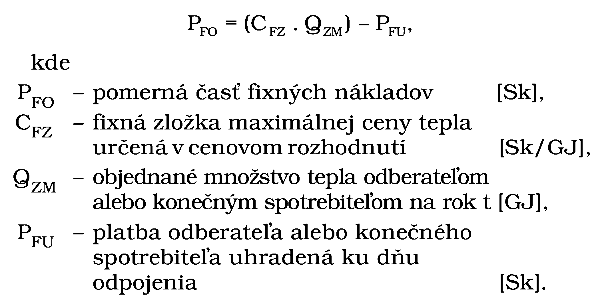
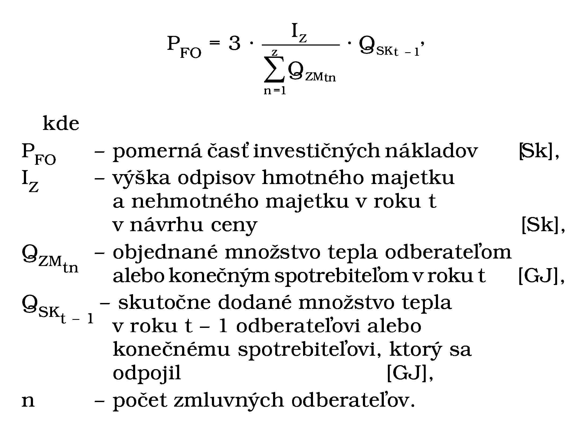

# § 2 Spôsob výpočtu ekonomicky oprávnených nákladov

(1) Pomerná časť fixných nákladov za objednané množstvo tepla, ktoré sú uvedené v § 1 ods. 2 písm. a), určí sa ako rozdiel súčinu fixnej zložky ceny tepla, ktorú úrad schválil cenovým rozhodnutím,1) a celkového množstva objednaného tepla na rok t a uhradených fixných nákladov v roku t odberateľom alebo konečným spotrebiteľom ku dňu odpojenia podľa vzorca

(2) Náklady na likvidáciu časti sústavy tepelných zariadení,2) ktoré sú uvedené v § 1 ods. 2 písm. b), určia sa do výšky 6 000 Sk za meter rozvinutej dĺžky tepelnej prípojky, ktorú dodávateľ musí zlikvidovať.

(3) Náklady na opätovné hydraulické vyregulovanie, ktoré sú uvedené v § 1 ods. 2 písm. c), určia sa do výšky 800 Sk za každé hydraulicky vyregulované odberné miesto.

(4) Náklady na práce súvisiace s odpojením, ktoré sú uvedené v § 1 ods. 2 písm. d), určia sa do výšky 5 000 Sk za každé odberné miesto, ktoré je predmetom odpojenia.

(5) Pomerná časť investičných nákladov, ktoré sú uvedené v § 1 ods. 2 písm. e), určí sa ako trojnásobok odpisov hmotného majetku a nehmotného majetku schválených úradom rozhodnutím o návrhu ceny tepla1) na rok t, ktorý sa používa výhradne na regulovanú činnosť, vydelený objednaným množstvom tepla na rok t a vynásobený celkovým množstvom dodaného tepla v roku t – 1 odberateľovi alebo konečnému spotrebiteľovi, ktorý sa odpojil, podľa vzorca

(6) Náklady na zabezpečenie určených meradiel,3) ktoré sú uvedené v § 1 ods. 2 písm. f), stanovia sa do výšky zostatkovej hodnoty určeného meradla, ktoré bolo inštalované na odbernom mieste odberateľa alebo konečného spotrebiteľa, ktorý sa odpojil.

(7) Pomerná časť investičných nákladov podľa odseku 5 sa rovnomerne prerozdelí počas troch nasledujúcich rokov medzi ostatných odberateľov alebo konečných spotrebiteľov v dotknutej sústave tepelných zariadení v pomere podľa dodaného množstva tepla v roku t.
