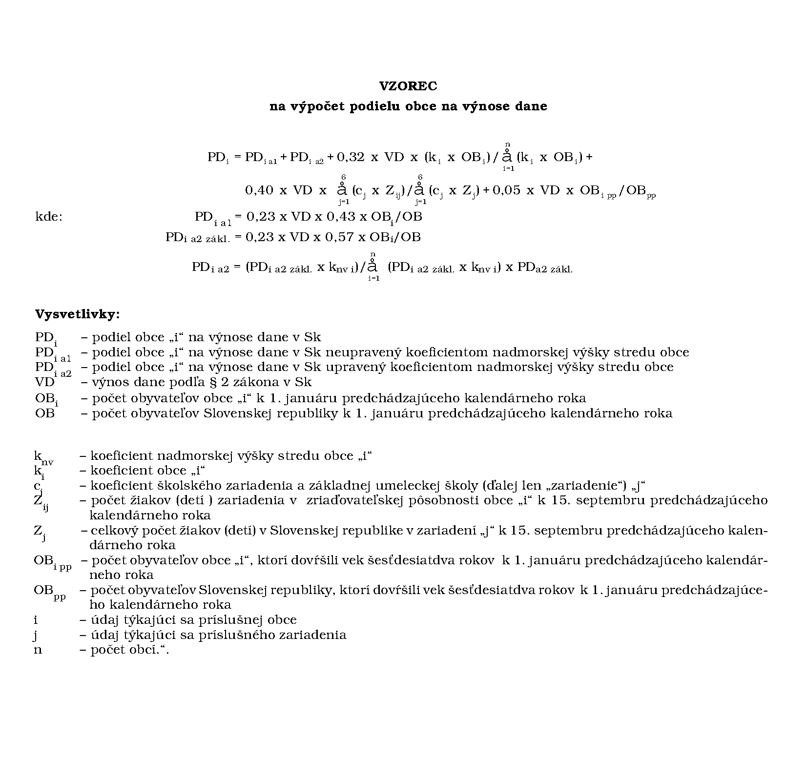

# Čl. I

Nariadenie vlády Slovenskej republiky č. 668/2004 Z. z. o rozdeľovaní výnosu dane z príjmov územnej samospráve sa mení takto:

- 1. V § 2 ods. 1 písm. a) sa číslo „44“ nahrádza číslom „57“.

- 2. Príloha č. 1 znie:

- „Príloha č. 1 k nariadeniu vlády č. 668/2004 Z. z.

- NADMORSKÁ VÝŠKA STREDU OBCE/MESTA (V METROCH) ZA OBCE/MESTÁ SLOVENSKEJ REPUBLIKY

- Kód obce | Obec/mesto | Okres | Kraj | Nadmorskávýška | Koeficient nadmorskej výšky

- 513831 | Klin nad Bodrogom | 811 | 8 | 98 | 0,7500

- 528153 | Svätá Mária | 811 | 8 | 98 | 0,7500

- 522571 | Kačanov | 807 | 8 | 100 | 0,7527

- 528684 | Pribeník | 811 | 8 | 100 | 0,7527

- 543926 | Viničky | 811 | 8 | 100 | 0,7527

- 528285 | Čierna | 811 | 8 | 101 | 0,7541

- 523054 | Senné | 807 | 8 | 101 | 0,7541

- 523119 | Stretava | 807 | 8 | 101 | 0,7541

- 528170 | Borša | 811 | 8 | 102 | 0,7555

- 522376 | Budkovce | 807 | 8 | 102 | 0,7555

- 528293 | Čierna nad Tisou | 811 | 8 | 102 | 0,7555

- 528391 | Ižkovce | 807 | 8 | 102 | 0,7555

- 522767 | Malé Raškovce | 807 | 8 | 102 | 0,7555

- 523127 | Stretavka | 807 | 8 | 102 | 0,7555

- 543942 | Vojany | 807 | 8 | 102 | 0,7555

- 528145 | Biel | 811 | 8 | 103 | 0,7568

- 522341 | Blatné Remety | 809 | 8 | 103 | 0,7568

- 528188 | Boťany | 811 | 8 | 103 | 0,7568

- 522431 | Hatalov | 807 | 8 | 103 | 0,7568

- 522511 | Iňačovce | 807 | 8 | 103 | 0,7568

- 528552 | Malý Horeš | 811 | 8 | 103 | 0,7568

- 522881 | Petrikovce | 807 | 8 | 103 | 0,7568

- 528668 | Poľany | 811 | 8 | 103 | 0,7568

- 523062 | Slavkovce | 807 | 8 | 103 | 0,7568

- 543896 | Veľké Trakany | 811 | 8 | 103 | 0,7568

- 543977 | Zatín | 811 | 8 | 103 | 0,7568

- 523364 | Zemplínska Široká | 807 | 8 | 103 | 0,7568

- 544027 | Zemplínske Hradište | 811 | 8 | 103 | 0,7568

- 528102 | Bačka | 811 | 8 | 104 | 0,7582

- 522333 | Blatná Polianka | 809 | 8 | 104 | 0,7582

- 522414 | Falkušovce | 807 | 8 | 104 | 0,7582

- 522546 | Jastrabie pri Michalovciach | 807 | 8 | 104 | 0,7582

- 528633 | Oborín | 807 | 8 | 104 | 0,7582

- 528706 | Rad | 811 | 8 | 104 | 0,7582

- 543756 | Slovenské Nové Mesto | 811 | 8 | 104 | 0,7582

- 523160 | Tašuľa | 809 | 8 | 104 | 0,7582

- 543870 | Veľké Raškovce | 807 | 8 | 104 | 0,7582

- 522635 | Zemplínske Kopčany | 807 | 8 | 104 | 0,7582

- 522325 | Bežovce | 809 | 8 | 105 | 0,7595

- 528161 | Boľ | 811 | 8 | 105 | 0,7595

- 522368 | Bracovce | 807 | 8 | 105 | 0,7595

- 522864 | Palín | 807 | 8 | 105 | 0,7595

- 523071 | Sliepkovce | 807 | 8 | 105 | 0,7595

- 543802 | Streda nad Bodrogom | 811 | 8 | 105 | 0,7595

- 523143 | Svätuš | 809 | 8 | 105 | 0,7595

- 543811 | Svinice | 811 | 8 | 105 | 0,7595

- 543969 | Vojka | 811 | 8 | 105 | 0,7595

- 523283 | Vrbnica | 807 | 8 | 105 | 0,7595

- 513857 | Budince | 807 | 8 | 106 | 0,7609

- 522384 | Bunkovce | 809 | 8 | 106 | 0,7609

- 522392 | Čečehov | 807 | 8 | 106 | 0,7609

- 528277 | Čičarovce | 807 | 8 | 106 | 0,7609

- 522406 | Dúbravka | 807 | 8 | 106 | 0,7609

- 528404 | Kapušianske Kľačany | 807 | 8 | 106 | 0,7609

- 543799 | Strážne | 811 | 8 | 106 | 0,7609

- 543888 | Veľké Slemence | 807 | 8 | 106 | 0,7609

- 543900 | Veľký Horeš | 811 | 8 | 106 | 0,7609

- 523372 | Žbince | 807 | 8 | 106 | 0,7609

- 522287 | Bajany | 807 | 8 | 107 | 0,7623

- 528137 | Beša | 807 | 8 | 107 | 0,7623

- 522694 | Lastomír | 807 | 8 | 107 | 0,7623

- 522937 | Porostov | 809 | 8 | 107 | 0,7623

- 523208 | Tušice | 807 | 8 | 107 | 0,7623

- 528307 | Čierne Pole | 807 | 8 | 108 | 0,7636

- 522465 | Hnojné | 807 | 8 | 108 | 0,7636

- 522651 | Krásnovce | 807 | 8 | 108 | 0,7636

- 522678 | Kristy | 809 | 8 | 108 | 0,7636

- 522716 | Lekárovce | 809 | 8 | 108 | 0,7636

- 522791 | Moravany | 807 | 8 | 108 | 0,7636

- 522856 | Ostrov | 809 | 8 | 108 | 0,7636

- 522872 | Pavlovce nad Uhom | 807 | 8 | 108 | 0,7636

- 523151 | Šamudovce | 807 | 8 | 108 | 0,7636

- 523216 | Tušická Nová Ves | 807 | 8 | 108 | 0,7636

- 522350 | Blatné Revištia | 809 | 8 | 109 | 0,7650

- 501042 | Bodza | 401 | 4 | 109 | 0,7650

- 555819 | Bodzianske Lúky | 401 | 4 | 109 | 0,7650

- 501107 | Dedina Mládeže | 401 | 4 | 109 | 0,7650

- 501158 | Chotín | 401 | 4 | 109 | 0,7650

- 522554 | Jenkovce | 809 | 8 | 109 | 0,7650

- 522911 | Pinkovce | 809 | 8 | 109 | 0,7650

- 528692 | Ptrukša | 807 | 8 | 109 | 0,7650

- 528714 | Ruská | 807 | 8 | 109 | 0,7650

- 543772 | Somotor | 811 | 8 | 109 | 0,7650

- 528099 | Trebišov | 811 | 8 | 109 | 0,7650

- 523291 | Vysoká nad Uhom | 807 | 8 | 109 | 0,7650

- 523330 | Záhor | 809 | 8 | 109 | 0,7650

- 501069 | Brestovec | 401 | 4 | 110 | 0,7664

- 503754 | Dolný Chotár | 202 | 2 | 110 | 0,7664

- 528331 | Drahňov | 807 | 8 | 110 | 0,7664

- 555568 | Horné Mýto | 201 | 2 | 110 | 0,7664

- 501654 | Jahodná | 201 | 2 | 110 | 0,7664

- 501182 | Kameničná | 401 | 4 | 110 | 0,7664

- 501026 | Komárno | 401 | 4 | 110 | 0,7664

- 503291 | Komoča | 404 | 4 | 110 | 0,7664

- 528439 | Kožuchov | 811 | 8 | 110 | 0,7664

- 503878 | Kráľov Brod | 202 | 2 | 110 | 0,7664

- 501221 | Lipové | 401 | 4 | 110 | 0,7664

- 501255 | Moča | 401 | 4 | 110 | 0,7664

- 556092 | Nána | 404 | 4 | 110 | 0,7664

- 522821 | Nižné Nemecké | 809 | 8 | 110 | 0,7664

- 503525 | Salka | 404 | 4 | 110 | 0,7664

- 523348 | Závadka | 807 | 8 | 110 | 0,7664

- 528340 | Dvorianky | 811 | 8 | 111 | 0,7677

- 522481 | Horovce | 807 | 8 | 111 | 0,7677

- 528366 | Hraň | 811 | 8 | 111 | 0,7677

- 528382 | Hriadky | 811 | 8 | 111 | 0,7677

- 501166 | Imeľ | 401 | 4 | 111 | 0,7677

- 501174 | Iža | 401 | 4 | 111 | 0,7677

- 501204 | Kolárovo | 401 | 4 | 111 | 0,7677

- 528544 | Malé Trakany | 811 | 8 | 111 | 0,7677

- 522813 | Nižná Rybnica | 809 | 8 | 111 | 0,7677

- 501310 | Patince | 401 | 4 | 111 | 0,7677

- 503584 | Štúrovo | 404 | 4 | 111 | 0,7677

- 543951 | Vojčice | 811 | 8 | 111 | 0,7677

- 501409 | Vrbová nad Váhom | 401 | 4 | 111 | 0,7677

- 503649 | Zemné | 404 | 4 | 111 | 0,7677

- 504190 | Žihárec | 405 | 4 | 111 | 0,7677

- 501506 | Boheľov | 201 | 2 | 112 | 0,7691

- 501085 | Čalovec | 401 | 4 | 112 | 0,7691

- 528323 | Dobrá | 811 | 8 | 112 | 0,7691

- 501611 | Dolný Štál | 201 | 2 | 112 | 0,7691

- 580911 | Holiare | 401 | 4 | 112 | 0,7691

- 501212 | Kravany nad Dunajom | 401 | 4 | 112 | 0,7691

- 528463 | Krišovská Liesková | 807 | 8 | 112 | 0,7691

- 528510 | Leles | 811 | 8 | 112 | 0,7691

- 501239 | Marcelová | 401 | 4 | 112 | 0,7691

- 501247 | Martovce | 401 | 4 | 112 | 0,7691

- 528579 | Maťovské Vojkovce | 807 | 8 | 112 | 0,7691

- 503932 | Neded | 405 | 4 | 112 | 0,7691

- 501824 | Okoč | 201 | 2 | 112 | 0,7691

- 501336 | Radvaň nad Dunajom | 401 | 4 | 112 | 0,7691

- 501344 | Sokolce | 401 | 4 | 112 | 0,7691

- 501361 | Tôň | 401 | 4 | 112 | 0,7691

- 555576 | Trhová Hradská | 201 | 2 | 112 | 0,7691

- 501387 | Veľké Kosihy | 401 | 4 | 112 | 0,7691

- 523232 | Veľké Revištia | 809 | 8 | 112 | 0,7691

- 501522 | Veľký Meder | 201 | 2 | 112 | 0,7691

- 504165 | Vlčany | 405 | 4 | 112 | 0,7691

- 502014 | Vydrany | 201 | 2 | 112 | 0,7691

- 503029 | Andovce | 404 | 4 | 113 | 0,7704

- 501093 | Číčov | 401 | 4 | 113 | 0,7704

- 501531 | Čiližská Radvaň | 201 | 2 | 113 | 0,7704

- 555665 | Malé Dvorníky | 201 | 2 | 113 | 0,7704

- 501301 | Okoličná na Ostrove | 401 | 4 | 113 | 0,7704

- 501867 | Padáň | 201 | 2 | 113 | 0,7704

- 503452 | Palárikovo | 404 | 4 | 113 | 0,7704

- 503991 | Selice | 405 | 4 | 113 | 0,7704

- 501921 | Topoľníky | 201 | 2 | 113 | 0,7704

- 555673 | Veľké Dvorníky | 201 | 2 | 113 | 0,7704

- 543853 | Veľké Kapušany | 807 | 8 | 113 | 0,7704

- 501417 | Zemianska Olča | 401 | 4 | 113 | 0,7704

- 544043 | Zemplínsky Branč | 811 | 8 | 113 | 0,7704

- 544175 | Dlhé Klčovo | 713 | 7 | 114 | 0,7718

- 501557 | Dolný Bar | 201 | 2 | 114 | 0,7718

- 555541 | Dunajský Klátov | 201 | 2 | 114 | 0,7718

- 503258 | Kamenný Most | 404 | 4 | 114 | 0,7718

- 501689 | Kľúčovec | 201 | 2 | 114 | 0,7718

- 555649 | Mad | 201 | 2 | 114 | 0,7718

- 528561 | Malý Kamenec | 811 | 8 | 114 | 0,7718

- 522783 | Markovce | 807 | 8 | 114 | 0,7718

- 501760 | Medveďov | 201 | 2 | 114 | 0,7718

- 501930 | Ňárad | 201 | 2 | 114 | 0,7718

- 501280 | Nesvady | 401 | 4 | 114 | 0,7718

- 501883 | Pataš | 201 | 2 | 114 | 0,7718

- 501379 | Trávnik | 401 | 4 | 114 | 0,7718

- 504106 | Trstice | 202 | 2 | 114 | 0,7718

- 555827 | Virt | 401 | 4 | 114 | 0,7718

- 501468 | Baloň | 201 | 2 | 115 | 0,7732

- 501140 | Hurbanovo | 401 | 4 | 115 | 0,7732

- 501191 | Klížska Nemá | 401 | 4 | 115 | 0,7732

- 501719 | Kútniky | 201 | 2 | 115 | 0,7732

- 503355 | Malé Kosihy | 404 | 4 | 115 | 0,7732

- 522279 | Michalovce | 807 | 8 | 115 | 0,7732

- 501816 | Ohrady | 201 | 2 | 115 | 0,7732

- 528676 | Parchovany | 811 | 8 | 115 | 0,7732

- 555720 | Povoda | 201 | 2 | 115 | 0,7732

- 504068 | Tešedíkovo | 405 | 4 | 115 | 0,7732

- 504092 | Trnovec nad Váhom | 405 | 4 | 115 | 0,7732

- 503746 | Dolné Saliby | 202 | 2 | 116 | 0,7745

- 501573 | Gabčíkovo | 201 | 2 | 116 | 0,7745

- 502375 | Ipeľský Sokolec | 402 | 4 | 116 | 0,7745

- 503223 | Jatov | 404 | 4 | 116 | 0,7745

- 522686 | Kusín | 807 | 8 | 116 | 0,7745

- 522708 | Laškovce | 807 | 8 | 116 | 0,7745

- 582361 | Obid | 404 | 4 | 116 | 0,7745

- 501875 | Sap | 201 | 2 | 116 | 0,7745

- 523046 | Sejkov | 809 | 8 | 116 | 0,7745

- 501981 | Veľké Blahovo | 201 | 2 | 116 | 0,7745

- 502073 | Bielovce | 402 | 4 | 117 | 0,7759

- 501484 | Blahová | 201 | 2 | 117 | 0,7759

- 503771 | Horné Saliby | 202 | 2 | 117 | 0,7759

- 503207 | Chľaba | 404 | 4 | 117 | 0,7759

- 501671 | Jurová | 201 | 2 | 117 | 0,7759

- 503231 | Kamenica nad Hronom | 404 | 4 | 117 | 0,7759

- 522597 | Klokočov | 807 | 8 | 117 | 0,7759

- 582522 | Potônske Lúky | 201 | 2 | 117 | 0,7759

- 543764 | Soľnička | 811 | 8 | 117 | 0,7759

- 502006 | Vrakúň | 201 | 2 | 117 | 0,7759

- 501450 | Baka | 201 | 2 | 118 | 0,7773

- 501077 | Búč | 401 | 4 | 118 | 0,7773

- 503711 | Diakovce | 405 | 4 | 118 | 0,7773

- 503720 | Dlhá nad Váhom | 405 | 4 | 118 | 0,7773

- 501433 | Dunajská Streda | 201 | 2 | 118 | 0,7773

- 522732 | Ložín | 807 | 8 | 118 | 0,7773

- 501743 | Lúč na Ostrove | 201 | 2 | 118 | 0,7773

- 555754 | Matúškovo | 202 | 2 | 118 | 0,7773

- 522902 | Petrovce nad Laborcom | 807 | 8 | 118 | 0,7773

- 504025 | Šaľa | 405 | 4 | 118 | 0,7773

- 504076 | Tomášikovo | 202 | 2 | 118 | 0,7773

- 501964 | Trstená na Ostrove | 201 | 2 | 118 | 0,7773

- 555517 | Bellova Ves | 201 | 2 | 119 | 0,7786

- 503461 | Bodíky | 201 | 2 | 119 | 0,7786

- 501581 | Holice | 201 | 2 | 119 | 0,7786

- 501697 | Kostolné Kračany | 201 | 2 | 119 | 0,7786

- 501701 | Kráľovičove Kračany | 201 | 2 | 119 | 0,7786

- 503011 | Nové Zámky | 404 | 4 | 119 | 0,7786

- 504084 | Topoľnica | 202 | 2 | 119 | 0,7786

- 555746 | Vieska | 201 | 2 | 119 | 0,7786

- 504173 | Vozokany | 202 | 2 | 119 | 0,7786

- 503690 | Čierna Voda | 202 | 2 | 120 | 0,7800

- 503703 | Čierny Brod | 202 | 2 | 120 | 0,7800

- 522449 | Hažín | 807 | 8 | 120 | 0,7800

- 501590 | Horná Potôň | 201 | 2 | 120 | 0,7800

- 522589 | Kaluža | 807 | 8 | 120 | 0,7800

- 503860 | Košúty | 202 | 2 | 120 | 0,7800

- 501735 | Lehnice | 201 | 2 | 120 | 0,7800

- 582638 | Malá Mača | 202 | 2 | 120 | 0,7800

- 522759 | Malčice | 807 | 8 | 120 | 0,7800

- 501786 | Michal na Ostrove | 201 | 2 | 120 | 0,7800

- 501859 | Orechová Potôň | 201 | 2 | 120 | 0,7800

- 504017 | Sládkovičovo | 202 | 2 | 120 | 0,7800

- 528650 | Svätuše | 811 | 8 | 120 | 0,7800

- 503614 | Tvrdošovce | 404 | 4 | 120 | 0,7800

- 501425 | Zlatná na Ostrove | 401 | 4 | 120 | 0,7800

- 501034 | Bajč | 401 | 4 | 121 | 0,7814

- 503070 | Bešeňov | 404 | 4 | 121 | 0,7814

- 522422 | Fekišovce | 809 | 8 | 121 | 0,7814

- 501603 | Horný Bar | 201 | 2 | 121 | 0,7814

- 503827 | Jánovce | 202 | 2 | 121 | 0,7814

- 503843 | Kajal | 202 | 2 | 121 | 0,7814

- 503886 | Kráľová nad Váhom | 405 | 4 | 121 | 0,7814

- 555606 | Macov | 201 | 2 | 121 | 0,7814

- 503401 | Mužla | 404 | 4 | 121 | 0,7814

- 543993 | Zemplín | 811 | 8 | 121 | 0,7814

- 522295 | Bánovce nad Ondavou | 807 | 8 | 122 | 0,7827

- 503177 | Dvory nad Žitavou | 404 | 4 | 122 | 0,7827

- 503665 | Galanta | 202 | 2 | 122 | 0,7827

- 523089 | Sobrance | 809 | 8 | 122 | 0,7827

- 501352 | Šrobárová | 401 | 4 | 122 | 0,7827

- 543934 | Višňov | 811 | 8 | 122 | 0,7827

- 544035 | Zemplínske Jastrabie | 811 | 8 | 122 | 0,7827

- 501395 | Bátorove Kosihy | 401 | 4 | 123 | 0,7841

- 501492 | Blatná na Ostrove | 201 | 2 | 123 | 0,7841

- 528251 | Čerhov | 811 | 8 | 123 | 0,7841

- 501549 | Dobrohošť | 201 | 2 | 123 | 0,7841

- 581674 | Hencovce | 713 | 7 | 123 | 0,7841

- 501662 | Janíky | 201 | 2 | 123 | 0,7841

- 503835 | Jelka | 202 | 2 | 123 | 0,7841

- 580597 | Kyselica | 201 | 2 | 123 | 0,7841

- 528617 | Novosad | 811 | 8 | 123 | 0,7841

- 501808 | Nový Život | 201 | 2 | 123 | 0,7841

- 522961 | Pozdišovce | 807 | 8 | 123 | 0,7841

- 501891 | Rohovce | 201 | 2 | 123 | 0,7841

- 503592 | Šurany | 404 | 4 | 123 | 0,7841

- 504131 | Veľké Úľany | 202 | 2 | 123 | 0,7841

- 501999 | Vojka nad Dunajom | 201 | 2 | 123 | 0,7841

- 502944 | Vyškovce nad Ipľom | 402 | 4 | 123 | 0,7841

- 503681 | Boldog | 108 | 1 | 124 | 0,7854

- 580554 | Čenkovce | 201 | 2 | 124 | 0,7854

- 503151 | Dolný Ohaj | 404 | 4 | 124 | 0,7854

- 503193 | Hul | 404 | 4 | 124 | 0,7854

- 519430 | Kučín | 701 | 7 | 124 | 0,7854

- 503312 | Leľa | 404 | 4 | 124 | 0,7854

- 502626 | Pastovce | 402 | 4 | 124 | 0,7854

- 503509 | Rastislavice | 404 | 4 | 124 | 0,7854

- 503983 | Reca | 108 | 1 | 124 | 0,7854

- 501956 | Trnávka | 201 | 2 | 124 | 0,7854

- 504122 | Veľká Mača | 202 | 2 | 124 | 0,7854

- 543918 | Veľký Kamenec | 811 | 8 | 124 | 0,7854

- 500917 | Vinodol | 403 | 4 | 124 | 0,7854

- 502961 | Zalaba | 402 | 4 | 124 | 0,7854

- 502022 | Zlaté Klasy | 201 | 2 | 124 | 0,7854

- 503673 | Abrahám | 202 | 2 | 125 | 0,7868

- 503045 | Bánov | 404 | 4 | 125 | 0,7868

- 503762 | Gáň | 202 | 2 | 125 | 0,7868

- 503797 | Hrubá Borša | 108 | 1 | 125 | 0,7868

- 503819 | Hurbanova Ves | 108 | 1 | 125 | 0,7868

- 528811 | Kučín | 713 | 7 | 125 | 0,7868

- 528498 | Ladmovce | 811 | 8 | 125 | 0,7868

- 522741 | Lúčky | 807 | 8 | 125 | 0,7868

- 503924 | Mostová | 202 | 2 | 125 | 0,7868

- 522805 | Nacina Ves | 807 | 8 | 125 | 0,7868

- 501832 | Oľdza | 201 | 2 | 125 | 0,7868

- 529001 | Poša | 713 | 7 | 125 | 0,7868

- 501972 | Veľká Paka | 201 | 2 | 125 | 0,7868

- 501441 | Báč | 201 | 2 | 126 | 0,7882

- 528226 | Byšta | 811 | 8 | 126 | 0,7882

- 501514 | Čakany | 201 | 2 | 126 | 0,7882

- 503789 | Hoste | 202 | 2 | 126 | 0,7882

- 501620 | Hubice | 201 | 2 | 126 | 0,7882

- 501638 | Hviezdoslavov | 201 | 2 | 126 | 0,7882

- 503321 | Lipová | 404 | 4 | 126 | 0,7882

- 501778 | Mierovo | 201 | 2 | 126 | 0,7882

- 508284 | Tureň | 108 | 1 | 126 | 0,7882

- 556050 | Úľany nad Žitavou | 404 | 4 | 126 | 0,7882

- 503240 | Kamenín | 404 | 4 | 127 | 0,7895

- 502448 | Kubáňovo | 402 | 4 | 127 | 0,7895

- 501727 | Kvetoslavov | 201 | 2 | 127 | 0,7895

- 513849 | Stanča | 811 | 8 | 127 | 0,7895

- 501913 | Štvrtok na Ostrove | 201 | 2 | 127 | 0,7895

- 523275 | Voľa | 807 | 8 | 127 | 0,7895

- 523241 | Zalužice | 807 | 8 | 127 | 0,7895

- 503801 | Hrubý Šúr | 108 | 1 | 128 | 0,7909

- 503851 | Kostolná pri Dunaji | 108 | 1 | 128 | 0,7909

- 503894 | Kráľová pri Senci | 108 | 1 | 128 | 0,7909

- 508071 | Malinovo | 108 | 1 | 128 | 0,7909

- 556556 | Pavlice | 207 | 2 | 128 | 0,7909

- 502723 | Sazdice | 402 | 4 | 128 | 0,7909

- 543730 | Sirník | 811 | 8 | 128 | 0,7909

- 508276 | Tomášov | 108 | 1 | 128 | 0,7909

- 508331 | Vlky | 108 | 1 | 128 | 0,7909

- 503126 | Černík | 404 | 4 | 129 | 0,7923

- 555789 | Dolná Streda | 202 | 2 | 129 | 0,7923

- 507903 | Hamuliakovo | 108 | 1 | 129 | 0,7923

- 522660 | Krčava | 809 | 8 | 129 | 0,7923

- 555908 | Malý Cetín | 403 | 4 | 129 | 0,7923

- 508098 | Miloslavov | 108 | 1 | 129 | 0,7923

- 529125 | Sačurov | 713 | 7 | 129 | 0,7923

- 504009 | Sereď | 202 | 2 | 129 | 0,7923

- 504050 | Šoporňa | 202 | 2 | 129 | 0,7923

- 523178 | Tibava | 809 | 8 | 129 | 0,7923

- 544001 | Zemplínska Nová Ves | 811 | 8 | 129 | 0,7923

- 503096 | Branovo | 404 | 4 | 130 | 0,7936

- 528200 | Brehov | 811 | 8 | 130 | 0,7936

- 500241 | Hájske | 405 | 4 | 130 | 0,7936

- 528781 | Kladzany | 713 | 7 | 130 | 0,7936

- 503282 | Komjatice | 404 | 4 | 130 | 0,7936

- 528447 | Kráľovský Chlmec | 811 | 8 | 130 | 0,7936

- 503398 | Mojzesovo | 404 | 4 | 130 | 0,7936

- 508110 | Most pri Bratislave | 108 | 1 | 130 | 0,7936

- 528919 | Nižný Hrušov | 713 | 7 | 130 | 0,7936

- 508136 | Nová Dedinka | 108 | 1 | 130 | 0,7936

- 582549 | Nový Svet | 108 | 1 | 130 | 0,7936

- 502677 | Pohronský Ruskov | 402 | 4 | 130 | 0,7936

- 503975 | Pusté Úľany | 202 | 2 | 130 | 0,7936

- 529133 | Sečovská Polianka | 713 | 7 | 130 | 0,7936

- 501905 | Šamorín | 201 | 2 | 130 | 0,7936

- 503606 | Trávnica | 404 | 4 | 130 | 0,7936

- 523186 | Trhovište | 807 | 8 | 130 | 0,7936

- 502871 | Tupá | 402 | 4 | 130 | 0,7936

- 523224 | Úbrež | 809 | 8 | 130 | 0,7936

- 504114 | Váhovce | 202 | 2 | 130 | 0,7936

- 504149 | Veľký Grob | 202 | 2 | 130 | 0,7936

- 503380 | Veľký Kýr | 404 | 4 | 130 | 0,7936

- 523313 | Vyšné Nemecké | 809 | 8 | 130 | 0,7936

- 523356 | Zbudza | 807 | 8 | 130 | 0,7936

- 545333 | Dunajská Lužná | 108 | 1 | 131 | 0,7950

- 507997 | Kalinkovo | 108 | 1 | 131 | 0,7950

- 528587 | Michaľany | 811 | 8 | 131 | 0,7950

- 501263 | Modrany | 401 | 4 | 131 | 0,7950

- 528901 | Nižný Hrabovec | 713 | 7 | 131 | 0,7950

- 507636 | Šúrovce | 207 | 2 | 131 | 0,7950

- 508292 | Veľký Biel | 108 | 1 | 131 | 0,7950

- 555509 | Zálesie | 108 | 1 | 131 | 0,7950

- 503088 | Bíňa | 404 | 4 | 132 | 0,7963

- 555843 | Čata | 402 | 4 | 132 | 0,7963

- 508209 | Rovinka | 108 | 1 | 132 | 0,7963

- 503550 | Strekov | 404 | 4 | 132 | 0,7963

- 544051 | Vranov nad Topľou | 713 | 7 | 132 | 0,7963

- 555886 | Čechynce | 403 | 4 | 133 | 0,7977

- 556661 | Dolné Lovčice | 207 | 2 | 133 | 0,7977

- 502324 | Hronovce | 402 | 4 | 133 | 0,7977

- 503363 | Maňa | 404 | 4 | 133 | 0,7977

- 503371 | Michal nad Žitavou | 404 | 4 | 133 | 0,7977

- 528927 | Nižný Kručov | 713 | 7 | 133 | 0,7977

- 528609 | Nižný Žipov | 811 | 8 | 133 | 0,7977

- 528943 | Ondavské Matiašovce | 713 | 7 | 133 | 0,7977

- 582000 | Bratislava | 100 | 1 | 134 | 0,7991

- 502278 | Horné Semerovce | 402 | 4 | 134 | 0,7991

- 503266 | Kmeťovo | 404 | 4 | 134 | 0,7991

- 556483 | Križovany nad Dudváhom | 207 | 2 | 134 | 0,7991

- 528625 | Nový Ruskov | 811 | 8 | 134 | 0,7991

- 503517 | Rúbaň | 404 | 4 | 134 | 0,7991

- 556513 | Vlčkovce | 207 | 2 | 134 | 0,7991

- 507822 | Blatné | 108 | 1 | 135 | 0,8004

- 544116 | Čaklov | 713 | 7 | 135 | 0,8004

- 501123 | Dulovce | 401 | 4 | 135 | 0,8004

- 555878 | Horná Kráľová | 405 | 4 | 135 | 0,8004

- 528374 | Hrčeľ | 811 | 8 | 135 | 0,8004

- 516074 | Ipeľské Predmostie | 610 | 6 | 135 | 0,8004

- 507938 | Ivanka pri Dunaji | 108 | 1 | 135 | 0,8004

- 528790 | Komárany | 713 | 7 | 135 | 0,8004

- 528838 | Majerovce | 713 | 7 | 135 | 0,8004

- 503436 | Nová Vieska | 404 | 4 | 135 | 0,8004

- 556491 | Opoj | 207 | 2 | 135 | 0,8004

- 522830 | Orechová | 809 | 8 | 135 | 0,8004

- 522988 | Pusté Čemerné | 807 | 8 | 135 | 0,8004

- 523101 | Strážske | 807 | 8 | 135 | 0,8004

- 500844 | Veľká Dolina | 403 | 4 | 135 | 0,8004

- 516473 | Veľká Ves nad Ipľom | 610 | 6 | 135 | 0,8004

- 502537 | Malé Ludince | 402 | 4 | 136 | 0,8018

- 501328 | Pribeta | 401 | 4 | 136 | 0,8018

- 503967 | Pusté Sady | 202 | 2 | 136 | 0,8018

- 556564 | Slovenská Nová Ves | 207 | 2 | 136 | 0,8018

- 502782 | Šahy | 402 | 4 | 136 | 0,8018

- 556025 | Vlkas | 404 | 4 | 136 | 0,8018

- 523267 | Vojnatina | 809 | 8 | 136 | 0,8018

- 500071 | Branč | 403 | 4 | 137 | 0,8032

- 500470 | Lúčnica nad Žitavou | 403 | 4 | 137 | 0,8032

- 556033 | Pavlová | 404 | 4 | 137 | 0,8032

- 508217 | Senec | 108 | 1 | 137 | 0,8032

- 507539 | Siladice | 203 | 2 | 137 | 0,8032

- 500895 | Veľký Cetín | 403 | 4 | 137 | 0,8032

- 507741 | Voderady | 207 | 2 | 137 | 0,8032

- 507768 | Zavar | 207 | 2 | 137 | 0,8032

- 502987 | Želiezovce | 402 | 4 | 137 | 0,8032

- 544086 | Benkovce | 713 | 7 | 138 | 0,8045

- 556521 | Dolné Zelenice | 203 | 2 | 138 | 0,8045

- 502243 | Hokovce | 402 | 4 | 138 | 0,8045

- 556530 | Horné Zelenice | 203 | 2 | 138 | 0,8045

- 522562 | Jovsa | 807 | 8 | 138 | 0,8045

- 502456 | Kukučínov | 402 | 4 | 138 | 0,8045

- 501115 | Svätý Peter | 401 | 4 | 138 | 0,8045

- 502928 | Veľké Turovce | 402 | 4 | 138 | 0,8045

- 503959 | Pata | 202 | 2 | 139 | 0,8059

- 504041 | Šintava | 202 | 2 | 139 | 0,8059

- 515868 | Balog nad Ipľom | 610 | 6 | 140 | 0,8073

- 507814 | Bernolákovo | 108 | 1 | 140 | 0,8073

- 506842 | Brestovany | 207 | 2 | 140 | 0,8073

- 507865 | Čataj | 108 | 1 | 140 | 0,8073

- 518387 | Dudince | 605 | 6 | 140 | 0,8073

- 520241 | Hudcovce | 702 | 7 | 140 | 0,8073

- 507911 | Chorvátsky Grob | 108 | 1 | 140 | 0,8073

- 516139 | Kosihy nad Ipľom | 610 | 6 | 140 | 0,8073

- 502499 | Lontov | 402 | 4 | 140 | 0,8073

- 528846 | Malá Domaša | 713 | 7 | 140 | 0,8073

- 503347 | Malá nad Hronom | 404 | 4 | 140 | 0,8073

- 500577 | Mojmírovce | 403 | 4 | 140 | 0,8073

- 529176 | Soľ | 713 | 7 | 140 | 0,8073

- 543781 | Stankovce | 811 | 8 | 140 | 0,8073

- 555991 | Svätoplukovo | 403 | 4 | 140 | 0,8073

- 529192 | Tovarné | 713 | 7 | 140 | 0,8073

- 529206 | Tovarnianska Polianka | 713 | 7 | 140 | 0,8073

- 529290 | Žalobín | 713 | 7 | 140 | 0,8073

- 500739 | Močenok | 405 | 4 | 141 | 0,8086

- 503479 | Podhájska | 404 | 4 | 141 | 0,8086

- 501018 | Žitavce | 403 | 4 | 141 | 0,8086

- 555487 | Igram | 108 | 1 | 142 | 0,8100

- 528641 | Plechotice | 811 | 8 | 142 | 0,8100

- 529168 | Slovenská Kajňa | 713 | 7 | 142 | 0,8100

- 516384 | Slovenské Ďarmoty | 610 | 6 | 142 | 0,8100

- 523135 | Suché | 807 | 8 | 142 | 0,8100

- 516465 | Veľká Čalomija | 610 | 6 | 142 | 0,8100

- 500933 | Vráble | 403 | 4 | 142 | 0,8100

- 528242 | Čeľovce | 811 | 8 | 143 | 0,8113

- 502154 | Demandice | 402 | 4 | 143 | 0,8113

- 502286 | Horné Turovce | 402 | 4 | 143 | 0,8113

- 507253 | Leopoldov | 203 | 2 | 143 | 0,8113

- 516228 | Muľa | 610 | 6 | 143 | 0,8113

- 523020 | Ruskovce | 809 | 8 | 143 | 0,8113

- 503185 | Gbelce | 404 | 4 | 144 | 0,8127

- 522473 | Horňa | 809 | 8 | 144 | 0,8127

- 580899 | Lužianky | 403 | 4 | 144 | 0,8127

- 500950 | Zbehy | 403 | 4 | 144 | 0,8127

- 520055 | Brekov | 702 | 7 | 145 | 0,8141

- 518409 | Hontianske Moravce | 605 | 6 | 145 | 0,8141

- 516112 | Koláre | 610 | 6 | 145 | 0,8141

- 508225 | Slovenský Grob | 107 | 1 | 145 | 0,8141

- 581691 | Štefanovičová | 403 | 4 | 145 | 0,8141

- 518867 | Terany | 605 | 6 | 145 | 0,8141

- 508349 | Vysoká pri Morave | 106 | 1 | 145 | 0,8141

- 507792 | Žlkovce | 203 | 2 | 145 | 0,8141

- 500101 | Čakajovce | 403 | 4 | 146 | 0,8154

- 503169 | Dubník | 404 | 4 | 146 | 0,8154

- 581020 | Hrnčiarovce nad Parnou | 207 | 2 | 146 | 0,8154

- 558320 | Ivanka pri Nitre | 403 | 4 | 146 | 0,8154

- 502391 | Jur nad Hronom | 402 | 4 | 146 | 0,8154

- 522724 | Lesné | 807 | 8 | 146 | 0,8154

- 522996 | Rakovec nad Ondavou | 807 | 8 | 146 | 0,8154

- 502804 | Šarovce | 402 | 4 | 146 | 0,8154

- 506745 | Trnava | 207 | 2 | 146 | 0,8154

- 507776 | Zeleneč | 207 | 2 | 146 | 0,8154

- 508381 | Zohor | 106 | 1 | 146 | 0,8154

- 506877 | Cífer | 207 | 2 | 147 | 0,8168

- 506885 | Červeník | 203 | 2 | 147 | 0,8168

- 508241 | Suchohrad | 106 | 1 | 147 | 0,8168

- 506851 | Bučany | 207 | 2 | 148 | 0,8182

- 500381 | Jelšovce | 403 | 4 | 148 | 0,8182

- 507288 | Madunice | 203 | 2 | 148 | 0,8182

- 502758 | Starý Hrádok | 402 | 4 | 148 | 0,8182

- 523259 | Vinné | 807 | 8 | 148 | 0,8182

- 502979 | Zbrojníky | 402 | 4 | 148 | 0,8182

- 507296 | Majcichov | 207 | 2 | 149 | 0,8195

- 528722 | Sečovce | 811 | 8 | 149 | 0,8195

- 503541 | Sikenička | 404 | 4 | 149 | 0,8195

- 508365 | Záhorská Ves | 106 | 1 | 149 | 0,8195

- 500046 | Báb | 403 | 4 | 150 | 0,8209

- 544132 | Čierne nad Topľou | 713 | 7 | 150 | 0,8209

- 515957 | Dolinka | 610 | 6 | 150 | 0,8209

- 506991 | Drahovce | 204 | 2 | 150 | 0,8209

- 507024 | Dvorníky | 203 | 2 | 150 | 0,8209

- 544191 | Giglovce | 713 | 7 | 150 | 0,8209

- 516058 | Chrastince | 610 | 6 | 150 | 0,8209

- 528773 | Kamenná Poruba | 713 | 7 | 150 | 0,8209

- 502472 | Keť | 402 | 4 | 150 | 0,8209

- 516147 | Kováčovce | 610 | 6 | 150 | 0,8209

- 501271 | Mudroňovo | 401 | 4 | 150 | 0,8209

- 503533 | Semerovo | 404 | 4 | 150 | 0,8209

- 502731 | Sikenica | 402 | 4 | 150 | 0,8209

- 504033 | Šalgočka | 202 | 2 | 150 | 0,8209

- 503576 | Šarkan | 404 | 4 | 150 | 0,8209

- 507661 | Trakovice | 203 | 2 | 150 | 0,8209

- 555932 | Veľké Vozokany | 407 | 4 | 150 | 0,8209

- 515779 | Vlkyňa | 609 | 6 | 150 | 0,8209

- 516538 | Vrbovka | 610 | 6 | 150 | 0,8209

- 504181 | Zemianske Sady | 202 | 2 | 150 | 0,8209

- 507890 | Gajary | 106 | 1 | 151 | 0,8222

- 555495 | Kaplna | 108 | 1 | 151 | 0,8222

- 528480 | Kysta | 811 | 8 | 151 | 0,8222

- 503495 | Radava | 404 | 4 | 151 | 0,8222

- 502740 | Slatina | 402 | 4 | 151 | 0,8222

- 503002 | Žemliare | 402 | 4 | 151 | 0,8222

- 544230 | Hlinné | 713 | 7 | 152 | 0,8236

- 543063 | Koniarovce | 406 | 4 | 152 | 0,8236

- 508039 | Láb | 106 | 1 | 152 | 0,8236

- 581097 | Ľudovítová | 403 | 4 | 152 | 0,8236

- 508179 | Pezinok | 107 | 1 | 152 | 0,8236

- 502952 | Vyšné nad Hronom | 402 | 4 | 152 | 0,8236

- 521043 | Závadka | 702 | 7 | 152 | 0,8236

- 528358 | Egreš | 811 | 8 | 153 | 0,8250

- 516171 | Malá Čalomija | 610 | 6 | 153 | 0,8250

- 504556 | Malé Leváre | 106 | 1 | 153 | 0,8250

- 502600 | Nýrovce | 402 | 4 | 153 | 0,8250

- 516279 | Opatovská Nová Ves | 610 | 6 | 153 | 0,8250

- 508195 | Plavecký Štvrtok | 106 | 1 | 153 | 0,8250

- 556114 | Sekule | 205 | 2 | 153 | 0,8250

- 516571 | Želovce | 610 | 6 | 153 | 0,8250

- 582387 | Čab | 403 | 4 | 154 | 0,8263

- 507962 | Jakubov | 106 | 1 | 154 | 0,8263

- 528421 | Kazimír | 811 | 8 | 154 | 0,8263

- 502880 | Turá | 402 | 4 | 154 | 0,8263

- 544124 | Čičava | 713 | 7 | 155 | 0,8277

- 502171 | Dolná Seč | 402 | 4 | 155 | 0,8277

- 556262 | Dvorany nad Nitrou | 406 | 4 | 155 | 0,8277

- 544205 | Girovce | 713 | 7 | 155 | 0,8277

- 518425 | Hontianske Tesáre | 605 | 6 | 155 | 0,8277

- 500313 | Hruboňovo | 403 | 4 | 155 | 0,8277

- 559547 | Jasenov | 702 | 7 | 155 | 0,8277

- 500399 | Kapince | 403 | 4 | 155 | 0,8277

- 515132 | Lenartovce | 609 | 6 | 155 | 0,8277

- 502511 | Málaš | 402 | 4 | 155 | 0,8277

- 502642 | Plášťovce | 402 | 4 | 155 | 0,8277

- 505404 | Preseľany | 406 | 4 | 155 | 0,8277

- 508306 | Viničné | 107 | 1 | 155 | 0,8277

- 500941 | Výčapy-Opatovce | 403 | 4 | 155 | 0,8277

- 529257 | Vyšný Žipov | 713 | 7 | 155 | 0,8277

- 503100 | Bruty | 404 | 4 | 156 | 0,8291

- 507032 | Hlohovec | 203 | 2 | 156 | 0,8291

- 520004 | Humenné | 702 | 7 | 156 | 0,8291

- 504513 | Kúty | 205 | 2 | 156 | 0,8291

- 503487 | Pozba | 404 | 4 | 156 | 0,8291

- 523097 | Staré | 807 | 8 | 156 | 0,8291

- 502821 | Tekovské Lužany | 402 | 4 | 156 | 0,8291

- 502847 | Tekovský Hrádok | 402 | 4 | 156 | 0,8291

- 516546 | Záhorce | 610 | 6 | 156 | 0,8291

- 542695 | Biskupová | 406 | 4 | 157 | 0,8304

- 542971 | Hrušovany | 406 | 4 | 157 | 0,8304

- 528471 | Kuzmice | 811 | 8 | 157 | 0,8304

- 582140 | Lackovce | 702 | 7 | 157 | 0,8304

- 502570 | Mýtne Ludany | 402 | 4 | 157 | 0,8304

- 518620 | Ratkovce | 203 | 2 | 157 | 0,8304

- 520896 | Topoľovka | 702 | 7 | 157 | 0,8304

- 507008 | Dubovany | 204 | 2 | 158 | 0,8318

- 502260 | Horná Seč | 402 | 4 | 158 | 0,8318

- 507806 | Báhoň | 107 | 1 | 159 | 0,8332

- 502049 | Bajka | 402 | 4 | 159 | 0,8332

- 542661 | Belince | 406 | 4 | 159 | 0,8332

- 504271 | Brodské | 206 | 2 | 159 | 0,8332

- 502227 | Farná | 402 | 4 | 159 | 0,8332

- 528412 | Kašov | 811 | 8 | 159 | 0,8332

- 519359 | Kochanovce | 701 | 7 | 159 | 0,8332

- 520373 | Kochanovce | 702 | 7 | 159 | 0,8332

- 508063 | Malacky | 106 | 1 | 159 | 0,8332

- 500534 | Malé Zálužie | 403 | 4 | 159 | 0,8332

- 529150 | Skrabské | 713 | 7 | 159 | 0,8332

- 500020 | Alekšince | 403 | 4 | 160 | 0,8345

- 506834 | Borovce | 204 | 2 | 160 | 0,8345

- 502090 | Bory | 402 | 4 | 160 | 0,8345

- 515914 | Čeláre | 610 | 6 | 160 | 0,8345

- 507946 | Jablonec | 107 | 1 | 160 | 0,8345

- 500356 | Jarok | 403 | 4 | 160 | 0,8345

- 543039 | Kamanová | 406 | 4 | 160 | 0,8345

- 504459 | Kopčany | 206 | 2 | 160 | 0,8345

- 500453 | Lehota | 403 | 4 | 160 | 0,8345

- 520446 | Lieskovec | 702 | 7 | 160 | 0,8345

- 505048 | Ludanice | 406 | 4 | 160 | 0,8345

- 507318 | Malženice | 207 | 2 | 160 | 0,8345

- 516244 | Nová Ves | 610 | 6 | 160 | 0,8345

- 507482 | Rakovice | 204 | 2 | 160 | 0,8345

- 500712 | Rumanová | 403 | 4 | 160 | 0,8345

- 518701 | Rykynčice | 605 | 6 | 160 | 0,8345

- 516333 | Sečianky | 610 | 6 | 160 | 0,8345

- 529141 | Sedliská | 713 | 7 | 160 | 0,8345

- 516376 | Sklabiná | 610 | 6 | 160 | 0,8345

- 500755 | Slepčany | 407 | 4 | 160 | 0,8345

- 507563 | Sokolovce | 204 | 2 | 160 | 0,8345

- 518841 | Súdovce | 605 | 6 | 160 | 0,8345

- 507601 | Špačince | 207 | 2 | 160 | 0,8345

- 500780 | Šurianky | 403 | 4 | 160 | 0,8345

- 543845 | Veľaty | 811 | 8 | 160 | 0,8345

- 504980 | Závod | 106 | 1 | 160 | 0,8345

- 502065 | Beša | 402 | 4 | 161 | 0,8359

- 500704 | Rišňovce | 403 | 4 | 161 | 0,8359

- 507725 | Veselé | 204 | 2 | 161 | 0,8359

- 503118 | Čechy | 404 | 4 | 162 | 0,8372

- 502413 | Kalná nad Hronom | 402 | 4 | 162 | 0,8372

- 504491 | Kuklov | 205 | 2 | 162 | 0,8372

- 502464 | Kuraľany | 402 | 4 | 162 | 0,8372

- 507440 | Piešťany | 204 | 2 | 162 | 0,8372

- 502715 | Santovka | 402 | 4 | 162 | 0,8372

- 515876 | Bátorová | 610 | 6 | 163 | 0,8386

- 504432 | Kátov | 206 | 2 | 163 | 0,8386

- 502031 | Levice | 402 | 4 | 163 | 0,8386

- 502618 | Ondrejovce | 402 | 4 | 163 | 0,8386

- 555967 | Telince | 403 | 4 | 163 | 0,8386

- 558354 | Bašovce | 204 | 2 | 164 | 0,8400

- 580473 | Biely Kostol | 207 | 2 | 164 | 0,8400

- 500232 | Golianovo | 403 | 4 | 164 | 0,8400

- 545350 | Hontianske Trsťany | 402 | 4 | 164 | 0,8400

- 508012 | Kostolište | 106 | 1 | 164 | 0,8400

- 543071 | Kovarce | 406 | 4 | 164 | 0,8400

- 500631 | Nová Ves nad Žitavou | 403 | 4 | 164 | 0,8400

- 556572 | Veľké Orvište | 204 | 2 | 164 | 0,8400

- 555860 | Veľký Lapáš | 403 | 4 | 164 | 0,8400

- 504963 | Vrádište | 206 | 2 | 164 | 0,8400

- 515892 | Bušince | 610 | 6 | 165 | 0,8413

- 545589 | Cabaj-Čápor | 403 | 4 | 165 | 0,8413

- 556297 | Čeľadince | 406 | 4 | 165 | 0,8413

- 528731 | Holčíkovce | 713 | 7 | 165 | 0,8413

- 514985 | Ivanice | 609 | 6 | 165 | 0,8413

- 507156 | Jaslovské Bohunice | 207 | 2 | 165 | 0,8413

- 559687 | Kechnec | 806 | 8 | 165 | 0,8413

- 516091 | Kiarov | 610 | 6 | 165 | 0,8413

- 507202 | Koplotovce | 203 | 2 | 165 | 0,8413

- 507229 | Krakovany | 204 | 2 | 165 | 0,8413

- 516155 | Lesenice | 610 | 6 | 165 | 0,8413

- 520462 | Lukačovce | 702 | 7 | 165 | 0,8413

- 528871 | Merník | 713 | 7 | 165 | 0,8413

- 522848 | Oreské | 807 | 8 | 165 | 0,8413

- 507431 | Pečeňady | 204 | 2 | 165 | 0,8413

- 556670 | Šelpice | 207 | 2 | 165 | 0,8413

- 508250 | Šenkvice | 107 | 1 | 165 | 0,8413

- 515817 | Zádor | 609 | 6 | 165 | 0,8413

- 502332 | Hronské Kľačany | 402 | 4 | 166 | 0,8427

- 528749 | Jasenovce | 713 | 7 | 166 | 0,8427

- 507385 | Ostrov | 204 | 2 | 166 | 0,8427

- 557340 | Trenč | 606 | 6 | 166 | 0,8427

- 559598 | Hažín nad Cirochou | 702 | 7 | 167 | 0,8441

- 503215 | Jasová | 404 | 4 | 167 | 0,8441

- 511480 | Kalonda | 606 | 6 | 167 | 0,8441

- 515078 | Kráľ | 609 | 6 | 167 | 0,8441

- 556653 | Radošovce | 207 | 2 | 167 | 0,8441

- 507709 | Veľké Kostoľany | 204 | 2 | 167 | 0,8441

- 504220 | Borský Svätý Jur | 205 | 2 | 168 | 0,8454

- 502201 | Domadice | 402 | 4 | 168 | 0,8454

- 504572 | Moravský Svätý Ján | 205 | 2 | 168 | 0,8454

- 505242 | Nitrianska Streda | 406 | 4 | 168 | 0,8454

- 500640 | Nové Sady | 403 | 4 | 168 | 0,8454

- 505285 | Oponice | 406 | 4 | 168 | 0,8454

- 515493 | Rumince | 609 | 6 | 168 | 0,8454

- 507679 | Trebatice | 204 | 2 | 168 | 0,8454

- 515710 | Včelince | 609 | 6 | 168 | 0,8454

- 506001 | Horná Streda | 304 | 3 | 169 | 0,8468

- 506346 | Očkov | 304 | 3 | 169 | 0,8468

- 506401 | Pobedim | 304 | 3 | 169 | 0,8468

- 581658 | Práznovce | 406 | 4 | 169 | 0,8468

- 560073 | Vyšný Hrabovec | 711 | 7 | 169 | 0,8468

- 500062 | Beladice | 407 | 4 | 170 | 0,8481

- 527203 | Bžany | 711 | 7 | 170 | 0,8481

- 514594 | Cakov | 609 | 6 | 170 | 0,8481

- 504319 | Čáry | 205 | 2 | 170 | 0,8481

- 500135 | Čeľadice | 403 | 4 | 170 | 0,8481

- 555916 | Červený Hrádok | 407 | 4 | 170 | 0,8481

- 556351 | Horné Chlebany | 406 | 4 | 170 | 0,8481

- 542938 | Horné Obdokovce | 406 | 4 | 170 | 0,8481

- 502294 | Horný Pial | 402 | 4 | 170 | 0,8481

- 502341 | Hronské Kosihy | 402 | 4 | 170 | 0,8481

- 556165 | Chrabrany | 406 | 4 | 170 | 0,8481

- 528757 | Jastrabie nad Topľou | 713 | 7 | 170 | 0,8481

- 507172 | Kľačany | 203 | 2 | 170 | 0,8481

- 507211 | Košolná | 207 | 2 | 170 | 0,8481

- 556149 | Krušovce | 406 | 4 | 170 | 0,8481

- 527513 | Lomné | 711 | 7 | 170 | 0,8481

- 505064 | Lužany | 406 | 4 | 170 | 0,8481

- 505137 | Malé Ripňany | 406 | 4 | 170 | 0,8481

- 555851 | Malý Lapáš | 403 | 4 | 170 | 0,8481

- 515183 | Martinová | 609 | 6 | 170 | 0,8481

- 500569 | Melek | 403 | 4 | 170 | 0,8481

- 506257 | Modrovka | 304 | 3 | 170 | 0,8481

- 520560 | Ohradzany | 702 | 7 | 170 | 0,8481

- 522953 | Porúbka | 809 | 8 | 170 | 0,8481

- 515353 | Radnovce | 609 | 6 | 170 | 0,8481

- 557765 | Riečka | 609 | 6 | 170 | 0,8481

- 504891 | Šaštín-Stráže | 205 | 2 | 170 | 0,8481

- 500810 | Tesárske Mlyňany | 407 | 4 | 170 | 0,8481

- 581160 | Veľké Kozmálovce | 402 | 4 | 170 | 0,8481

- 504947 | Veľké Leváre | 106 | 1 | 170 | 0,8481

- 500887 | Veľké Zálužie | 403 | 4 | 170 | 0,8481

- 500909 | Vieska nad Žitavou | 407 | 4 | 170 | 0,8481

- 516520 | Vinica | 610 | 6 | 170 | 0,8481

- 504157 | Vinohrady nad Váhom | 202 | 2 | 170 | 0,8481

- 518107 | Hosťovce | 806 | 8 | 171 | 0,8495

- 502596 | Nový Tekov | 402 | 4 | 171 | 0,8495

- 507512 | Ružindol | 207 | 2 | 171 | 0,8495

- 522309 | Baškovce | 809 | 8 | 172 | 0,8509

- 505889 | Brunovce | 304 | 3 | 172 | 0,8509

- 528234 | Cejkov | 811 | 8 | 172 | 0,8509

- 521299 | Čaňa | 806 | 8 | 172 | 0,8509

- 500691 | Poľný Kesov | 403 | 4 | 172 | 0,8509

- 502812 | Tehla | 402 | 4 | 172 | 0,8509

- 527939 | Turany nad Ondavou | 711 | 7 | 172 | 0,8509

- 500518 | Veľké Chyndice | 403 | 4 | 172 | 0,8509

- 515752 | Vieska nad Blhom | 609 | 6 | 172 | 0,8509

- 557757 | Abovce | 609 | 6 | 173 | 0,8522

- 500160 | Čifáre | 403 | 4 | 173 | 0,8522

- 502251 | Hontianska Vrbica | 402 | 4 | 173 | 0,8522

- 520772 | Slovenská Volová | 702 | 7 | 173 | 0,8522

- 515655 | Štrkovec | 609 | 6 | 173 | 0,8522

- 521779 | Turnianska Nová Ves | 806 | 8 | 173 | 0,8522

- 515841 | Žíp | 609 | 6 | 173 | 0,8522

- 502103 | Brhlovce | 402 | 4 | 174 | 0,8536

- 514624 | Číž | 609 | 6 | 174 | 0,8536

- 502189 | Dolné Semerovce | 402 | 4 | 174 | 0,8536

- 522538 | Jasenov | 809 | 8 | 174 | 0,8536

- 520454 | Ľubiša | 702 | 7 | 174 | 0,8536

- 505439 | Rajčany | 406 | 4 | 174 | 0,8536

- 505498 | Solčany | 406 | 4 | 174 | 0,8536

- 507571 | Suchá nad Parnou | 207 | 2 | 174 | 0,8536

- 500798 | Tajná | 403 | 4 | 174 | 0,8536

- 504998 | Topoľčany | 406 | 4 | 174 | 0,8536

- 505714 | Veľké Ripňany | 406 | 4 | 174 | 0,8536

- 581488 | Zvončín | 207 | 2 | 174 | 0,8536

- 581623 | Babindol | 403 | 4 | 175 | 0,8550

- 544094 | Bystré | 713 | 7 | 175 | 0,8550

- 528269 | Černochov | 811 | 8 | 175 | 0,8550

- 557919 | Dulovo | 609 | 6 | 175 | 0,8550

- 544183 | Ďurďoš | 713 | 7 | 175 | 0,8550

- 516007 | Glabušovce | 610 | 6 | 175 | 0,8550

- 556777 | Jesenské | 402 | 4 | 175 | 0,8550

- 522601 | Kolibabovce | 809 | 8 | 175 | 0,8550

- 503274 | Kolta | 404 | 4 | 175 | 0,8550

- 581135 | Malé Kozmálovce | 402 | 4 | 175 | 0,8550

- 558192 | Malý Krtíš | 610 | 6 | 175 | 0,8550

- 516236 | Nenince | 610 | 6 | 175 | 0,8550

- 516252 | Obeckov | 610 | 6 | 175 | 0,8550

- 502669 | Podlužany | 402 | 4 | 175 | 0,8550

- 511803 | Rapovce | 606 | 6 | 175 | 0,8550

- 502863 | Tlmače | 402 | 4 | 175 | 0,8550

- 514519 | Bátka | 609 | 6 | 176 | 0,8563

- 527157 | Breznica | 711 | 7 | 176 | 0,8563

- 514951 | Chanava | 609 | 6 | 176 | 0,8563

- 527581 | Miňovce | 711 | 7 | 176 | 0,8563

- 543748 | Slivník | 811 | 8 | 176 | 0,8563

- 502766 | Starý Tekov | 402 | 4 | 176 | 0,8563

- 523194 | Trnava pri Laborci | 807 | 8 | 176 | 0,8563

- 543985 | Zbehňov | 811 | 8 | 176 | 0,8563

- 506796 | Bohdanovce nad Trnavou | 207 | 2 | 177 | 0,8577

- 500402 | Klasov | 403 | 4 | 177 | 0,8577

- 505170 | Nadlice | 305 | 3 | 177 | 0,8577

- 506435 | Potvorice | 304 | 3 | 177 | 0,8577

- 506443 | Považany | 304 | 3 | 177 | 0,8577

- 504718 | Prietržka | 206 | 2 | 177 | 0,8577

- 515442 | Rimavská Seč | 609 | 6 | 177 | 0,8577

- 505919 | Častkovce | 304 | 3 | 178 | 0,8591

- 543004 | Chynorany | 305 | 3 | 178 | 0,8591

- 520292 | Jankovce | 702 | 7 | 178 | 0,8591

- 511463 | Jelšovec | 606 | 6 | 178 | 0,8591

- 513806 | Veľká Tŕňa | 811 | 8 | 178 | 0,8591

- 520331 | Kamenica nad Cirochou | 702 | 7 | 179 | 0,8604

- 555924 | Malé Vozokany | 407 | 4 | 179 | 0,8604

- 508314 | Vinosady | 107 | 1 | 179 | 0,8604

- 505901 | Čachtice | 304 | 3 | 180 | 0,8618

- 503134 | Dedinka | 404 | 4 | 180 | 0,8618

- 504335 | Dojč | 205 | 2 | 180 | 0,8618

- 582425 | Dolné Lefantovce | 403 | 4 | 180 | 0,8618

- 506958 | Dolné Otrokovce | 203 | 2 | 180 | 0,8618

- 506966 | Dolné Trhovište | 203 | 2 | 180 | 0,8618

- 559644 | Gruzovce | 702 | 7 | 180 | 0,8618

- 500321 | Choča | 407 | 4 | 180 | 0,8618

- 502359 | Iňa | 402 | 4 | 180 | 0,8618

- 507130 | Jalšové | 203 | 2 | 180 | 0,8618

- 528803 | Košarovce | 702 | 7 | 180 | 0,8618

- 528455 | Kravany | 811 | 8 | 180 | 0,8618

- 502430 | Krškany | 402 | 4 | 180 | 0,8618

- 502502 | Lula | 402 | 4 | 180 | 0,8618

- 519561 | Lužany pri Topli | 712 | 7 | 180 | 0,8618

- 556785 | Malé Chyndice | 403 | 4 | 180 | 0,8618

- 519596 | Mičakovce | 712 | 7 | 180 | 0,8618

- 505196 | Nedanovce | 305 | 3 | 180 | 0,8618

- 500593 | Neverice | 407 | 4 | 180 | 0,8618

- 528935 | Nová Kelča | 713 | 7 | 180 | 0,8618

- 556459 | Nová Ves nad Váhom | 304 | 3 | 180 | 0,8618

- 529052 | Remeniny | 713 | 7 | 180 | 0,8618

- 515566 | Stránska | 609 | 6 | 180 | 0,8618

- 507989 | Svätý Jur | 107 | 1 | 180 | 0,8618

- 502791 | Šalov | 402 | 4 | 180 | 0,8618

- 515621 | Šimonovce | 609 | 6 | 180 | 0,8618

- 580457 | Tovarníky | 406 | 4 | 180 | 0,8618

- 559784 | Turňa nad Bodvou | 806 | 8 | 180 | 0,8618

- 511994 | Veľká nad Ipľom | 606 | 6 | 180 | 0,8618

- 543861 | Veľké Ozorovce | 811 | 8 | 180 | 0,8618

- 520985 | Víťazovce | 702 | 7 | 180 | 0,8618

- 519987 | Železník | 712 | 7 | 180 | 0,8618

- 515833 | Žiar | 608 | 6 | 180 | 0,8618

- 528129 | Bara | 811 | 8 | 181 | 0,8631

- 508047 | Limbach | 107 | 1 | 181 | 0,8631

- 500607 | Nevidzany | 407 | 4 | 181 | 0,8631

- 504912 | Trnovec | 206 | 2 | 181 | 0,8631

- 508322 | Vištuk | 107 | 1 | 181 | 0,8631

- 521167 | Belža | 806 | 8 | 182 | 0,8645

- 507849 | Budmerice | 107 | 1 | 182 | 0,8645

- 502197 | Dolný Pial | 402 | 4 | 182 | 0,8645

- 514691 | Dubovec | 609 | 6 | 182 | 0,8645

- 520195 | Hankovce | 702 | 7 | 182 | 0,8645

- 500666 | Paňa | 403 | 4 | 182 | 0,8645

- 521868 | Peder | 806 | 8 | 182 | 0,8645

- 508233 | Stupava | 106 | 1 | 182 | 0,8645

- 502910 | Veľké Ludince | 402 | 4 | 182 | 0,8645

- 506818 | Boleráz | 207 | 2 | 183 | 0,8659

- 520161 | Dlhé nad Cirochou | 709 | 7 | 183 | 0,8659

- 514667 | Drňa | 609 | 6 | 183 | 0,8659

- 506125 | Kočovce | 304 | 3 | 183 | 0,8659

- 500488 | Lukáčovce | 403 | 4 | 183 | 0,8659

- 515612 | Tornaľa | 608 | 6 | 183 | 0,8659

- 514969 | Chrámec | 609 | 6 | 184 | 0,8672

- 581305 | Nemčice | 406 | 4 | 184 | 0,8672

- 507369 | Nižná | 204 | 2 | 184 | 0,8672

- 511781 | Prša | 606 | 6 | 184 | 0,8672

- 504823 | Smolinské | 205 | 2 | 184 | 0,8672

- 529222 | Vechec | 713 | 7 | 184 | 0,8672

- 511251 | Boľkovce | 606 | 6 | 185 | 0,8686

- 542733 | Bošany | 305 | 3 | 185 | 0,8686

- 556599 | Dlhá | 207 | 2 | 185 | 0,8686

- 515965 | Dolná Strehová | 610 | 6 | 185 | 0,8686

- 515990 | Ďurkovce | 610 | 6 | 185 | 0,8686

- 511404 | Fiľakovské Kováče | 606 | 6 | 185 | 0,8686

- 521370 | Geča | 806 | 8 | 185 | 0,8686

- 542881 | Hajná Nová Ves | 406 | 4 | 185 | 0,8686

- 504378 | Holíč | 206 | 2 | 185 | 0,8686

- 502421 | Kozárovce | 402 | 4 | 185 | 0,8686

- 518603 | Lišov | 605 | 6 | 185 | 0,8686

- 516198 | Malé Zlievce | 610 | 6 | 185 | 0,8686

- 518646 | Medovarce | 605 | 6 | 185 | 0,8686

- 511668 | Nitra nad Ipľom | 606 | 6 | 185 | 0,8686

- 515256 | Otročok | 608 | 6 | 185 | 0,8686

- 511692 | Panické Dravce | 606 | 6 | 185 | 0,8686

- 502651 | Plavé Vozokany | 402 | 4 | 185 | 0,8686

- 529044 | Rafajovce | 713 | 7 | 185 | 0,8686

- 557854 | Rakytník | 609 | 6 | 185 | 0,8686

- 518832 | Sudince | 605 | 6 | 185 | 0,8686

- 515639 | Širkovce | 609 | 6 | 185 | 0,8686

- 520977 | Veľopolie | 702 | 7 | 185 | 0,8686

- 522198 | Vyšná Myšľa | 806 | 8 | 185 | 0,8686

- 516562 | Zombor | 610 | 6 | 185 | 0,8686

- 522261 | Ždaňa | 806 | 8 | 185 | 0,8686

- 528218 | Brezina | 811 | 8 | 186 | 0,8700

- 506893 | Dechtice | 207 | 2 | 186 | 0,8700

- 513792 | Malá Tŕňa | 811 | 8 | 186 | 0,8700

- 504815 | Skalica | 206 | 2 | 186 | 0,8700

- 520926 | Udavské | 702 | 7 | 186 | 0,8700

- 521035 | Vyšný Hrušov | 702 | 7 | 186 | 0,8700

- 503061 | Belá | 404 | 4 | 187 | 0,8713

- 514721 | Gemer | 608 | 6 | 187 | 0,8713

- 508055 | Lozorno | 106 | 1 | 187 | 0,8713

- 528528 | Luhyňa | 811 | 8 | 187 | 0,8713

- 528897 | Nižná Sitnica | 702 | 7 | 187 | 0,8713

- 505307 | Ostratice | 305 | 3 | 187 | 0,8713

- 521973 | Seňa | 806 | 8 | 187 | 0,8713

- 511927 | Trebeľovce | 606 | 6 | 187 | 0,8713

- 502111 | Čajkov | 402 | 4 | 188 | 0,8727

- 599310 | Chorváty | 806 | 8 | 188 | 0,8727

- 507164 | Kátlovce | 207 | 2 | 188 | 0,8727

- 506427 | Podolie | 304 | 3 | 188 | 0,8727

- 505455 | Rybany | 301 | 3 | 188 | 0,8727

- 515701 | Uzovská Panica | 609 | 6 | 188 | 0,8727

- 516511 | Vieska | 610 | 6 | 188 | 0,8727

- 507750 | Vrbové | 204 | 2 | 188 | 0,8727

- 507326 | Merašice | 203 | 2 | 189 | 0,8740

- 507466 | Prašník | 204 | 2 | 189 | 0,8740

- 503631 | Veľké Lovce | 404 | 4 | 189 | 0,8740

- 582697 | Bádice | 403 | 4 | 190 | 0,8754

- 505846 | Beckov | 304 | 3 | 190 | 0,8754

- 519081 | Brezov | 701 | 7 | 190 | 0,8754

- 542792 | Čermany | 406 | 4 | 190 | 0,8754

- 500151 | Čierne Kľačany | 407 | 4 | 190 | 0,8754

- 521337 | Drienovec | 806 | 8 | 190 | 0,8754

- 504351 | Gbely | 206 | 2 | 190 | 0,8754

- 545635 | Horné Lefantovce | 403 | 4 | 190 | 0,8754

- 521558 | Kokšov-Bakša | 806 | 8 | 190 | 0,8754

- 581704 | Kuzmice | 406 | 4 | 190 | 0,8754

- 519472 | Lascov | 701 | 7 | 190 | 0,8754

- 516163 | Ľuboriečka | 610 | 6 | 190 | 0,8754

- 511218 | Lučenec | 606 | 6 | 190 | 0,8754

- 520501 | Myslina | 702 | 7 | 190 | 0,8754

- 500011 | Nitra | 403 | 4 | 190 | 0,8754

- 502588 | Nová Dedina | 402 | 4 | 190 | 0,8754

- 516261 | Olováry | 610 | 6 | 190 | 0,8754

- 505331 | Pečeňany | 301 | 3 | 190 | 0,8754

- 511714 | Pinciná | 606 | 6 | 190 | 0,8754

- 500674 | Podhorany | 403 | 4 | 190 | 0,8754

- 529028 | Prosačov | 713 | 7 | 190 | 0,8754

- 521922 | Rešica | 806 | 8 | 190 | 0,8754

- 520721 | Rovné | 702 | 7 | 190 | 0,8754

- 516457 | Trebušovce | 610 | 6 | 190 | 0,8754

- 522139 | Valaliky | 806 | 8 | 190 | 0,8754

- 502936 | Veľký Ďur | 402 | 4 | 190 | 0,8754

- 502120 | Čaka | 402 | 4 | 191 | 0,8768

- 511439 | Holiša | 606 | 6 | 191 | 0,8768

- 527637 | Nižná Olšava | 711 | 7 | 191 | 0,8768

- 506923 | Dolná Krupá | 207 | 2 | 192 | 0,8781

- 511391 | Fiľakovo | 606 | 6 | 192 | 0,8781

- 516830 | Hronský Beňadik | 612 | 6 | 192 | 0,8781

- 514993 | Janice | 609 | 6 | 192 | 0,8781

- 500372 | Jelenec | 403 | 4 | 192 | 0,8781

- 520403 | Koškovce | 702 | 7 | 192 | 0,8781

- 528501 | Lastovce | 811 | 8 | 192 | 0,8781

- 508268 | Štefanová | 107 | 1 | 192 | 0,8781

- 515698 | Tomášovce | 609 | 6 | 192 | 0,8781

- 543829 | Trnávka | 811 | 8 | 192 | 0,8781

- 503053 | Bardoňovo | 404 | 4 | 193 | 0,8795

- 505994 | Hôrka nad Váhom | 304 | 3 | 193 | 0,8795

- 515027 | Kaloša | 609 | 6 | 193 | 0,8795

- 503339 | Ľubá | 404 | 4 | 193 | 0,8795

- 522945 | Poruba pod Vihorlatom | 807 | 8 | 193 | 0,8795

- 505803 | Žabokreky nad Nitrou | 305 | 3 | 193 | 0,8795

- 514748 | Gemerská Panica | 808 | 8 | 194 | 0,8809

- 542954 | Horné Štitáre | 406 | 4 | 194 | 0,8809

- 556157 | Jacovce | 406 | 4 | 194 | 0,8809

- 515001 | Jesenské | 609 | 6 | 194 | 0,8809

- 515159 | Levkuška | 608 | 6 | 194 | 0,8809

- 556793 | Borčany | 301 | 3 | 195 | 0,8822

- 544141 | Ďapalovce | 713 | 7 | 195 | 0,8822

- 518336 | Domaníky | 605 | 6 | 195 | 0,8822

- 514756 | Gemerská Ves | 608 | 6 | 195 | 0,8822

- 518417 | Hontianske Nemce | 605 | 6 | 195 | 0,8822

- 521582 | Košická Polianka | 806 | 8 | 195 | 0,8822

- 519588 | Marhaň | 701 | 7 | 195 | 0,8822

- 511625 | Mučín | 606 | 6 | 195 | 0,8822

- 506338 | Nové Mesto nad Váhom | 304 | 3 | 195 | 0,8822

- 505315 | Partizánske | 305 | 3 | 195 | 0,8822

- 515281 | Pavlovce | 609 | 6 | 195 | 0,8822

- 556327 | Solčianky | 406 | 4 | 195 | 0,8822

- 504882 | Šajdíkove Humence | 205 | 2 | 195 | 0,8822

- 527912 | Tisinec | 711 | 7 | 195 | 0,8822

- 529249 | Vyšná Sitnica | 702 | 7 | 195 | 0,8822

- 506931 | Dolné Dubové | 207 | 2 | 196 | 0,8836

- 514713 | Figa | 609 | 6 | 196 | 0,8836

- 556173 | Livina | 305 | 3 | 196 | 0,8836

- 502481 | Lok | 402 | 4 | 196 | 0,8836

- 504670 | Popudinské Močidľany | 206 | 2 | 196 | 0,8836

- 507521 | Sasinkovo | 203 | 2 | 196 | 0,8836

- 500968 | Zlaté Moravce | 407 | 4 | 196 | 0,8836

- 503037 | Bajtava | 404 | 4 | 197 | 0,8850

- 520021 | Baškovce | 702 | 7 | 197 | 0,8850

- 544159 | Davidov | 713 | 7 | 197 | 0,8850

- 500194 | Dolné Obdokovce | 403 | 4 | 197 | 0,8850

- 527262 | Duplín | 711 | 7 | 197 | 0,8850

- 514799 | Gortva | 609 | 6 | 197 | 0,8850

- 528536 | Malé Ozorovce | 811 | 8 | 197 | 0,8850

- 500682 | Pohranice | 403 | 4 | 197 | 0,8850

- 515469 | Rimavské Janovce | 609 | 6 | 197 | 0,8850

- 528111 | Bačkov | 811 | 8 | 198 | 0,8863

- 514501 | Barca | 609 | 6 | 198 | 0,8863

- 506788 | Bíňovce | 207 | 2 | 198 | 0,8863

- 504238 | Borský Mikuláš | 205 | 2 | 198 | 0,8863

- 580449 | Brodzany | 305 | 3 | 198 | 0,8863

- 519391 | Kračúnovce | 712 | 7 | 198 | 0,8863

- 507491 | Ratnovce | 204 | 2 | 198 | 0,8863

- 506583 | Trenčianske Bohuslavice | 304 | 3 | 198 | 0,8863

- 512010 | Veľké Dravce | 606 | 6 | 198 | 0,8863

- 527173 | Brusnica | 711 | 7 | 199 | 0,8877

- 543047 | Klátova Nová Ves | 305 | 3 | 199 | 0,8877

- 580309 | Mikušovce | 606 | 6 | 199 | 0,8877

- 504769 | Rohožník | 106 | 1 | 199 | 0,8877

- 505641 | Urmince | 406 | 4 | 199 | 0,8877

- 505676 | Veľké Dvorany | 406 | 4 | 199 | 0,8877

- 557307 | Vidiná | 606 | 6 | 199 | 0,8877

- 521175 | Beniakovce | 806 | 8 | 200 | 0,8890

- 506800 | Bojničky | 203 | 2 | 200 | 0,8890

- 542741 | Brezolupy | 301 | 3 | 200 | 0,8890

- 525600 | Čoltovo | 808 | 8 | 200 | 0,8890

- 518344 | Drážovce | 605 | 6 | 200 | 0,8890

- 558338 | Ducové | 204 | 2 | 200 | 0,8890

- 521388 | Gyňov | 806 | 8 | 200 | 0,8890

- 519219 | Harhaj | 701 | 7 | 200 | 0,8890

- 507067 | Horné Orešany | 207 | 2 | 200 | 0,8890

- 555959 | Hosťová | 403 | 4 | 200 | 0,8890

- 506052 | Hrádok | 304 | 3 | 200 | 0,8890

- 556581 | Hubina | 204 | 2 | 200 | 0,8890

- 520276 | Jabloň | 702 | 7 | 200 | 0,8890

- 516082 | Kamenné Kosihy | 610 | 6 | 200 | 0,8890

- 515035 | Kesovce | 609 | 6 | 200 | 0,8890

- 506168 | Krivosúd-Bodovka | 309 | 3 | 200 | 0,8890

- 528820 | Kvakovce | 713 | 7 | 200 | 0,8890

- 556190 | Livinské Opatovce | 305 | 3 | 200 | 0,8890

- 519537 | Lúčka | 712 | 7 | 200 | 0,8890

- 506206 | Lúka | 304 | 3 | 200 | 0,8890

- 580953 | Malé Uherce | 305 | 3 | 200 | 0,8890

- 500551 | Martin nad Žitavou | 407 | 4 | 200 | 0,8890

- 527548 | Matovce | 712 | 7 | 200 | 0,8890

- 507342 | Moravany nad Váhom | 204 | 2 | 200 | 0,8890

- 505200 | Nedašovce | 301 | 3 | 200 | 0,8890

- 521761 | Nižný Lánec | 806 | 8 | 200 | 0,8890

- 507415 | Pastuchov | 203 | 2 | 200 | 0,8890

- 519731 | Porúbka | 701 | 7 | 200 | 0,8890

- 500747 | Sľažany | 407 | 4 | 200 | 0,8890

- 516392 | Slovenské Kľačany | 610 | 6 | 200 | 0,8890

- 516431 | Širákov | 610 | 6 | 200 | 0,8890

- 522121 | Vajkovce | 806 | 8 | 200 | 0,8890

- 516490 | Veľké Zlievce | 610 | 6 | 200 | 0,8890

- 515850 | Veľký Krtíš | 610 | 6 | 200 | 0,8890

- 529231 | Vlača | 713 | 7 | 200 | 0,8890

- 522171 | Vyšná Hutka | 806 | 8 | 200 | 0,8890

- 519944 | Vyšný Kručov | 701 | 7 | 200 | 0,8890

- 515248 | Orávka | 609 | 6 | 201 | 0,8904

- 529079 | Rudlov | 713 | 7 | 201 | 0,8904

- 505838 | Adamovské Kochanovce | 309 | 3 | 202 | 0,8918

- 506940 | Dolné Orešany | 207 | 2 | 202 | 0,8918

- 506095 | Ivanovce | 309 | 3 | 202 | 0,8918

- 521507 | Kalša | 806 | 8 | 202 | 0,8918

- 521591 | Košické Oľšany | 806 | 8 | 202 | 0,8918

- 545686 | Melčice-Lieskové | 309 | 3 | 202 | 0,8918

- 527840 | Stropkov | 711 | 7 | 202 | 0,8918

- 503568 | Svodín | 404 | 4 | 202 | 0,8918

- 506541 | Štvrtok | 309 | 3 | 202 | 0,8918

- 506656 | Veľké Bierovce | 309 | 3 | 202 | 0,8918

- 544019 | Zemplínska Teplica | 811 | 8 | 202 | 0,8918

- 521485 | Janík | 806 | 8 | 203 | 0,8931

- 511676 | Nové Hony | 606 | 6 | 203 | 0,8931

- 504874 | Studienka | 106 | 1 | 203 | 0,8931

- 511854 | Šávoľ | 606 | 6 | 203 | 0,8931

- 505561 | Tesáre | 406 | 4 | 203 | 0,8931

- 520012 | Adidovce | 702 | 7 | 204 | 0,8945

- 507121 | Chtelnica | 204 | 2 | 204 | 0,8945

- 506249 | Modrová | 304 | 3 | 204 | 0,8945

- 506371 | Opatovce | 309 | 3 | 204 | 0,8945

- 522104 | Trstené pri Hornáde | 806 | 8 | 204 | 0,8945

- 512001 | Veľká Ves | 607 | 6 | 204 | 0,8945

- 521191 | Blažice | 806 | 8 | 205 | 0,8959

- 525553 | Bohúňovo | 808 | 8 | 205 | 0,8959

- 511293 | Buzitka | 606 | 6 | 205 | 0,8959

- 521302 | Čečejovce | 806 | 8 | 205 | 0,8959

- 542849 | Dolné Naštice | 301 | 3 | 205 | 0,8959

- 514845 | Hodejovec | 609 | 6 | 205 | 0,8959

- 516015 | Horná Strehová | 610 | 6 | 205 | 0,8959

- 581895 | Hrkovce | 402 | 4 | 205 | 0,8959

- 521566 | Komárovce | 806 | 8 | 205 | 0,8959

- 519448 | Kuková | 712 | 7 | 205 | 0,8959

- 528978 | Petkovce | 713 | 7 | 205 | 0,8959

- 502707 | Rybník | 402 | 4 | 205 | 0,8959

- 559636 | Sopkovce | 702 | 7 | 205 | 0,8959

- 504904 | Štefanov | 205 | 2 | 205 | 0,8959

- 522252 | Žarnov | 806 | 8 | 205 | 0,8959

- 514535 | Belín | 609 | 6 | 206 | 0,8972

- 520063 | Brestov | 702 | 7 | 206 | 0,8972

- 514578 | Bretka | 808 | 8 | 206 | 0,8972

- 506133 | Kostolná-Záriečie | 309 | 3 | 206 | 0,8972

- 528951 | Pakostov | 702 | 7 | 206 | 0,8972

- 527921 | Tokajík | 711 | 7 | 206 | 0,8972

- 520039 | Belá nad Cirochou | 709 | 7 | 207 | 0,8986

- 515973 | Dolné Plachtince | 610 | 6 | 207 | 0,8986

- 506982 | Dolný Lopašov | 204 | 2 | 207 | 0,8986

- 504343 | Dubovce | 206 | 2 | 207 | 0,8986

- 544213 | Hanušovce nad Topľou | 713 | 7 | 207 | 0,8986

- 514837 | Hodejov | 609 | 6 | 207 | 0,8986

- 511471 | Kalinovo | 607 | 6 | 207 | 0,8986

- 558206 | Malé Straciny | 610 | 6 | 207 | 0,8986

- 521744 | Nižný Čaj | 806 | 8 | 207 | 0,8986

- 504611 | Petrova Ves | 206 | 2 | 207 | 0,8986

- 515361 | Rašice | 608 | 6 | 207 | 0,8986

- 521965 | Sady nad Torysou | 806 | 8 | 207 | 0,8986

- 505463 | Skačany | 305 | 3 | 207 | 0,8986

- 515019 | Jestice | 609 | 6 | 208 | 0,8999

- 599981 | Košice | 800 | 8 | 208 | 0,8999

- 514462 | Rimavská Sobota | 609 | 6 | 208 | 0,8999

- 504203 | Senica | 205 | 2 | 208 | 0,8999

- 581607 | Brehy | 612 | 6 | 209 | 0,9013

- 521221 | Budimír | 806 | 8 | 209 | 0,9013

- 500437 | Ladice | 407 | 4 | 209 | 0,9013

- 515311 | Polina | 608 | 6 | 209 | 0,9013

- 581399 | Banka | 204 | 2 | 210 | 0,9027

- 559831 | Bočiar | 806 | 8 | 210 | 0,9027

- 514551 | Bottovo | 609 | 6 | 210 | 0,9027

- 542873 | Dvorec | 301 | 3 | 210 | 0,9027

- 519197 | Giraltovce | 712 | 7 | 210 | 0,9027

- 519316 | Kalnište | 712 | 7 | 210 | 0,9027

- 520357 | Karná | 702 | 7 | 210 | 0,9027

- 527386 | Kolbovce | 711 | 7 | 210 | 0,9027

- 521612 | Kráľovce | 806 | 8 | 210 | 0,9027

- 556246 | Krásno | 305 | 3 | 210 | 0,9027

- 543110 | Krtovce | 406 | 4 | 210 | 0,9027

- 518573 | Ladzany | 605 | 6 | 210 | 0,9027

- 504530 | Letničie | 206 | 2 | 210 | 0,9027

- 515574 | Leváre | 608 | 6 | 210 | 0,9027

- 520497 | Modra nad Cirochou | 702 | 7 | 210 | 0,9027

- 519626 | Nemcovce | 701 | 7 | 210 | 0,9027

- 516295 | Pôtor | 610 | 6 | 210 | 0,9027

- 516341 | Seľany | 610 | 6 | 210 | 0,9027

- 525162 | Seniakovce | 707 | 7 | 210 | 0,9027

- 527807 | Soboš | 712 | 7 | 210 | 0,9027

- 559865 | Sokoľany | 806 | 8 | 210 | 0,9027

- 556548 | Šterusy | 204 | 2 | 210 | 0,9027

- 556611 | Tekolďany | 203 | 2 | 210 | 0,9027

- 505692 | Veľké Chlievany | 301 | 3 | 210 | 0,9027

- 558214 | Veľké Straciny | 610 | 6 | 210 | 0,9027

- 500925 | Volkovce | 407 | 4 | 210 | 0,9027

- 523321 | Vyšné Remety | 809 | 8 | 210 | 0,9027

- 529117 | Vyšný Kazimír | 713 | 7 | 210 | 0,9027

- 511234 | Belina | 606 | 6 | 211 | 0,9040

- 542717 | Bojná | 406 | 4 | 211 | 0,9040

- 557889 | Gemerské Michalovce | 609 | 6 | 211 | 0,9040

- 504416 | Jablonica | 205 | 2 | 211 | 0,9040

- 525901 | Licince | 608 | 6 | 211 | 0,9040

- 511609 | Mašková | 606 | 6 | 211 | 0,9040

- 511871 | Šíd | 606 | 6 | 211 | 0,9040

- 505820 | Trenčín | 309 | 3 | 211 | 0,9040

- 507687 | Trstín | 207 | 2 | 211 | 0,9040

- 582816 | Žitavany | 407 | 4 | 211 | 0,9040

- 521264 | Buzica | 806 | 8 | 212 | 0,9054

- 520225 | Hrabovec nad Laborcom | 702 | 7 | 212 | 0,9054

- 527475 | Krušinec | 711 | 7 | 212 | 0,9054

- 521680 | Mokrance | 806 | 8 | 212 | 0,9054

- 500585 | Nemčiňany | 407 | 4 | 212 | 0,9054

- 520543 | Nižné Ladičkovce | 702 | 7 | 212 | 0,9054

- 504777 | Rovensko | 205 | 2 | 212 | 0,9054

- 528021 | Vyškovce | 711 | 7 | 212 | 0,9054

- 521086 | Zbudské Dlhé | 702 | 7 | 212 | 0,9054

- 511331 | Čamovce | 606 | 6 | 213 | 0,9068

- 504475 | Koválov | 205 | 2 | 213 | 0,9068

- 527793 | Kručov | 711 | 7 | 213 | 0,9068

- 515141 | Lenka | 609 | 6 | 213 | 0,9068

- 556122 | Rohov | 205 | 2 | 213 | 0,9068

- 527831 | Stročín | 712 | 7 | 213 | 0,9068

- 557315 | Biskupice | 606 | 6 | 214 | 0,9081

- 559873 | Dvorníky-Včeláre | 806 | 8 | 214 | 0,9081

- 519456 | Kurima | 701 | 7 | 214 | 0,9081

- 518140 | Nižná Hutka | 806 | 8 | 214 | 0,9081

- 515671 | Teplý Vrch | 609 | 6 | 214 | 0,9081

- 506567 | Trenčianska Turná | 309 | 3 | 214 | 0,9081

- 544060 | Babie | 713 | 7 | 215 | 0,9095

- 558273 | Bulhary | 606 | 6 | 215 | 0,9095

- 514608 | Čerenčany | 609 | 6 | 215 | 0,9095

- 514616 | Čierny Potok | 609 | 6 | 215 | 0,9095

- 542962 | Hradište | 305 | 3 | 215 | 0,9095

- 521442 | Hrašovík | 806 | 8 | 215 | 0,9095

- 506109 | Kálnica | 304 | 3 | 215 | 0,9095

- 511544 | Lipovany | 606 | 6 | 215 | 0,9095

- 556696 | Nitrianske Hrnčiarovce | 403 | 4 | 215 | 0,9095

- 556289 | Otrhánky | 301 | 3 | 215 | 0,9095

- 521931 | Rozhanovce | 806 | 8 | 215 | 0,9095

- 515604 | Sútor | 609 | 6 | 215 | 0,9095

- 529184 | Štefanovce | 713 | 7 | 215 | 0,9095

- 517291 | Tekovská Breznica | 612 | 6 | 215 | 0,9095

- 556645 | Tepličky | 203 | 2 | 215 | 0,9095

- 515795 | Valice | 609 | 6 | 215 | 0,9095

- 505706 | Veľké Kršteňany | 305 | 3 | 215 | 0,9095

- 556475 | Zamarovce | 309 | 3 | 215 | 0,9095

- 542652 | Bánovce nad Bebravou | 301 | 3 | 216 | 0,9109

- 519138 | Dubinné | 701 | 7 | 216 | 0,9109

- 507041 | Horná Krupá | 207 | 2 | 216 | 0,9109

- 514861 | Hostice | 609 | 6 | 216 | 0,9109

- 500305 | Hosťovce | 407 | 4 | 216 | 0,9109

- 521698 | Moldava nad Bodvou | 806 | 8 | 216 | 0,9109

- 511749 | Podrečany | 606 | 6 | 216 | 0,9109

- 505421 | Radošina | 406 | 4 | 216 | 0,9109

- 520802 | Snina | 709 | 7 | 216 | 0,9109

- 511919 | Tomášovce | 606 | 6 | 216 | 0,9109

- 515744 | Veľký Blh | 609 | 6 | 216 | 0,9109

- 544108 | Cabov | 713 | 7 | 217 | 0,9122

- 514764 | Gemerské Dechtáre | 609 | 6 | 217 | 0,9122

- 515264 | Ožďany | 609 | 6 | 217 | 0,9122

- 514543 | Blhovce | 609 | 6 | 218 | 0,9136

- 520071 | Brestov nad Laborcom | 705 | 7 | 218 | 0,9136

- 522503 | Choňkovce | 809 | 8 | 218 | 0,9136

- 515205 | Neporadza | 609 | 6 | 218 | 0,9136

- 504602 | Osuské | 205 | 2 | 218 | 0,9136

- 526096 | Plešivec | 808 | 8 | 218 | 0,9136

- 521884 | Ploské | 806 | 8 | 218 | 0,9136

- 505358 | Podlužany | 301 | 3 | 218 | 0,9136

- 515591 | Sušany | 607 | 6 | 218 | 0,9136

- 522147 | Veľká Ida | 806 | 8 | 218 | 0,9136

- 511269 | Breznička | 607 | 6 | 219 | 0,9149

- 525740 | Hrhov | 808 | 8 | 219 | 0,9149

- 506141 | Kostolné | 303 | 3 | 219 | 0,9149

- 504858 | Sološnica | 106 | 1 | 219 | 0,9149

- 517356 | Voznica | 612 | 6 | 219 | 0,9149

- 528048 | Vyšná Olšava | 711 | 7 | 219 | 0,9149

- 527165 | Breznička | 711 | 7 | 220 | 0,9163

- 521272 | Cestice | 806 | 8 | 220 | 0,9163

- 524361 | Drienovská Nová Ves | 707 | 7 | 220 | 0,9163

- 514811 | Hajnáčka | 609 | 6 | 220 | 0,9163

- 542890 | Haláčovce | 301 | 3 | 220 | 0,9163

- 514918 | Hrnčiarske Zalužany | 607 | 6 | 220 | 0,9163

- 522490 | Husák | 809 | 8 | 220 | 0,9163

- 508080 | Marianka | 106 | 1 | 220 | 0,9163

- 528854 | Matiaška | 713 | 7 | 220 | 0,9163

- 521795 | Nová Polhora | 806 | 8 | 220 | 0,9163

- 527696 | Okrúhle | 712 | 7 | 220 | 0,9163

- 505412 | Prusy | 301 | 3 | 220 | 0,9163

- 517232 | Rudno nad Hronom | 612 | 6 | 220 | 0,9163

- 516406 | Stredné Plachtince | 610 | 6 | 220 | 0,9163

- 519821 | Stuľany | 701 | 7 | 220 | 0,9163

- 505552 | Šišov | 301 | 3 | 220 | 0,9163

- 500828 | Topoľčianky | 407 | 4 | 220 | 0,9163

- 506559 | Trenčianska Teplá | 309 | 3 | 220 | 0,9163

- 545741 | Trenčianske Stankovce | 309 | 3 | 220 | 0,9163

- 506672 | Višňové | 304 | 3 | 220 | 0,9163

- 516554 | Závada | 610 | 6 | 220 | 0,9163

- 521205 | Bohdanovce | 806 | 8 | 221 | 0,9177

- 520152 | Dedačov | 702 | 7 | 222 | 0,9190

- 506028 | Horňany | 309 | 3 | 222 | 0,9190

- 556602 | Horné Trhovište | 203 | 2 | 222 | 0,9190

- 505749 | Velušovce | 406 | 4 | 222 | 0,9190

- 523305 | Vyšná Rybnica | 809 | 8 | 222 | 0,9190

- 507881 | Dubová | 107 | 1 | 223 | 0,9204

- 556408 | Chudá Lehota | 301 | 3 | 223 | 0,9204

- 519375 | Koprivnica | 701 | 7 | 223 | 0,9204

- 556360 | Libichava | 301 | 3 | 223 | 0,9204

- 504742 | Radošovce | 206 | 2 | 223 | 0,9204

- 529087 | Ruská Kajňa | 702 | 7 | 223 | 0,9204

- 521957 | Ruskov | 806 | 8 | 223 | 0,9204

- 556131 | Rybky | 205 | 2 | 223 | 0,9204

- 525961 | Meliata | 808 | 8 | 224 | 0,9218

- 517097 | Nová Baňa | 612 | 6 | 224 | 0,9218

- 520918 | Ubľa | 709 | 7 | 224 | 0,9218

- 500836 | Velčice | 407 | 4 | 224 | 0,9218

- 515906 | Čebovce | 610 | 6 | 225 | 0,9231

- 513946 | Čereňany | 307 | 3 | 225 | 0,9231

- 515981 | Dolné Strháre | 610 | 6 | 225 | 0,9231

- 514675 | Držkovce | 608 | 6 | 225 | 0,9231

- 521477 | Chrastné | 806 | 8 | 225 | 0,9231

- 516066 | Chrťany | 610 | 6 | 225 | 0,9231

- 516104 | Kleňany | 610 | 6 | 225 | 0,9231

- 519723 | Poliakovce | 701 | 7 | 225 | 0,9231

- 511790 | Radzovce | 606 | 6 | 225 | 0,9231

- 524352 | Drienov | 707 | 7 | 226 | 0,9245

- 507059 | Horné Dubové | 207 | 2 | 226 | 0,9245

- 527335 | Chotča | 711 | 7 | 226 | 0,9245

- 556416 | Ješkova Ves | 305 | 3 | 226 | 0,9245

- 504645 | Plavecký Peter | 205 | 2 | 226 | 0,9245

- 520683 | Ptičie | 702 | 7 | 226 | 0,9245

- 520691 | Radvaň nad Laborcom | 705 | 7 | 226 | 0,9245

- 502995 | Žemberovce | 402 | 4 | 226 | 0,9245

- 516589 | Žiar nad Hronom | 613 | 6 | 226 | 0,9245

- 505897 | Bzince pod Javorinou | 304 | 3 | 227 | 0,9258

- 525651 | Gemerská Hôrka | 808 | 8 | 227 | 0,9258

- 506087 | Chocholná-Velčice | 309 | 3 | 227 | 0,9258

- 514977 | Chvalová | 608 | 6 | 227 | 0,9258

- 507199 | Kočín-Lančár | 204 | 2 | 227 | 0,9258

- 527769 | Rakovčík | 712 | 7 | 227 | 0,9258

- 505447 | Ruskovce | 301 | 3 | 227 | 0,9258

- 516708 | Bzenica | 613 | 6 | 228 | 0,9272

- 513989 | Dolné Vestenice | 307 | 3 | 228 | 0,9272

- 520349 | Kamienka | 702 | 7 | 228 | 0,9272

- 506281 | Nemšová | 309 | 3 | 228 | 0,9272

- 506630 | Vaďovce | 304 | 3 | 228 | 0,9272

- 557391 | Borčice | 302 | 3 | 229 | 0,9286

- 506061 | Hrachovište | 304 | 3 | 229 | 0,9286

- 507954 | Jablonové | 106 | 1 | 229 | 0,9286

- 504521 | Lakšárska Nová Ves | 205 | 2 | 229 | 0,9286

- 511897 | Šurice | 606 | 6 | 229 | 0,9286

- 505951 | Dolné Srnie | 304 | 3 | 230 | 0,9299

- 507075 | Horné Otrokovce | 203 | 2 | 230 | 0,9299

- 519251 | Hrabovec | 701 | 7 | 230 | 0,9299

- 524590 | Janovík | 707 | 7 | 230 | 0,9299

- 519332 | Kobylnice | 712 | 7 | 230 | 0,9299

- 543101 | Krnča | 406 | 4 | 230 | 0,9299

- 500500 | Machulince | 407 | 4 | 230 | 0,9299

- 505129 | Malé Kršteňany | 305 | 3 | 230 | 0,9299

- 521876 | Perín-Chym | 806 | 8 | 230 | 0,9299

- 511811 | Ratka | 606 | 6 | 230 | 0,9299

- 529061 | Rohožník | 702 | 7 | 230 | 0,9299

- 518735 | Sebechleby | 605 | 6 | 230 | 0,9299

- 527106 | Svidník | 712 | 7 | 230 | 0,9299

- 558397 | Šípkové | 204 | 2 | 230 | 0,9299

- 582719 | Štitáre | 403 | 4 | 230 | 0,9299

- 556271 | Turčianky | 305 | 3 | 230 | 0,9299

- 527955 | Valkovce | 712 | 7 | 230 | 0,9299

- 505684 | Veľké Hoste | 301 | 3 | 230 | 0,9299

- 505722 | Veľké Uherce | 305 | 3 | 230 | 0,9299

- 528013 | Vojtovce | 711 | 7 | 230 | 0,9299

- 521027 | Vyšné Ladičkovce | 702 | 7 | 230 | 0,9299

- 517381 | Žarnovica | 612 | 6 | 230 | 0,9299

- 502057 | Bátovce | 402 | 4 | 231 | 0,9313

- 502219 | Drženice | 402 | 4 | 231 | 0,9313

- 524743 | Lemešany | 707 | 7 | 231 | 0,9313

- 542709 | Blesovce | 406 | 4 | 232 | 0,9327

- 519693 | Ortuťová | 701 | 7 | 232 | 0,9327

- 515523 | Skerešovo | 608 | 6 | 232 | 0,9327

- 526266 | Slavec | 808 | 8 | 232 | 0,9327

- 525201 | Šarišské Bohdanovce | 707 | 7 | 232 | 0,9327

- 557901 | Vyšné Valice | 609 | 6 | 232 | 0,9327

- 521353 | Ďurďošík | 806 | 8 | 233 | 0,9340

- 518522 | Haniska | 707 | 7 | 233 | 0,9340

- 521400 | Haniska | 806 | 8 | 233 | 0,9340

- 557404 | Kameničany | 302 | 3 | 233 | 0,9340

- 525014 | Petrovany | 707 | 7 | 233 | 0,9340

- 546682 | Skalka nad Váhom | 309 | 3 | 233 | 0,9340

- 526304 | Šivetice | 608 | 6 | 233 | 0,9340

- 520900 | Turcovce | 702 | 7 | 233 | 0,9340

- 506826 | Borová | 207 | 2 | 234 | 0,9354

- 514683 | Dubno | 609 | 6 | 234 | 0,9354

- 520268 | Chlmec | 702 | 7 | 234 | 0,9354

- 524638 | Kendice | 707 | 7 | 234 | 0,9354

- 557790 | Nižný Skálnik | 609 | 6 | 234 | 0,9354

- 514292 | Oslany | 307 | 3 | 234 | 0,9354

- 515272 | Padarovce | 609 | 6 | 234 | 0,9354

- 522201 | Vyšný Čaj | 806 | 8 | 234 | 0,9354

- 507831 | Borinka | 106 | 1 | 235 | 0,9368

- 505871 | Bošáca | 304 | 3 | 235 | 0,9368

- 515884 | Brusník | 610 | 6 | 235 | 0,9368

- 525677 | Gemerské Teplice | 608 | 6 | 235 | 0,9368

- 521736 | Nižná Myšľa | 806 | 8 | 235 | 0,9368

- 505579 | Timoradza | 301 | 3 | 235 | 0,9368

- 519995 | Želmanovce | 712 | 7 | 235 | 0,9368

- 514586 | Budikovany | 609 | 6 | 236 | 0,9381

- 557421 | Slavnica | 302 | 3 | 236 | 0,9381

- 527882 | Šarišský Štiavnik | 712 | 7 | 236 | 0,9381

- 515809 | Vyšný Skálnik | 609 | 6 | 236 | 0,9381

- 514454 | Zemianske Kostoľany | 307 | 3 | 236 | 0,9381

- 542920 | Horné Naštice | 301 | 3 | 237 | 0,9395

- 514926 | Hrušovo | 609 | 6 | 237 | 0,9395

- 526070 | Pašková | 808 | 8 | 237 | 0,9395

- 505757 | Vozokany | 406 | 4 | 237 | 0,9395

- 514934 | Hubovo | 609 | 6 | 238 | 0,9408

- 525766 | Hucín | 608 | 6 | 238 | 0,9408

- 520250 | Rokytov pri Humennom | 702 | 7 | 238 | 0,9408

- 557412 | Sedmerovec | 302 | 3 | 238 | 0,9408

- 521116 | Zubné | 702 | 7 | 238 | 0,9408

- 524221 | Bretejovce | 707 | 7 | 239 | 0,9422

- 527181 | Bukovce | 711 | 7 | 239 | 0,9422

- 542822 | Dežerice | 301 | 3 | 239 | 0,9422

- 516741 | Dolná Ždaňa | 613 | 6 | 239 | 0,9422

- 516767 | Hliník nad Hronom | 613 | 6 | 239 | 0,9422

- 517011 | Lehôtka pod Brehmi | 613 | 6 | 239 | 0,9422

- 511820 | Rovňany | 607 | 6 | 239 | 0,9422

- 505854 | Bobot | 309 | 3 | 240 | 0,9436

- 521281 | Čakanovce | 806 | 8 | 240 | 0,9436

- 500127 | Čaradice | 407 | 4 | 240 | 0,9436

- 516724 | Dolná Trnávka | 613 | 6 | 240 | 0,9436

- 527271 | Fijaš | 712 | 7 | 240 | 0,9436

- 514781 | Gemerský Jablonec | 609 | 6 | 240 | 0,9436

- 543055 | Kolačno | 305 | 3 | 240 | 0,9436

- 519367 | Komárov | 701 | 7 | 240 | 0,9436

- 515060 | Konrádovce | 609 | 6 | 240 | 0,9436

- 528862 | Medzianky | 713 | 7 | 240 | 0,9436

- 505153 | Miezgovce | 301 | 3 | 240 | 0,9436

- 511617 | Mládzovo | 607 | 6 | 240 | 0,9436

- 516210 | Modrý Kameň | 610 | 6 | 240 | 0,9436

- 507351 | Naháč | 207 | 2 | 240 | 0,9436

- 505251 | Norovce | 406 | 4 | 240 | 0,9436

- 513440 | Nová Dubnica | 302 | 3 | 240 | 0,9436

- 519677 | Oľšavce | 701 | 7 | 240 | 0,9436

- 505323 | Pažiť | 305 | 3 | 240 | 0,9436

- 515299 | Petrovce | 609 | 6 | 240 | 0,9436

- 511722 | Pleš | 606 | 6 | 240 | 0,9436

- 511765 | Poltár | 607 | 6 | 240 | 0,9436

- 518743 | Selce | 605 | 6 | 240 | 0,9436

- 522023 | Slanské Nové Mesto | 806 | 8 | 240 | 0,9436

- 522082 | Trebejov | 806 | 8 | 240 | 0,9436

- 505617 | Tvrdomestice | 406 | 4 | 240 | 0,9436

- 512885 | Bolešov | 302 | 3 | 241 | 0,9449

- 511323 | Čakanovce | 606 | 6 | 241 | 0,9449

- 580252 | Milhosť | 806 | 8 | 241 | 0,9449

- 521850 | Paňovce | 806 | 8 | 241 | 0,9449

- 504831 | Smrdáky | 205 | 2 | 241 | 0,9449

- 505960 | Drietoma | 309 | 3 | 242 | 0,9463

- 513016 | Dubnica nad Váhom | 302 | 3 | 242 | 0,9463

- 517020 | Lovča | 613 | 6 | 242 | 0,9463

- 505234 | Nitrianska Blatnica | 406 | 4 | 242 | 0,9463

- 556211 | Orešany | 406 | 4 | 242 | 0,9463

- 529010 | Prituľany | 702 | 7 | 242 | 0,9463

- 529095 | Ruská Poruba | 702 | 7 | 242 | 0,9463

- 507555 | Smolenice | 207 | 2 | 242 | 0,9463

- 504211 | Bílkove Humence | 205 | 2 | 243 | 0,9477

- 514659 | Drienčany | 609 | 6 | 243 | 0,9477

- 525812 | Kameňany | 608 | 6 | 243 | 0,9477

- 524760 | Ličartovce | 707 | 7 | 243 | 0,9477

- 504599 | Oreské | 206 | 2 | 243 | 0,9477

- 556742 | Pochabany | 301 | 3 | 243 | 0,9477

- 505382 | Pravotice | 301 | 3 | 243 | 0,9477

- 527751 | Radoma | 712 | 7 | 243 | 0,9477

- 527904 | Štefurov | 712 | 7 | 243 | 0,9477

- 545651 | Veľké Držkovce | 301 | 3 | 243 | 0,9477

- 519383 | Kožany | 701 | 7 | 244 | 0,9490

- 514268 | Nováky | 307 | 3 | 244 | 0,9490

- 527718 | Potôčky | 711 | 7 | 244 | 0,9490

- 521981 | Skároš | 806 | 8 | 244 | 0,9490

- 517305 | Tekovské Nemce | 407 | 4 | 244 | 0,9490

- 519103 | Buclovany | 701 | 7 | 245 | 0,9504

- 542857 | Dubnička | 301 | 3 | 245 | 0,9504

- 516023 | Horné Plachtince | 610 | 6 | 245 | 0,9504

- 516031 | Horné Strháre | 610 | 6 | 245 | 0,9504

- 500411 | Kolíňany | 403 | 4 | 245 | 0,9504

- 500429 | Kostoľany pod Tribečom | 407 | 4 | 245 | 0,9504

- 521825 | Olšovany | 806 | 8 | 245 | 0,9504

- 508187 | Píla | 107 | 1 | 245 | 0,9504

- 506419 | Podkylava | 303 | 3 | 245 | 0,9504

- 520934 | Ulič | 709 | 7 | 245 | 0,9504

- 559881 | Zádiel | 806 | 8 | 245 | 0,9504

- 525758 | Hrušov | 808 | 8 | 246 | 0,9517

- 504394 | Chropov | 206 | 2 | 246 | 0,9517

- 514250 | Nitrica | 307 | 3 | 246 | 0,9517

- 527726 | Potoky | 711 | 7 | 246 | 0,9517

- 504360 | Hlboké | 205 | 2 | 247 | 0,9531

- 515736 | Veľké Teriakovce | 609 | 6 | 247 | 0,9531

- 504297 | Cerová | 205 | 2 | 248 | 0,9545

- 506915 | Dobrá Voda | 207 | 2 | 248 | 0,9545

- 505056 | Ľutov | 301 | 3 | 248 | 0,9545

- 527611 | Mrázovce | 711 | 7 | 248 | 0,9545

- 506532 | Svinná | 309 | 3 | 248 | 0,9545

- 556441 | Zemianske Podhradie | 304 | 3 | 248 | 0,9545

- 506265 | Moravské Lieskové | 304 | 3 | 249 | 0,9558

- 520101 | Čabiny | 705 | 7 | 250 | 0,9572

- 513024 | Dulov | 302 | 3 | 250 | 0,9572

- 525685 | Gemerský Sad | 608 | 6 | 250 | 0,9572

- 515051 | Kociha | 609 | 6 | 250 | 0,9572

- 506150 | Krajné | 303 | 3 | 250 | 0,9572

- 543080 | Krásna Ves | 301 | 3 | 250 | 0,9572

- 525898 | Kunova Teplica | 808 | 8 | 250 | 0,9572

- 513296 | Ladce | 302 | 3 | 250 | 0,9572

- 511528 | Lehôtka | 606 | 6 | 250 | 0,9572

- 520489 | Michajlov | 709 | 7 | 250 | 0,9572

- 520578 | Oľka | 705 | 7 | 250 | 0,9572

- 528994 | Piskorovce | 713 | 7 | 250 | 0,9572

- 524140 | Prešov | 707 | 7 | 250 | 0,9572

- 504700 | Prietrž | 205 | 2 | 250 | 0,9572

- 504726 | Prievaly | 205 | 2 | 250 | 0,9572

- 516368 | Senné | 610 | 6 | 250 | 0,9572

- 522031 | Sokoľ | 806 | 8 | 250 | 0,9572

- 518816 | Stará Huta | 604 | 6 | 250 | 0,9572

- 522040 | Svinica | 806 | 8 | 250 | 0,9572

- 505536 | Šalgovce | 406 | 4 | 250 | 0,9572

- 522091 | Trsťany | 806 | 8 | 250 | 0,9572

- 505731 | Veľký Klíž | 305 | 3 | 250 | 0,9572

- 505765 | Vysočany | 301 | 3 | 250 | 0,9572

- 529265 | Zámutov | 713 | 7 | 250 | 0,9572

- 500992 | Žirany | 403 | 4 | 250 | 0,9572

- 556220 | Ardanovce | 406 | 4 | 251 | 0,9586

- 512851 | Beluša | 308 | 3 | 251 | 0,9586

- 507873 | Doľany | 107 | 1 | 251 | 0,9586

- 521183 | Bidovce | 806 | 8 | 252 | 0,9599

- 528315 | Dargov | 811 | 8 | 252 | 0,9599

- 513121 | Horovce | 308 | 3 | 252 | 0,9599

- 514900 | Hrnčiarska Ves | 607 | 6 | 252 | 0,9599

- 557617 | Krivoklát | 302 | 3 | 252 | 0,9599

- 508021 | Kuchyňa | 106 | 1 | 252 | 0,9599

- 557501 | Kvašov | 308 | 3 | 252 | 0,9599

- 513598 | Pruské | 302 | 3 | 252 | 0,9599

- 504840 | Sobotište | 205 | 2 | 252 | 0,9599

- 511846 | Stará Halič | 606 | 6 | 252 | 0,9599

- 557625 | Vršatské Podhradie | 302 | 3 | 252 | 0,9599

- 559652 | Maškovce | 702 | 7 | 253 | 0,9613

- 557811 | Rimavské Zalužany | 609 | 6 | 253 | 0,9613

- 514632 | Dolné Zahorany | 609 | 6 | 254 | 0,9626

- 514730 | Gemerček | 609 | 6 | 254 | 0,9626

- 527564 | Mestisko | 712 | 7 | 254 | 0,9626

- 504734 | Radimov | 206 | 2 | 254 | 0,9626

- 520993 | Volica | 705 | 7 | 254 | 0,9626

- 513156 | Ilava | 302 | 3 | 255 | 0,9640

- 527360 | Kapišová | 712 | 7 | 255 | 0,9640

- 520365 | Klenová | 709 | 7 | 255 | 0,9640

- 513253 | Košeca | 302 | 3 | 255 | 0,9640

- 511552 | Lovinobaňa | 606 | 6 | 255 | 0,9640

- 519855 | Šašová | 701 | 7 | 255 | 0,9640

- 528889 | Michalok | 713 | 7 | 256 | 0,9654

- 511641 | Mýtna | 606 | 6 | 256 | 0,9654

- 527670 | Nižný Orlík | 712 | 7 | 256 | 0,9654

- 504629 | Plavecké Podhradie | 106 | 1 | 256 | 0,9654

- 526240 | Silická Jablonica | 808 | 8 | 256 | 0,9654

- 519201 | Hankovce | 701 | 7 | 257 | 0,9667

- 506036 | Horné Srnie | 309 | 3 | 257 | 0,9667

- 504637 | Plavecký Mikuláš | 106 | 1 | 257 | 0,9667

- 520829 | Stakčín | 709 | 7 | 257 | 0,9667

- 521345 | Družstevná pri Hornáde | 806 | 8 | 258 | 0,9681

- 525791 | Jelšava | 608 | 6 | 258 | 0,9681

- 582514 | Kostoľany nad Hornádom | 806 | 8 | 258 | 0,9681

- 527521 | Makovce | 711 | 7 | 258 | 0,9681

- 527131 | Beňadikovce | 712 | 7 | 259 | 0,9695

- 522155 | Veľká Lodina | 806 | 8 | 259 | 0,9695

- 504262 | Brezová pod Bradlom | 303 | 3 | 260 | 0,9708

- 513911 | Bystričany | 307 | 3 | 260 | 0,9708

- 502162 | Devičany | 402 | 4 | 260 | 0,9708

- 580601 | Dukovce | 712 | 7 | 260 | 0,9708

- 516759 | Hodruša-Hámre | 612 | 6 | 260 | 0,9708

- 514012 | Horné Vestenice | 307 | 3 | 260 | 0,9708

- 516121 | Kosihovce | 610 | 6 | 260 | 0,9708

- 506231 | Mníchova Lehota | 309 | 3 | 260 | 0,9708

- 506273 | Motešice | 309 | 3 | 260 | 0,9708

- 500658 | Obyce | 407 | 4 | 260 | 0,9708

- 529036 | Radvanovce | 713 | 7 | 260 | 0,9708

- 515507 | Rybník | 608 | 6 | 260 | 0,9708

- 557471 | Streženice | 308 | 3 | 260 | 0,9708

- 505510 | Súlovce | 406 | 4 | 260 | 0,9708

- 527866 | Šandal | 711 | 7 | 260 | 0,9708

- 521361 | Ďurkov | 806 | 8 | 261 | 0,9722

- 504564 | Mokrý Háj | 206 | 2 | 261 | 0,9722

- 520781 | Slovenské Krivé | 702 | 7 | 261 | 0,9722

- 557439 | Dolné Kočkovce | 308 | 3 | 262 | 0,9736

- 522457 | Hlivištia | 809 | 8 | 262 | 0,9736

- 518557 | Krupina | 605 | 6 | 262 | 0,9736

- 599328 | Ladomerská Vieska | 613 | 6 | 262 | 0,9736

- 504483 | Koválovec | 206 | 2 | 263 | 0,9749

- 527505 | Ladomirová | 712 | 7 | 263 | 0,9749

- 556688 | Lošonec | 207 | 2 | 263 | 0,9749

- 505374 | Prašice | 406 | 4 | 263 | 0,9749

- 511901 | Točnica | 606 | 6 | 263 | 0,9749

- 520110 | Černina | 702 | 7 | 264 | 0,9763

- 505773 | Závada | 406 | 4 | 264 | 0,9763

- 519014 | Abrahámovce | 701 | 7 | 265 | 0,9776

- 518280 | Devičie | 605 | 6 | 265 | 0,9776

- 511358 | Divín | 606 | 6 | 265 | 0,9776

- 520179 | Dúbrava | 709 | 7 | 265 | 0,9776

- 527394 | Korejovce | 712 | 7 | 265 | 0,9776

- 505021 | Lipovník | 406 | 4 | 265 | 0,9776

- 504548 | Lopašov | 206 | 2 | 265 | 0,9776

- 521663 | Malá Lodina | 806 | 8 | 265 | 0,9776

- 513610 | Púchov | 308 | 3 | 265 | 0,9776

- 515761 | Višňové | 608 | 6 | 265 | 0,9776

- 521060 | Zbojné | 705 | 7 | 265 | 0,9776

- 560022 | Brzotín | 808 | 8 | 267 | 0,9804

- 521329 | Debraď | 806 | 8 | 267 | 0,9804

- 514870 | Hostišovce | 609 | 6 | 267 | 0,9804

- 515515 | Selce | 607 | 6 | 267 | 0,9804

- 506613 | Trenčianske Teplice | 309 | 3 | 268 | 0,9817

- 521141 | Bačkovík | 806 | 8 | 269 | 0,9831

- 557447 | Nimnica | 308 | 3 | 269 | 0,9831

- 504939 | Unín | 206 | 2 | 269 | 0,9831

- 525405 | Veľký Šariš | 707 | 7 | 269 | 0,9831

- 527998 | Vislava | 711 | 7 | 269 | 0,9831

- 542776 | Cimenná | 301 | 3 | 270 | 0,9845

- 513954 | Diviacka Nová Ves | 307 | 3 | 270 | 0,9845

- 556424 | Haluzice | 304 | 3 | 270 | 0,9845

- 519227 | Hažlín | 701 | 7 | 270 | 0,9845

- 514942 | Husiná | 609 | 6 | 270 | 0,9845

- 514110 | Koš | 307 | 3 | 270 | 0,9845

- 513326 | Lednické Rovne | 308 | 3 | 270 | 0,9845

- 500461 | Lovce | 407 | 4 | 270 | 0,9845

- 505226 | Nemečky | 406 | 4 | 270 | 0,9845

- 519642 | Nižná Voľa | 701 | 7 | 270 | 0,9845

- 514284 | Opatovce nad Nitrou | 307 | 3 | 270 | 0,9845

- 511838 | Ružiná | 606 | 6 | 270 | 0,9845

- 505544 | Šípkov | 301 | 3 | 270 | 0,9845

- 506648 | Veľká Hradná | 309 | 3 | 270 | 0,9845

- 529281 | Zlatník | 713 | 7 | 270 | 0,9845

- 505790 | Zlatníky | 301 | 3 | 270 | 0,9845

- 580937 | Bohunice | 402 | 4 | 271 | 0,9858

- 514641 | Dražice | 609 | 6 | 271 | 0,9858

- 524395 | Fintice | 707 | 7 | 271 | 0,9858

- 526100 | Prihradzany | 608 | 6 | 271 | 0,9858

- 511366 | Dobroč | 606 | 6 | 272 | 0,9872

- 516805 | Horné Hámre | 612 | 6 | 272 | 0,9872

- 522627 | Koňuš | 809 | 8 | 272 | 0,9872

- 521078 | Zbudská Belá | 705 | 7 | 272 | 0,9872

- 557331 | Gregorova Vieska | 606 | 6 | 273 | 0,9885

- 514888 | Hrachovo | 609 | 6 | 273 | 0,9885

- 528765 | Juskova Voľa | 713 | 7 | 273 | 0,9885

- 515124 | Lehota nad Rimavicou | 609 | 6 | 273 | 0,9885

- 506184 | Lubina | 304 | 3 | 273 | 0,9885

- 502634 | Pečenice | 402 | 4 | 273 | 0,9885

- 511421 | Halič | 606 | 6 | 274 | 0,9899

- 515582 | Studená | 609 | 6 | 274 | 0,9899

- 514063 | Kamenec pod Vtáčnikom | 307 | 3 | 275 | 0,9913

- 519529 | Lopúchov | 701 | 7 | 275 | 0,9913

- 525928 | Lubeník | 608 | 6 | 275 | 0,9913

- 511561 | Ľuboreč | 606 | 6 | 275 | 0,9913

- 516317 | Príbelce | 610 | 6 | 275 | 0,9913

- 515426 | Rimavská Baňa | 609 | 6 | 275 | 0,9913

- 515451 | Rimavské Brezovo | 609 | 6 | 275 | 0,9913

- 520748 | Ruská Volová | 709 | 7 | 275 | 0,9913

- 505471 | Slatina nad Bebravou | 301 | 3 | 275 | 0,9913

- 513725 | Tuchyňa | 302 | 3 | 275 | 0,9913

- 505811 | Žitná-Radiša | 301 | 3 | 275 | 0,9913

- 582301 | Bohunice | 302 | 3 | 276 | 0,9926

- 527297 | Havaj | 711 | 7 | 276 | 0,9926

- 505102 | Malé Hoste | 301 | 3 | 276 | 0,9926

- 519006 | Bardejov | 701 | 7 | 277 | 0,9940

- 524417 | Fulianka | 707 | 7 | 277 | 0,9940

- 518590 | Ľubotice | 707 | 7 | 277 | 0,9940

- 513776 | Visolaje | 308 | 3 | 277 | 0,9940

- 508161 | Pernek | 106 | 1 | 278 | 0,9954

- 506524 | Stará Turá | 304 | 3 | 279 | 0,9967

- 511978 | Uhorské | 607 | 6 | 279 | 0,9967

- 504327 | Častkov | 205 | 2 | 280 | 0,9981

- 521311 | Čižatice | 806 | 8 | 280 | 0,9981

- 544221 | Hermanovce nad Topľou | 713 | 7 | 280 | 0,9981

- 518476 | Hronská Breznica | 611 | 6 | 280 | 0,9981

- 521493 | Jasov | 806 | 8 | 280 | 0,9981

- 560049 | Jovice | 808 | 8 | 280 | 0,9981

- 524620 | Kapušany | 707 | 7 | 280 | 0,9981

- 522643 | Koromľa | 809 | 8 | 280 | 0,9981

- 515108 | Kružno | 609 | 6 | 280 | 0,9981

- 526037 | Nandraž | 608 | 6 | 280 | 0,9981

- 520624 | Papín | 702 | 7 | 280 | 0,9981

- 513881 | Prievidza | 307 | 3 | 280 | 0,9981

- 520705 | Repejov | 705 | 7 | 280 | 0,9981

- 523038 | Ruský Hrabovec | 809 | 8 | 280 | 0,9981

- 505480 | Slatinka nad Bebravou | 301 | 3 | 280 | 0,9981

- 515540 | Stará Bašta | 609 | 6 | 280 | 0,9981

- 527823 | Staškovce | 711 | 7 | 280 | 0,9981

- 524727 | Lada | 707 | 7 | 281 | 0,9995

- 500984 | Žikava | 407 | 4 | 281 | 0,9995

- 513741 | Udiča | 306 | 3 | 282 | 1,0008

- 524913 | Nemcovce | 707 | 7 | 283 | 1,0022

- 516449 | Šuľa | 610 | 6 | 283 | 1,0022

- 528081 | Vyšný Orlík | 712 | 7 | 283 | 1,0022

- 527289 | Gribov | 711 | 7 | 284 | 1,0035

- 504386 | Hradište pod Vrátnom | 205 | 2 | 284 | 1,0035

- 522970 | Priekopa | 809 | 8 | 284 | 1,0035

- 506508 | Soblahov | 309 | 3 | 284 | 1,0035

- 527815 | Soľník | 711 | 7 | 284 | 1,0035

- 556238 | Svrbice | 406 | 4 | 284 | 1,0035

- 518204 | Budča | 611 | 6 | 285 | 1,0049

- 505943 | Dolná Súča | 309 | 3 | 285 | 1,0049

- 527319 | Hrabovčík | 712 | 7 | 285 | 1,0049

- 527483 | Kružlová | 712 | 7 | 285 | 1,0049

- 520942 | Uličské Krivé | 709 | 7 | 285 | 1,0049

- 529214 | Vavrinec | 713 | 7 | 285 | 1,0049

- 514004 | Horná Ves | 307 | 3 | 286 | 1,0063

- 527661 | Nižný Mirošov | 712 | 7 | 286 | 1,0063

- 523003 | Remetské Hámre | 809 | 8 | 286 | 1,0063

- 557820 | Sása | 608 | 6 | 286 | 1,0063

- 525341 | Tulčík | 707 | 7 | 286 | 1,0063

- 511315 | Cinobaňa | 607 | 6 | 288 | 1,0090

- 519499 | Lipová | 701 | 7 | 288 | 1,0090

- 515345 | Potok | 609 | 6 | 288 | 1,0090

- 512842 | Považská Bystrica | 306 | 3 | 288 | 1,0090

- 515388 | Ratkovská Lehota | 609 | 6 | 288 | 1,0090

- 512940 | Dohňany | 308 | 3 | 289 | 1,0104

- 527629 | Nižná Jedľová | 712 | 7 | 289 | 1,0104

- 519065 | Beloveža | 701 | 7 | 290 | 1,0117

- 520080 | Brezovec | 709 | 7 | 290 | 1,0117

- 500283 | Hostie | 407 | 4 | 290 | 1,0117

- 504424 | Jablonka | 303 | 3 | 290 | 1,0117

- 527467 | Krišľovce | 711 | 7 | 290 | 1,0117

- 505072 | Malá Hradná | 301 | 3 | 290 | 1,0117

- 511595 | Málinec | 607 | 6 | 290 | 1,0117

- 524883 | Mirkovce | 707 | 7 | 290 | 1,0117

- 506290 | Neporadza | 309 | 3 | 290 | 1,0117

- 522899 | Petrovce | 809 | 8 | 290 | 1,0117

- 520659 | Pichne | 709 | 7 | 290 | 1,0117

- 515728 | Večelkov | 609 | 6 | 290 | 1,0117

- 524336 | Demjata | 707 | 7 | 291 | 1,0131

- 502383 | Jabloňovce | 402 | 4 | 291 | 1,0131

- 527343 | Jakušovce | 711 | 7 | 291 | 1,0131

- 580384 | Mokrá Lúka | 608 | 6 | 291 | 1,0131

- 517267 | Stará Kremnička | 613 | 6 | 292 | 1,0144

- 527947 | Vagrinec | 712 | 7 | 292 | 1,0144

- 527980 | Veľkrop | 711 | 7 | 293 | 1,0158

- 518158 | Zvolen | 611 | 6 | 293 | 1,0158

- 599336 | Lutila | 613 | 6 | 294 | 1,0172

- 517186 | Prestavlky | 613 | 6 | 294 | 1,0172

- 525073 | Radatice | 707 | 7 | 295 | 1,0185

- 520853 | Sukov | 705 | 7 | 295 | 1,0185

- 516791 | Horná Ždaňa | 613 | 6 | 296 | 1,0199

- 527602 | Mlynárovce | 712 | 7 | 296 | 1,0199

- 511340 | České Brezovo | 607 | 6 | 297 | 1,0213

- 512958 | Dolná Breznica | 308 | 3 | 297 | 1,0213

- 557692 | Horná Breznica | 308 | 3 | 297 | 1,0213

- 520233 | Hrubov | 702 | 7 | 297 | 1,0213

- 521817 | Obišovce | 806 | 8 | 297 | 1,0213

- 527700 | Oľšavka | 711 | 7 | 297 | 1,0213

- 525383 | Varhaňovce | 707 | 7 | 297 | 1,0213

- 513903 | Bojnice | 307 | 3 | 298 | 1,0226

- 514829 | Hnúšťa | 609 | 6 | 298 | 1,0226

- 521639 | Kysak | 806 | 8 | 298 | 1,0226

- 515370 | Ratková | 608 | 6 | 298 | 1,0226

- 525774 | Chyžné | 608 | 6 | 299 | 1,0240

- 515230 | Nová Bašta | 609 | 6 | 299 | 1,0240

- 518310 | Dolný Badín | 605 | 6 | 300 | 1,0254

- 520322 | Kalná Roztoka | 709 | 7 | 300 | 1,0254

- 560065 | Kružná | 808 | 8 | 300 | 1,0254

- 559971 | Lipníky | 707 | 7 | 300 | 1,0254

- 524841 | Malý Šariš | 707 | 7 | 300 | 1,0254

- 500542 | Mankovce | 407 | 4 | 300 | 1,0254

- 514209 | Nedožery-Brezany | 307 | 3 | 300 | 1,0254

- 505277 | Omastiná | 301 | 3 | 300 | 1,0254

- 528960 | Pavlovce | 713 | 7 | 300 | 1,0254

- 513474 | Plevník-Drienové | 306 | 3 | 300 | 1,0254

- 580791 | Radoľa | 504 | 5 | 300 | 1,0254

- 529109 | Ruská Voľa | 713 | 7 | 300 | 1,0254

- 518115 | Slančík | 806 | 8 | 300 | 1,0254

- 506591 | Trenčianske Jastrabie | 309 | 3 | 300 | 1,0254

- 505625 | Uhrovec | 301 | 3 | 300 | 1,0254

- 518905 | Uňatín | 605 | 6 | 300 | 1,0254

- 521213 | Boliarov | 806 | 8 | 301 | 1,0267

- 520411 | Krásny Brod | 705 | 7 | 301 | 1,0267

- 506303 | Nová Bošáca | 304 | 3 | 301 | 1,0267

- 517895 | Predmier | 501 | 5 | 301 | 1,0267

- 526258 | Sirk | 608 | 6 | 301 | 1,0267

- 511447 | Hradište | 607 | 6 | 302 | 1,0281

- 524581 | Janov | 707 | 7 | 302 | 1,0281

- 518506 | Kováčová | 611 | 6 | 303 | 1,0294

- 515175 | Lukovištia | 609 | 6 | 303 | 1,0294

- 511862 | Šiatorská Bukovinka | 606 | 6 | 303 | 1,0294

- 513962 | Diviaky nad Nitricou | 307 | 3 | 304 | 1,0308

- 527351 | Jurkova Voľa | 712 | 7 | 304 | 1,0308

- 511374 | Kotmanová | 606 | 6 | 304 | 1,0308

- 525324 | Trnkov | 707 | 7 | 304 | 1,0308

- 557927 | Zacharovce | 609 | 6 | 304 | 1,0308

- 524263 | Bzenov | 707 | 7 | 305 | 1,0322

- 518441 | Horný Badín | 605 | 6 | 305 | 1,0322

- 558133 | Lieskovec | 611 | 6 | 305 | 1,0322

- 511579 | Lupoč | 606 | 6 | 305 | 1,0322

- 518808 | Sliač | 611 | 6 | 305 | 1,0322

- 521655 | Malá Ida | 806 | 8 | 306 | 1,0335

- 526193 | Rozložná | 808 | 8 | 306 | 1,0335

- 517461 | Bytča | 501 | 5 | 308 | 1,0363

- 524387 | Dulova Ves | 707 | 7 | 308 | 1,0363

- 521728 | Nižná Kamenica | 806 | 8 | 308 | 1,0363

- 528030 | Vyšná Jedľová | 712 | 7 | 308 | 1,0363

- 546640 | Dolný Lieskov | 306 | 3 | 310 | 1,0390

- 505978 | Dubodiel | 309 | 3 | 310 | 1,0390

- 527327 | Hunkovce | 712 | 7 | 310 | 1,0390

- 521523 | Kecerovce | 806 | 8 | 310 | 1,0390

- 517798 | Maršová-Rašov | 501 | 5 | 310 | 1,0390

- 514241 | Nitrianske Sučany | 307 | 3 | 310 | 1,0390

- 515302 | Ploské | 608 | 6 | 310 | 1,0390

- 520667 | Porúbka | 702 | 7 | 310 | 1,0390

- 519936 | Raslavice | 701 | 7 | 310 | 1,0390

- 526151 | Revúcka Lehota | 608 | 6 | 310 | 1,0390

- 519774 | Rokytov | 701 | 7 | 310 | 1,0390

- 557480 | Slopná | 306 | 3 | 310 | 1,0390

- 581585 | Veľká Lúka | 611 | 6 | 310 | 1,0390

- 513172 | Jasenica | 306 | 3 | 311 | 1,0403

- 515663 | Tachty | 609 | 6 | 311 | 1,0403

- 580236 | Hronsek | 601 | 6 | 312 | 1,0417

- 520381 | Kolbasov | 709 | 7 | 312 | 1,0417

- 521671 | Medzev | 806 | 8 | 313 | 1,0431

- 525529 | Rožňava | 808 | 8 | 313 | 1,0431

- 525235 | Šarišské Michaľany | 708 | 7 | 313 | 1,0431

- 521949 | Rudník | 806 | 8 | 314 | 1,0444

- 506010 | Horná Súča | 309 | 3 | 315 | 1,0458

- 506044 | Hrabovka | 309 | 3 | 315 | 1,0458

- 525863 | Krásnohorská Dlhá Lúka | 808 | 8 | 315 | 1,0458

- 520438 | Ladomirov | 709 | 7 | 315 | 1,0458

- 518913 | Sverepec | 306 | 3 | 315 | 1,0458

- 517526 | Dolný Hričov | 511 | 5 | 316 | 1,0472

- 514128 | Lazany | 307 | 3 | 316 | 1,0472

- 519324 | Kľušov | 701 | 7 | 317 | 1,0485

- 504971 | Vrbovce | 303 | 3 | 317 | 1,0485

- 517593 | Horný Hričov | 511 | 5 | 318 | 1,0499

- 514233 | Nitrianske Rudno | 307 | 3 | 318 | 1,0499

- 524981 | Ostrovany | 708 | 7 | 318 | 1,0499

- 526142 | Revúca | 608 | 6 | 318 | 1,0499

- 506478 | Selec | 309 | 3 | 319 | 1,0513

- 525448 | Záborské | 707 | 7 | 319 | 1,0513

- 525537 | Ardovo | 808 | 8 | 320 | 1,0526

- 514098 | Kocurany | 307 | 3 | 320 | 1,0526

- 511501 | Krná | 607 | 6 | 320 | 1,0526

- 556823 | Medzany | 707 | 7 | 320 | 1,0526

- 513385 | Mikušovce | 302 | 3 | 320 | 1,0526

- 520527 | Nechválova Polianka | 702 | 7 | 320 | 1,0526

- 514314 | Poluvsie | 307 | 3 | 320 | 1,0526

- 514438 | Veľká Čausa | 307 | 3 | 320 | 1,0526

- 557293 | Vlkanová | 601 | 6 | 320 | 1,0526

- 582051 | Zlatno | 607 | 6 | 320 | 1,0526

- 524212 | Brestov | 707 | 7 | 321 | 1,0540

- 506869 | Buková | 207 | 2 | 321 | 1,0540

- 513377 | Mestečko | 308 | 3 | 321 | 1,0540

- 506354 | Omšenie | 309 | 3 | 322 | 1,0553

- 525456 | Záhradné | 707 | 7 | 322 | 1,0553

- 525511 | Župčany | 707 | 7 | 322 | 1,0553

- 521426 | Hodkovce | 806 | 8 | 323 | 1,0567

- 513814 | Záriečie | 308 | 3 | 323 | 1,0567

- 521604 | Košický Klečenov | 806 | 8 | 324 | 1,0581

- 527459 | Krajné Čierno | 712 | 7 | 324 | 1,0581

- 519618 | Mokroluh | 701 | 7 | 324 | 1,0581

- 527645 | Nižná Pisaná | 712 | 7 | 324 | 1,0581

- 514331 | Pravenec | 307 | 3 | 324 | 1,0581

- 525146 | Sabinov | 708 | 7 | 324 | 1,0581

- 519022 | Andrejová | 701 | 7 | 325 | 1,0594

- 544078 | Banské | 713 | 7 | 325 | 1,0594

- 518247 | Čabradský Vrbovok | 605 | 6 | 325 | 1,0594

- 504581 | Myjava | 303 | 3 | 325 | 1,0594

- 528986 | Petrovce | 713 | 7 | 325 | 1,0594

- 517178 | Prenčov | 602 | 6 | 325 | 1,0594

- 527742 | Pstriná | 712 | 7 | 325 | 1,0594

- 519928 | Vyšná Voľa | 701 | 7 | 325 | 1,0594

- 519961 | Zborov | 701 | 7 | 325 | 1,0594

- 527211 | Cernina | 712 | 7 | 326 | 1,0608

- 524433 | Gregorovce | 707 | 7 | 326 | 1,0608

- 520471 | Medzilaborce | 705 | 7 | 326 | 1,0608

- 506516 | Stará Lehota | 304 | 3 | 326 | 1,0608

- 520870 | Šmigovec | 709 | 7 | 326 | 1,0608

- 527971 | Varechovce | 711 | 7 | 326 | 1,0608

- 524271 | Čelovce | 707 | 7 | 327 | 1,0622

- 517496 | Divinka | 511 | 5 | 327 | 1,0622

- 517623 | Hvozdnica | 501 | 5 | 327 | 1,0622

- 527777 | Rovné | 712 | 7 | 327 | 1,0622

- 518000 | Svederník | 511 | 5 | 328 | 1,0635

- 527491 | Kurimka | 712 | 7 | 329 | 1,0649

- 527220 | Cigla | 712 | 7 | 330 | 1,0662

- 525626 | Dlhá Ves | 808 | 8 | 330 | 1,0662

- 527254 | Dubová | 712 | 7 | 330 | 1,0662

- 513351 | Košecké Podhradie | 302 | 3 | 330 | 1,0662

- 517691 | Kotešová | 501 | 5 | 330 | 1,0662

- 518531 | Kráľovce-Krnišov | 605 | 6 | 330 | 1,0662

- 557706 | Lipník | 307 | 3 | 330 | 1,0662

- 525065 | Pušovce | 707 | 7 | 330 | 1,0662

- 527858 | Svidnička | 712 | 7 | 330 | 1,0662

- 522066 | Šemša | 806 | 8 | 330 | 1,0662

- 519871 | Tarnov | 701 | 7 | 330 | 1,0662

- 529273 | Závada | 702 | 7 | 330 | 1,0662

- 514144 | Liešťany | 307 | 3 | 331 | 1,0676

- 525944 | Magnezitovce | 608 | 6 | 331 | 1,0676

- 525111 | Rokycany | 707 | 7 | 331 | 1,0676

- 524794 | Ľubovec | 707 | 7 | 332 | 1,0690

- 506605 | Trenčianske Mitice | 309 | 3 | 332 | 1,0690

- 527408 | Korunková | 711 | 7 | 333 | 1,0703

- 527432 | Krajná Poľana | 712 | 7 | 333 | 1,0703

- 520535 | Nižná Jablonka | 702 | 7 | 334 | 1,0717

- 515931 | Červeňany | 610 | 6 | 335 | 1,0731

- 527246 | Dobroslava | 712 | 7 | 335 | 1,0731

- 520641 | Pčoliné | 709 | 7 | 335 | 1,0731

- 515485 | Rovné | 609 | 6 | 335 | 1,0731

- 520861 | Svetlice | 705 | 7 | 336 | 1,0744

- 528005 | Vladiča | 711 | 7 | 336 | 1,0744

- 557633 | Bodiná | 306 | 3 | 337 | 1,0758

- 527688 | Nová Polianka | 712 | 7 | 337 | 1,0758

- 521787 | Nováčany | 806 | 8 | 337 | 1,0758

- 558222 | Počarová | 306 | 3 | 337 | 1,0758

- 513563 | Prečín | 306 | 3 | 337 | 1,0758

- 514373 | Sebedražie | 307 | 3 | 337 | 1,0758

- 526321 | Turčok | 608 | 6 | 337 | 1,0758

- 525189 | Šarišská Poruba | 707 | 7 | 338 | 1,0772

- 507857 | Častá | 107 | 1 | 339 | 1,0785

- 527530 | Malá Poľana | 711 | 7 | 339 | 1,0785

- 522929 | Podhoroď | 809 | 8 | 339 | 1,0785

- 520713 | Roškovce | 705 | 7 | 339 | 1,0785

- 518212 | Bzovík | 605 | 6 | 340 | 1,0799

- 515922 | Čelovce | 610 | 6 | 340 | 1,0799

- 517631 | Jablonové | 501 | 5 | 340 | 1,0799

- 543187 | Jaklovce | 801 | 8 | 340 | 1,0799

- 558087 | Lukavica | 611 | 6 | 340 | 1,0799

- 519545 | Lukavica | 701 | 7 | 340 | 1,0799

- 543322 | Margecany | 801 | 8 | 340 | 1,0799

- 580546 | Orovnica | 612 | 6 | 340 | 1,0799

- 511684 | Ozdín | 607 | 6 | 340 | 1,0799

- 511706 | Píla | 606 | 6 | 340 | 1,0799

- 525022 | Podhorany | 707 | 7 | 340 | 1,0799

- 513687 | Stupné | 306 | 3 | 340 | 1,0799

- 505595 | Trebichava | 301 | 3 | 340 | 1,0799

- 505633 | Uhrovské Podhradie | 301 | 3 | 340 | 1,0799

- 520951 | Valentovce | 705 | 7 | 340 | 1,0799

- 500976 | Zlatno | 407 | 4 | 340 | 1,0799

- 518972 | Zvolenská Slatina | 611 | 6 | 340 | 1,0799

- 525545 | Betliar | 808 | 8 | 341 | 1,0812

- 506079 | Hrašné | 303 | 3 | 341 | 1,0812

- 525669 | Gemerská Poloma | 808 | 8 | 342 | 1,0826

- 511498 | Kokava nad Rimavicou | 607 | 6 | 342 | 1,0826

- 517402 | Žilina | 511 | 5 | 342 | 1,0826

- 526185 | Roštár | 808 | 8 | 343 | 1,0840

- 524174 | Bajerov | 707 | 7 | 344 | 1,0853

- 517038 | Lovčica-Trubín | 613 | 6 | 344 | 1,0853

- 526053 | Ochtiná | 808 | 8 | 344 | 1,0853

- 528072 | Vyšný Mirošov | 712 | 7 | 344 | 1,0853

- 560031 | Čučma | 808 | 8 | 345 | 1,0867

- 544167 | Detrík | 713 | 7 | 345 | 1,0867

- 502367 | Ipeľské Úľany | 402 | 4 | 345 | 1,0867

- 557714 | Jalovec | 307 | 3 | 345 | 1,0867

- 513334 | Lúky | 308 | 3 | 345 | 1,0867

- 514187 | Malinová | 307 | 3 | 345 | 1,0867

- 517801 | Mojš | 511 | 5 | 345 | 1,0867

- 525995 | Muránska Dlhá Lúka | 608 | 6 | 345 | 1,0867

- 522007 | Slanec | 806 | 8 | 345 | 1,0867

- 519839 | Sveržov | 701 | 7 | 345 | 1,0867

- 526312 | Štítnik | 808 | 8 | 345 | 1,0867

- 519880 | Tročany | 701 | 7 | 345 | 1,0867

- 518891 | Turová | 611 | 6 | 345 | 1,0867

- 557498 | Vydrná | 308 | 3 | 345 | 1,0867

- 524654 | Kojatice | 707 | 7 | 346 | 1,0881

- 518514 | Kozí Vrbovok | 605 | 6 | 346 | 1,0881

- 521108 | Zemplínske Hámre | 709 | 7 | 346 | 1,0881

- 581984 | Hlboké nad Váhom | 501 | 5 | 347 | 1,0894

- 527734 | Príkra | 712 | 7 | 347 | 1,0894

- 527238 | Dlhoňa | 712 | 7 | 348 | 1,0908

- 518484 | Jalšovík | 605 | 6 | 348 | 1,0908

- 514225 | Nitrianske Pravno | 307 | 3 | 348 | 1,0908

- 525006 | Pečovská Nová Ves | 708 | 7 | 348 | 1,0908

- 525421 | Vysoká | 708 | 7 | 348 | 1,0908

- 525723 | Henckovce | 808 | 8 | 349 | 1,0921

- 524514 | Chmeľovec | 707 | 7 | 349 | 1,0921

- 525847 | Koceľovce | 808 | 8 | 349 | 1,0921

- 504467 | Košariská | 303 | 3 | 349 | 1,0921

- 518760 | Sielnica | 611 | 6 | 349 | 1,0921

- 521159 | Baška | 806 | 8 | 350 | 1,0935

- 520284 | Jalová | 709 | 7 | 350 | 1,0935

- 521540 | Kecerovský Lipovec | 806 | 8 | 350 | 1,0935

- 543136 | Kšinná | 301 | 3 | 350 | 1,0935

- 514179 | Malá Čausa | 307 | 3 | 350 | 1,0935

- 519600 | Mikulášová | 701 | 7 | 350 | 1,0935

- 521809 | Nový Salaš | 806 | 8 | 350 | 1,0935

- 526118 | Rákoš | 608 | 6 | 350 | 1,0935

- 521906 | Rákoš | 806 | 8 | 350 | 1,0935

- 514357 | Ráztočno | 307 | 3 | 350 | 1,0935

- 559610 | Rokytovce | 705 | 7 | 350 | 1,0935

- 509434 | Rudinka | 504 | 5 | 350 | 1,0935

- 526215 | Rudná | 808 | 8 | 350 | 1,0935

- 514365 | Rudnianska Lehota | 307 | 3 | 350 | 1,0935

- 504793 | Rudník | 303 | 3 | 350 | 1,0935

- 517364 | Vyhne | 613 | 6 | 350 | 1,0935

- 582093 | Vyšný Medzev | 806 | 8 | 350 | 1,0935

- 518956 | Zemiansky Vrbovok | 605 | 6 | 350 | 1,0935

- 527416 | Kožuchovce | 711 | 7 | 352 | 1,0962

- 522180 | Vyšná Kamenica | 806 | 8 | 352 | 1,0962

- 525821 | Kečovo | 808 | 8 | 354 | 1,0990

- 502693 | Pukanec | 402 | 4 | 354 | 1,0990

- 519049 | Bartošovce | 701 | 7 | 355 | 1,1003

- 527149 | Bodružal | 712 | 7 | 355 | 1,1003

- 518191 | Breziny | 611 | 6 | 355 | 1,1003

- 518298 | Dobrá Niva | 611 | 6 | 355 | 1,1003

- 558168 | Nezbudská Lúčka | 511 | 5 | 355 | 1,1003

- 543233 | Kluknava | 801 | 8 | 356 | 1,1017

- 521892 | Poproč | 806 | 8 | 356 | 1,1017

- 518034 | Teplička nad Váhom | 511 | 5 | 356 | 1,1017

- 521051 | Zboj | 709 | 7 | 356 | 1,1017

- 524298 | Červenica pri Sabinove | 708 | 7 | 358 | 1,1044

- 515043 | Klenovec | 609 | 6 | 358 | 1,1044

- 509256 | Kysucké Nové Mesto | 504 | 5 | 358 | 1,1044

- 580864 | Podskalie | 306 | 3 | 358 | 1,1044

- 526126 | Rakovnica | 808 | 8 | 358 | 1,1044

- 519090 | Brezovka | 701 | 7 | 360 | 1,1071

- 521248 | Bukovec | 806 | 8 | 360 | 1,1071

- 519189 | Gerlachov | 701 | 7 | 360 | 1,1071

- 547590 | Hričovské Podhradie | 511 | 5 | 360 | 1,1071

- 524522 | Chminianska Nová Ves | 707 | 7 | 360 | 1,1071

- 514021 | Chrenovec-Brusno | 307 | 3 | 360 | 1,1071

- 520390 | Kolonica | 709 | 7 | 360 | 1,1071

- 514101 | Kostolná Ves | 307 | 3 | 360 | 1,1071

- 519421 | Kružlov | 701 | 7 | 360 | 1,1071

- 526045 | Nižná Slaná | 808 | 8 | 360 | 1,1071

- 516309 | Pravica | 610 | 6 | 360 | 1,1071

- 525090 | Ražňany | 708 | 7 | 360 | 1,1071

- 517241 | Sklené Teplice | 613 | 6 | 360 | 1,1071

- 517984 | Strečno | 511 | 5 | 360 | 1,1071

- 514411 | Tužina | 307 | 3 | 360 | 1,1071

- 512931 | Červený Kameň | 302 | 3 | 361 | 1,1085

- 525375 | Uzovský Šalgov | 708 | 7 | 361 | 1,1085

- 508438 | Banská Bystrica | 601 | 6 | 362 | 1,1099

- 518069 | Varín | 511 | 5 | 362 | 1,1099

- 516945 | Kosorín | 613 | 6 | 363 | 1,1112

- 527891 | Šemetkovce | 712 | 7 | 363 | 1,1112

- 525286 | Teriakovce | 707 | 7 | 363 | 1,1112

- 528056 | Vyšná Pisaná | 712 | 7 | 363 | 1,1112

- 525910 | Lipovník | 808 | 8 | 364 | 1,1126

- 524832 | Malý Slivník | 707 | 7 | 364 | 1,1126

- 521914 | Rankovce | 806 | 8 | 364 | 1,1126

- 521418 | Herľany | 806 | 8 | 365 | 1,1140

- 519286 | Chmeľová | 701 | 7 | 365 | 1,1140

- 543501 | Richnava | 801 | 8 | 365 | 1,1140

- 508977 | Sebedín-Bečov | 601 | 6 | 365 | 1,1140

- 512915 | Brvnište | 306 | 3 | 367 | 1,1167

- 525731 | Honce | 808 | 8 | 367 | 1,1167

- 527599 | Miroľa | 712 | 7 | 367 | 1,1167

- 521841 | Opiná | 806 | 8 | 367 | 1,1167

- 514080 | Kľačno | 307 | 3 | 368 | 1,1180

- 524735 | Lažany | 707 | 7 | 368 | 1,1180

- 511943 | Tuhár | 606 | 6 | 368 | 1,1180

- 521001 | Výrava | 705 | 7 | 368 | 1,1180

- 525871 | Krásnohorské Podhradie | 808 | 8 | 369 | 1,1194

- 525120 | Rožkovany | 708 | 7 | 369 | 1,1194

- 580856 | Horný Lieskov | 306 | 3 | 370 | 1,1208

- 516813 | Hrabičov | 612 | 6 | 370 | 1,1208

- 524492 | Hubošovce | 708 | 7 | 370 | 1,1208

- 519294 | Janovce | 701 | 7 | 370 | 1,1208

- 519341 | Kobyly | 701 | 7 | 370 | 1,1208

- 557935 | Lietavská Lúčka | 511 | 5 | 370 | 1,1208

- 527572 | Miková | 711 | 7 | 370 | 1,1208

- 521752 | Nižný Klátov | 806 | 8 | 370 | 1,1208

- 527653 | Nižný Komárnik | 712 | 7 | 370 | 1,1208

- 519707 | Osikov | 701 | 7 | 370 | 1,1208

- 520811 | Stakčínska Roztoka | 709 | 7 | 370 | 1,1208

- 515647 | Španie Pole | 609 | 6 | 370 | 1,1208

- 543705 | Veľký Folkmar | 801 | 8 | 370 | 1,1208

- 517861 | Petrovice | 501 | 5 | 371 | 1,1221

- 525430 | Vyšná Šebastová | 707 | 7 | 371 | 1,1221

- 526509 | Gelnica | 801 | 8 | 372 | 1,1235

- 520519 | Ňagov | 705 | 7 | 372 | 1,1235

- 508454 | Badín | 601 | 6 | 373 | 1,1249

- 509183 | Dunajov | 502 | 5 | 373 | 1,1249

- 525693 | Gočaltovo | 808 | 8 | 373 | 1,1249

- 527424 | Krajná Bystrá | 712 | 7 | 374 | 1,1262

- 527785 | Roztoky | 712 | 7 | 374 | 1,1262

- 525171 | Svinia | 707 | 7 | 374 | 1,1262

- 518352 | Drienovo | 605 | 6 | 375 | 1,1276

- 517551 | Gbeľany | 511 | 5 | 375 | 1,1276

- 527301 | Havranec | 712 | 7 | 375 | 1,1276

- 517577 | Hôrky | 511 | 5 | 375 | 1,1276

- 524549 | Chmiňany | 707 | 7 | 375 | 1,1276

- 524662 | Kokošovce | 707 | 7 | 375 | 1,1276

- 509370 | Povina | 504 | 5 | 375 | 1,1276

- 519766 | Richvald | 701 | 7 | 375 | 1,1276

- 521019 | Vyšná Jablonka | 702 | 7 | 375 | 1,1276

- 509264 | Kysucký Lieskovec | 504 | 5 | 376 | 1,1290

- 525952 | Markuška | 808 | 8 | 376 | 1,1290

- 527556 | Medvedie | 712 | 7 | 378 | 1,1317

- 509001 | Slovenská Ľupča | 601 | 6 | 378 | 1,1317

- 543268 | Krompachy | 810 | 8 | 379 | 1,1330

- 508471 | Baláže | 601 | 6 | 380 | 1,1344

- 547522 | Bitarová | 511 | 5 | 380 | 1,1344

- 504289 | Bukovec | 303 | 3 | 380 | 1,1344

- 520136 | Čukalovce | 709 | 7 | 380 | 1,1344

- 516040 | Hrušov | 610 | 6 | 380 | 1,1344

- 514071 | Kanianka | 307 | 3 | 380 | 1,1344

- 521574 | Košická Belá | 806 | 8 | 380 | 1,1344

- 517712 | Krasňany | 511 | 5 | 380 | 1,1344

- 512435 | Lipovec | 506 | 5 | 380 | 1,1344

- 547620 | Paština Závada | 511 | 5 | 380 | 1,1344

- 514349 | Radobica | 307 | 3 | 380 | 1,1344

- 519812 | Stebník | 701 | 7 | 380 | 1,1344

- 519979 | Zlaté | 701 | 7 | 380 | 1,1344

- 517488 | Divina | 511 | 5 | 381 | 1,1358

- 557609 | Ďurďové | 306 | 3 | 381 | 1,1358

- 517828 | Nededza | 511 | 5 | 381 | 1,1358

- 513601 | Pružina | 306 | 3 | 381 | 1,1358

- 525642 | Drnava | 808 | 8 | 382 | 1,1371

- 557358 | Vrútky | 506 | 5 | 382 | 1,1371

- 525294 | Terňa | 707 | 7 | 383 | 1,1385

- 518085 | Veľké Rovné | 501 | 5 | 383 | 1,1385

- 509248 | Krásno nad Kysucou | 502 | 5 | 384 | 1,1399

- 517127 | Píla | 612 | 6 | 384 | 1,1399

- 526177 | Rochovce | 808 | 8 | 384 | 1,1399

- 520888 | Topoľa | 709 | 7 | 384 | 1,1399

- 557277 | Kynceľová | 601 | 6 | 385 | 1,1412

- 520594 | Osadné | 709 | 7 | 385 | 1,1412

- 518727 | Sása | 611 | 6 | 385 | 1,1412

- 518921 | Vígľaš | 604 | 6 | 385 | 1,1412

- 524565 | Jakubova Voľa | 708 | 7 | 386 | 1,1426

- 520187 | Habura | 705 | 7 | 387 | 1,1439

- 520209 | Hostovice | 709 | 7 | 387 | 1,1439

- 581348 | Petrova Lehota | 309 | 3 | 387 | 1,1439

- 557960 | Porúbka | 511 | 5 | 387 | 1,1439

- 509426 | Rudina | 504 | 5 | 387 | 1,1439

- 518018 | Štiavnik | 501 | 5 | 387 | 1,1439

- 508756 | Lučatín | 601 | 6 | 388 | 1,1453

- 526011 | Muránska Lehota | 608 | 6 | 388 | 1,1453

- 504254 | Brestovec | 303 | 3 | 389 | 1,1467

- 508543 | Dolná Mičiná | 601 | 6 | 389 | 1,1467

- 543250 | Kolinovce | 810 | 8 | 389 | 1,1467

- 524778 | Lipany | 708 | 7 | 389 | 1,1467

- 526088 | Petrovo | 808 | 8 | 389 | 1,1467

- 543594 | Spišské Vlachy | 810 | 8 | 389 | 1,1467

- 525391 | Veľký Slivník | 707 | 7 | 389 | 1,1467

- 516660 | Bartošova Lehôtka | 613 | 6 | 390 | 1,1480

- 547557 | Brezany | 511 | 5 | 390 | 1,1480

- 524255 | Brežany | 707 | 7 | 390 | 1,1480

- 542806 | Čierna Lehota | 301 | 3 | 390 | 1,1480

- 512966 | Dolná Mariková | 306 | 3 | 390 | 1,1480

- 557510 | Hatné | 306 | 3 | 390 | 1,1480

- 504408 | Chvojnica | 303 | 3 | 390 | 1,1480

- 557552 | Klieština | 306 | 3 | 390 | 1,1480

- 517674 | Kolárovice | 501 | 5 | 390 | 1,1480

- 516953 | Kozelník | 602 | 6 | 390 | 1,1480

- 526908 | Mníšek nad Popradom | 710 | 7 | 390 | 1,1480

- 543497 | Prakovce | 801 | 8 | 390 | 1,1480

- 525502 | Žipov | 707 | 7 | 390 | 1,1480

- 513008 | Domaniža | 306 | 3 | 391 | 1,1494

- 517500 | Dlhé Pole | 511 | 5 | 392 | 1,1508

- 525987 | Muráň | 608 | 6 | 393 | 1,1521

- 512648 | Sučany | 506 | 5 | 393 | 1,1521

- 525359 | Uzovce | 708 | 7 | 393 | 1,1521

- 519847 | Šarišské Čierne | 701 | 7 | 394 | 1,1535

- 512150 | Ďanová | 506 | 5 | 395 | 1,1549

- 512036 | Martin | 506 | 5 | 395 | 1,1549

- 519634 | Nižná Polianka | 701 | 7 | 395 | 1,1549

- 516287 | Opava | 610 | 6 | 395 | 1,1549

- 518883 | Trpín | 605 | 6 | 395 | 1,1549

- 513971 | Dlžín | 307 | 3 | 396 | 1,1562

- 524506 | Chmeľov | 707 | 7 | 396 | 1,1562

- 524697 | Krížovany | 707 | 7 | 396 | 1,1562

- 514136 | Lehota pod Vtáčnikom | 307 | 3 | 397 | 1,1576

- 526339 | Vlachovo | 808 | 8 | 397 | 1,1576

- 513318 | Lednica | 308 | 3 | 398 | 1,1589

- 508764 | Medzibrod | 601 | 6 | 398 | 1,1589

- 524905 | Mošurov | 707 | 7 | 398 | 1,1589

- 513466 | Papradno | 306 | 3 | 398 | 1,1589

- 515531 | Slizké | 609 | 6 | 398 | 1,1589

- 517976 | Stráža | 511 | 5 | 398 | 1,1589

- 527190 | Bystrá | 711 | 7 | 400 | 1,1617

- 520098 | Čabalovce | 705 | 7 | 400 | 1,1617

- 518263 | Detva | 604 | 6 | 400 | 1,1617

- 518301 | Dolné Mladonice | 605 | 6 | 400 | 1,1617

- 519278 | Hutka | 701 | 7 | 400 | 1,1617

- 519405 | Krivé | 701 | 7 | 400 | 1,1617

- 519464 | Kurov | 701 | 7 | 400 | 1,1617

- 513300 | Lazy pod Makytou | 308 | 3 | 400 | 1,1617

- 518662 | Očová | 611 | 6 | 400 | 1,1617

- 518689 | Pliešovce | 611 | 6 | 400 | 1,1617

- 518697 | Podzámčok | 611 | 6 | 400 | 1,1617

- 514322 | Poruba | 307 | 3 | 400 | 1,1617

- 517941 | Rosina | 511 | 5 | 400 | 1,1617

- 520845 | Strihovce | 709 | 7 | 400 | 1,1617

- 527025 | Sulín | 710 | 7 | 400 | 1,1617

- 517992 | Súľov-Hradná | 501 | 5 | 400 | 1,1617

- 525197 | Šarišská Trstená | 707 | 7 | 400 | 1,1617

- 519863 | Šiba | 701 | 7 | 400 | 1,1617

- 518964 | Vaniškovce | 701 | 7 | 400 | 1,1617

- 522163 | Vtáčkovce | 806 | 8 | 400 | 1,1617

- 513091 | Horná Poruba | 302 | 3 | 402 | 1,1644

- 527378 | Kečkovce | 712 | 7 | 402 | 1,1644

- 526207 | Rožňavské Bystré | 808 | 8 | 402 | 1,1644

- 509329 | Ochodnica | 504 | 5 | 403 | 1,1658

- 543411 | Olcnava | 810 | 8 | 404 | 1,1671

- 509469 | Snežnica | 504 | 5 | 404 | 1,1671

- 508675 | Brusno | 601 | 6 | 405 | 1,1685

- 508519 | Čerín | 601 | 6 | 405 | 1,1685

- 519308 | Jedlinka | 701 | 7 | 405 | 1,1685

- 518824 | Stožok | 604 | 6 | 406 | 1,1698

- 512681 | Turany | 506 | 5 | 406 | 1,1698

- 543713 | Vítkovce | 810 | 8 | 406 | 1,1698

- 516678 | Beluj | 602 | 6 | 407 | 1,1712

- 512486 | Nolčovo | 506 | 5 | 408 | 1,1726

- 580317 | Utekáč | 607 | 6 | 408 | 1,1726

- 500364 | Jedľové Kostoľany | 407 | 4 | 409 | 1,1739

- 524701 | Kvačany | 707 | 7 | 409 | 1,1739

- 519901 | Varadka | 701 | 7 | 409 | 1,1739

- 519057 | Becherov | 701 | 7 | 410 | 1,1753

- 522317 | Beňatina | 809 | 8 | 410 | 1,1753

- 518255 | Čekovce | 605 | 6 | 410 | 1,1753

- 520217 | Hrabová Roztoka | 709 | 7 | 410 | 1,1753

- 512371 | Košťany nad Turcom | 506 | 5 | 410 | 1,1753

- 512389 | Krpeľany | 506 | 5 | 410 | 1,1753

- 519570 | Malcov | 701 | 7 | 410 | 1,1753

- 521701 | Mudrovce | 806 | 8 | 410 | 1,1753

- 557285 | Nemce | 601 | 6 | 410 | 1,1753

- 509302 | Nesluša | 504 | 5 | 410 | 1,1753

- 504661 | Polianka | 303 | 3 | 410 | 1,1753

- 504866 | Stará Myjava | 303 | 3 | 410 | 1,1753

- 516422 | Suché Brezovo | 610 | 6 | 410 | 1,1753

- 512711 | Turčianske Kľačany | 506 | 5 | 410 | 1,1753

- 514217 | Nevidzany | 307 | 3 | 411 | 1,1767

- 515680 | Tisovec | 609 | 6 | 411 | 1,1767

- 524450 | Hendrichovce | 707 | 7 | 412 | 1,1780

- 518166 | Babiná | 611 | 6 | 415 | 1,1821

- 527114 | Baňa | 711 | 7 | 415 | 1,1821

- 526436 | Bystrany | 810 | 8 | 415 | 1,1821

- 513342 | Lysá pod Makytou | 308 | 3 | 415 | 1,1821

- 517933 | Rajecké Teplice | 511 | 5 | 415 | 1,1821

- 525499 | Žehňa | 707 | 7 | 415 | 1,1821

- 513997 | Handlová | 307 | 3 | 416 | 1,1835

- 514489 | Babinec | 609 | 6 | 419 | 1,1876

- 524191 | Bertotovce | 707 | 7 | 419 | 1,1876

- 524379 | Dubovica | 708 | 7 | 419 | 1,1876

- 543365 | Mníšek nad Hnilcom | 801 | 8 | 419 | 1,1876

- 518221 | Bzovská Lehôtka | 611 | 6 | 420 | 1,1889

- 509132 | Čadca | 502 | 5 | 420 | 1,1889

- 512168 | Diaková | 506 | 5 | 420 | 1,1889

- 518450 | Horný Tisovník | 604 | 6 | 420 | 1,1889

- 543152 | Chrasť nad Hornádom | 810 | 8 | 420 | 1,1889

- 527441 | Krajná Porúbka | 712 | 7 | 420 | 1,1889

- 517755 | Lietavská Svinná-Babkov | 511 | 5 | 420 | 1,1889

- 519553 | Lukov | 701 | 7 | 420 | 1,1889

- 519669 | Nižný Tvarožec | 701 | 7 | 420 | 1,1889

- 547611 | Ovčiarsko | 511 | 5 | 420 | 1,1889

- 504653 | Podbranč | 205 | 2 | 420 | 1,1889

- 512524 | Príbovce | 506 | 5 | 420 | 1,1889

- 557595 | Sádočné | 306 | 3 | 420 | 1,1889

- 517950 | Stráňavy | 511 | 5 | 420 | 1,1889

- 509531 | Zborov nad Bystricou | 502 | 5 | 420 | 1,1889

- 519171 | Gaboltov | 701 | 7 | 421 | 1,1903

- 515086 | Kraskovo | 609 | 6 | 421 | 1,1903

- 520551 | Nová Sedlica | 709 | 7 | 421 | 1,1903

- 508985 | Selce | 601 | 6 | 421 | 1,1903

- 524573 | Jakubovany | 708 | 7 | 422 | 1,1917

- 515400 | Ratkovské Bystré | 608 | 6 | 422 | 1,1917

- 524930 | Okružná | 707 | 7 | 423 | 1,1930

- 524824 | Ľutina | 708 | 7 | 424 | 1,1944

- 508837 | Oravce | 601 | 6 | 424 | 1,1944

- 543616 | Spišský Hrušov | 810 | 8 | 424 | 1,1944

- 521256 | Bunetice | 806 | 8 | 425 | 1,1957

- 518361 | Dubové | 611 | 6 | 425 | 1,1957

- 526541 | Helcmanovce | 801 | 8 | 425 | 1,1957

- 516872 | Janova Lehota | 613 | 6 | 425 | 1,1957

- 557579 | Malé Lednice | 306 | 3 | 425 | 1,1957

- 543349 | Matejovce nad Hornádom | 810 | 8 | 425 | 1,1957

- 504688 | Poriadie | 303 | 3 | 425 | 1,1957

- 520675 | Príslop | 709 | 7 | 425 | 1,1957

- 526282 | Slavošovce | 808 | 8 | 425 | 1,1957

- 519782 | Smilno | 701 | 7 | 425 | 1,1957

- 516503 | Veľký Lom | 610 | 6 | 425 | 1,1957

- 524689 | Krivany | 708 | 7 | 426 | 1,1971

- 517259 | Slaská | 613 | 6 | 426 | 1,1971

- 512834 | Žabokreky | 506 | 5 | 426 | 1,1971

- 526657 | Žehra | 810 | 8 | 426 | 1,1971

- 516601 | Baďan | 602 | 6 | 427 | 1,1985

- 505935 | Dolná Poruba | 309 | 3 | 427 | 1,1985

- 508586 | Dúbravica | 601 | 6 | 427 | 1,1985

- 509400 | Raková | 502 | 5 | 427 | 1,1985

- 512061 | Benice | 506 | 5 | 428 | 1,1998

- 526061 | Pača | 808 | 8 | 428 | 1,1998

- 517143 | Podhorie | 602 | 6 | 428 | 1,1998

- 517739 | Lietava | 511 | 5 | 429 | 1,2012

- 512541 | Rakovo | 506 | 5 | 429 | 1,2012

- 526231 | Silická Brezová | 808 | 8 | 429 | 1,2012

- 526371 | Baldovce | 704 | 7 | 430 | 1,2026

- 512214 | Dražkovce | 506 | 5 | 430 | 1,2026

- 509744 | Kraľovany | 503 | 5 | 430 | 1,2026

- 518549 | Kriváň | 604 | 6 | 430 | 1,2026

- 518611 | Litava | 605 | 6 | 430 | 1,2026

- 543438 | Oľšavka | 810 | 8 | 430 | 1,2026

- 504696 | Priepasné | 303 | 3 | 430 | 1,2026

- 525081 | Ratvaj | 708 | 7 | 430 | 1,2026

- 525138 | Ruská Nová Ves | 707 | 7 | 430 | 1,2026

- 526274 | Slavoška | 808 | 8 | 430 | 1,2026

- 526355 | Spišská Nová Ves | 810 | 8 | 430 | 1,2026

- 543578 | Spišské Podhradie | 704 | 7 | 430 | 1,2026

- 518131 | Zbyňov | 511 | 5 | 430 | 1,2026

- 500348 | Zubák | 308 | 3 | 430 | 1,2026

- 514896 | Hrlica | 608 | 6 | 431 | 1,2039

- 525243 | Šarišské Sokolovce | 708 | 7 | 431 | 1,2039

- 524310 | Ďačov | 708 | 7 | 432 | 1,2053

- 508632 | Horná Mičiná | 601 | 6 | 432 | 1,2053

- 518379 | Dúbravy | 604 | 6 | 434 | 1,2080

- 543306 | Lieskovany | 810 | 8 | 434 | 1,2080

- 525707 | Gočovo | 808 | 8 | 435 | 1,2094

- 526568 | Hincovce | 810 | 8 | 435 | 1,2094

- 517682 | Konská | 511 | 5 | 435 | 1,2094

- 543331 | Markušovce | 810 | 8 | 435 | 1,2094

- 505340 | Podhradie | 406 | 4 | 435 | 1,2094

- 512702 | Turčianska Štiavnička | 506 | 5 | 435 | 1,2094

- 518981 | Železná Breznica | 611 | 6 | 435 | 1,2094

- 512419 | Ležiachov | 506 | 5 | 437 | 1,2121

- 557994 | Kľače | 511 | 5 | 438 | 1,2135

- 509281 | Lopušné Pažite | 504 | 5 | 438 | 1,2135

- 509175 | Dolný Vadičov | 504 | 5 | 439 | 1,2148

- 525154 | Sedlice | 707 | 7 | 439 | 1,2148

- 512753 | Turčiansky Peter | 506 | 5 | 439 | 1,2148

- 518239 | Cerovo | 605 | 6 | 440 | 1,2162

- 517518 | Dolná Tižina | 511 | 5 | 440 | 1,2162

- 508551 | Dolný Harmanec | 601 | 6 | 440 | 1,2162

- 512206 | Dolný Kalník | 506 | 5 | 440 | 1,2162

- 526479 | Domaňovce | 704 | 7 | 440 | 1,2162

- 581747 | Horná Ves | 613 | 6 | 440 | 1,2162

- 517640 | Jasenové | 511 | 5 | 440 | 1,2162

- 580520 | Korytárky | 604 | 6 | 440 | 1,2162

- 508829 | Nemecká | 603 | 6 | 440 | 1,2162

- 520764 | Ruský Potok | 709 | 7 | 440 | 1,2162

- 514381 | Seč | 307 | 3 | 440 | 1,2162

- 509493 | Svrčinovec | 502 | 5 | 440 | 1,2162

- 527874 | Šarbov | 712 | 7 | 440 | 1,2162

- 524603 | Jarovnice | 708 | 7 | 441 | 1,2176

- 543403 | Odorín | 810 | 8 | 441 | 1,2176

- 525031 | Podhradík | 707 | 7 | 441 | 1,2176

- 511030 | Stankovany | 508 | 5 | 441 | 1,2176

- 528064 | Vyšný Komárnik | 712 | 7 | 441 | 1,2176

- 543535 | Slovinky | 810 | 8 | 442 | 1,2189

- 516732 | Dolná Ves | 613 | 6 | 443 | 1,2203

- 524531 | Chminianske Jakubovany | 707 | 7 | 443 | 1,2203

- 511731 | Podkriváň | 604 | 6 | 443 | 1,2203

- 512109 | Borcová | 509 | 5 | 445 | 1,2230

- 520632 | Parihuzovce | 709 | 7 | 445 | 1,2230

- 526533 | Harichovce | 810 | 8 | 446 | 1,2244

- 518051 | Turie | 511 | 5 | 446 | 1,2244

- 512320 | Jazernica | 509 | 5 | 448 | 1,2271

- 527963 | Vápeník | 712 | 7 | 448 | 1,2271

- 519715 | Petrová | 701 | 7 | 449 | 1,2285

- 516597 | Svätý Anton | 602 | 6 | 449 | 1,2285

- 525316 | Torysa | 708 | 7 | 449 | 1,2285

- 518174 | Bacúrov | 611 | 6 | 450 | 1,2298

- 512087 | Blažovce | 509 | 5 | 450 | 1,2298

- 524204 | Bodovce | 708 | 7 | 450 | 1,2298

- 512133 | Bystrička | 506 | 5 | 450 | 1,2298

- 519162 | Fričkovce | 701 | 7 | 450 | 1,2298

- 519243 | Hervartov | 701 | 7 | 450 | 1,2298

- 512290 | Horný Kalník | 506 | 5 | 450 | 1,2298

- 510441 | Hubová | 508 | 5 | 450 | 1,2298

- 509221 | Klubina | 502 | 5 | 450 | 1,2298

- 526886 | Malý Lipník | 710 | 7 | 450 | 1,2298

- 512451 | Moškovec | 509 | 5 | 450 | 1,2298

- 506311 | Nová Lehota | 304 | 3 | 450 | 1,2298

- 520586 | Oľšinkov | 705 | 7 | 450 | 1,2298

- 519791 | Snakov | 701 | 7 | 450 | 1,2298

- 559989 | Suchá Dolina | 707 | 7 | 450 | 1,2298

- 581712 | Šuja | 511 | 5 | 450 | 1,2298

- 517313 | Trnavá Hora | 613 | 6 | 450 | 1,2298

- 512761 | Valča | 506 | 5 | 450 | 1,2298

- 518093 | Višňové | 511 | 5 | 450 | 1,2298

- 519910 | Vyšná Polianka | 701 | 7 | 450 | 1,2298

- 510807 | Ľubochňa | 508 | 5 | 451 | 1,2312

- 509485 | Staškov | 502 | 5 | 451 | 1,2312

- 520128 | Čertižné | 705 | 7 | 452 | 1,2326

- 526517 | Granč-Petrovce | 704 | 7 | 452 | 1,2326

- 526835 | Legnava | 710 | 7 | 452 | 1,2326

- 517917 | Rajec | 511 | 5 | 452 | 1,2326

- 517429 | Belá | 511 | 5 | 453 | 1,2339

- 520314 | Kalinov | 705 | 7 | 453 | 1,2339

- 523011 | Ruská Bystrá | 809 | 8 | 453 | 1,2339

- 509159 | Čierne | 502 | 5 | 454 | 1,2353

- 525855 | Kováčová | 808 | 8 | 454 | 1,2353

- 511064 | Švošov | 508 | 5 | 454 | 1,2353

- 519073 | Bogliarka | 701 | 7 | 455 | 1,2366

- 557561 | Čelkova Lehota | 306 | 3 | 455 | 1,2366

- 512397 | Laskár | 506 | 5 | 455 | 1,2366

- 518671 | Ostrá Lúka | 611 | 6 | 455 | 1,2366

- 517135 | Pitelová | 613 | 6 | 455 | 1,2366

- 524239 | Brezovica | 708 | 7 | 456 | 1,2380

- 524328 | Daletice | 708 | 7 | 457 | 1,2394

- 509973 | Párnica | 503 | 5 | 458 | 1,2407

- 500721 | Skýcov | 407 | 4 | 458 | 1,2407

- 524468 | Hermanovce | 707 | 7 | 459 | 1,2421

- 526428 | Buglovce | 704 | 7 | 460 | 1,2435

- 513920 | Cigeľ | 307 | 3 | 460 | 1,2435

- 519235 | Hertník | 701 | 7 | 460 | 1,2435

- 518433 | Horné Mladonice | 605 | 6 | 460 | 1,2435

- 519260 | Hrabské | 701 | 7 | 460 | 1,2435

- 512303 | Ivančiná | 509 | 5 | 460 | 1,2435

- 543195 | Jamník | 810 | 8 | 460 | 1,2435

- 581640 | Korytné | 704 | 7 | 460 | 1,2435

- 524964 | Ondrašovce | 707 | 7 | 460 | 1,2435

- 521833 | Opátka | 806 | 8 | 460 | 1,2435

- 517879 | Podhorie | 511 | 5 | 460 | 1,2435

- 509361 | Podvysoká | 502 | 5 | 460 | 1,2435

- 508942 | Priechod | 601 | 6 | 460 | 1,2435

- 512567 | Ratkovo | 506 | 5 | 460 | 1,2435

- 522015 | Slanská Huta | 806 | 8 | 460 | 1,2435

- 518794 | Slatinské Lazy | 604 | 6 | 460 | 1,2435

- 543641 | Studenec | 704 | 7 | 460 | 1,2435

- 522074 | Štós | 806 | 8 | 460 | 1,2435

- 514390 | Šútovce | 307 | 3 | 460 | 1,2435

- 512656 | Šútovo | 506 | 5 | 460 | 1,2435

- 512672 | Trnovo | 506 | 5 | 460 | 1,2435

- 525839 | Kobeliarovo | 808 | 8 | 461 | 1,2448

- 524956 | Oľšov | 708 | 7 | 461 | 1,2448

- 508934 | Predajná | 603 | 6 | 461 | 1,2448

- 524409 | Fričovce | 707 | 7 | 462 | 1,2462

- 510165 | Veličná | 503 | 5 | 462 | 1,2462

- 527122 | Belejovce | 712 | 7 | 463 | 1,2475

- 512737 | Turčiansky Ďur | 506 | 5 | 463 | 1,2475

- 509060 | Tajov | 601 | 6 | 464 | 1,2489

- 512095 | Bodorová | 509 | 5 | 465 | 1,2503

- 523429 | Červený Kláštor | 703 | 7 | 465 | 1,2503

- 512443 | Malý Čepčín | 509 | 5 | 465 | 1,2503

- 524301 | Červenica | 707 | 7 | 466 | 1,2516

- 525057 | Proč | 707 | 7 | 467 | 1,2530

- 525219 | Šarišské Dravce | 708 | 7 | 467 | 1,2530

- 525634 | Dobšiná | 808 | 8 | 468 | 1,2544

- 509540 | Dolný Kubín | 503 | 5 | 468 | 1,2544

- 512346 | Karlová | 506 | 5 | 468 | 1,2544

- 526444 | Danišovce | 810 | 8 | 470 | 1,2571

- 513083 | Horná Mariková | 306 | 3 | 470 | 1,2571

- 515116 | Kyjatice | 609 | 6 | 470 | 1,2571

- 512494 | Ondrašová | 509 | 5 | 470 | 1,2571

- 509922 | Oravská Poruba | 503 | 5 | 470 | 1,2571

- 508853 | Podbrezová | 603 | 6 | 470 | 1,2571

- 512613 | Slovany | 506 | 5 | 470 | 1,2571

- 512630 | Socovce | 506 | 5 | 470 | 1,2571

- 512664 | Trebostovo | 506 | 5 | 470 | 1,2571

- 509086 | Valaská | 603 | 6 | 470 | 1,2571

- 512788 | Veľký Čepčín | 509 | 5 | 470 | 1,2571

- 513822 | Záskalie | 306 | 3 | 470 | 1,2571

- 543241 | Kojšov | 801 | 8 | 471 | 1,2585

- 509507 | Turzovka | 502 | 5 | 471 | 1,2585

- 514853 | Horné Zahorany | 609 | 6 | 472 | 1,2598

- 512338 | Kaľamenová | 509 | 5 | 472 | 1,2598

- 512427 | Liešno | 509 | 5 | 472 | 1,2598

- 508101 | Modra | 107 | 1 | 472 | 1,2598

- 515396 | Ratkovská Suchá | 609 | 6 | 472 | 1,2598

- 519740 | Regetovka | 701 | 7 | 472 | 1,2598

- 524344 | Drienica | 708 | 7 | 473 | 1,2612

- 526380 | Beharovce | 704 | 7 | 474 | 1,2625

- 509345 | Oščadnica | 502 | 5 | 474 | 1,2625

- 543144 | Hrišovce | 801 | 8 | 475 | 1,2639

- 519481 | Lenartov | 701 | 7 | 475 | 1,2639

- 523674 | Majere | 703 | 7 | 475 | 1,2639

- 543608 | Spišský Hrhov | 704 | 7 | 475 | 1,2639

- 512125 | Budiš | 509 | 5 | 476 | 1,2653

- 527009 | Starina | 710 | 7 | 477 | 1,2666

- 508781 | Môlča | 601 | 6 | 478 | 1,2680

- 524476 | Hrabkov | 707 | 7 | 479 | 1,2694

- 508799 | Moštenica | 601 | 6 | 479 | 1,2694

- 508951 | Ráztoka | 603 | 6 | 479 | 1,2694

- 543527 | Slatvina | 810 | 8 | 479 | 1,2694

- 516627 | Banská Belá | 602 | 6 | 480 | 1,2707

- 508535 | Dolná Lehota | 603 | 6 | 480 | 1,2707

- 543179 | Jablonov | 704 | 7 | 480 | 1,2707

- 525782 | Jablonov nad Turňou | 808 | 8 | 480 | 1,2707

- 517704 | Kotrčiná Lúčka | 511 | 5 | 480 | 1,2707

- 518565 | Lackov | 605 | 6 | 480 | 1,2707

- 509337 | Olešná | 502 | 5 | 480 | 1,2707

- 519685 | Ondavka | 701 | 7 | 480 | 1,2707

- 512508 | Podhradie | 506 | 5 | 480 | 1,2707

- 509442 | Rudinská | 504 | 5 | 480 | 1,2707

- 512583 | Sklabiňa | 506 | 5 | 480 | 1,2707

- 509019 | Staré Hory | 601 | 6 | 480 | 1,2707

- 518077 | Veľká Čierna | 511 | 5 | 480 | 1,2707

- 524867 | Miklušovce | 707 | 7 | 481 | 1,2721

- 543381 | Nemešany | 704 | 7 | 482 | 1,2734

- 520616 | Palota | 705 | 7 | 482 | 1,2734

- 543659 | Švedlár | 801 | 8 | 482 | 1,2734

- 514420 | Valaská Belá | 307 | 3 | 482 | 1,2734

- 510254 | Žaškov | 503 | 5 | 482 | 1,2734

- 512460 | Mošovce | 509 | 5 | 483 | 1,2748

- 517119 | Ostrý Grúň | 612 | 6 | 483 | 1,2748

- 525367 | Uzovské Pekľany | 708 | 7 | 483 | 1,2748

- 516716 | Dekýš | 602 | 6 | 484 | 1,2762

- 517658 | Kamenná Poruba | 511 | 5 | 484 | 1,2762

- 524948 | Olejníkov | 708 | 7 | 484 | 1,2762

- 509477 | Stará Bystrica | 502 | 5 | 484 | 1,2762

- 526843 | Lesnica | 710 | 7 | 485 | 1,2775

- 519758 | Rešov | 701 | 7 | 485 | 1,2775

- 560154 | Smižany | 810 | 8 | 485 | 1,2775

- 508594 | Harmanec | 601 | 6 | 486 | 1,2789

- 512222 | Dubové | 509 | 5 | 487 | 1,2803

- 509396 | Radôstka | 502 | 5 | 487 | 1,2803

- 517968 | Stránske | 511 | 5 | 487 | 1,2803

- 524999 | Ovčie | 707 | 7 | 488 | 1,2816

- 526959 | Plaveč | 710 | 7 | 488 | 1,2816

- 509205 | Horný Vadičov | 504 | 5 | 489 | 1,2830

- 510785 | Lisková | 508 | 5 | 489 | 1,2830

- 512818 | Záborie | 506 | 5 | 489 | 1,2830

- 512044 | Abramová | 509 | 5 | 490 | 1,2844

- 515949 | Dačov Lom | 610 | 6 | 490 | 1,2844

- 525715 | Hanková | 808 | 8 | 490 | 1,2844

- 508616 | Hiadeľ | 601 | 6 | 490 | 1,2844

- 521469 | Hýľov | 806 | 8 | 490 | 1,2844

- 523615 | Lechnica | 703 | 7 | 490 | 1,2844

- 526878 | Ľubotín | 710 | 7 | 490 | 1,2844

- 543519 | Rudňany | 810 | 8 | 490 | 1,2844

- 525332 | Tuhrina | 707 | 7 | 490 | 1,2844

- 519952 | Vyšný Tvarožec | 701 | 7 | 490 | 1,2844

- 518999 | Žibritov | 605 | 6 | 490 | 1,2844

- 516848 | Ihráč | 613 | 6 | 491 | 1,2857

- 508748 | Ľubietová | 601 | 6 | 491 | 1,2857

- 526347 | Vyšná Slaná | 808 | 8 | 491 | 1,2857

- 524158 | Abranovce | 707 | 7 | 492 | 1,2871

- 508667 | Hronec | 603 | 6 | 492 | 1,2871

- 508969 | Riečka | 601 | 6 | 492 | 1,2871

- 514039 | Chvojnica | 307 | 3 | 493 | 1,2884

- 543225 | Klčov | 704 | 7 | 493 | 1,2884

- 524247 | Brezovička | 708 | 7 | 494 | 1,2898

- 517721 | Kunerad | 511 | 5 | 494 | 1,2898

- 526941 | Orlov | 710 | 7 | 494 | 1,2898

- 510998 | Ružomberok | 508 | 5 | 494 | 1,2898

- 522520 | Inovce | 809 | 8 | 495 | 1,2912

- 513245 | Kostolec | 306 | 3 | 495 | 1,2912

- 524808 | Lúčina | 707 | 7 | 495 | 1,2912

- 517194 | Prochot | 613 | 6 | 497 | 1,2939

- 525251 | Šindliar | 707 | 7 | 497 | 1,2939

- 511056 | Štiavnička | 508 | 5 | 497 | 1,2939

- 508497 | Brezno | 603 | 6 | 498 | 1,2953

- 512079 | Blatnica | 506 | 5 | 500 | 1,2980

- 519154 | Frička | 701 | 7 | 500 | 1,2980

- 518468 | Hriňová | 604 | 6 | 500 | 1,2980

- 516821 | Hronská Dúbrava | 613 | 6 | 500 | 1,2980

- 516856 | Ilija | 602 | 6 | 500 | 1,2980

- 512354 | Kláštor pod Znievom | 506 | 5 | 500 | 1,2980

- 516937 | Kopernica | 613 | 6 | 500 | 1,2980

- 517771 | Lysica | 511 | 5 | 500 | 1,2980

- 516414 | Sucháň | 610 | 6 | 500 | 1,2980

- 545961 | Turčianske Jaseno | 506 | 5 | 500 | 1,2980

- 507407 | Turík | 508 | 5 | 500 | 1,2980

- 509701 | Istebné | 503 | 5 | 501 | 1,2993

- 524611 | Kamenica | 708 | 7 | 501 | 1,2993

- 580813 | Bziny | 503 | 5 | 502 | 1,3007

- 508918 | Poniky | 601 | 6 | 502 | 1,3007

- 526673 | Čirč | 710 | 7 | 505 | 1,3048

- 580244 | Malachov | 601 | 6 | 505 | 1,3048

- 512621 | Slovenské Pravno | 509 | 5 | 505 | 1,3048

- 523836 | Spišská Stará Ves | 703 | 7 | 505 | 1,3048

- 519804 | Stebnícka Huta | 701 | 7 | 505 | 1,3048

- 518875 | Tŕnie | 611 | 6 | 505 | 1,3048

- 525413 | Víťaz | 707 | 7 | 505 | 1,3048

- 524557 | Jakovany | 708 | 7 | 507 | 1,3075

- 508705 | Jasenie | 603 | 6 | 507 | 1,3075

- 512559 | Rakša | 509 | 5 | 507 | 1,3075

- 522210 | Vyšný Klátov | 806 | 8 | 507 | 1,3075

- 512265 | Háj | 509 | 5 | 508 | 1,3089

- 507300 | Ivachnová | 508 | 5 | 508 | 1,3089

- 510670 | Liptovská Teplá | 508 | 5 | 510 | 1,3116

- 519502 | Livov | 701 | 7 | 510 | 1,3116

- 543314 | Lúčka | 704 | 7 | 510 | 1,3116

- 524875 | Milpoš | 708 | 7 | 510 | 1,3116

- 512575 | Rudno | 509 | 5 | 510 | 1,3116

- 510181 | Vyšný Kubín | 503 | 5 | 510 | 1,3116

- 543284 | Letanovce | 810 | 8 | 511 | 1,3130

- 509957 | Oravský Podzámok | 503 | 5 | 511 | 1,3130

- 510301 | Bešeňová | 508 | 5 | 512 | 1,3143

- 524816 | Lúčka | 708 | 7 | 512 | 1,3143

- 557986 | Ďurčiná | 511 | 5 | 513 | 1,3157

- 509272 | Lodno | 504 | 5 | 513 | 1,3157

- 517925 | Rajecká Lesná | 511 | 5 | 513 | 1,3157

- 524425 | Geraltov | 707 | 7 | 514 | 1,3171

- 509833 | Medzibrodie nad Oravou | 503 | 5 | 514 | 1,3171

- 511773 | Praha | 606 | 6 | 514 | 1,3171

- 517216 | Repište | 613 | 6 | 514 | 1,3171

- 525260 | Široké | 707 | 7 | 514 | 1,3171

- 518042 | Terchová | 511 | 5 | 514 | 1,3171

- 526363 | Arnutovce | 810 | 8 | 515 | 1,3184

- 524280 | Červená Voda | 708 | 7 | 515 | 1,3184

- 512478 | Necpaly | 506 | 5 | 515 | 1,3184

- 526991 | Ruská Voľa nad Popradom | 710 | 7 | 515 | 1,3184

- 524921 | Nižný Slavkov | 708 | 7 | 516 | 1,3198

- 509523 | Zákopčie | 502 | 5 | 516 | 1,3198

- 509167 | Dlhá nad Kysucou | 502 | 5 | 520 | 1,3252

- 512257 | Folkušová | 506 | 5 | 520 | 1,3252

- 543161 | Iliašovce | 810 | 8 | 520 | 1,3252

- 510599 | Likavka | 508 | 5 | 520 | 1,3252

- 543551 | Smolnícka Huta | 801 | 8 | 520 | 1,3252

- 514403 | Temeš | 307 | 3 | 520 | 1,3252

- 512729 | Turčianske Teplice | 509 | 5 | 520 | 1,3252

- 513784 | Vrchteplá | 306 | 3 | 520 | 1,3252

- 525596 | Čierna Lehota | 808 | 8 | 521 | 1,3266

- 543276 | Kurimany | 704 | 7 | 521 | 1,3266

- 526746 | Hromoš | 710 | 7 | 523 | 1,3293

- 509451 | Skalité | 502 | 5 | 524 | 1,3307

- 526703 | Hajtovka | 710 | 7 | 525 | 1,3321

- 519111 | Cigeľka | 701 | 7 | 526 | 1,3334

- 510742 | Liptovský Michal | 508 | 5 | 526 | 1,3334

- 509311 | Nová Bystrica | 502 | 5 | 526 | 1,3334

- 509639 | Dlhá nad Oravou | 503 | 5 | 527 | 1,3348

- 525308 | Tichý Potok | 708 | 7 | 527 | 1,3348

- 526754 | Chmeľnica | 710 | 7 | 528 | 1,3362

- 515167 | Lipovec | 609 | 6 | 528 | 1,3362

- 511153 | Vlachy | 505 | 5 | 528 | 1,3362

- 508861 | Podkonice | 601 | 6 | 529 | 1,3375

- 512052 | Belá-Dulice | 506 | 5 | 530 | 1,3389

- 526738 | Hraničné | 710 | 7 | 530 | 1,3389

- 517780 | Malá Čierna | 511 | 5 | 530 | 1,3389

- 526967 | Plavnica | 710 | 7 | 530 | 1,3389

- 508896 | Pohronský Bukovec | 601 | 6 | 530 | 1,3389

- 510041 | Sedliacka Dubová | 503 | 5 | 530 | 1,3389

- 543586 | Spišské Tomášovce | 810 | 8 | 532 | 1,3416

- 524441 | Hanigovce | 708 | 7 | 533 | 1,3430

- 543373 | Nálepkovo | 801 | 8 | 533 | 1,3430

- 513938 | Čavoj | 307 | 3 | 534 | 1,3443

- 509671 | Horná Lehota | 503 | 5 | 534 | 1,3443

- 517542 | Fačkov | 511 | 5 | 536 | 1,3471

- 509710 | Jasenová | 503 | 5 | 537 | 1,3484

- 526649 | Žakarovce | 801 | 8 | 537 | 1,3484

- 526720 | Hniezdne | 710 | 7 | 539 | 1,3511

- 527050 | Údol | 710 | 7 | 539 | 1,3511

- 526690 | Forbasy | 710 | 7 | 540 | 1,3525

- 525936 | Lúčka | 808 | 8 | 540 | 1,3525

- 543471 | Pongrácovce | 704 | 7 | 540 | 1,3525

- 543721 | Vojkovce | 810 | 8 | 540 | 1,3525

- 527084 | Vislanka | 710 | 7 | 541 | 1,3539

- 524646 | Klenov | 707 | 7 | 542 | 1,3552

- 543446 | Ordzovany | 704 | 7 | 543 | 1,3566

- 509515 | Vysoká nad Kysucou | 502 | 5 | 543 | 1,3566

- 509761 | Krivá | 503 | 5 | 545 | 1,3593

- 526665 | Stará Ľubovňa | 710 | 7 | 545 | 1,3593

- 526398 | Betlanovce | 810 | 8 | 546 | 1,3607

- 524751 | Lesíček | 707 | 7 | 546 | 1,3607

- 526223 | Silica | 808 | 8 | 546 | 1,3607

- 526592 | Hrabušice | 810 | 8 | 548 | 1,3634

- 508527 | Čierny Balog | 603 | 6 | 550 | 1,3661

- 526681 | Ďurková | 710 | 7 | 550 | 1,3661

- 512311 | Jasenovo | 509 | 5 | 550 | 1,3661

- 516902 | Kľak | 612 | 6 | 550 | 1,3661

- 518492 | Klokoč | 604 | 6 | 550 | 1,3661

- 516970 | Kremnica | 613 | 6 | 550 | 1,3661

- 511005 | Liptovské Sliače | 508 | 5 | 550 | 1,3661

- 517160 | Počúvadlo | 602 | 6 | 550 | 1,3661

- 514306 | Podhradie | 307 | 3 | 550 | 1,3661

- 520730 | Runina | 709 | 7 | 550 | 1,3661

- 512591 | Sklabinský Podzámok | 506 | 5 | 550 | 1,3661

- 543632 | Stará Voda | 801 | 8 | 550 | 1,3661

- 543667 | Teplička | 810 | 8 | 550 | 1,3661

- 510955 | Potok | 508 | 5 | 554 | 1,3716

- 525570 | Brdárka | 808 | 8 | 555 | 1,3730

- 526916 | Nižné Ružbachy | 710 | 7 | 555 | 1,3730

- 509981 | Podbiel | 510 | 5 | 555 | 1,3730

- 509213 | Klokočov | 502 | 5 | 556 | 1,3743

- 523712 | Matiašovce | 703 | 7 | 556 | 1,3743

- 517348 | Veľké Pole | 612 | 6 | 556 | 1,3743

- 508462 | Beňuš | 603 | 6 | 557 | 1,3757

- 526401 | Bijacovce | 704 | 7 | 557 | 1,3757

- 526461 | Doľany | 704 | 7 | 560 | 1,3798

- 543209 | Kaľava | 810 | 8 | 560 | 1,3798

- 526827 | Lacková | 710 | 7 | 560 | 1,3798

- 510661 | Liptovská Štiavnica | 508 | 5 | 560 | 1,3798

- 517763 | Lutiše | 511 | 5 | 560 | 1,3798

- 518654 | Michalková | 611 | 6 | 560 | 1,3798

- 526983 | Pusté Pole | 710 | 7 | 560 | 1,3798

- 543624 | Spišský Štvrtok | 704 | 7 | 560 | 1,3798

- 526614 | Vyšný Slavkov | 704 | 7 | 560 | 1,3798

- 524671 | Krásna Lúka | 708 | 7 | 561 | 1,3811

- 543560 | Smolník | 801 | 8 | 561 | 1,3811

- 510653 | Liptovská Sielnica | 505 | 5 | 562 | 1,3825

- 526924 | Nová Ľubovňa | 710 | 7 | 562 | 1,3825

- 525561 | Bôrka | 808 | 8 | 564 | 1,3852

- 511536 | Lentvora | 606 | 6 | 564 | 1,3852

- 509230 | Korňa | 502 | 5 | 565 | 1,3866

- 519413 | Kríže | 701 | 7 | 565 | 1,3866

- 517046 | Lúčky | 613 | 6 | 565 | 1,3866

- 510823 | Ludrová | 508 | 5 | 565 | 1,3866

- 515337 | Poproč | 609 | 6 | 565 | 1,3866

- 527041 | Šarišské Jastrabie | 710 | 7 | 565 | 1,3866

- 523879 | Spišský Štiavnik | 706 | 7 | 567 | 1,3893

- 510335 | Bobrovník | 505 | 5 | 568 | 1,3907

- 510530 | Kalameny | 508 | 5 | 568 | 1,3907

- 510904 | Partizánska Ľupča | 505 | 5 | 568 | 1,3907

- 510114 | Tvrdošín | 510 | 5 | 569 | 1,3920

- 557251 | Bystrá | 603 | 6 | 570 | 1,3934

- 543292 | Levoča | 704 | 7 | 570 | 1,3934

- 510777 | Liptovský Trnovec | 505 | 5 | 570 | 1,3934

- 510084 | Štefanov nad Oravou | 510 | 5 | 570 | 1,3934

- 526975 | Podolínec | 710 | 7 | 572 | 1,3961

- 523976 | Toporec | 703 | 7 | 572 | 1,3961

- 509876 | Nižná | 510 | 5 | 573 | 1,3975

- 517330 | Veľká Lehota | 612 | 6 | 576 | 1,4016

- 510262 | Liptovský Mikuláš | 505 | 5 | 577 | 1,4029

- 518930 | Vígľašská Huta-Kalinka | 604 | 6 | 579 | 1,4057

- 512117 | Brieštie | 509 | 5 | 580 | 1,4070

- 510416 | Galovany | 505 | 5 | 580 | 1,4070

- 510831 | Malatíny | 505 | 5 | 580 | 1,4070

- 526029 | Muránska Zdychava | 608 | 6 | 580 | 1,4070

- 508845 | Osrblie | 603 | 6 | 580 | 1,4070

- 518751 | Senohrad | 605 | 6 | 580 | 1,4070

- 527076 | Veľký Lipník | 710 | 7 | 580 | 1,4070

- 526134 | Rejdová | 808 | 8 | 582 | 1,4098

- 525278 | Štefanovce | 707 | 7 | 582 | 1,4098

- 509299 | Makov | 502 | 5 | 583 | 1,4111

- 509787 | Leštiny | 503 | 5 | 586 | 1,4152

- 526771 | Jarabina | 710 | 7 | 587 | 1,4166

- 524786 | Lipovce | 707 | 7 | 587 | 1,4166

- 526789 | Kamienka | 710 | 7 | 588 | 1,4179

- 512605 | Sklené | 509 | 5 | 588 | 1,4179

- 510351 | Bukovina | 505 | 5 | 590 | 1,4207

- 508772 | Michalová | 603 | 6 | 590 | 1,4207

- 543462 | Poľanovce | 704 | 7 | 590 | 1,4207

- 525472 | Zlatá Baňa | 707 | 7 | 590 | 1,4207

- 523542 | Jánovce | 706 | 7 | 591 | 1,4220

- 510017 | Pucov | 503 | 5 | 591 | 1,4220

- 512796 | Vrícko | 506 | 5 | 592 | 1,4234

- 523470 | Holumnica | 703 | 7 | 593 | 1,4248

- 516651 | Banský Studenec | 602 | 6 | 594 | 1,4261

- 523411 | Bušovce | 703 | 7 | 594 | 1,4261

- 509698 | Chlebnice | 503 | 5 | 594 | 1,4261

- 510424 | Gôtovany | 505 | 5 | 595 | 1,4275

- 511226 | Ábelová | 606 | 6 | 596 | 1,4288

- 517062 | Malá Lehota | 612 | 6 | 597 | 1,4302

- 510815 | Lúčky | 508 | 5 | 598 | 1,4316

- 510866 | Martinček | 508 | 5 | 598 | 1,4316

- 523780 | Podhorany | 703 | 7 | 598 | 1,4316

- 516643 | Banská Štiavnica | 602 | 6 | 600 | 1,4343

- 526711 | Haligovce | 710 | 7 | 600 | 1,4343

- 526894 | Matysová | 710 | 7 | 600 | 1,4343

- 511757 | Polichno | 606 | 6 | 600 | 1,4343

- 510971 | Prosiek | 505 | 5 | 600 | 1,4343

- 510211 | Zázrivá | 503 | 5 | 600 | 1,4343

- 513865 | Zliechov | 302 | 3 | 603 | 1,4384

- 556807 | Ižipovce | 505 | 5 | 605 | 1,4411

- 526801 | Kremná | 710 | 7 | 607 | 1,4438

- 510106 | Trstená | 510 | 5 | 607 | 1,4438

- 526576 | Hnilčík | 810 | 8 | 608 | 1,4452

- 510637 | Liptovská Osada | 508 | 5 | 609 | 1,4466

- 509582 | Bobrov | 507 | 5 | 610 | 1,4479

- 526452 | Dlhé Stráže | 704 | 7 | 610 | 1,4479

- 526525 | Harakovce | 704 | 7 | 610 | 1,4479

- 523488 | Hôrka | 706 | 7 | 610 | 1,4479

- 526762 | Jakubany | 710 | 7 | 610 | 1,4479

- 510572 | Kvačany | 505 | 5 | 610 | 1,4479

- 557269 | Turecká | 601 | 6 | 610 | 1,4479

- 524093 | Vydrník | 706 | 7 | 610 | 1,4479

- 511099 | Uhorská Ves | 505 | 5 | 611 | 1,4493

- 510793 | Ľubeľa | 505 | 5 | 612 | 1,4507

- 523518 | Hranovnica | 706 | 7 | 613 | 1,4520

- 509868 | Námestovo | 507 | 5 | 614 | 1,4534

- 523861 | Spišské Hanušovce | 703 | 7 | 614 | 1,4534

- 510271 | Beňadiková | 505 | 5 | 615 | 1,4547

- 508489 | Braväcovo | 603 | 6 | 615 | 1,4547

- 510947 | Podtureň | 505 | 5 | 615 | 1,4547

- 527092 | Vyšné Ružbachy | 710 | 7 | 615 | 1,4547

- 526860 | Lomnička | 710 | 7 | 617 | 1,4575

- 508888 | Pohronská Polhora | 603 | 6 | 618 | 1,4588

- 526495 | Dúbrava | 704 | 7 | 620 | 1,4616

- 517071 | Močiar | 602 | 6 | 620 | 1,4616

- 527068 | Veľká Lesná | 710 | 7 | 620 | 1,4616

- 510921 | Pavlova Ves | 505 | 5 | 622 | 1,4643

- 523607 | Krížová Ves | 703 | 7 | 624 | 1,4670

- 510246 | Zubrohlava | 507 | 5 | 624 | 1,4670

- 510700 | Liptovské Matiašovce | 505 | 5 | 626 | 1,4697

- 512273 | Horná Štubňa | 509 | 5 | 627 | 1,4711

- 525103 | Renčišov | 708 | 7 | 627 | 1,4711

- 509124 | Závadka nad Hronom | 603 | 6 | 627 | 1,4711

- 525049 | Poloma | 708 | 7 | 628 | 1,4725

- 508900 | Polomka | 603 | 6 | 628 | 1,4725

- 508446 | Bacúch | 603 | 6 | 629 | 1,4738

- 508641 | Horné Pršany | 601 | 6 | 630 | 1,4752

- 523585 | Kežmarok | 703 | 7 | 630 | 1,4752

- 510688 | Liptovské Beharovce | 505 | 5 | 630 | 1,4752

- 523682 | Ľubica | 703 | 7 | 630 | 1,4752

- 508811 | Mýto pod Ďumbierom | 603 | 6 | 630 | 1,4752

- 509892 | Oravská Jasenica | 507 | 5 | 630 | 1,4752

- 511048 | Svätý Kríž | 505 | 5 | 630 | 1,4752

- 509795 | Liesek | 510 | 5 | 631 | 1,4766

- 523828 | Spišská Belá | 703 | 7 | 631 | 1,4766

- 523461 | Havka | 703 | 7 | 633 | 1,4793

- 510327 | Bobrovec | 505 | 5 | 634 | 1,4806

- 510548 | Komjatná | 508 | 5 | 634 | 1,4806

- 511196 | Závažná Poruba | 505 | 5 | 634 | 1,4806

- 526550 | Henclová | 801 | 8 | 635 | 1,4820

- 511277 | Budiná | 606 | 6 | 636 | 1,4834

- 510408 | Dúbrava | 505 | 5 | 636 | 1,4834

- 508659 | Hrochoť | 601 | 6 | 636 | 1,4834

- 513407 | Mojtín | 308 | 3 | 636 | 1,4834

- 510726 | Liptovský Hrádok | 505 | 5 | 637 | 1,4847

- 523526 | Huncovce | 703 | 7 | 639 | 1,4875

- 523950 | Švábovce | 706 | 7 | 639 | 1,4875

- 511072 | Trstené | 505 | 5 | 639 | 1,4875

- 524000 | Veľká Lomnica | 703 | 7 | 639 | 1,4875

- 508624 | Horná Lehota | 603 | 6 | 640 | 1,4888

- 509728 | Klin | 507 | 5 | 640 | 1,4888

- 519511 | Livovská Huta | 701 | 7 | 640 | 1,4888

- 509990 | Pokryváč | 503 | 5 | 640 | 1,4888

- 510009 | Pribiš | 503 | 5 | 643 | 1,4929

- 518719 | Čimhová | 510 | 5 | 644 | 1,4943

- 509949 | Oravský Biely Potok | 510 | 5 | 644 | 1,4943

- 523577 | Jurské | 703 | 7 | 647 | 1,4984

- 526487 | Dravce | 704 | 7 | 648 | 1,4997

- 526797 | Kolačkov | 710 | 7 | 648 | 1,4997

- 510157 | Vavrečka | 507 | 5 | 648 | 1,4997

- 511102 | Valaská Dubová | 508 | 5 | 649 | 1,5011

- 512141 | Čremošné | 509 | 5 | 650 | 1,5025

- 523437 | Gánovce | 706 | 7 | 650 | 1,5025

- 526819 | Kyjov | 710 | 7 | 650 | 1,5025

- 508926 | Povrazník | 601 | 6 | 650 | 1,5025

- 523810 | Slovenská Ves | 703 | 7 | 650 | 1,5025

- 527017 | Stráňany | 710 | 7 | 650 | 1,5025

- 502898 | Uhliská | 402 | 4 | 650 | 1,5025

- 510149 | Vasiľov | 507 | 5 | 650 | 1,5025

- 510734 | Liptovský Ján | 505 | 5 | 654 | 1,5079

- 517470 | Čičmany | 511 | 5 | 655 | 1,5093

- 509809 | Lokca | 507 | 5 | 655 | 1,5093

- 526932 | Obručné | 710 | 7 | 655 | 1,5093

- 509779 | Krušetnica | 507 | 5 | 656 | 1,5106

- 522244 | Zlatá Idka | 806 | 8 | 659 | 1,5147

- 521396 | Hačava | 806 | 8 | 660 | 1,5161

- 510581 | Lazisko | 505 | 5 | 660 | 1,5161

- 510602 | Liptovská Anna | 505 | 5 | 660 | 1,5161

- 581241 | Malý Slavkov | 703 | 7 | 660 | 1,5161

- 512699 | Turček | 509 | 5 | 660 | 1,5161

- 510025 | Rabča | 507 | 5 | 661 | 1,5174

- 524077 | Vrbov | 703 | 7 | 662 | 1,5188

- 523992 | Veľká Franková | 703 | 7 | 664 | 1,5215

- 509027 | Strelníky | 601 | 6 | 666 | 1,5243

- 517372 | Vysoká | 602 | 6 | 667 | 1,5256

- 510319 | Bobrovček | 505 | 5 | 668 | 1,5270

- 509591 | Breza | 507 | 5 | 668 | 1,5270

- 526851 | Litmanová | 710 | 7 | 668 | 1,5270

- 524069 | Vojňany | 703 | 7 | 668 | 1,5270

- 526584 | Hnilec | 810 | 8 | 669 | 1,5284

- 509965 | Osádka | 503 | 5 | 670 | 1,5297

- 510190 | Zábiedovo | 510 | 5 | 670 | 1,5297

- 524123 | Žakovce | 703 | 7 | 671 | 1,5311

- 510696 | Liptovské Kľačany | 505 | 5 | 672 | 1,5324

- 523381 | Poprad | 706 | 7 | 672 | 1,5324

- 527033 | Šambron | 710 | 7 | 672 | 1,5324

- 523852 | Spišské Bystré | 706 | 7 | 674 | 1,5352

- 523984 | Tvarožná | 703 | 7 | 676 | 1,5379

- 510564 | Kráľova Lehota | 505 | 5 | 677 | 1,5393

- 524018 | Veľký Slavkov | 706 | 7 | 677 | 1,5393

- 508802 | Motyčky | 601 | 6 | 678 | 1,5406

- 524182 | Bajerovce | 708 | 7 | 679 | 1,5420

- 524042 | Vlková | 703 | 7 | 679 | 1,5420

- 509558 | Babín | 507 | 5 | 680 | 1,5433

- 510718 | Liptovské Revúce | 508 | 5 | 680 | 1,5433

- 523739 | Mlynčeky | 703 | 7 | 680 | 1,5433

- 510092 | Ťapešovo | 507 | 5 | 680 | 1,5433

- 510203 | Zákamenné | 507 | 5 | 680 | 1,5433

- 558281 | Liptovská Porúbka | 505 | 5 | 681 | 1,5447

- 580287 | Liptovský Peter | 505 | 5 | 681 | 1,5447

- 510513 | Jalovec | 505 | 5 | 686 | 1,5515

- 523747 | Mlynica | 706 | 7 | 688 | 1,5543

- 509914 | Oravská Polhora | 507 | 5 | 688 | 1,5543

- 510467 | Hybe | 505 | 5 | 690 | 1,5570

- 510751 | Liptovský Ondrej | 505 | 5 | 690 | 1,5570

- 509817 | Lomná | 507 | 5 | 690 | 1,5570

- 508608 | Heľpa | 603 | 6 | 695 | 1,5638

- 523496 | Hozelec | 706 | 7 | 695 | 1,5638

- 510521 | Jamník | 505 | 5 | 695 | 1,5638

- 509680 | Hruštín | 507 | 5 | 697 | 1,5665

- 509604 | Brezovica | 510 | 5 | 700 | 1,5706

- 510912 | Pavčina Lehota | 505 | 5 | 700 | 1,5706

- 523909 | Stráne pod Tatrami | 703 | 7 | 700 | 1,5706

- 510173 | Vitanová | 510 | 5 | 700 | 1,5706

- 526002 | Muránska Huta | 608 | 6 | 703 | 1,5747

- 517089 | Nevoľné | 613 | 6 | 703 | 1,5747

- 523798 | Rakúsy | 703 | 7 | 704 | 1,5761

- 523844 | Spišská Teplica | 706 | 7 | 704 | 1,5761

- 523534 | Ihľany | 703 | 7 | 706 | 1,5788

- 524085 | Výborná | 703 | 7 | 706 | 1,5788

- 523593 | Kravany | 706 | 7 | 710 | 1,5842

- 510050 | Sihelné | 507 | 5 | 710 | 1,5842

- 543683 | Úhorná | 801 | 8 | 710 | 1,5842

- 511111 | Vavrišovo | 505 | 5 | 712 | 1,5870

- 523399 | Abrahámovce | 703 | 7 | 713 | 1,5883

- 510505 | Jakubovany | 505 | 5 | 715 | 1,5911

- 508721 | Králiky | 601 | 6 | 715 | 1,5911

- 510629 | Liptovská Lúžna | 508 | 5 | 717 | 1,5938

- 523771 | Osturňa | 703 | 7 | 717 | 1,5938

- 511013 | Smrečany | 505 | 5 | 718 | 1,5951

- 509094 | Vaľkovňa | 603 | 6 | 720 | 1,5979

- 524115 | Zálesie | 703 | 7 | 720 | 1,5979

- 518123 | Háj | 806 | 8 | 725 | 1,6047

- 523801 | Reľov | 703 | 7 | 728 | 1,6088

- 509035 | Špania Dolina | 601 | 6 | 728 | 1,6088

- 509655 | Habovka | 510 | 5 | 730 | 1,6115

- 516881 | Jastrabá | 613 | 6 | 730 | 1,6115

- 510858 | Malužiná | 505 | 5 | 733 | 1,6156

- 523887 | Stará Lesná | 703 | 7 | 736 | 1,6197

- 543357 | Mlynky | 810 | 8 | 739 | 1,6238

- 511889 | Šoltýska | 607 | 6 | 743 | 1,6292

- 507393 | Konská | 505 | 5 | 745 | 1,6320

- 543390 | Nižné Repaše | 704 | 7 | 747 | 1,6347

- 523763 | Nová Lesná | 706 | 7 | 747 | 1,6347

- 523623 | Lendak | 703 | 7 | 749 | 1,6374

- 559938 | Malá Franková | 703 | 7 | 750 | 1,6388

- 517283 | Štiavnické Bane | 602 | 6 | 750 | 1,6388

- 509884 | Novoť | 507 | 5 | 752 | 1,6415

- 509931 | Oravské Veselé | 507 | 5 | 755 | 1,6456

- 523402 | Batizovce | 706 | 7 | 756 | 1,6469

- 509663 | Hladovka | 510 | 5 | 756 | 1,6469

- 510033 | Rabčice | 507 | 5 | 756 | 1,6469

- 524034 | Vikartovce | 706 | 7 | 756 | 1,6469

- 510238 | Zuberec | 510 | 5 | 760 | 1,6524

- 523925 | Svit | 706 | 7 | 763 | 1,6565

- 508870 | Pohorelá | 603 | 6 | 764 | 1,6579

- 510963 | Pribylina | 505 | 5 | 765 | 1,6592

- 511200 | Žiar | 505 | 5 | 765 | 1,6592

- 523658 | Lučivná | 706 | 7 | 767 | 1,6619

- 523569 | Jezersko | 703 | 7 | 770 | 1,6660

- 515094 | Krokava | 609 | 6 | 770 | 1,6660

- 511170 | Východná | 505 | 5 | 775 | 1,6728

- 543489 | Poráč | 810 | 8 | 778 | 1,6769

- 524026 | Vernár | 706 | 7 | 778 | 1,6769

- 509566 | Beňadovo | 507 | 5 | 780 | 1,6797

- 516988 | Kremnické Bane | 613 | 6 | 784 | 1,6851

- 510611 | Liptovská Kokava | 505 | 5 | 787 | 1,6892

- 510459 | Huty | 505 | 5 | 789 | 1,6919

- 510076 | Suchá Hora | 510 | 5 | 790 | 1,6933

- 523445 | Gerlachov | 706 | 7 | 791 | 1,6947

- 511129 | Važec | 505 | 5 | 792 | 1,6960

- 525618 | Dedinky | 808 | 8 | 795 | 1,7001

- 516996 | Kunešov | 613 | 6 | 800 | 1,7069

- 543420 | Oľšavica | 704 | 7 | 800 | 1,7069

- 517399 | Župkov | 612 | 6 | 800 | 1,7069

- 526606 | Vyšné Repaše | 704 | 7 | 802 | 1,7097

- 509825 | Malatiná | 503 | 5 | 803 | 1,7110

- 543454 | Pavľany | 704 | 7 | 805 | 1,7137

- 557323 | Ďubákovo | 607 | 6 | 810 | 1,7206

- 543675 | Torysky | 704 | 7 | 810 | 1,7206

- 510386 | Demänovská Dolina | 505 | 5 | 820 | 1,7342

- 518271 | Detvianska Huta | 604 | 6 | 820 | 1,7342

- 511145 | Veterná Poruba | 505 | 5 | 820 | 1,7342

- 508691 | Jarabá | 603 | 6 | 823 | 1,7383

- 523721 | Mengusovce | 706 | 7 | 825 | 1,7410

- 524051 | Vlkovce | 703 | 7 | 825 | 1,7410

- 526631 | Závadka | 801 | 8 | 827 | 1,7437

- 511137 | Veľké Borové | 505 | 5 | 828 | 1,7451

- 523933 | Štrba | 706 | 7 | 829 | 1,7465

- 511510 | Látky | 604 | 6 | 830 | 1,7478

- 509850 | Mútne | 507 | 5 | 836 | 1,7560

- 523500 | Hradisko | 703 | 7 | 840 | 1,7615

- 559890 | Štôla | 706 | 7 | 840 | 1,7615

- 508713 | Kordíky | 601 | 6 | 849 | 1,7737

- 510874 | Nižná Boca | 505 | 5 | 851 | 1,7764

- 526291 | Stratená | 808 | 8 | 860 | 1,7887

- 526410 | Brutovce | 704 | 7 | 863 | 1,7928

- 543691 | Uloža | 704 | 7 | 870 | 1,8023

- 524107 | Šuňava | 706 | 7 | 871 | 1,8037

- 516961 | Krahule | 613 | 6 | 872 | 1,8051

- 510840 | Malé Borové | 505 | 5 | 880 | 1,8160

- 509043 | Šumiac | 603 | 6 | 880 | 1,8160

- 509051 | Telgárt | 603 | 6 | 881 | 1,8173

- 508993 | Sihla | 603 | 6 | 890 | 1,8296

- 524131 | Ždiar | 706 | 7 | 896 | 1,8378

- 523631 | Liptovská Teplička | 706 | 7 | 919 | 1,8691

- 509906 | Oravská Lesná | 507 | 5 | 934 | 1,8896

- 511188 | Vyšná Boca | 505 | 5 | 951 | 1,9128

- 508560 | Donovaly | 601 | 6 | 960 | 1,9250

- 508578 | Drábsko | 603 | 6 | 960 | 1,9250

- 580368 | Tatranská Javorina | 706 | 7 | 1000 | 1,9796

- 560103 | Vysoké Tatry | 706 | 7 | 1010 | 1,9932

- 508730 | Lom nad Rimavicou | 603 | 6 | 1015 | 2,0000

- “.

- 3. Príloha č. 4 znie:

- „Príloha č. 4 k nariadeniu vlády č. 668/2004 Z. z.

- VZOREC

- na výpočet podielu obce na výnose dane

- 
