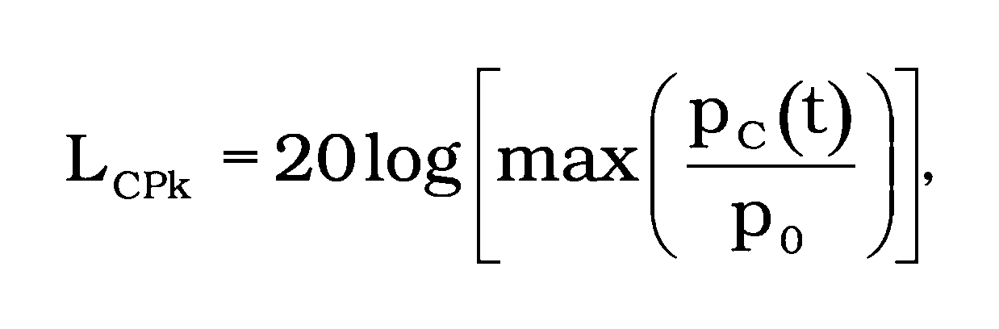

# Čl. I

Nariadenie vlády Slovenskej republiky č. 115/2006 Z. z. o minimálnych zdravotných a bezpečnostných požiadavkách na ochranu zamestnancov pred rizikami súvisiacimi s expozíciou hluku sa mení a dopĺňa takto:

- 1. V poznámke pod čiarou k odkazu 2 sa citácia „Zákon Národnej rady Slovenskej republiky č. 330/1996 Z. z. o bezpečnosti a ochrane zdravia pri práci v znení neskorších predpisov. Zákon Národnej rady Slovenskej republiky č. 272 /1994 Z. z. o ochrane zdravia ľudí v znení neskorších predpisov.“ nahrádza citáciou „Zákon č. 124/2006 Z. z. o bezpečnosti a ochrane zdravia pri práci a o zmene a doplnení niektorých zákonov. Zákon č. 126/2006 Z. z. o verejnom zdravotníctve a o zmene a doplnení niektorých zákonov.“.

- 2. V § 3 ods. 2 sa slová „Závodná zdravotná služba3)“ nahrádzajú slovami „Pracovná zdravotná služba3)“.

  - Poznámka pod čiarou k odkazu 3 znie:

- „3)

- § 26 zákona č. 124/2006 Z. z.“.

- 3. V § 3 ods. 2 sa slovo „povolenie4)“ nahrádza slovami „osvedčenie o odbornej spôsobilosti4)“.

  - Poznámka pod čiarou k odkazu 4 znie:

- „4)

- § 9 zákona č. 126/2006 Z. z.“.

- 4. V poznámke pod čiarou k odkazu 5 sa citácia „§ 8 ods. 1 písm. b) zákona Národnej rady Slovenskej republiky č. 330/1996 Z. z. v znení zákona č. 158/2001 Z. z.“ nahrádza citáciou „§ 6 ods. 1 písm. c) zákona č. 124/2006 Z. z.“.

- 5. V poznámke pod čiarou k odkazu 6 sa citácia „§ 8a ods. 1 písm. c) zákona Národnej rady Slovenskej republiky č. 330/1996 Z. z. v znení zákona č. 158/2001 Z. z.“ nahrádza citáciou „§ 3 písm. c) zákona č. 124/2006 Z. z.“.

- 6. V poznámke pod čiarou k odkazu 8 sa citácia „Napríklad § 18 zákona Národnej rady Slovenskej republiky č. 272/1994 Z. z. v znení neskorších predpisov, zákon č. 95/2000 Z. z. o inšpekcii práce a o zmene a doplnení niektorých zákonov.“ nahrádza citáciou „Napríklad § 37 zákona č. 126/2006 Z. z., zákon č. 125/2006 Z. z. o inšpekcii práce a o zmene a doplnení zákona č. 82/2005 Z. z. o nelegálnej práci a nelegálnom zamestnávaní a o zmene a doplnení niektorých zákonov.“.

- 7. V poznámke pod čiarou k odkazu 9 sa citácia „§ 8 zákona Národnej rady Slovenskej republiky č. 330/1996 Z. z. v znení zákona č. 158/2001 Z. z.“ nahrádza citáciou „§ 5 zákona č. 124/2006 Z. z.“.

- 8. V § 4 ods. 1 sa vkladá nová prvá veta, ktorá znie:

- „Riziko, vyplývajúce zamestnancovi z expozície hluku, musí zamestnávateľ odstrániť alebo znížiť na najnižšiu dosiahnuteľnú úroveň s prihliadnutím na technický pokrok a dostupnosť opatrení na odstránenie alebo zníženie hluku predovšetkým pri zdroji hluku.“.

- 9. V poznámke pod čiarou k odkazu 11 sa citácia „§ 8a ods. 3 písm. h) zákona Národnej rady Slovenskej republiky č. 330/1996 Z. z. v znení zákona č. 158/2001 Z. z.“ nahrádza citáciou „§ 6 ods. 1 písm. h) bod 3 zákona č. 124/2006 Z. z.“.

- 10. V § 4 ods. 4 sa slová „tabuľky č. 1“ nahrádzajú slovami „bodu 2“.

- 11. V poznámke pod čiarou k odkazu 14 sa citácia „§ 8b ods. 2 zákona Národnej rady Slovenskej republiky č. 330/1996 Z. z. v znení zákona č. 158/2001 Z. z.“ nahrádza citáciou „§ 7 ods. 5 zákona č. 124/2006 Z. z.“.

- 12. V poznámke pod čiarou k odkazu 15 sa citácia „§ 8e zákona Národnej rady Slovenskej republiky č. 330/1996 Z. z. v znení zákona č. 158/2001 Z. z.“ nahrádza citáciou „§ 10 zákona č. 124/2006 Z. z.“.

- 13. V poznámke pod čiarou k odkazu 16 sa citácia „§ 8a ods. 1 písm. o) zákona Národnej rady Slovenskej republiky č. 330/1996 Z. z. v znení zákona č. 158/2001 Z. z.“ nahrádza citáciou „§ 6 ods. 1 písm. q) zákona č. 124/2006 Z. z.“.

- 14. V poznámke pod čiarou k odkazu 18 sa citácia „§ 18 zákona Národnej rady Slovenskej republiky č. 272/1994 Z. z. v znení neskorších predpisov“ nahrádza citáciou „§ 3 zákona č. 126/2006 Z. z.“.

- 15. V § 9 odsek 5 znie:

- „(5)

- Mimoriadne lekárske prehliadky exponovaných zamestnancov navrhne lekár vykonávajúci zdravotný dohľad alebo nariadi orgán verejného zdravotníctva, ak sú na to dôvody dané ochranou ich zdravia.“.

- Poznámka pod čiarou k odkazu 19 sa vypúšťa.

- 16. V § 14 odsek 2 znie:

- „(2)

- Zamestnávatelia, ktorí prevádzkujú pracoviská uvedené do prevádzky pred účinnosťou tohto nariadenia vlády, môžu využívať ustanovenie § 4 ods. 4 písm. b) najdlhšie do 28. februára 2007 vrátane.“.

- 17. V poznámke pod čiarou k odkazu 20 sa citácia „Zákon Národnej rady Slovenskej republiky č. 272/1994 Z. z. v znení neskorších predpisov.“ nahrádza citáciou „Zákon č. 126/2006 Z. z.“.

- 18. V prílohe č. 1 bode 13 sa slová „podľa bodu 10“ nahrádzajú slovami „podľa bodu 12“.

- 19. V prílohe č. 1 bode 14 sa slová „podľa bodu 10“ nahrádzajú slovami „podľa bodu 12“.

- 20. V prílohe č. 1 bode 19 sa za slová „z prílohy C STN ISO 9612.“ vkladajú slová „Akustika. Pokyny na meranie a hodnotenie hlukovej expozície v pracovnom prostredí“.

- 21. V prílohe č. 1 bod 22 znie:

- „22.

- Vrcholová hladina C akustického tlaku je hladina určená z maximálneho okamžitého akustického tlaku s frekvenčným vážením C počas meraného intervalu podľa vzťahu

- 

- kde pc(t) je časová funkcia akustického tlaku váženého frekvenčnou váhovou funkciou C.

- Hladina sa získa meraním hladiny C akustického tlaku na zvukomeri pri použití funkcie Peak. Použitie tejto funkcie sa vyjadruje v značke indexom Pk.

- Značka: LCPk

- Jednotka: dB“.

- 22. V prílohe č. 1 bode 25 sa slová „v ktorom okamžitá hodnota akustického tlaku je vyššia ako hodnota LCPk znížená o 20 dB.“ nahrádzajú slovami „ohraničeným poklesom hodnoty LCPk zníženej o 20 dB.“.

- 23. V prílohe č. 1 bode 27 sa slová „najvyššia prípustná hodnota“ nahrádzajú slovami „akčná hodnota expozície hluku alebo limitná hodnota expozície hluku.“.

- 24. V prílohe č. 1 bod 29 znie:

- „29.

- Akčná hodnota expozície hluku je hodnota určujúcej veličiny hluku, pri ktorej prekročení sa vykonávajú opatrenia na zníženie hluku. V značke veličiny je index a, napr. LAEX,8h,a.

- Horná akčná hodnota expozície hluku a dolná akčná hodnota expozície hluku sú určené na ochranu zdravia zamestnancov, predovšetkým na ochranu sluchu pred počuteľným zvukom. Akčné hodnoty expozície hluku pre skupiny prác sú určené na ochranu zdravia zamestnancov pred nešpecifickými, najmä rušivými a obťažujúcimi účinkami hluku.“.

- 25. V prílohe č. 1 bode 30 v prvej vete sa za slová „Limitná hodnota“ vkladá slovo „expozície“.

- 26. V prílohe č. 2 bod 1 znie:

- „1.

- Limitné hodnoty expozície, horné akčné hodnoty expozície a dolné akčné hodnoty expozície hluku

- Na ochranu zdravia zamestnancov, predovšetkým z hľadiska ochrany ich sluchu pred počuteľným hlukom, sa ustanovujú limitné hodnoty expozície hluku, horné akčné hodnoty expozície hluku a dolné akčné hodnoty expozície hluku.“.

  - Body 1.1. až 1.5. sa nevypúšťajú.

- 27. V prílohe č. 2 bod 2 znie:

- „2.

- Akčné hodnoty hlukovej expozície pre skupiny prác

- Na ochranu zdravia zamestnancov z hľadiska ochrany pred nešpecifickými, najmä rušivými alebo obťažujúcimi účinkami hluku sa ustanovujú akčné hodnoty normalizovaných hladín hlukovej expozície pre skupiny prác. Hodnotenie podľa tohto odseku sa používa len pre práce, ktoré vyžadujú duševné sústredenie sa alebo sluchovú komunikáciu.“.

  - Body 2.1. až 2.5.2. sa nevypúšťajú.

- 28. V prílohe č. 2 tabuľke č. 1 v riadku IV veta znie:

- „Činnosť, pri ktorej sa používajú hlučné stroje a nástroje alebo ktorá je vykonávaná v hlučnom prostredí, vyžaduje aspoň čiastkové sluchové informácie a nespĺňa podmienky zaradenia do skupín I, II alebo III.“.

- 29. Slová „lekárske preventívne prehliadky“ vo všetkých tvaroch sa v celom texte nariadenia vlády nahrádzajú slovami „lekárske preventívne prehliadky vo vzťahu k práci“ v príslušnom tvare.

- 30. Slová „orgán na ochranu zdravia“ vo všetkých tvaroch sa v celom texte nariadenia vlády nahrádzajú slovami „orgán verejného zdravotníctva“ v príslušnom tvare.

- 31. Slová „hlukovej expozície“ vo všetkých tvaroch sa v celom texte nariadenia vlády nahrádzajú slovami „expozície hluku“ v príslušnom tvare.
