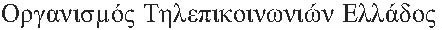
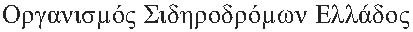
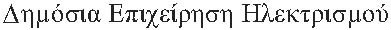

Príloha k dohode

- ZOZNAM SÚVISIACICH SUBJEKTOV UVEDENÝCH V ČLÁNKU 11

  - Na účely článku 11 tejto dohody sa za „súvisiaci subjekt, ktorý koná ako orgán verejnej správy alebo ktorého úloha je uznávaná medzinárodnou zmluvou,“ považujú tieto subjekty:

  - SUBJEKTY V RÁMCI EURÓPSKEJ ÚNIE Belgicko – Vlaams Gewest (Flámsky región)

  - – Région wallonne (Valónsky región)

  - – Région bruxelloise/Brussels Gewest (Bruselský región)

  - – Communauté française (Francúzske spoločenstvo)

  - – Vlaamse Gemeenschap (Flámske spoločenstvo)

  - – Deutschsprachige Gemeinschaft (Nemecky hovoriace spoločenstvo)

    - Španielsko – Xunta de Galicia (vláda autonómneho spoločenstva Galície)

    - – Junta de Andalucía (vláda autonómneho spoločenstva Andalúzie)

    - – Junta de Extremadura (vláda autonómneho spoločenstva Estremadury)

    - – Junta de Castilla-La Mancha (vláda autonómneho spoločenstva Kastílie-La Manche)

    - – Junta de Castilla-León (vláda autonómneho spoločenstva Kastílie-Leónu)

    - – Gobierno Foral de Navarra (vláda autonómneho spoločenstva Navarry)

    - – Govern de les Illes Balears (vláda autonómneho spoločenstva Baleárskych ostrovov)

    - – Generalitat de Catalunya (vláda autonómneho spoločenstva Katalánska)

    - – Generalitat de Valencia (vláda autonómneho spoločenstva Valencie)

    - – Diputación General de Aragón (vláda autonómneho spoločenstva Aragónska)

    - – Gobierno de las Islas Canarias (vláda autonómneho spoločenstva Kanárskych ostrovov)

    - – Gobierno de Murcia (vláda autonómneho spoločenstva Murcie)

    - – Gobierno de Madrid (vláda autonómneho spoločenstva Madridu)

    - – Gobierno de la Comunidad Autónoma del País Vasco/Euzkadi (vláda autonómneho spoločenstva Baskicka)

    - – Diputación Foral de Guipúzcoa (regionálna rada Guipúzcoy)

    - – Diputación Foral de Vizcaya/Bizkaia (regionálna rada Biskajska)

    - – Diputación Foral de Álava (regionálna rada Álavy)

    - – Ayuntamiento de Madrid (mestská rada Madridu)

    - – Ayuntamiento de Barcelona (mestská rada Barcelony)

    - – Cabildo Insular de Gran Canaria (ostrovná rada Gran Canarie)

    - – Cabildo Insular de Tenerife (ostrovná rada Tenerife)

    - – Instituto de Crédito Oficial (Verejný úverový ústav)

    - – Instituto Catalán de Finanzas (Finančný ústav Katalánska)

    - – Instituto Valenciano de Finanzas (Finančný ústav Valencie)

    - Grécko –  (Národný telekomunikačný úrad)

    - –  (Národná železničná spoločnosť)

    - –  (Štátna elektrárenská spoločnosť)

    - Francúzsko – La Caisse d´amortissement de la dette sociale (CADES) (Fond na úhradu dlhu sociálneho zabezpečenia)

    - – L´Agence française de développement (AFD) (Francúzska rozvojová agentúra)

    - – Réseau Ferré de France (RFF) (Francúzska železničná sieť)

    - – Caisse Nationale des Autoroutes (CNA) (Národný diaľničný fond)

    - – Assistance publique Hôpitaux de Paris (APHP) (Zväz verejných nemocníc parížskej oblasti)

    - – Charbonnages de France (CDF) (Ústredie francúzskych štátnych spoločností na ťažbu čierneho uhlia)

    - – Entreprise miničre et chimique (EMC) (Štátna ťažobná a chemická spoločnosť)

    - Taliansko – regióny

    - – provincie

    - – mestá a obce

    - – Cassa Depositi e Prestiti (Fond vkladov a pôžičiek)

    - Lotyšsko – Pađvaldîbas (miestne samosprávy)

    - Poľsko – gminy (obce)

    - – powiaty (okresy)

    - – województwa (vojvodstvá)

    - – związki gmin (združenia obcí)

    - – związki powiatów (združenia okresov)

    - – związki województw (združenia vojvodstiev)

    - – miasto stołeczne Warszawa (hlavné mesto Varšava)

    - – Agencja Restrukturyzacji i Modernizacji Rolnictwa (Agentúra pre reštrukturalizáciu a modernizáciu poľnohospodárstva)

    - – Agencja Nieruchomości Rolnych (Agentúra pre poľnohospodársky majetok)

    - Portugalsko – Regiăo Autónoma da Madeira (autonómna oblasť Madeira)

    - – Regiăo Autónoma dos Açores (autonómna oblasť Azory)

    - – mestá a obce

    - Slovensko – mestá a obce

    - – Železnice Slovenskej republiky

    - – Štátny fond cestného hospodárstva

    - – Slovenské elektrárne

    - – Vodohospodárska výstavba

    - MEDZINÁRODNÉ SUBJEKTY – Európska banka pre obnovu a rozvoj

    - – Európska investičná banka

    - – Ázijská rozvojová banka

    - – Africká rozvojová banka

    - – Svetová banka/Medzinárodná banka pre obnovu a rozvoj/Medzinárodný menový fond

    - – Medzinárodné finančné združenie

    - – Medziamerická rozvojová banka

    - – Rozvojová banka Rady Európy

    - – Euratom

    - – Európske spoločenstvo

    - – Andské rozvojové združenie

    - – Eurofima

    - – Európske spoločenstvo pre uhlie a oceľ

    - – Nordická investičná banka

    - – Karibská rozvojová banka

    - Ustanovenia článku 11 sa netýkajú žiadnych medzinárodných záväzkov, ktoré mohli zmluvné strany prijať vo vzťahu k uvedeným medzinárodným subjektom.

    - SUBJEKTY V TRETÍCH KRAJINÁCH

      - Subjekty, ktoré spĺňajú tieto kritériá:

        - 1. Subjekt sa podľa vnútroštátnych kritérií jednoznačne považuje za verejný subjekt.

        - 2. Takýto verejný subjekt je netrhovým výrobcom, ktorý spravuje a financuje skupinu činností hlavne poskytovaním netrhových tovarov a služieb určených v prospech spoločenstva, ktoré účinne kontroluje štátna správa.

        - 3. Takýto verejný subjekt vydáva cenné papiere pravidelne a vo veľkom rozsahu.

        - 4. Príslušný štát je schopný zaručiť, že takýto verejný subjekt nevykoná predčasnú náhradu v prípade klauzúl o pripočítaní úroku zaplateného v inej krajine („gross-up“).

    - PODMIENKY NA ZMENU TEJTO PRÍLOHY

      - Zoznam súvisiacich subjektov v tejto prílohe sa môže zmeniť na základe vzájomnej dohody.
