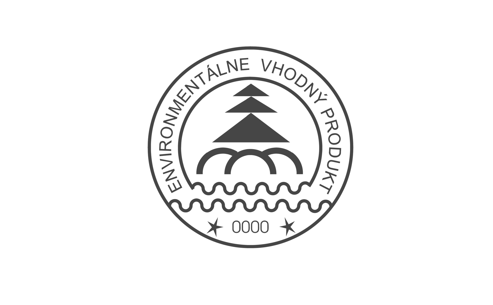

# Čl. I

Zákon č. 469/2002 Z. z. o environmentálnom označovaní výrobkov v znení zákona č. 587/2004 Z. z. sa mení a dopĺňa takto:

- 1. Slovo „výrobok“ vo všetkých tvaroch sa v celom texte zákona vrátane jeho príloh a v právnych predpisoch vydaných na jeho vykonanie nahrádza slovom „produkt“ v príslušnom tvare.

- 2. V § 1 odsek 1 znie:

- „(1)

- Tento zákon upravuje

- a)

- podmienky a postup pri udeľovaní a používaní environmentálnej značky „Environmentálne vhodný produkt" (ďalej len „národná environmentálna značka"),

- b)

- pôsobnosť orgánov štátnej správy pri udeľovaní environmentálnej značky „Európsky kvet" (ďalej len „environmentálna značka Európskeho spoločenstva") ustanovenej podľa osobitného predpisu,1a)

- c)

- zodpovednosť za porušovanie povinností ustanovených týmto zákonom a osobitným predpisom.1a)“.

  - Poznámka pod čiarou k odkazu 1a znie:

  - „1a)

  - Nariadenie Európskeho parlamentu a Rady (ES) č. 1980/2000 zo 17. júla 2000 o revidovanej metóde spoločenstva pri udeľovaní environmentálnej značky (Mimoriadne vydanie Ú. v. EÚ, kap. 15/zv. 5, Ú. v. ES L 237, 21. 9. 2000).“.

- 3. Slovo „tovar“ vo všetkých tvaroch sa v celom texte zákona vrátane príloh nahrádza slovom „výrobok“ v príslušnom tvare.

- 4. Poznámka pod čiarou k odkazu 3 znie:

- „3) Body 6.2 a 6.3 prílohy VI nariadenia Európskeho parlamentu a Rady (ES) č. 761/2001 z 19. marca 2001, ktorým sa umožňuje dobrovoľná účasť organizácií v systéme spoločenstva pre ekologické riadenie a audit (EMAS) (Mimoriadne vydanie Ú. v. EÚ, kap. 13/zv. 26, Ú. v. ES L 114, 24. 4. 2001).“.

- 5. V § 2 ods. 1 písm. e) sa slová „§ 5“ nahrádzajú slovami „tohto zákona“.

- 6. V § 2 ods. 2 sa slovo „Environmentálnou“ nahrádza slovami „Národnou environmentálnou“.

- 7. V nadpise § 3 sa za slovo „udelenie“ vkladá slovo „národnej“.

- 8. V § 3 ods. 1 sa slovo „Environmentálna“ nahrádza slovami „Národná environmentálna“.

- 9. V § 3 ods. 3 písm. c) sa slová „udelenie environmentálnej značky“ nahrádzajú slovami „udelenie národnej environmentálnej značky“.

- 10. V § 3 ods. 4 písm. b) sa slovo „priemyselného“ vypúšťa a slovo „vyrábajúceho“ sa nahrádza slovom „produkujúceho“.

- 11. V § 3 ods. 4 písm. f) sa za slovo „udelená“ vkladá slovo „národná“.

- 12. V § 3 ods. 6 sa slovo „Environmentálnu“ nahrádza slovami „Národnú environmentálnu“.

- 13. V poznámke pod čiarou k odkazu 6 sa citácia „Napríklad zákon č. 76/1998 Z. z. o ochrane ozónovej vrstvy Zeme a o doplnení zákona č. 455/1991 Z. z. o živnostenskom podnikaní (živnostenský zákon) v znení neskorších predpisov v znení neskorších predpisov, zákon Národnej rady Slovenskej republiky č. 272/1994 Z. z. o ochrane zdravia ľudí v znení neskorších predpisov.“ nahrádza citáciou „Napríklad zákon č. 76/1998 Z. z. o ochrane ozónovej vrstvy Zeme a o doplnení zákona č. 455/1991 Z. z. o živnostenskom podnikaní (živnostenský zákon) v znení neskorších predpisov v znení neskorších predpisov, zákon č. 126/2006 Z. z. o verejnom zdravotníctve a o zmene a doplnení niektorých zákonov.“.

- 14. V § 4 ods. 1 sa slovo „Environmentálna“ nahrádza slovami „Národná environmentálna“.

- 15. V § 5 ods. 4 sa slová „(§ 11)“ nahrádzajú slovami „(§ 10)“.

- 16. V § 5 odsek 9 znie:

- „(9)

- Skupiny produktov, podskupiny produktov a osobitné podmienky na udelenie národnej environmentálnej značky pre jednotlivé skupiny produktov a podskupiny produktov vrátane ich aktualizácie podľa odseku 7 určí ministerstvo a uverejní ich vo Vestníku Ministerstva životného prostredia Slovenskej republiky (ďalej len „vestník") a na svojej internetovej stránke.“.

- 17. V § 6 ods. 1 tretia veta znie:

- „V hornej časti medzikružia je nápis „Environmentálne vhodný produkt"; v dolnej časti sa uvádza identifikačné číslo oznámenia o určení skupín produktov, podskupín produktov a osobitných podmienok na udelenie národnej environmentálnej značky.“.

- 18. V § 9 odsek 4 znie:

- „(4)

- Úhrada podľa odseku 1 písm. a) spojená s preskúmaním žiadosti o udelenie národnej environmentálnej značky je najmenej 5 000 Sk a najviac 15 000 Sk.“.

- 19. V § 9 odseky 6 a 7 znejú:

- „(6)

- Úhrada podľa odseku 1 písm. b) za používanie národnej environmentálnej značky je 0,02 % z ročného objemu predaja produktu; ročná úhrada za produkty v jednej skupine produktov je najmenej 3 000 Sk a najviac 120 000 Sk.

- (7)

- Základom na určenie čiastky ročného objemu predaja je

- a)

- výrobná cena, ak je produktom výrobok,

- b)

- dodacia cena, ak je produktom služba.“.

- 20. V § 9 ods. 8 písm. b) sa slová „v systéme environmentálne orientovaného riadenia a auditu“ nahrádzajú slovami „v schéme Európskeho spoločenstva pre environmentálne manažérstvo a audit“.

- 21. V poznámke pod čiarou k odkazu 13 sa citácia „Zákon č. 468/2002 Z. z.“ nahrádza citáciou „Nariadenie Európskeho parlamentu a Rady (ES) č. 761/2001. Zákon č. 491/2005 Z. z. o environmentálnom overovaní a registrácii organizácií v schéme Európskeho spoločenstva pre environmentálne manažérstvo a audit a o zmene a doplnení niektorých zákonov.“.

- 22. § 10 vrátane nadpisu znie:

- 㤠10

- Environmentálna značka Európskeho spoločenstva

- Na udeľovanie a používanie environmentálnej značky Európskeho spoločenstva sa vzťahujú osobitné predpisy.13a)“.

  - Poznámka pod čiarou k odkazu 13a znie:

  - „13a)

  - Nariadenie Európskeho parlamentu a Rady (ES) č. 1980/2000.

  - Rozhodnutie Komisie č. 2000/728/ES z 10. novembra 2000 ustanovujúce poplatky za prihlášku environmentálnej značky spoločenstva a ročné poplatky za environmentálnu značku spoločenstva (Mimoriadne vydanie Ú. v. EÚ, kap.15/zv. 5, Ú. v. ES L 293, 22. 11. 2000) v znení rozhodnutia Komisie 2000/393/ES z 22. mája 2003, ktorým sa mení a dopĺňa rozhodnutie 2000/728/ES ustanovujúce poplatky za prihlášku environmentálnej značky spoločenstva a ročné poplatky za environmentálne značky spoločenstva (Mimoriadne vydanie Ú. v. EÚ, kap. 15/zv. 7, Ú. v. EÚ L 135, 3. 6. 2003).

  - Rozhodnutie Komisie č. 2000/729/ES z 10. novembra 2000 o štandardnej zmluve obsahujúcej podmienky používania environmentálnej značky spoločenstva (Mimoriadne vydanie Ú. v. EÚ, kap.15/zv. 5, Ú. v. ES L 293, 22. 11. 2000).

  - Rozhodnutie Komisie č. 2000/730/ES z 10. novembra 2000, ktorým sa zriaďuje Rada pre environmentálne označovanie Európskej únie a jej rokovací poriadok (Mimoriadne vydanie Ú. v. EÚ, kap.15/zv. 5, Ú. v. ES L 293, 22. 11. 2000).

  - Rozhodnutie Komisie č. 2000/731/ES z 10. novembra 2000, ktorým sa ustanovuje rokovací poriadok Poradenského fóra revidovaného systému pre udeľovanie environmentálnej značky spoločenstva (Mimoriadne vydanie Ú. v. EÚ, kap. 15/zv. 5, Ú. v. ES L 293, 22. 11. 2000).“.

- 23. § 11 až 13 sa vypúšťajú.

- 24. V poznámke pod čiarou k odkazu 14 sa citácia „§ 7 až 10 zákona Slovenskej národnej rady č. 595/1990 Zb. o štátnej správe pre životné prostredie v znení neskorších predpisov“ nahrádza citáciou „§ 9 a 10 zákona č. 525/2003 Z. z. o štátnej správe starostlivosti o životné prostredie a o zmene a doplnení niektorých zákonov v znení neskorších predpisov.“.

- 25. V § 14 ods. 2 písmeno a) znie:

- „a)

- určuje skupiny produktov a podľa potreby aj podskupiny produktov, ako aj osobitné podmienky na udelenie národnej environmentálnej značky pre jednotlivé skupiny produktov a podskupiny produktov vrátane ich pravidelnej revízie a aktualizácie (§ 5 ods. 9),“.

- 26. V § 14 ods. 2 písmeno f) znie:

- „f)

- plní úlohy príslušného orgánu podľa osobitného predpisu,14a) ako aj ďalšie úlohy na úseku medzinárodnej spolupráce v záujme zabezpečenia súladu a koordinovanosti národného systému environmentálneho označovania produktov so schémou Európskeho spoločenstva pri udeľovaní environmentálnej značky.“.

  - Poznámka pod čiarou k odkazu 14a znie:

  - „14a)

  - Čl. 11 a 14 nariadenia Európskeho parlamentu a Rady (ES) č. 1980/2000.“.

- 27. V § 14 ods. 3 sa na konci pripája táto veta: „Na výkon kontrolnej činnosti podľa tohto zákona sa primerane vzťahuje osobitný predpis.14b)“.

  - Poznámka pod čiarou k odkazu 14b znie:

  - „14b)

  - § 8 až 13 zákona Národnej rady Slovenskej republiky č. 10/1996 Z. z. o kontrole v štátnej správe v znení zákona č. 502/2001 Z. z.“.

- 28. V § 15 odsek 2 znie:

- „(2)

- Ministerstvo raz ročne uverejní vo vestníku a na svojej internetovej stránke zoznam produktov, ktorým udelilo národnú environmentálnu značku a zoznam výrobkov,14c) ktorým udelilo environmentálnu značku Európskeho spoločenstva a využije ďalšie formy aktívnej propagácie a informovania verejnosti o systéme environmentálneho označovania.“.

  - Poznámka pod čiarou k odkazu 14c znie:

  - „14c)

  - Čl. I nariadenia Európskeho parlamentu a Rady (ES) č. 1980/2000.“.

- 29. V § 16 odsek 1 znie:

- „(1)

- Pokutu do 500 000 Sk uloží inšpekcia právnickej osobe alebo fyzickej osobe-podnikateľovi, ak na území Slovenskej republiky

- a)

- neoprávnene používa národnú environmentálnu značku alebo environmentálnu značku Európskeho spoločenstva,

- b)

- použije klamlivú reklamu, klamlivé označenie produktu alebo výrobku,14c) akúkoľvek inú značku, alebo logo, ktoré by mohli viesť k zámene s národnou environmentálnou značkou alebo s environmentálnou značkou Európskeho spoločenstva.“.

- 30. V § 16 odsek 3 znie:

- „(3)

- Inšpekcia pri rozhodovaní o výške pokuty prihliada na závažnosť porušenia povinnosti a na pohnútky a okolnosti, ktoré viedli k tomuto porušeniu, na čas trvania protiprávneho stavu a na hroziace alebo vzniknuté škodlivé následky na životné prostredie alebo na zdravie ľudí.“.

- 31. Nad § 18 sa vkladá nadpis, ktorý znie:

- „Prechodné ustanovenia“.

  - Súčasne sa zrušuje nadpis pod § 18.

- 32. Za § 18 sa vkladá § 18a, ktorý vrátane nadpisu znie:

- 㤠18a

- Prechodné ustanovenia účinné od 1. júna 2007

- (1)

- Zmluvy o používaní národnej environmentálnej značky “Environmentálne vhodný výrobok„ uzavreté do 31. mája 2007 ostávajú nedotknuté do skončenia ich platnosti, najneskôr však do 31. mája 2010.

- (2)

- Výnosy ministerstva, ktorými sa určili osobitné podmienky na udelenie národnej environmentálnej značky do 31. mája 2007, strácajú účinnosť dňom v nich uvedeným, najneskôr však 31. mája 2010.“.

- 33. Príloha č. 2 znie:

- „Príloha č. 2 k zákonu č. 469/2002 Z. z.

- NÁRODNÁ ENVIRONMENTÁLNA ZNAČKA

- (vzor)

- Národná environmentálna značka podľa vzoru uvedeného v tejto prílohe je jednofarebná a môže sa tlačiť v ľubovoľnej farbe, ktorá vyhovuje celkovému tvarovaniu produktu alebo jeho obalu.

- Vonkajší priemer (veľkosť) značky musí byť minimálne 15 mm.“.

- 

- 34. Príloha č. 3 sa vypúšťa.

- 35. V prílohe č. 4 v nadpise sa za slovo „používať" vkladá slovo „národnú".

- 36. V prílohe č. 4 sa vypúšťa časť B. Súčasne sa zrušuje označenie časti A.

- 37. V prílohe č. 4 čl. 1 písm. a) sa slová „výnosu, ktorým boli vydané osobitné podmienky na udelenie národnej environmentálnej značky" nahrádzajú slovami „oznámenia o určení skupín produktov, podskupín produktov a osobitných podmienok na udelenie národnej environmentálnej značky".

- 38. V prílohe č. 4 čl. 9 písm. a) druhý bod znie:

- „2.

- koniec platnosti zmluvy,“.

- 39. V prílohe č. 4 čl. 9 sa vypúšťa písmeno d).

- Doterajšie písmená e) a f) sa označujú ako písmená d) a e).

- 40. V prílohe č. 4 časti Prílohy k zmluve časť Príloha č. 2 znie:

- „Príloha č. 2 – kópia oznámenia ministerstva o určení skupín produktov, podskupín produktov a osobitných podmienok na udelenie národnej environmentálnej značky pre príslušnú skupinu a podskupinu produktov.“.
