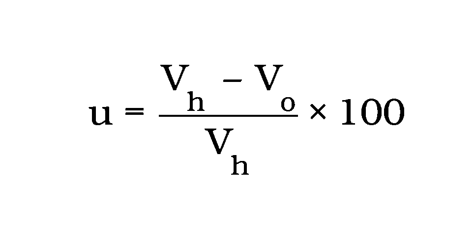

# Čl. I

Vyhláška Ministerstva financií Slovenskej republiky č. 226/2004 Z. z., ktorou sa ustanovujú podrobnosti o požiadavkách na usporiadanie technologických zariadení na výrobu, spracovanie, skladovanie a prepravu liehu, kontrole množstva liehu, zisťovaní zásob liehu a o spôsobe vedenia evidencie liehu sa mení a dopĺňa takto:

- 1. V § 1 odsek 2 znie:

- „(2)

- Technologické zariadenie na výrobu liehu v podniku na výrobu liehu1) (ďalej len „výrobné zariadenie") je destilačný prístroj, rafinačný prístroj a rektifikačný prístroj a ich súčasti, potrubia, iné prístroje a ich súčasti, v ktorých sú lieh a liehové pary nezmerané kontrolným objemovým meradlom na lieh (ďalej len „kontrolné liehové meradlo"). Kontrolné liehové meradlo je objemové meradlo na lieh2) a meracia zostava na lieh, ktorú možno používať na základe výnimky udelenej podľa osobitného predpisu2a) podniku na výrobu liehu, ktorého výrobná kapacita je 10 000 l/h a viac. Výrobné zariadenie je aj zariadenie na zberanie a odvádzanie lutrovej vody a odlúčených olejov a voskov, pričom lutrovou vodou je voda vznikajúca po oddelení liehu v procese výroby; v liehovarníckom závode na pestovateľské pálenie ovocia, v ktorom sa úkvapy a dokvapy odvádzajú do zariadenia na zachytávanie lutrovej vody, sa za lutrovú vodu považuje aj zmes úkvapov a dokvapov s lutrovou vodou.“.

- Poznámka pod čiarou k odkazu 2a znie:

- „2a)

- § 19 ods. 2 písm. a) zákona č. 142/2000 Z. z. o metrológii a o zmene a doplnení niektorých zákonov v znení zákona č. 431/2004 Z. z.“.

- 2. V § 1 ods. 9 sa na konci bodka nahrádza čiarkou a pripájajú sa tieto slová: „ak to usporiadanie výrobného zariadenia umožňuje a ak je to v súlade s osobitným predpisom.2b)“.

- Poznámka pod čiarou k odkazu 2b znie:

- „2b)

- Napríklad vyhláška Ministerstva vnútra Slovenskej republiky č. 94/2004 Z. z., ktorou sa ustanovujú technické požiadavky na protipožiarnu bezpečnosť pri výstavbe a pri užívaní stavieb.“.

- 3. V § 1 ods. 10 a 11, § 3 ods. 4, § 5 ods. 2 a 3, § 5 ods. 4 druhej vete, § 5 ods. 5 a 6, § 6 vrátane nadpisu, § 8 ods. 2 až 4, § 8 ods. 5 písm. a) a § 8 ods. 9 sa slová „kontrolné liehové meradlo“ vo všetkých tvaroch nahrádzajú slovami „objemové meradlo na lieh“ v príslušnom tvare.

- 4. V § 2 ods. 5 sa slová „§ 22 ods. 6“ nahrádzajú slovami „§ 22 ods. 5 písm. a)“.

- 5. V § 3 odsek 6 znie:

- „(6)

- Uzáverami majú byť zabezpečené všetky kohúty, ventily, otvory, príruby, príklopy, odnímateľné zorné sklá, čistiace otvory a potrubia tej časti výrobného zariadenia, v ktorej sa nachádza nezmeraný lieh a liehové pary alebo liehové kvapaliny. Ak na výrobné zariadenie podniku na výrobu liehu, ktorý používa na meranie vyrobeného množstva liehu meraciu zostavu na lieh, nie je možné umiestniť uzáveru z technického dôvodu alebo technologického dôvodu, postupuje sa podľa § 20 ods. 3 zákona. Spojovacie potrubie od chladiča ku kontrolnému liehovému meradlu, kontrolné liehové meradlo a zariadenie na zberanie a odvádzanie lutrovej vody, ak lutrová voda sa nevráti späť do výrobného procesu, sa zabezpečia vo všetkých podnikoch na výrobu liehu.“.

- 6. V § 3 ods. 7 až 11 sa na konci pripája táto veta: „Toto ustanovenie sa nevzťahuje na podnik na výrobu liehu, ktorý používa na meranie vyrobeného množstva liehu meraciu zostavu na lieh.“.

- 7. § 5 sa dopĺňa odsekmi 7 a 8, ktoré znejú:

- „(7)

- Meracia zostava na lieh pozostáva z hmotnostného prietokomeru na lieh, prepočítavača množstva liehu, meradla teploty pretekajúceho liehu a z vibračného hustomeru na lieh a podlieha kalibrácii na základe výnimky udelenej podľa osobitného predpisu;2a) súčasťou meracej zostavy na lieh je aj etalónové gravimetrické zariadenie s nádržou, vyhodnocovacia jednotka, regulátor prietoku liehu a teplotný poistný ventil.

- (8)

- Meracia zostava na lieh je umiestnená tak, aby na ňu nepôsobilo teplo a aby sa zamedzilo jej vonkajšiemu mechanickému zaťaženiu a otrasom. Meracia zostava na lieh je zabezpečená krytom a umiestnená v priestorovo ohraničenom mieste zabezpečenom uzáverou, pričom uzáverou je zabezpečený aj kryt meracej zostavy na lieh.“.

- 8. Za § 6 sa vkladajú § 6a a 6b, ktoré vrátane nadpisov znejú:

- 㤠6a

- Kontrola meracej zostavy na lieh

- (1)

- Kontrola meracej zostavy na lieh sa má vykonať pred každým začatím výroby liehu a pred každým ukončením výroby liehu. Kontrola správnosti chodu meracej zostavy na lieh sa vykonáva počas výroby liehu vždy pri zisťovaní vyrobeného množstva liehu. Kontrola meracej zostavy na lieh sa môže vykonať aj s prihliadnutím na prevádzkové pomery podniku na výrobu liehu. Meracia zostava na lieh sa má po jej kontrole zabezpečiť uzáverou.

- (2)

- Po ukončení výroby a po ukončení zisťovania vyrobeného množstva liehu sa meracia zostava na lieh skontroluje a opäť zabezpečí uzáverou.

- (3)

- Pred každým začatím výroby liehu sa kontroluje

- a)

- stav vyhodnocovacej jednotky meracej zostavy na lieh,

- b)

- platnosť dokladu o kalibrácii meracej zostavy na lieh,

- c)

- počet, umiestnenie a neporušenosť uzáver na meracej zostave na lieh.

- (4)

- Opravy porúch vzniknutých neoprávneným zásahom alebo vonkajším pôsobením na meraciu zostavu na lieh a opravy jednotlivých častí meracej zostavy na lieh na mieste jej inštalácie a korekcie programu vyhodnocovacej jednotky meracej zostavy na lieh sa vykonávajú len v prítomnosti zamestnanca colného úradu. Meracia zostava na lieh sa po oprave jej jednotlivej časti kalibruje v súlade s výnimkou udelenou podľa osobitného predpisu.2a)

- § 6b

- Váhová merná skúška meracej zostavy na lieh

- (1)

- Váhovú mernú skúšku meracej zostavy na lieh vykonáva s prihliadnutím na prevádzkové pomery podniku na výrobu liehu zamestnanec colného úradu v prítomnosti prevádzkovateľa podniku na výrobu liehu.

- (2)

- Pri váhovej mernej skúške meracej zostavy na lieh sa porovnáva vyrobené množstvo liehu, vypočítané vyhodnocovacou jednotkou meracej zostavy na lieh na základe údajov o hmotnosti, objeme, teplote a hustote vyrobeného liehu s vyrobeným množstvom liehu vypočítaným z objemovej koncentrácie liehu a hmotnosti liehu zistenej etalónovým gravimetrickým zariadením s nádržou. Počas váhovej mernej skúšky meracej zostavy na lieh celé vyrobené množstvo liehu vteká len do etalónového gravimetrického zariadenia s nádržou.

- (3)

- Odchýlka meracej zostavy na lieh „u" sa zisťuje z údajov podľa odseku 2, vyjadruje sa v percentách a vypočíta sa podľa vzorca

- 

- kde

- Vh je množstvo liehu (v l a.) zistené z hmotnosti liehu etalónovým gravimetrickým zariadením s nádržou,

- Vo je množstvo liehu (v l a.) zmerané meracou zostavou na lieh.

- (4)

- Odchýlka meracej zostavy na lieh zistená váhovou mernou skúškou meracej zostavy na lieh nesmie byť väčšia ako ± 0,3 %.“.

- 9. V § 8 ods. 10 sa slová „nádoba meradla“ nahrádzajú slovami „nádoba objemového meradla na lieh“ a slovo „destilačného“ sa nahrádza slovom „výrobného“.

- 10. § 8 sa dopĺňa odsekmi 15 a 16, ktoré znejú:

- „(15)

- V podniku na výrobu liehu, ktorý používa na meranie vyrobeného množstva liehu meraciu zostavu na lieh, sa vyrobené množstvo liehu zisťuje zo záznamu vyhodnocovacej jednotky meracej zostavy na lieh na základe údajov o hmotnosti, objeme, teplote a hustote vyrobeného množstva liehu. V sporných prípadoch zistení vyrobeného množstva liehu je základom na určenie a zúčtovanie vyrobeného množstva liehu zistenie colného úradu.

- (16)

- Odchýlka väčšia ako 0,3 % zistená váhovou mernou skúškou meracej zostavy na lieh sa bezodkladne oznamuje oprávnenej právnickej osobe alebo fyzickej osobe12a) na účely zabezpečenia postupu podľa osobitného predpisu3) a oprávnenej právnickej osobe alebo fyzickej osobe na vykonanie kalibrácie v súlade s výnimkou udelenou podľa osobitného predpisu.2a) Ak sa zistí odchýlka meracej zostavy na lieh väčšia ako 0,3 %, odo dňa zistenia odchýlky až do jej odstránenia a vykonania kalibrácie sa uskutočňuje korekcia vyrobeného množstva liehu.“.

- Poznámka pod čiarou k odkazu 12a znie:

- „12a)

- § 33 zákona č. 142/2000 Z. z. v znení zákona č. 431/2004 Z. z.“.
