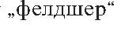

# Čl. I

Zákon č. 578/2004 Z. z. o poskytovateľoch zdravotnej starostlivosti, zdravotníckych pracovníkoch, stavovských organizáciách v zdravotníctve a o zmene a doplnení niektorých zákonov v znení zákona č. 720/2004 Z. z., zákona č. 351/2005 Z. z., zákona č. 538/2005 Z. z., zákona č. 282/2006 Z. z., zákona č. 527/2006 Z. z. a zákona č. 673/2006 Z. z. sa mení a dopĺňa takto:

- 1. V § 10 ods. 2 sa za slová „na základe povolenia,“ vkladajú slová „ak v odseku 3 nie je ustanovené inak,“.

- 2. § 10 sa dopĺňa odsekom 3, ktorý znie:

- „(3)

- Samostatná zdravotnícka prax podľa odseku 1 nie je poskytovanie lekárskej služby prvej pomoci.“.

- 3. V § 79 sa odsek 1 dopĺňa písmenom w), ktoré znie:

- „w)

- poskytovať lekársku službu prvej pomoci podľa rozpisu určeného samosprávnym krajom, ak ide o poskytovateľa, ktorý poskytuje všeobecnú ambulantnú starostlivosť v špecializačnom odbore všeobecné lekárstvo alebo v špecializačnom odbore pediatria, a poskytovateľa, ktorý poskytuje špecializovanú ambulantnú starostlivosť v odbore zubné lekárstvo.“.

- 4. V § 79 ods. 3 písm. a) sa slová „o) a v)“ nahrádzajú slovami „o), v) a w)“.

- 5. V § 79 ods. 3 písm. b) sa slová „s) a v)“ nahrádzajú slovami „s), v) a w)“.

- 6. V § 82 ods. 1 písm. b) sa slová „q) a r)“ nahrádzajú slovami „q), r) a w)“.

- 7. Príloha č. 1 sa dopĺňa bodom č. 22, ktorý znie:

- „22.

- Smernica Rady 2006/100/ES z 20. novembra 2006, ktorou sa z dôvodu pristúpenia Bulharska a Rumunska upravujú určité smernice v oblasti voľného pohybu osôb (Ú. v. EÚ L 363, 20. 12. 2006).“.

- 8. Príloha č. 3 znie:

- „Príloha č. 3 k zákonu č. 578/2004 Z. z. v znení zákona č. 272/2007 Z. z.

- UZNÁVANIE DIPLOMOV O ŠPECIALIZÁCII

- A.

- Uznávanie diplomov o špecializácii v kategórii lekár

- a)

- Diplom, certifikát a iný doklad o kvalifikácii, ktorý vydal príslušný orgán členského štátu a obsahuje názov kvalifikácie uvedenej v tabuľke č. 1, sa uznáva ako diplom o špecializácii v príslušnom špecializačnom odbore v kategórii lekár získaný v Slovenskej republike podľa tabuľky č. 2,

- Tabuľka č. 1

- p. č. | Krajina | Názov kvalifikácie | Udeľujúci orgán

- 1 | Belgicko / Belgique / België / Belgien | Bijzondere beroepstitel van geneesheer-specialist/Titre professionnel particulier de médecin spécialiste | Minister bevoegd voor Volksgezondheid/Ministre de la Santé publique

- 2 | Bulharsko / България | Свидетелство за призната специалност | Медицински университет, Висш медицински институт или Военномедицинска академия

- 3 | Cyprus / Κύπρος | Πιστοποιητικό Αναγνώρισης Ειδικότητας | Ιατρικό Συμβούλιο

- 4 | Česko / Česká republika | Diplom o specializaci | Ministerstvo zdravotnictví

- 5 | Dánsko / Danmark | Bevis for tilladelse til at betegne sig som speciallæge | Sundhedsstyrelsen

- 6 | Estónsko / Eesti | Residentuuri lõputunnistus eriarstiabi erialal | Tartu Ülikool

- 7 | Fínsko / Suomi / Finland | Erikoislääkärin tutkinto / specialläkarexamen | 1. Helsingin yliopisto / Helsingfors universitet 2. Kuopion yliopisto 3. Oulun yliopisto 4. Tampereen yliopisto 5. Turun yliopisto

- 8 | Francúzsko / France | 1. Certificat d'études spéciales de médecine 2. Attestation de médecin spécialiste qualifié 3. Certificat d'études spéciales de médecine 4. Diplôme d'études spécialisées ou spécialisation complémentaire qualifiante de médecine | 1. 3. 4. Universités 2. Conseil de l'Ordre des médecins

- 9 | Grécko / Ελλάς | Τίτλος Ιατρικής Ειδικότητας | 1. Νομαρχιακή Αυτοδιοίκηση 2. Νομαρχία

- 10 | Holandsko / Nederland | Bewijs van inschrijving in een Specialistenregister | 1. Medisch Specialisten Registratie Commissie (MSRC) van de Koninklijke Nederlandsche Maatschappij tot Bevordering der Geneeskunst 2. Sociaal-Geneeskundigen Registratie Commissie van de Koninklijke Nederlandsche Maatschappij tot Bevordering der Geneeskunst 3. Huisarts en Verpleeghuisarts Registratie Commissie (HVRC) van de Koninklijke Nederlandsche Maatschappij tot Bevordering der Geneeskunst

- 11 | Írsko / Ireland | Certificate of Specialist doctor | Competent authority

- 12 | Litva / Lietuva | Rezidentūros pažymėjimas, nurodantis suteiktą gydytojo specialisto profesinę kvalifikaciją | Universitetas

- 13 | Lotyšsko / Latvija | Sertifikāts – kompetentu iestāāžu izsniegts dokuments, kas apliecina, ka persona ir nokāārtojusi sertifikāācijas eksāāmenu specialitātē | Latvijas Ārstu biedrība Latvijas Ārstniecības personu profesionālo organizāciju savienība

- 14 | Luxembursko / Luxembourg | Certificat de médecin spécialiste | Ministre de la Santé publique

- 15 | Maďarsko / Magyarország | Szakorvosi bizonyítvány | Az Egészségügyi, Szociális és Családügyi Minisztérium illetékes testülete

- 16 | Malta / Malta | Ċertifikat ta' Speċjalista Mediku | Kumitat ta' Approvazzjoni dwar Speċjalisti

- 17 | Nemecko / Deutschland | Fachärztliche Anerkennung | Countryesärztekammer

- 18 | Poľsko / Polska | Dyplom uzyskania tytułu specjalisty | Centrum Egzaminów Medycznych

- 19 | Portugalsko / Portugal | 1. Grau de assistente e/ou 2. Titulo de especialista | 1. Ministério da Saúde 2. Ordem dos Médicos

- 20 | Rakúsko / Österreich | Facharztdiplom | Österreichische Ärztekammer

- 21 | Rumunsko / România | Certificat de medic specialist | Ministerul Sănătăţii Publici

- 22 | Slovinsko / Slovenija | Potrdilo o opravljenem specialističnem izpitu | 1. Ministrstvo za zdravje 2. Zdravniška zbornica Slovenije

- 23 | Španielsko / España | Título de Especialista | Ministerio de Educación y Cultura

- 24 | Švédsko / Sverige | Bevis om specialkompetens som läkare, utfärdat av Socialstyrelsen | Socialstyrelsen

- 25 | Taliansko / Italia | Diploma di medico specialista | Università

- 26 | Veľká Británia a Severné Írsko / United Kingdom | Certificate of Completion of specialist training | Competent authority

- 27 | Island / Ísland | Sérfræðileayfi | Heilbrigðis og tryggingamálaráðuneyti

- 28 | Lichtenštajnsko / Liechtenstein | diplomy ostatných krajín uvedené v tabuľke | príslušný orgán

- 29 | Nórsko / Norge | Spesialistgodkjenning | Den norske lægeforening ihht. delegert myndighet

- 30 | Švajčiarsko / Die Schweiz / La Suisse / La Svizzera / La Svizra | Facharzt / spécialiste / specialista | Département fédéral de ľintérieur

- Tabuľka č. 2

- Por. číslo | Krajina | Názov špecializačného odboru v členskom štáte | Minimálna dĺžka prípravy v členskom štáte | Názov zodpovedajúceho špecializačného odboru v Slovenskej republike

- 1. 01 | Belgicko / Belgique / België / Belgien | Anesthésie-réanimation / Anesthesie reanimatie | 3 roky | anestéziológia a intenzívna medicína

- 1. 02 | Bulharsko / България | Анестезиология и интензивно лечение | |

- 1. 03 | Cyprus / Κύπρος | Αναισθησιολογία | |

- 1. 04 | Česko / Česká republika | Anesteziologie a resuscitace | |

- 1. 05 | Dánsko / Danmark | Anæstesiologi | |

- 1. 06 | Estónsko / Eesti | Anestesioloogia | |

- 1. 07 | Fínsko / Suomi / <?xml:namespace prefix = st1 />Finland | Anestesiologia ja tehohoito / anestesiologi och intensivvård | |

- 1. 08 | Francúzsko / France | Anesthésiologie-Réanimation chirurgicale | |

- 1. 09 | Grécko / Ελλάς | Αναισθησιολογία | |

- 1. 10 | Holandsko / Nederland | Anesthesiologie | |

- 1. 11 | Írsko / Ireland | Anaesthesia | |

- 1. 12 | Litva / Lietuva | Anesteziologija reanimatologija | |

- 1. 13 | Lotyšsko / Latvija | Anestezioloģija un reanimatoloģija | |

- 1. 14 | Luxembursko / Luxembourg | Anesthésie-réanimation | |

- 1. 15 | Maďarsko / Magyarország | Aneszteziológia és intenzív terápia | |

- 1. 16 | Malta / Malta | Anesteżija u Kura Intensiva | |

- 1. 17 | Nemecko / Deutschland | Anästhesiologie | |

- 1. 18 | Poľsko / Polska | Anestezjologia i intensywna terapia | |

- 1. 19 | Portugalsko / Portugal | Anestesiologia | |

- 1. 20 | Rakúsko / Österreich | Anästhesiologie und Intensivmedizin | |

- 1. 21 | Rumunsko / România | Anestezie şi terapie intensivă | |

- 1. 22 | Slovinsko / Slovenija | Anesteziologija, reanimatologija in perioperativna intenzivna medicina | |

- 1. 23 | Španielsko / España | Anestesiología y Reanimación | |

- 1. 24 | Švédsko / Sverige | Anestesi och intensivvård | |

- 1. 25 | Taliansko / Italia | Anestesia e rianimazione | |

- 1. 26 | Veľká Británia a Severné Írsko / United Kingdom | Anaesthetics | |

- 1. 27 | Island / Ísland | Svæefinga- og gjörgæluæknisfræði | |

- 1. 28 | Lichtenštajnsko / Liechtenstein | Anästhesiologie | |

- 1. 29 | Nórsko / Norge | Anestesiologi | |

- 1. 30 | Švajčiarsko / Die Schweiz / La Suisse / La Svizzera / La Svizra | Anästhesiologie / anesthésiologie / anestesiologia | |

- 2. 01 | Belgicko / Belgique / België / Belgien | Chirurgie / Heelkunde | 5 rokov | chirurgia

- 2. 02 | Bulharsko / България | Хирургия | |

- 2. 03 | Cyprus / Κύπρος | Γενική Χειρουργική | |

- 2. 04 | Česko / Česká republika | Chirurgie | |

- 2. 05 | Dánsko / Danmark | Kirurgi eller kirurgiske sygdomme | |

- 2. 06 | Estónsko / Eesti | Üldkirurgia | |

- 2. 07 | Fínsko / Suomi / Finland | Yleiskirurgia / allmän kirurgi | |

- 2. 08 | Francúzsko / France | Chirurgie générale | |

- 2. 09 | Grécko / Ελλάς | Χειρoυργική | |

- 2. 10 | Holandsko / Nederland | Heelkunde | |

- 2. 11 | Írsko / Ireland | General surgery | |

- 2. 12 | Litva / Lietuva | Chirurgija | |

- 2. 13 | Lotyšsko / Latvija | Ķirurģija | |

- 2. 14 | Luxembursko / Luxembourg | Chirurgie générale | |

- 2. 15 | Maďarsko / Magyarország | Sebészet | |

- 2. 16 | Malta / Malta | Kirurġija Ġenerali | |

- 2. 17 | Nemecko / Deutschland | (Allgemeine) Chirurgie | |

- 2. 18 | Poľsko / Polska | Chirurgia ogólna | |

- 2. 19 | Portugalsko / Portugal | Cirurgia geral | |

- 2. 20 | Rakúsko / Österreich | Chirurgie | |

- 2. 21 | Rumunsko / România | Chirurgie generală | |

- 2. 22 | Slovinsko / Slovenija | Splošna kirurgija | |

- 2. 23 | Španielsko / España | Cirugía general y del aparato digestivo | |

- 2. 24 | Švédsko / Sverige | Kirurgi | |

- 2. 25 | Taliansko / Italia | Chirurgia generale | |

- 2. 26 | Veľká Británia a Severné Írsko / United Kingdom | General surgery | |

- 2. 27 | Island / Ísland | Skurðlækningar | |

- 2. 28 | Lichtenštajnsko / Liechtenstein | Chirurgie | |

- 2. 29 | Nórsko / Norge | Generell kirurgi | |

- 2. 30 | Švajčiarsko / Die Schweiz / La Suisse / La Svizzera / La Svizra | Chirurgie / chirurgie / chirurgia | |

- 3. 01 | Belgicko / Belgique / België / Belgien | Neurochirurgie | 5 rokov | neurochirurgia

- 3. 02 | Bulharsko / България | Неврохирургия | |

- 3. 03 | Cyprus / Κύπρος | Νευροχειρουργική | |

- 3. 04 | Česko / Česká republika | Neurochirurgie | |

- 3. 05 | Dánsko / Danmark | Neurokirurgi eller kirurgiske nervesygdomme | |

- 3. 06 | Estónsko / Eesti | Neurokirurgia | |

- 3. 07 | Fínsko / Suomi / Finland | Neurokirurgia / Neurokirurgi | |

- 3. 08 | Francúzsko / France | Neurochirurgie | |

- 3. 09 | Grécko / Ελλάς | Νευρoχειρoυργική | |

- 3. 10 | Holandsko / Nederland | Neurochirurgie | |

- 3. 11 | Írsko / Ireland | neurosurgery | |

- 3. 12 | Litva / Lietuva | Neurochirurgija | |

- 3. 13 | Lotyšsko / Latvija | Neiroķirurģija | |

- 3. 14 | Luxembursko / Luxembourg | Neurochirurgie | |

- 3. 15 | Maďarsko / Magyarország | Idegsebészet | |

- 3. 16 | Malta / Malta | Newrokirurġija | |

- 3. 17 | Nemecko / Deutschland | Neurochirurgie | |

- 3. 18 | Poľsko / Polska | Neurochirurgia | |

- 3. 19 | Portugalsko / Portugal | Neurocirurgia | |

- 3. 20 | Rakúsko / Österreich | Neurochirurgie | |

- 3. 21 | Rumunsko / România | Neurochirurgie | |

- 3. 22 | Slovinsko / Slovenija | Nevrokirurgija | |

- 3. 23 | Španielsko / España | Neurocirugía | |

- 3. 24 | Švédsko / Sverige | Neurokirurgi | |

- 3. 25 | Taliansko / Italia | Neurochirurgia | |

- 3. 26 | Veľká Británia a Severné Írsko / United Kingdom | Neurosurgery | |

- 3. 27 | Island / Ísland | Taugaskurðlækningar | |

- 3. 28 | Lichtenštajnsko / Liechtenstein | Neurochirurgie | |

- 3. 29 | Nórsko / Norge | Nevrokirurgi | |

- 3. 30 | Švajčiarsko / Die Schweiz / La Suisse / La Svizzera / La Svizra | Neurochirurgie / neurochirurgie / neurochirurgia | |

- 4. 01 | Belgicko / Belgique/ België / Belgien | Gynécologie - obstétrique / gynaecologie en verloskunde | 4 roky | gynekológia a pôrodníctvo

- 4. 02 | Bulharsko / България | Акушерство, гинекология и репродуктивна медицина | |

- 4. 03 | Cyprus / Κύπρος | Μαιευτική – Γυναικολογία | |

- 4. 04 | Česko / Česká republika | Gynekologie a porodnictví | |

- 4. 05 | Dánsko / Danmark | Gynækologi og obstetrik eller kvindesygdomme og fødselshjælp | |

- 4. 06 | Estónsko / Eesti | Sünnitusabi ja günekoloogia | |

- 4. 07 | Fínsko / Suomi / Finland | Naistentaudit ja synnytykset / kvinnosjukdomar och förlossningar | |

- 4. 08 | Francúzsko / France | Gynécologie - obstétrique | |

- 4. 09 | Grécko / Ελλάς | Μαιευτική-Γυναικoλoγία | |

- 4. 10 | Holandsko / Nederland | Verloskunde en gynaecologie | |

- 4. 11 | Írsko / Ireland | Obstetrics and gynaecology | |

- 4. 12 | Litva / Lietuva | Akušerija ginekologija | |

- 4. 13 | Lotyšsko / Latvija | Ginekoloģija un dzemdniecība | |

- 4. 14 | Luxembursko / Luxembourg | Gynécologie - obstétrique | |

- 4. 15 | Maďarsko / Magyarország | Szülészet-nőgyógyászat | |

- 4. 16 | Malta / Malta | Ostetriċja u Ġinekoloġija | |

- 4. 17 | Nemecko / Deutschland | Frauenheilkunde und Geburtshilfe | |

- 4. 18 | Poľsko / Polska | Położnictwo i ginekologia | |

- 4. 19 | Portugalsko / Portugal | Ginecologia e obstetricia | |

- 4. 20 | Rakúsko / Österreich | Frauenheilkunde und Geburtshilfe | |

- 4. 21 | Rumunsko / România | Obstetrică-ginecologie | |

- 4. 22 | Slovinsko / Slovenija | Ginekologija in porodništvo | |

- 4. 23 | Španielsko / España | Obstetricia y ginecología | |

- 4. 24 | Švédsko / Sverige | Obstetrik och gynekologi | |

- 4. 25 | Taliansko / Italia | Ginecologia e ostetricia | |

- 4. 26 | Veľká Británia a Severné Írsko / United Kingdom | Obstetrics and gynaecology | |

- 4. 27 | Island / Ísland | Fæðingar- og kvenlækningar | |

- 4. 28 | Lichtenštajnsko / Liechtenstein | Gynäkologie und Geburtshilfe | |

- 4. 29 | Nórsko / Norge | Fødselshjelp og kvinnesykdommer | |

- 4. 30 | Švajčiarsko / Die Schweiz / La Suisse / La Svizzera / La Svizra | Gynäkologie und Geburtshilfe / gynécologie et obstétrique / ginecologia e ostetricia | |

- 5. 01 | Belgicko / Belgique/ België / Belgien | Médecine interne / inwendige geneeskunde | 5 rokov | vnútorné lekárstvo

- 5. 02 | Bulharsko / България | Вътрешни болести | |

- 5. 03 | Cyprus / Κύπρος | Παθoλoγία | |

- 5. 04 | Česko / Česká republika | Vnitřní lékařství | |

- 5. 05 | Dánsko / Danmark | Intern medicin | |

- 5. 06 | Estónsko / Eesti | Sisehaigused | |

- 5. 07 | Fínsko / Suomi / Finland | Sisätaudit / inre medicin | |

- 5. 08 | Francúzsko / France | Médecine interne | |

- 5. 09 | Grécko / Ελλάς | Παθoλoγία | |

- 5. 10 | Holandsko / Nederland | Interne geneeskunde | |

- 5. 11 | Írsko / Ireland | General medicine | |

- 5. 12 | Litva / Lietuva | Vidaus ligos | |

- 5. 13 | Lotyšsko / Latvija | Internā medicīna | |

- 5. 14 | Luxembursko / Luxembourg | Médecine interne | |

- 5. 15 | Maďarsko / Magyarország | Belgyógyászat | |

- 5. 16 | Malta / Malta | Mediċina Interna | |

- 5. 17 | Nemecko / Deutschland | Innere Medizin | |

- 5. 18 | Poľsko / Polska | Choroby wewnętrzne | |

- 5. 19 | Portugalsko / Portugal | Medicina interna | |

- 5. 20 | Rakúsko / Österreich | Innere Medizin | |

- 5. 21 | Rumunsko / România | Medicină internă | |

- 5. 22 | Slovinsko / Slovenija | Interna medicina | |

- 5. 23 | Španielsko / España | Medicina interna | |

- 5. 24 | Švédsko / Sverige | Internmedicin | |

- 5. 25 | Taliansko / Italia | Medicina interna | |

- 5. 26 | Veľká Británia a Severné Írsko / United Kingdom | General (internal) medicine | |

- 5. 27 | Island / Ísland | Lyflækningar | |

- 5. 28 | Lichtenštajnsko / Liechtenstein | Innere Medizin | |

- 5. 29 | Nórsko / Norge | Indremedisin | |

- 5. 30 | Švajčiarsko / Die Schweiz / La Suisse / La Svizzera / La Svizra | Innere Medizin / médecine interne / medicina interna | |

- 6. 01 | Belgicko / Belgique / België / Belgien | Ophtalmologie / oftalmologie | 3 roky | oftalmológia

- 6. 02 | Bulharsko / България | Очни болести | |

- 6. 03 | Cyprus / Κύπρος | Οφθαλμολογία | |

- 6. 04 | Česko / Česká republika | Oftalmologie | |

- 6. 05 | Dánsko / Danmark | Oftalmologi eller øjensygdomme | |

- 6. 06 | Estónsko / Eesti | Oftalmoloogia | |

- 6. 07 | Fínsko / Suomi / Finland | Silmätaudit / Ögonsjukdomar | |

- 6. 08 | Francúzsko / France | Ophtalmologie | |

- 6. 09 | Grécko / Ελλάς | Οφθαλμoλoγία | |

- 6. 10 | Holandsko / Nederland | Oogheelkunde | |

- 6. 11 | Írsko / Ireland | Ophthalmic surgery | |

- 6. 12 | Litva / Lietuva | Oftalmologija | |

- 6. 13 | Lotyšsko / Latvija | Oftalmoloģija | |

- 6. 14 | Luxembursko / Luxembourg | Ophtalmologie | |

- 6. 15 | Maďarsko / Magyarország | Szemészet | |

- 6. 16 | Malta / Malta | Oftalmoloġija | |

- 6. 17 | Nemecko / Deutschland | Augenheilkunde | |

- 6. 18 | Poľsko / Polska | Okulistyka | |

- 6. 19 | Portugalsko / Portugal | Oftalmologia | |

- 6. 20 | Rakúsko / Österreich | Augenheilkunde und Optometrie | |

- 6. 21 | Rumunsko / România | Oftalmologie | |

- 6. 22 | Slovinsko / Slovenija | Oftalmologija | |

- 6. 23 | Španielsko / España | Oftalmología | |

- 6. 24 | Švédsko / Sverige | Ögonsjukdomar (oftalmologi) | |

- 6. 25 | Taliansko / Italia | Oftalmologia | |

- 6. 26 | Veľká Británia a Severné Írsko / United Kingdom | Ophthalmology | |

- 6. 27 | Island / Ísland | Augnlækningar | |

- 6. 28 | Lichtenštajnsko / Liechtenstein | Augenheilkunde | |

- 6. 29 | Nórsko / Norge | øyesykdommer | |

- 6. 30 | Švajčiarsko / Die Schweiz / La Suisse / La Svizzera / La Svizra | Ophtalmologie / ophtalmologie / oftalmologia | |

- 7. 01 | Belgicko / Belgique / België / Belgien | Oto-rhino-laryngologie / otorhinolaryngologie | 3 roky | otorinolaryngológia

- 7. 02 | Bulharsko / България | Ушно-носно-гърлени болести | |

- 7. 03 | Cyprus / Κύπρος | Ωτορινολαρυγγολογία | |

- 7. 04 | Česko / Česká republika | Otorinolaryngologie | |

- 7. 05 | Dánsko / Danmark | Oto-rhino-laryngologi eller øre-næse-halssygdomme | |

- 7. 06 | Estónsko / Eesti | Otorinolarüngoloogia | |

- 7. 07 | Fínsko / Suomi / Finland | Korva-, nenä- ja kurkkutaudit / öron-, näs- och halssjukdomar | |

- 7. 08 | Francúzsko / France | Oto-rhino-laryngologie | |

- 7. 09 | Grécko / Ελλάς | Ωτoρινoλαρυγγoλoγία | |

- 7. 10 | Holandsko / Nederland | Keel-, neus- en oorheelkunde | |

- 7. 11 | Írsko / Ireland | Otolaryngology | |

- 7. 12 | Litva / Lietuva | Otorinolaringologija | |

- 7. 13 | Lotyšsko / Latvija | Otolaringoloģija | |

- 7. 14 | Luxembursko / Luxembourg | Oto-rhino-laryngologie | |

- 7. 15 | Maďarsko / Magyarország | Fül-orr-gégegyógyászat | |

- 7. 16 | Malta / Malta | Otorinolaringoloġija | |

- 7. 17 | Nemecko / Deutschland | Hals-Nasen-Ohrenheilkunde | |

- 7. 18 | Poľsko / Polska | Otorynolaryngologia | |

- 7. 19 | Portugalsko / Portugal | Otorrinolaringologia | |

- 7. 20 | Rakúsko / Österreich | Hals-, Nasen-und Ohrenkrankheiten | |

- 7. 21 | Rumunsko / România | Otorinolaringologie | |

- 7. 22 | Slovinsko / Slovenija | Otorinolaringologija | |

- 7. 23 | Španielsko / España | Otorrinolaringología | |

- 7. 24 | Švédsko / Sverige | Öron-, näs- och halssjukdomar (oto-rhino-laryngologi) | |

- 7. 25 | Taliansko / Italia | Otorinolaringoiatria | |

- 7. 26 | Veľká Británia a Severné Írsko / United Kingdom | Otolaryngology | |

- 7. 27 | Island / Ísland | Háls, nef- og eyrnalækningar | |

- 7. 28 | Lichtenštajnsko / Liechtenstein | Hals-, Nasen- und Ohrenkrankheiten | |

- 7. 29 | Nórsko / Norge | øre-nese-halssykdommer | |

- 7. 30 | Švajčiarsko / Die Schweiz / La Suisse / La Svizzera / La Svizra | Oto–Rhino–Laryngologie / oto–rhino-laryngologie / otorinolaringoiatria | |

- 8. 01 | Belgicko / Belgique / België / Belgien | Pédiatrie / pediatrie | 4 roky | pediatria

- 8. 02 | Bulharsko / България | Детски болести | |

- 8. 03 | Cyprus / Κύπρος | Παιδιατρική | |

- 8. 04 | Česko / Česká republika | Dětské lékařství | |

- 8. 05 | Dánsko / Danmark | Pædiatri eller sygdomme hos børn | |

- 8. 06 | Estónsko / Eesti | Pediaatria | |

- 8. 07 | Fínsko / Suomi / Finland | Lastentaudit / barnsjukdomar | |

- 8. 08 | Francúzsko / France | Pédiatrie | |

- 8. 09 | Grécko / Ελλάς | Παιδιατρική | |

- 8. 10 | Holandsko / Nederland | Kindergeneeskunde | |

- 8. 11 | Írsko / Ireland | Paediatrics | |

- 8. 12 | Litva / Lietuva | Vaikų ligos | |

- 8. 13 | Lotyšsko / Latvija | Pediatrija | |

- 8. 14 | Luxembursko / Luxembourg | Pédiatrie | |

- 8. 15 | Maďarsko / Magyarország | Csecsemő- és gyermekgyógyászat | |

- 8. 16 | Malta / Malta | Pedjatrija | |

- 8. 17 | Nemecko / Deutschland | Kinder und Jugendmedizin | |

- 8. 18 | Poľsko / Polska | Pediatria | |

- 8. 19 | Portugalsko / Portugal | Pediatria | |

- 8. 20 | Rakúsko / Österreich | Kinder- und Jugendheilkunde | |

- 8. 21 | Rumunsko / România | Pediatrie | |

- 8. 22 | Slovinsko / Slovenija | Pediatrija | |

- 8. 23 | Španielsko / España | Pediatria y sus áreas especificas | |

- 8. 24 | Švédsko / Sverige | Barn- och ungdomsmedicin | |

- 8. 25 | Taliansko / Italia | Pédiatria | |

- 8. 26 | Veľká Británia a Severné Írsko / United Kingdom | Paediatrics | |

- 8. 27 | Island / Ísland | Barnalækningar | |

- 8. 28 | Lichtenštajnsko / Liechtenstein | Kinderheilkunde | |

- 8. 29 | Nórsko / Norge | Barnesykdommer | |

- 8. 30 | Švajčiarsko / Die Schweiz / La Suisse / La Svizzera / La Svizra | Kinder- und Jugendmedezin / pédiatrie / pediatria | |

- 9. 01 | Belgicko / Belgique / België / Belgien | Pneumologie | 4 roky | pneumológia a ftizeológia

- 9. 02 | Bulharsko / България | Пневмология и фтизиатрия | |

- 9. 03 | Cyprus / Κύπρος | Πνευμονολογία – Φυματιολογία | |

- 9. 04 | Česko / Česká republika | Tuberkulóza a respirační nemoci | |

- 9. 05 | Dánsko / Danmark | Medicinske lungesygdomme | |

- 9. 06 | Estónsko / Eesti | Pulmonoloogia | |

- 9. 07 | Fínsko / Suomi / Finland | Keuhkosairaudet ja allergologia / lungsjukdomar och allergologi | |

- 9. 08 | Francúzsko / France | Pneumologie | |

- 9. 09 | Grécko / Ελλάς | Φυματιoλoγία-Πνευμoνoλoγία | |

- 9. 10 | Holandsko / Nederland | Longziekten en tuberculose | |

- 9. 11 | Írsko / Ireland | Respiratory medicine | |

- 9. 12 | Litva / Lietuva | Pulmonologija | |

- 9. 13 | Lotyšsko / Latvija | Ftiziopneimonoloģija | |

- 9. 14 | Luxembursko / Luxembourg | Pneumologie | |

- 9. 15 | Maďarsko / Magyarország | Tüdőgyógyászat | |

- 9. 16 | Malta / Malta | Mediċina Respiratorja | |

- 9. 17 | Nemecko / Deutschland | Pneumologie | |

- 9. 18 | Poľsko / Polska | Choroby płuc | |

- 9. 19 | Portugalsko / Portugal | Pneumologia | |

- 9. 20 | Rakúsko / Österreich | Lungenkrankheiten | |

- 9. 21 | Rumunsko / România | Pneumologie | |

- 9. 22 | Slovinsko / Slovenija | Pnevmologija | |

- 9. 23 | Španielsko / España | Neumologia | |

- 9. 24 | Švédsko / Sverige | Lungsjukdomar (pneumologi) | |

- 9. 25 | Taliansko / Italia | Malattie dell'apparato respiratorio | |

- 9. 26 | Veľká Británia a Severné Írsko / United Kingdom | Respiratory medicine | |

- 9. 27 | Island / Ísland | Lungnalækningar | |

- 9. 28 | Lichtenštajnsko/ Liechtenstein | Pneumologie | |

- 9. 29 | Nórsko / Norge | Lungesykdommer | |

- 9. 30 | Švajčiarsko / Die Schweiz / La Suisse / La Svizzera / La Svizra | Pneumologie / pneumologie / pneumologia | |

- 10. 01 | Belgicko / Belgique / België / Belgien | Urologie | 5 rokov | urológia

- 10. 02 | Bulharsko / България | Урология | |

- 10. 03 | Cyprus / Κύπρος | Ουρολογία | |

- 10. 04 | Česko / Česká republika | Urologie | |

- 10. 05 | Dánsko / Danmark | Urologi eller urinvejenes kirurgiske sygdomme | |

- 10. 06 | Estónsko / Eesti | Uroloogia | |

- 10. 07 | Fínsko / Suomi / Finland | Urologia / urologi | |

- 10. 08 | Francúzsko / France | Urologie | |

- 10. 09 | Grécko / Ελλάς | Ουρoλoγία | |

- 10. 10 | Holandsko / Nederland | Urologie | |

- 10. 11 | Írsko / Ireland | Urology | |

- 10. 12 | Litva / Lietuva | Urologija | |

- 10. 13 | Lotyšsko / Latvija | Uroloģija | |

- 10. 14 | Luxembursko / Luxembourg | Urologie | |

- 10. 15 | Maďarsko / Magyarország | Urológia | |

- 10. 16 | Malta / Malta | Uroloġija | |

- 10. 17 | Nemecko / Deutschland | Urologie | |

- 10. 18 | Poľsko / Polska | Urologia | |

- 10. 19 | Portugalsko / Portugal | Urologia | |

- 10. 20 | Rakúsko / Österreich | Urologie | |

- 10. 21 | Rumunsko / România | Urologie | |

- 10. 22 | Slovinsko / Slovenija | Urologija | |

- 10. 23 | Španielsko / España | Urología | |

- 10. 24 | Švédsko / Sverige | Urologi | |

- 10. 25 | Taliansko / Italia | Urologia | |

- 10. 26 | Veľká Británia a Severné Írsko / United Kingdom | Urology | |

- 10. 27 | Island / Ísland | Þvagfæraskurðlækningar | |

- 10. 28 | Lichtenštajnsko/ Liechtenstein | Urologie | |

- 10. 29 | Nórsko / Norge | Urologi | |

- 10. 30 | Švajčiarsko / Die Schweiz / La Suisse / La Svizzera / La Svizra | Urologie / urologie / urologia | |

- 11. 01 | Belgicko / Belgique/ België / Belgien | Chirurgie orthopédique/ Orthopedische heelkunde | 5 rokov | ortopédia

- 11. 02 | Bulharsko / България | Ортопедия и травматология | |

- 11. 03 | Cyprus / Κύπρος | Ορθοπεδική | |

- 11. 04 | Česko / Česká republika | Ortopedie | |

- 11. 05 | Dánsko / Danmark | Ortopædisk kirurgi | |

- 11. 06 | Estónsko / Eesti | Ortopeedia | |

- 11. 07 | Fínsko / Suomi / Finland | Ortopedia ja traumatologia / ortopedi och traumatologi | |

- 11. 08 | Francúzsko / France | Chirurgie orthopédique et traumatologie | |

- 11. 09 | Grécko / Ελλάς | Ορθoπεδική | |

- 11. 10 | Holandsko / Nederland | Orthopedie | |

- 11. 11 | Írsko / Ireland | Trauma and orthopaedic surgery | |

- 11. 12 | Litva / Lietuva | Ortopedija traumatologija | |

- 11. 13 | Lotyšsko / Latvija | Traumatoloģija un ortopēdija | |

- 11. 14 | Luxembursko / Luxembourg | Orthopédie | |

- 11. 15 | Maďarsko / Magyarország | Ortopédia | |

- 11. 16 | Malta / Malta | Kirurġija Ortopedika | |

- 11. 17 | Nemecko / Deutschland | Orthopädie (und Unfallchirurgie) | |

- 11. 18 | Poľsko / Polska | Ortopedia i traumatologia narządu ruchu | |

- 11. 19 | Portugalsko / Portugal | Ortopedia | |

- 11. 20 | Rakúsko / Österreich | Orthopädie und Orthopädische Chirurgie | |

- 11. 21 | Rumunsko / România | Ortopedie şi traumatologie | |

- 11. 22 | Slovinsko / Slovenija | Ortopedska kirurgija | |

- 11. 23 | Španielsko / España | Cirugía ortopédica y traumatología | |

- 11. 24 | Švédsko / Sverige | Ortopedi | |

- 11. 25 | Taliansko / Italia | Ortopedia e traumatologia | |

- 11. 26 | Veľká Británia a Severné Írsko / United Kingdom | Trauma and orthopaedic surgery | |

- 11. 27 | Island / Ísland | Bæklunarskurðlækningar | |

- 11. 28 | Lichtenštajnsko/ Liechtenstein | Orthopädische Chirurgie | |

- 11. 29 | Nórsko / Norge | Ortopedisk kirurgi | |

- 11. 30 | Švajčiarsko / Die Schweiz / La Suisse / La Svizzera / La Svizra | Orthopädische Chirurgie / chirurgie orthopédique / chirurgia ortopedica | |

- 12. 01 | Belgicko / Belgique/ België / Belgien | Anatomie pathologique / Pathologische anatomie | 4 roky | patologická anatómia

- 12. 02 | Bulharsko / България | Обща и клинична патология | |

- 12. 03 | Cyprus / Κύπρος | Παθολογοανατομία – Ιστολογία | |

- 12. 04 | Česko / Česká republika | Patologická anatomie | |

- 12. 05 | Dánsko / Danmark | Patologisk anatomi eller vævs- og celleundersøgelser | |

- 12. 06 | Estónsko / Eesti | Patoloogia | |

- 12. 07 | Fínsko / Suomi / Finland | Patologia / patologi | |

- 12. 08 | Francúzsko / France | Anatomie et cytologie pathologiques | |

- 12. 09 | Grécko / Ελλάς | Παθoλoγική Ανατoμική | |

- 12. 10 | Holandsko / Nederland | Pathologie | |

- 12. 11 | Írsko / Ireland | histopathology | |

- 12. 12 | Litva / Lietuva | Patologija | |

- 12. 13 | Lotyšsko / Latvija | Patoloģija | |

- 12. 14 | Luxembursko / Luxembourg | Anatomie pathologique | |

- 12. 15 | Maďarsko / Magyarország | Patológia | |

- 12. 16 | Malta / Malta | Istopatoloġija | |

- 12. 17 | Nemecko / Deutschland | Pathologie | |

- 12. 18 | Poľsko / Polska | Patomorfologia | |

- 12. 19 | Portugalsko / Portugal | Anatomia patológica | |

- 12. 20 | Rakúsko / Österreich | Pathologie | |

- 12. 21 | Rumunsko / România | Anatomie patologică | |

- 12. 22 | Slovinsko / Slovenija | Anatomska patologija in citopatologija | |

- 12. 23 | Španielsko / España | Anatomía patológica | |

- 12. 24 | Švédsko / Sverige | Klinisk patologi | |

- 12. 25 | Taliansko / Italia | Anatomia patologica | |

- 12. 26 | Veľká Británia a Severné Írsko / United Kingdom | Histopathology | |

- 12. 27 | Island / Ísland | Vefjameinafræði | |

- 12. 28 | Lichtenštajnsko/ Liechtenstein | Pathologie | |

- 12. 29 | Nórsko / Norge | Patologi | |

- 12. 30 | Švajčiarsko / Die Schweiz / La Suisse / La Svizzera / La Svizra | Pathologie / pathologie / patologia | |

- 13. 01 | Belgicko / Belgique / België / Belgien | Neurologie | 4 roky | neurológia

- 13. 02 | Bulharsko / България | Нервни болести | |

- 13. 03 | Cyprus / Κύπρος | Νευρολογία | |

- 13. 04 | Česko / Česká republika | Neurologie | |

- 13. 05 | Dánsko / Danmark | Neurologi eller medicinske nervesygdomme | |

- 13. 06 | Estónsko / Eesti | Neuroloogia | |

- 13. 07 | Fínsko / Suomi / Finland | Neurologia / neurologi | |

- 13. 08 | Francúzsko / France | Neurologie | |

- 13. 09 | Grécko / Ελλάς | Νευρoλoγία | |

- 13. 10 | Holandsko / Nederland | Neurologie | |

- 13. 11 | Írsko / Ireland | Neurology | |

- 13. 12 | Litva / Lietuva | Neurologija | |

- 13. 13 | Lotyšsko / Latvija | Neiroloģija | |

- 13. 14 | Luxembursko / Luxembourg | Neurologie | |

- 13. 15 | Maďarsko / Magyarország | Neurológia | |

- 13. 16 | Malta / Malta | Newroloġija | |

- 13. 17 | Nemecko / Deutschland | Neurologie | |

- 13. 18 | Poľsko / Polska | Neurologia | |

- 13. 19 | Portugalsko / Portugal | Neurologia | |

- 13. 20 | Rakúsko / Österreich | Neurologie | |

- 13. 21 | Rumunsko / România | Neurologie | |

- 13. 22 | Slovinsko / Slovenija | Nevrologija | |

- 13. 23 | Španielsko / España | Neurología | |

- 13. 24 | Švédsko / Sverige | Neurologi | |

- 13. 25 | Taliansko / Italia | Neurologia | |

- 13. 26 | Veľká Británia a Severné Írsko / United Kingdom | Neurology | |

- 13. 27 | Island / Ísland | Taugalækningar | |

- 13. 28 | Lichtenštajnsko/ Liechtenstein | Neurologie | |

- 13. 29 | Nórsko / Norge | Nevrologi | |

- 13. 30 | Švajčiarsko / Die Schweiz / La Suisse / La Svizzera / La Svizra | Neurologie / neurologie / neurologia | |

- 14. 01 | Belgicko / Belgique / België / Belgien | Psychiatrie | 4 roky | psychiatria

- 14. 02 | Bulharsko / България | Психиатрия | |

- 14. 03 | Cyprus / Κύπρος | Ψυχιατρική | |

- 14. 04 | Česko / Česká republika | Psychiatrie | |

- 14. 05 | Dánsko / Danmark | Psykiatri | |

- 14. 06 | Estónsko / Eesti | Psühhiaatria | |

- 14. 07 | Fínsko / Suomi / Finland | Psykiatria / psykiatri | |

- 14. 08 | Francúzsko / France | Psychiatrie | |

- 14. 09 | Grécko / Ελλάς | Ψυχιατρική | |

- 14. 10 | Holandsko / Nederland | Psychiatrie | |

- 14. 11 | Írsko / Ireland | Psychiatry | |

- 14. 12 | Litva / Lietuva | Psichiatrija | |

- 14. 13 | Lotyšsko / Latvija | Psihiatrija | |

- 14. 14 | Luxembursko / Luxembourg | Psychiatrie | |

- 14. 15 | Maďarsko / Magyarország | Pszichiátria | |

- 14. 16 | Malta / Malta | Psikjatrija | |

- 14. 17 | Nemecko / Deutschland | Psychiatrie und Psychotherapie | |

- 14. 18 | Poľsko / Polska | Psychiatria | |

- 14. 19 | Portugalsko / Portugal | Psiquiatria | |

- 14. 20 | Rakúsko / Österreich | Psychiatrie | |

- 14. 21 | Rumunsko / România | Psihiatrie | |

- 14. 22 | Slovinsko / Slovenija | Psihiatrija | |

- 14. 23 | Španielsko / España | Psiquiatría | |

- 14. 24 | Švédsko / Sverige | Psykiatri | |

- 14. 25 | Taliansko / Italia | Psichiatria | |

- 14. 26 | Veľká Británia a Severné Írsko / United Kingdom | General psychiatry | |

- 14. 27 | Island / Ísland | Geðlækningar | |

- 14. 28 | Lichtenštajnsko/ Liechtenstein | Psychiatrie und Psychotherapie | |

- 14. 29 | Nórsko / Norge | Psykiatri | |

- 14. 30 | Švajčiarsko / Die Schweiz / La Suisse / La Svizzera / La Svizra | Psychiatrie und Psychotherapie / psychiatrie et psychothérapie / psichiatria e psicoterapia | |

- 15. 01 | Belgicko / Belgique / België / Belgien | Radiodiagnostic / röntgendiagnose | 4 roky | rádiológia

- 15. 02 | Bulharsko / България | Образна диагностика | |

- 15. 03 | Cyprus / Κύπρος | Ακτινολογία | |

- 15. 04 | Česko / Česká republika | Radiologie a zobrazovací metody | |

- 15. 05 | Dánsko / Danmark | Diagnostik radiologi eller røntgenundersøgelse | |

- 15. 06 | Estónsko / Eesti | Radioloogia | |

- 15. 07 | Fínsko / Suomi / Finland | Radiologia / radiologi | |

- 15. 08 | Francúzsko / France | Radiodiagnostic et imagerie médicale | |

- 15. 09 | Grécko / Ελλάς | Ακτινoδιαγνωστική | |

- 15. 10 | Holandsko / Nederland | Radiologie | |

- 15. 11 | Írsko / Ireland | Diagnostic radiology | |

- 15. 12 | Litva / Lietuva | Radiologija | |

- 15. 13 | Lotyšsko / Latvija | Diagnostiskā radioloģija | |

- 15. 14 | Luxembursko / Luxembourg | Radiodiagnostic | |

- 15. 15 | Maďarsko / Magyarország | Radiológia | |

- 15. 16 | Malta / Malta | Radjoloġija | |

- 15. 17 | Nemecko / Deutschland | Diagnostische Radiologie | |

- 15. 18 | Poľsko / Polska | Radiologia i diagnostyka obrazowa | |

- 15. 19 | Portugalsko / Portugal | Radiodiagnóstico | |

- 15. 20 | Rakúsko / Österreich | Medizinische Radiologie-Diagnostik | |

- 15. 21 | Rumunsko / România | Radiologie-imagistică medicală | |

- 15. 22 | Slovinsko / Slovenija | Radiologija | |

- 15. 23 | Španielsko / España | Radiodiagnóstico | |

- 15. 24 | Švédsko / Sverige | Medicinsk radiologi | |

- 15. 25 | Taliansko / Italia | Radiodiagnostica | |

- 15. 26 | Veľká Británia a Severné Írsko / United Kingdom | Clinical radiology | |

- 15. 27 | Island / Ísland | Geislagreining | |

- 15. 28 | Lichtenštajnsko/ Liechtenstein | Medizinische Radiologie / Radiodiagnostik | |

- 15. 29 | Nórsko / Norge | Radiologi | |

- 15. 30 | Švajčiarsko / Die Schweiz / La Suisse / La Svizzera / La Svizra | Medizinische Radiologie / Radiodiagnostik / radiologie médicale / radio–diagnostic / radiologia medica / radiodiagnostica | |

- 16. 01 | Belgicko / Belgique / België / Belgien | Radiothérapie-oncologie / radiotherapie-oncologie | 4 roky | radiačná onkológia

- 16. 02 | Bulharsko / България | Лъчелечение | |

- 16. 03 | Cyprus / Κύπρος | Ακτινοθεραπευτική | |

- 16. 04 | Česko / Česká republika | Radiační onkologie | |

- 16. 05 | Dánsko / Danmark | Onkologi | |

- 16. 06 | Estónsko / Eesti | Onkoloogia | |

- 16. 07 | Fínsko / Suomi / Finland | Syöpätaudit / cancersjukdomar | |

- 16. 08 | Francúzsko / France | Oncologie radiothérapique | |

- 16. 09 | Grécko / Ελλάς | Ακτινοθεραπευτική Ογκολογία | |

- 16. 10 | Holandsko / Nederland | Radiotherapie | |

- 16. 11 | Írsko / Ireland | Radiation oncology | |

- 16. 12 | Litva / Lietuva | Onkologija radioterapija | |

- 16. 13 | Lotyšsko / Latvija | Terapeitiskā radioloģija | |

- 16. 14 | Luxembursko / Luxembourg | Radiothérapie | |

- 16. 15 | Maďarsko / Magyarország | Sugárterápia | |

- 16. 16 | Malta / Malta | Onkologija u Radjoterapija | |

- 16. 17 | Nemecko / Deutschland | Strahlentherapie | |

- 16. 18 | Poľsko / Polska | Radioterapia onkologiczna | |

- 16. 19 | Portugalsko / Portugal | Radioterapia | |

- 16. 20 | Rakúsko / Österreich | Strahlentherapie / Radioonkologie | |

- 16. 21 | Rumunsko / România | Radioterapie | |

- 16. 22 | Slovinsko / Slovenija | Radioterapija in onkologija | |

- 16. 23 | Španielsko / España | Oncología radioterápica | |

- 16. 24 | Švédsko / Sverige | Tumörsjukdomar (allmän onkologi) | |

- 16. 25 | Taliansko / Italia | Radioterapia | |

- 16. 26 | Veľká Británia a Severné Írsko / United Kingdom | Clinical oncology | |

- 16. 27 | Island / Ísland | - | |

- 16. 28 | Lichtenštajnsko/ Liechtenstein | Medizinische Radiologie / Radio-Onkologie | |

- 16. 29 | Nórsko / Norge | | |

- 16. 30 | Švajčiarsko / Die Schweiz / La Suisse / La Svizzera / La Svizra | Medizinische Radiologie / Radio–Onkologie / radiologie médicale / radio–onkologie / radiologia medica / radio–oncologia | |

- 17. 01 | Belgicko / Belgique / België / Belgien | Biologie clinique / klinische biologie | 4 roky | laboratórna medicína

- 17. 02 | Bulharsko / България | Клинична лаборатория | |

- 17. 03 | Cyprus / Κύπρος | - | |

- 17. 04 | Česko / Česká republika | - | |

- 17. 05 | Dánsko / Danmark | - | |

- 17. 06 | Estónsko / Eesti | Laborimeditsiin | |

- 17. 07 | Fínsko / Suomi / Finland | - | |

- 17. 08 | Francúzsko / France | Biologie médicale | |

- 17. 09 | Grécko / Ελλάς | - | |

- 17. 10 | Holandsko / Nederland | - | |

- 17. 11 | Írsko / Ireland | - | |

- 17. 12 | Litva / Lietuva | Laboratorinė medicina | |

- 17. 13 | Lotyšsko / Latvija | - | |

- 17. 14 | Luxembursko / Luxembourg | Biologie clinique | |

- 17. 15 | Maďarsko / Magyarország | Orvosi laboratóriumi diagnosztika | |

- 17. 16 | Malta / Malta | - | |

- 17. 17 | Nemecko / Deutschland | - | |

- 17. 18 | Poľsko / Polska | Diagnostyka laboratoryjna | |

- 17. 19 | Portugalsko / Portugal | Patologia clínica | |

- 17. 20 | Rakúsko / Österreich | Medizinische Biologie | |

- 17. 21 | Rumunsko / România | Medicină de laborator | |

- 17. 22 | Slovinsko / Slovenija | - | |

- 17. 23 | Španielsko / España | Análisis clínicos | |

- 17. 24 | Švédsko / Sverige | - | |

- 17. 25 | Taliansko / Italia | Patologia clinica | |

- 17. 26 | Veľká Británia a Severné Írsko / United Kingdom | - | |

- 17. 27 | Island / Ísland | - | |

- 17. 28 | Lichtenštajnsko/ Liechtenstein | - | |

- 17. 29 | Nórsko / Norge | - | |

- 17. 30 | Švajčiarsko / Die Schweiz / La Suisse / La Svizzera / La Svizra | - | |

- 18. 01 | Belgicko / Belgique / België / Belgien | - | 4 roky | klinická mikrobiológia

- 18. 02 | Bulharsko / България | Микробиология | |

- 18. 03 | Cyprus / Κύπρος | Μικροβιολογία | |

- 18. 04 | Česko / Česká republika | Lékařská mikrobiologie | |

- 18. 05 | Dánsko / Danmark | Klinisk mikrobiologi | |

- 18. 06 | Estónsko / Eesti | - | |

- 18. 07 | Fínsko / Suomi / Finland | Kliininen mikrobiologia / klinisk mikrobiologi | |

- 18. 08 | Francúzsko / France | - | |

- 18. 09 | Grécko / Ελλάς | 1. Iατρική Βιoπαθoλoγία 2. Μικρoβιoλoγία | |

- 18. 10 | Holandsko / Nederland | Medische microbiologie | |

- 18. 11 | Írsko / Ireland | Microbiology | |

- 18. 12 | Litva / Lietuva | - | |

- 18. 13 | Lotyšsko / Latvija | Mikrobioloģija | |

- 18. 14 | Luxembursko / Luxembourg | Microbiologie | |

- 18. 15 | Maďarsko / Magyarország | Orvosi mikrobiológia | |

- 18. 16 | Malta / Malta | Mikrobijoloġija | |

- 18. 17 | Nemecko / Deutschland | Mikrobiologie (Virologie) und Infektionsepidemiologie | |

- 18. 18 | Poľsko / Polska | Mikrobiologia lekarska | |

- 18. 19 | Portugalsko / Portugal | - | |

- 18. 20 | Rakúsko / Österreich | Hygiene und Mikrobiologie | |

- 18. 21 | Rumunsko / România | - | |

- 18. 22 | Slovinsko / Slovenija | Klinična mikrobiologija | |

- 18. 23 | Španielsko / España | Microbiología y parasitología | |

- 18. 24 | Švédsko / Sverige | Klinisk bakteriologi | |

- 18. 25 | Taliansko / Italia | Microbiologia e virologia | |

- 18. 26 | Veľká Británia a Severné Írsko / United Kingdom | Medical microbiology and virology | |

- 18. 27 | Island / Ísland | Syklafræði | |

- 18. 28 | Lichtenštajnsko/ Liechtenstein | - | |

- 18. 29 | Nórsko / Norge | Medisinsk mikrobiologi | |

- 18. 30 | Švajčiarsko / Die Schweiz / La Suisse / La Svizzera / La Svizra | - | |

- 19. 01 | Belgicko / Belgique / België / Belgien | - | 4 roky | klinická biochémia

- 19. 02 | Bulharsko / България | Биохимия | |

- 19. 03 | Cyprus / Κύπρος | - | |

- 19. 04 | Česko / Česká republika | Klinická biochemie | |

- 19. 05 | Dánsko / Danmark | Klinisk biokemi | |

- 19. 06 | Estónsko / Eesti | - | |

- 19. 07 | Fínsko / Suomi / Finland | Kliininen kemia / klinisk kemi | |

- 19. 08 | Francúzsko / France | - | |

- 19. 09 | Grécko / Ελλάς | - | |

- 19. 10 | Holandsko / Nederland | Klinische chemie | |

- 19. 11 | Írsko / Ireland | Chemical pathology | |

- 19. 12 | Litva / Lietuva | - | |

- 19. 13 | Lotyšsko / Latvija | - | |

- 19. 14 | Luxembursko / Luxembourg | Chimie biologique | |

- 19. 15 | Maďarsko / Magyarország | - | |

- 19. 16 | Malta / Malta | Patoloġija Kimika | |

- 19. 17 | Nemecko / Deutschland | Laboratoriumsmedizin | |

- 19. 18 | Poľsko / Polska | - | |

- 19. 19 | Portugalsko / Portugal | - | |

- 19. 20 | Rakúsko / Österreich | Medizinische und chemische Labordiagnostik | |

- 19. 21 | Rumunsko / România | - | |

- 19. 22 | Slovinsko / Slovenija | Medicinska biokemija | |

- 19. 23 | Španielsko / España | Bioquímica clínica | |

- 19. 24 | Švédsko / Sverige | Klinisk kemi | |

- 19. 25 | Taliansko / Italia | Biochimica clinica | |

- 19. 26 | Veľká Británia a Severné Írsko / United Kingdom | Chemical pathology | |

- 19. 27 | Island / Ísland | Klínísk lífefnafræði | |

- 19. 28 | Lichtenštajnsko/ Liechtenstein | - | |

- 19. 29 | Nórsko / Norge | Klinisk kjemi | |

- 19. 30 | Švajčiarsko / Die Schweiz / La Suisse / La Svizzera / La Svizra | - | |

- 20. 01 | Belgicko / Belgique / België / Belgien | - | 4 roky | klinická imunológia a alergológia

- 20. 02 | Bulharsko / България | Клинична имунология Имунология | |

- 20. 03 | Cyprus / Κύπρος | Ανοσολογία | |

- 20. 04 | Česko / Česká republika | Alergologie a klinická imunologie | |

- 20. 05 | Dánsko / Danmark | Klinisk immunologi | |

- 20. 06 | Estónsko / Eesti | - | |

- 20. 07 | Fínsko / Suomi / Finland | - | |

- 20. 08 | Francúzsko / France | - | |

- 20. 09 | Grécko / Ελλάς | - | |

- 20. 10 | Holandsko / Nederland | - | |

- 20. 11 | Írsko / Ireland | immunology (clinical and laboratory) | |

- 20. 12 | Litva / Lietuva | - | |

- 20. 13 | Lotyšsko / Latvija | Imunoloģija | |

- 20. 14 | Luxembursko / Luxembourg | Immunologie | |

- 20. 15 | Maďarsko / Magyarország | Allergológia és klinikai immunológia | |

- 20. 16 | Malta / Malta | Immunoloġija | |

- 20. 17 | Nemecko / Deutschland | - | |

- 20. 18 | Poľsko / Polska | Immunologia kliniczna | |

- 20. 19 | Portugalsko / Portugal | - | |

- 20. 20 | Rakúsko / Österreich | Immunologie | |

- 20. 21 | Rumunsko / România | - | |

- 20. 22 | Slovinsko / Slovenija | - | |

- 20. 23 | Španielsko / España | Immunología | |

- 20. 24 | Švédsko / Sverige | Klinisk immunologi | |

- 20. 25 | Taliansko / Italia | - | |

- 20. 26 | Veľká Británia a Severné Írsko / United Kingdom | Immunology | |

- 20. 27 | Island / Ísland | Ónæmisfræði | |

- 20. 28 | Lichtenštajnsko/ Liechtenstein | Allergologie und klinische Immunologie | |

- 20. 29 | Nórsko / Norge | Immunologi og transfusjonsmedisin | |

- 20. 30 | Švajčiarsko / Die Schweiz / La Suisse / La Svizzera / La Svizra | Allergologie und klinische Immunologie / allergologie et immunologie clinique / allergologia e immunologia clinica | |

- 21. 01 | Belgicko / Belgique / België / Belgien | Chirurgie plastique, reconstructrice et esthétique / plastische, reconstructieve en esthetische heelkunde | 5 rokov | plastická chirurgia

- 21. 02 | Bulharsko / България | Пластично-възстановителна хирургия | |

- 21. 03 | Cyprus / Κύπρος | Πλαστική Χειρουργική | |

- 21. 04 | Česko / Česká republika | Plastická chirurgie | |

- 21. 05 | Dánsko / Danmark | Plastikkirurgi | |

- 21. 06 | Estónsko / Eesti | Plastika- ja rekonstruktiivkirurgia | |

- 21. 07 | Fínsko / Suomi / Finland | Plastiikkakirurgia / plastikkirurgi | |

- 21. 08 | Francúzsko / France | Chirurgie plastique, reconstructrice et esthétique | |

- 21. 09 | Grécko / Ελλάς | Πλαστική Χειρoυργική | |

- 21. 10 | Holandsko / Nederland | Plastische chirurgie | |

- 21. 11 | Írsko / Ireland | Plastic, reconsructive and aesthetic surgery | |

- 21. 12 | Litva / Lietuva | Plastinė ir rekonstrukcinė chirurgija | |

- 21. 13 | Lotyšsko / Latvija | Plastiskā ķirurģija | |

- 21. 14 | Luxembursko / Luxembourg | Chirurgie plastique | |

- 21. 15 | Maďarsko / Magyarország | Plasztikai (égési) sebészet | |

- 21. 16 | Malta / Malta | Kirurġija Plastika | |

- 21. 17 | Nemecko / Deutschland | Plastische (und Ästhetische) Chirurgie | |

- 21. 18 | Poľsko / Polska | Chirurgia plastyczna | |

- 21. 19 | Portugalsko / Portugal | Cirurgia plástica e reconstrutiva | |

- 21. 20 | Rakúsko / Österreich | Plastische Chirurgie | |

- 21. 21 | Rumunsko / România | Chirurgie plastică - microchirurgie reconstructivă | |

- 21. 22 | Slovinsko / Slovenija | Plastična, rekonstrukcijska in estetska kirurgija | |

- 21. 23 | Španielsko / España | Cirugía plástica, estética y reparadora | |

- 21. 24 | Švédsko / Sverige | Plastikkirurgi | |

- 21. 25 | Taliansko / Italia | Chirurgia plastica e ricostruttiva | |

- 21. 26 | Veľká Británia a Severné Írsko / United Kingdom | Plastic surgery | |

- 21. 27 | Island / Ísland | Lýtalækningar | |

- 21. 28 | Lichtenštajnsko/ Liechtenstein | Plastische- und Wiederherstellungschirurgie | |

- 21. 29 | Nórsko / Norge | Plastikkirurgi | |

- 21. 30 | Švajčiarsko / Die Schweiz / La Suisse / La Svizzera / La Svizra | Plastische und Wiederherstellungschirurgie / chirurgie plastique et reconstructive / chirurgia plastica e ricostruttiva | |

- 22. 01 | Belgicko / Belgique / België / Belgien | Chirurgie thoracique / heelkunde op de thorax | 5 rokov | hrudníková chirurgia

- 22. 02 | Bulharsko / България | Гръдна хирургия Кардиохирургия | |

- 22. 03 | Cyprus / Κύπρος | Χειρουργική Θώρακος | |

- 22. 04 | Česko / Česká republika | Kardiochirurgie | |

- 22. 05 | Dánsko / Danmark | Thoraxkirurgi eller brysthulens kirurgiske sygdomme | |

- 22. 06 | Estónsko / Eesti | Torakaalkirurgia | |

- 22. 07 | Fínsko / Suomi / Finland | Sydän-ja rintaelinkirurgia / Hjärt- och thoraxkirurgi | |

- 22. 08 | Francúzsko / France | Chirurgie thoracique et cardiovasculaire | |

- 22. 09 | Grécko / Ελλάς | Χειρoυργική Θώρακoς | |

- 22. 10 | Holandsko / Nederland | Cardio-thoracale chirurgie | |

- 22. 11 | Írsko / Ireland | Thoracic surgery | |

- 22. 12 | Litva / Lietuva | Krūtinės chirurgija | |

- 22. 13 | Lotyšsko / Latvija | Torakālā ķirurģija | |

- 22. 14 | Luxembursko / Luxembourg | Chirurgie thoracique | |

- 22. 15 | Maďarsko / Magyarország | Mellkassebészet | |

- 22. 16 | Malta / Malta | Kirurġija Kardjo-Toraċika | |

- 22. 17 | Nemecko / Deutschland | Thoraxchirurgie | |

- 22. 18 | Poľsko / Polska | Chirurgia klatki piersiowej | |

- 22. 19 | Portugalsko / Portugal | Cirurgia cardiotorácica | |

- 22. 20 | Rakúsko / Österreich | - | |

- 22. 21 | Rumunsko / România | Chirurgie toracică | |

- 22. 22 | Slovinsko / Slovenija | Torakalna kirurgija | |

- 22. 23 | Španielsko / España | Cirugía torácica | |

- 22. 24 | Švédsko / Sverige | Thoraxkirurgi | |

- 22. 25 | Taliansko / Italia | Chirurgia toracica; Cardiochirurgia | |

- 22. 26 | Veľká Británia a Severné Írsko / United Kingdom | Cardo-thoracic surgery | |

- 22. 27 | Island / Ísland | Brjóstholsskurðlækningar | |

- 22. 28 | Lichtenštajnsko/ Liechtenstein | Herz- und thorakale Gefässchirurgie | |

- 22. 29 | Nórsko / Norge | Thoraxkirurgi | |

- 22. 30 | Švajčiarsko / Die Schweiz / La Suisse / La Svizzera / La Svizra | Herz- und thorakale Gefässchirurgie / chirurgie cardiaque et vasculaire thoracique / chirurgia del cuore e dei vasi toracici | |

- 23. 01 | Belgicko / Belgique/ België / Belgien | - | 5 rokov | detská chirurgia

- 23. 02 | Bulharsko / България | Детска хирургия | |

- 23. 03 | Cyprus / Κύπρος | Χειρουργική Παίδων | |

- 23. 04 | Česko / Česká republika | Dětská chirurgie | |

- 23. 05 | Dánsko / Danmark | - | |

- 23. 06 | Estónsko / Eesti | Lastekirurgia | |

- 23. 07 | Fínsko / Suomi / Finland | Lastenkirurgia / Barnkirurgi | |

- 23. 08 | Francúzsko / France | Chirurgie infantile | |

- 23. 09 | Grécko / Ελλάς | Χειρoυργική Παίδων | |

- 23. 10 | Holandsko / Nederland | | |

- 23. 11 | Írsko / Ireland | Paediatric surgery | |

- 23. 12 | Litva / Lietuva | Vaikų chirurgija | |

- 23. 13 | Lotyšsko / Latvija | Bērnu ķirurģija | |

- 23. 14 | Luxembursko / Luxembourg | Chirurgie pédiatrique | |

- 23. 15 | Maďarsko / Magyarország | Gyermeksebészet | |

- 23. 16 | Malta / Malta | Kirurġija Pedjatrika | |

- 23. 17 | Nemecko / Deutschland | Kinderchirurgie | |

- 23. 18 | Poľsko / Polska | Chirurgia dziecięca | |

- 23. 19 | Portugalsko / Portugal | Cirurgia pediátrica | |

- 23. 20 | Rakúsko / Österreich | Kinderchirurgie | |

- 23. 21 | Rumunsko / România | Chirurgie pediatrică | |

- 23. 22 | Slovinsko / Slovenija | - | |

- 23. 23 | Španielsko / España | Cirugía pediátrica | |

- 23. 24 | Švédsko / Sverige | Barn- och ungdomskirurgi | |

- 23. 25 | Taliansko / Italia | Chirurgia pediatrica | |

- 23. 26 | Veľká Británia a Severné Írsko / United Kingdom | Paediatric surgery | |

- 23. 27 | Island / Ísland | Barnaskurðlækningar | |

- 23. 28 | Lichtenštajnsko/ Liechtenstein | Kinderchirurgie | |

- 23. 29 | Nórsko / Norge | Barnekirurgi | |

- 23. 30 | Švajčiarsko / Die Schweiz / La Suisse / La Svizzera / La Svizra | Kinderchirurgie / chirurgie pédiatrique / chirurgia pediatrica | |

- 24. 01 | Belgicko / Belgique/ België / Belgien | Chirurgie des vaisseaux / bloedvatenheelkunde | 5 rokov | cievna chirurgia

- 24. 02 | Bulharsko / България | Съдова хирургия | |

- 24. 03 | Cyprus / Κύπρος | Χειρουργική Αγγείων | |

- 24. 04 | Česko / Česká republika | Cévní chirurgie | |

- 24. 05 | Dánsko / Danmark | Karkirurgi eller kirurgiske blodkarsygdomme | |

- 24. 06 | Estónsko / Eesti | Kardiovaskulaarkirurgia | |

- 24. 07 | Fínsko / Suomi / Finland | Verisuonikirurgia / kärlkirurgi | |

- 24. 08 | Francúzsko / France | Chirurgie vasculaire | |

- 24. 09 | Grécko / Ελλάς | Αγγειoχειρoυργική | |

- 24. 10 | Holandsko / Nederland | - | |

- 24. 11 | Írsko / Ireland | - | |

- 24. 12 | Litva / Lietuva | Kraujagyslių chirurgija | |

- 24. 13 | Lotyšsko / Latvija | Asinsvadu ķirurģija | |

- 24. 14 | Luxembursko / Luxembourg | Chirurgie vasculaire | |

- 24. 15 | Maďarsko / Magyarország | Érsebészet | |

- 24. 16 | Malta / Malta | Kirurġija Vaskolari | |

- 24. 17 | Nemecko / Deutschland | Gefäβchirurgie | |

- 24. 18 | Poľsko / Polska | Chirurgia naczyniowa | |

- 24. 19 | Portugalsko / Portugal | Cirurgia vascular | |

- 24. 20 | Rakúsko / Österreich | - | |

- 24. 21 | Rumunsko / România | Chirurgie vasculară | |

- 24. 22 | Slovinsko / Slovenija | Kardiovaskularna kirurgija | |

- 24. 23 | Španielsko / España | Angiología y cirugía vascular | |

- 24. 24 | Švédsko / Sverige | - | |

- 24. 25 | Taliansko / Italia | Chirurgia vascolare | |

- 24. 26 | Veľká Británia a Severné Írsko / United Kingdom | - | |

- 24. 27 | Island / Ísland | Æðaskurðlækningar | |

- 24. 28 | Lichtenštajnsko/ Liechtenstein | - | |

- 24. 29 | Nórsko / Norge | Karkirurgi | |

- 24. 30 | Švajčiarsko / Die Schweiz / La Suisse / La Svizzera / La Svizra | - | |

- 25. 01 | Belgicko / Belgique / België / Belgien | Cardiologie | 4 roky | kardiológia

- 25. 02 | Bulharsko / България | Кардиология | |

- 25. 03 | Cyprus / Κύπρος | Καρδιολογία | |

- 25. 04 | Česko / Česká republika | Kardiologie | |

- 25. 05 | Dánsko / Danmark | Kardiologi | |

- 25. 06 | Estónsko / Eesti | Kardioloogia | |

- 25. 07 | Fínsko / Suomi / Finland | Kardiologia / kardiologi | |

- 25. 08 | Francúzsko / France | Pathologie cardio-vasculaire | |

- 25. 09 | Grécko / Ελλάς | Καρδιoλoγία | |

- 25. 10 | Holandsko / Nederland | Cardiologie | |

- 25. 11 | Írsko / Ireland | Cardiology | |

- 25. 12 | Litva / Lietuva | Kardiologija | |

- 25. 13 | Lotyšsko / Latvija | Kardioloģija | |

- 25. 14 | Luxembursko / Luxembourg | Cardiologie et angiologie | |

- 25. 15 | Maďarsko / Magyarország | Kardiológia | |

- 25. 16 | Malta / Malta | Kardjoloġija | |

- 25. 17 | Nemecko / Deutschland | Innere Medizin und Schwerpunkt Kardiologie | |

- 25. 18 | Poľsko / Polska | Kardiologia | |

- 25. 19 | Portugalsko / Portugal | Cardiologia | |

- 25. 20 | Rakúsko / Österreich | - | |

- 25. 21 | Rumunsko / România | Cardiologie | |

- 25. 22 | Slovinsko / Slovenija | - | |

- 25. 23 | Španielsko / España | Cardiología | |

- 25. 24 | Švédsko / Sverige | Kardiologi | |

- 25. 25 | Taliansko / Italia | Cardiologia | |

- 25. 26 | Veľká Británia a Severné Írsko / United Kingdom | Cardiology | |

- 25. 27 | Island / Ísland | Hjartalækningar | |

- 25. 28 | Lichtenštajnsko/ Liechtenstein | Kardiologie | |

- 25. 29 | Nórsko / Norge | Hjertesykdommer | |

- 25. 30 | Švajčiarsko / Die Schweiz / La Suisse / La Svizzera / La Svizra | Kardiologie / cardiologie / cardiologia | |

- 26. 01 | Belgicko / Belgique / België / Belgien | Gastro-entérologie / gastroenterologie | 4 roky | gastroenterológia

- 26. 02 | Bulharsko / България | Гастроентерология | |

- 26. 03 | Cyprus / Κύπρος | Γαστρεντερολογία | |

- 26. 04 | Česko / Česká republika | Gastroenterologie | |

- 26. 05 | Dánsko / Danmark | Medicinsk gastroenterologi eller medicinske mave-tarm-sygdomme | |

- 26. 06 | Estónsko / Eesti | Gastroenteroloogia | |

- 26. 07 | Fínsko / Suomi / Finland | Gastroenterologia / gastroenterologi | |

- 26. 08 | Francúzsko / France | Gastro-entérologie et hépatologie | |

- 26. 09 | Grécko / Ελλάς | Γαστρεντερoλoγία | |

- 26. 10 | Holandsko / Nederland | Leer van maag-darm-leverziekten | |

- 26. 11 | Írsko / Ireland | Gastro-enterology | |

- 26. 12 | Litva / Lietuva | Gastroenterologija | |

- 26. 13 | Lotyšsko / Latvija | Gastroenteroloģija | |

- 26. 14 | Luxembursko / Luxembourg | Gastro-entérologie | |

- 26. 15 | Maďarsko / Magyarország | Gasztroenterológia | |

- 26. 16 | Malta / Malta | Gastroenteroloġija | |

- 26. 17 | Nemecko / Deutschland | Innere Medizin und Schwerpunkt Gastroenterologie | |

- 26. 18 | Poľsko / Polska | Gastroenterologia | |

- 26. 19 | Portugalsko / Portugal | Gastrenterologia | |

- 26. 20 | Rakúsko / Österreich | - | |

- 26. 21 | Rumunsko / România | Gastroenterologie | |

- 26. 22 | Slovinsko / Slovenija | Gastroenterologija | |

- 26. 23 | Španielsko / España | Aparato digestivo | |

- 26. 24 | Švédsko / Sverige | Medicinsk gastroenterologi och hepatologi | |

- 26. 25 | Taliansko / Italia | Gastroenterologia | |

- 26. 26 | Veľká Británia a Severné Írsko / United Kingdom | Gastro-enterology | |

- 26. 27 | Island / Ísland | Meltingarlækningar | |

- 26. 28 | Lichtenštajnsko/ Liechtenstein | Gastroenterologie | |

- 26. 29 | Nórsko / Norge | Fordøyelsessykdommer | |

- 26. 30 | Švajčiarsko / Die Schweiz / La Suisse / La Svizzera / La Svizra | Gastroenterologie / gastro-entérologie / gastroenterologia | |

- 27. 01 | Belgicko / Belgique / België / Belgien | Rhumathologie / reumatologie | 4 roky | reumatológia

- 27. 02 | Bulharsko / България | Ревматология | |

- 27. 03 | Cyprus / Κύπρος | Ρευματολογία | |

- 27. 04 | Česko / Česká republika | Revmatologie | |

- 27. 05 | Dánsko / Danmark | Reumatologi | |

- 27. 06 | Estónsko / Eesti | Reumatoloogia | |

- 27. 07 | Fínsko / Suomi / Finland | Reumatologia / reumatologi | |

- 27. 08 | Francúzsko / France | Rhumathologie | |

- 27. 09 | Grécko / Ελλάς | Ρευματoλoγία | |

- 27. 10 | Holandsko / Nederland | Reumatologie | |

- 27. 11 | Írsko / Ireland | Rheumatology | |

- 27. 12 | Litva / Lietuva | Reumatologija | |

- 27. 13 | Lotyšsko / Latvija | Reimatoloģija | |

- 27. 14 | Luxembursko / Luxembourg | Rhumathologie | |

- 27. 15 | Maďarsko / Magyarország | Reumatológia | |

- 27. 16 | Malta / Malta | Rewmatoloġija | |

- 27. 17 | Nemecko / Deutschland | Innere Medizin und Schwerpunkt Rheumatologie | |

- 27. 18 | Poľsko / Polska | Reumatologia | |

- 27. 19 | Portugalsko / Portugal | Reumatologia | |

- 27. 20 | Rakúsko / Österreich | - | |

- 27. 21 | Rumunsko / România | Reumatologie | |

- 27. 22 | Slovinsko / Slovenija | - | |

- 27. 23 | Španielsko / España | Reumatología | |

- 27. 24 | Švédsko / Sverige | Reumatologi | |

- 27. 25 | Taliansko / Italia | Reumatologia | |

- 27. 26 | Veľká Británia a Severné Írsko / United Kingdom | Rheumatology | |

- 27. 27 | Island / Ísland | Gigtarlækningar | |

- 27. 28 | Lichtenštajnsko/ Liechtenstein | Rheumatologie | |

- 27. 29 | Nórsko / Norge | Revmatologi | |

- 27. 30 | Švajčiarsko / Die Schweiz / La Suisse / La Svizzera / La Svizra | Rheumatologie / rhumatologie / reumatologia | |

- 28. 01 | Belgicko / Belgique / België / Belgien | - | 3 roky | hematológia a transfúziológia

- 28. 02 | Bulharsko / България | Трансфузионна хематология | |

- 28. 03 | Cyprus / Κύπρος | Αιματολογία | |

- 28. 04 | Česko / Česká republika | Hematologie a transfúzní lékařství | |

- 28. 05 | Dánsko / Danmark | Hæmatologi eller blodsygdomme | |

- 28. 06 | Estónsko / Eesti | Hematoloogia | |

- 28. 07 | Fínsko / Suomi / Finland | Kliininen hematologia / Klinisk hematologi | |

- 28. 08 | Francúzsko / France | - | |

- 28. 09 | Grécko / Ελλάς | Αιματoλoγία | |

- 28. 10 | Holandsko / Nederland | - | |

- 28. 11 | Írsko / Ireland | Haematology (clinical and laboratory) | |

- 28. 12 | Litva / Lietuva | Hematologija | |

- 28. 13 | Lotyšsko / Latvija | Hematoloģija | |

- 28. 14 | Luxembursko / Luxembourg | Hématologie | |

- 28. 15 | Maďarsko / Magyarország | Haematológia | |

- 28. 16 | Malta / Malta | Ematoloġija | |

- 28. 17 | Nemecko / Deutschland | Innere Medizin und Schwerpunkt Hämatologie und Onkologie | |

- 28. 18 | Poľsko / Polska | Hematologia | |

- 28. 19 | Portugalsko / Portugal | Imuno-hemoterapia | |

- 28. 20 | Rakúsko / Österreich | - | |

- 28. 21 | Rumunsko / România | Hematologie | |

- 28. 22 | Slovinsko / Slovenija | - | |

- 28. 23 | Španielsko / España | Hematología y hemoterapia | |

- 28. 24 | Švédsko / Sverige | Hematologi | |

- 28. 25 | Taliansko / Italia | Ematologia | |

- 28. 26 | Veľká Británia a Severné Írsko / United Kingdom | Haematology | |

- 28. 27 | Island / Ísland | Blóðmeinafræði | |

- 28. 28 | Lichtenštajnsko/ Liechtenstein | Hämatologie | |

- 28. 29 | Nórsko / Norge | Blodsykdommer | |

- 28. 30 | Švajčiarsko / Die Schweiz / La Suisse / La Svizzera / La Svizra | Hämatologie / hématologie / ematologia | |

- 29. 01 | Belgicko / Belgique / België / Belgien | - | 3 roky | endokrinológia

- 29. 02 | Bulharsko / България | Ендокринология и болести на обмяната | |

- 29. 03 | Cyprus / Κύπρος | Ενδοκρινολογία | |

- 29. 04 | Česko / Česká republika | Endokrinologie | |

- 29. 05 | Dánsko / Danmark | Medicinsk endokrinologi eller medicinske hormonsygdomme | |

- 29. 06 | Estónsko / Eesti | Endokrinoloogia | |

- 29. 07 | Fínsko / Suomi / Finland | Endokrinologia / endokrinologi | |

- 29. 08 | Francúzsko / France | Endocrinologie, maladies métaboliques | |

- 29. 09 | Grécko / Ελλάς | Ενδoκρινoλoγία | |

- 29. 10 | Holandsko / Nederland | - | |

- 29. 11 | Írsko / Ireland | Endocrinology and diabetes mellitus | |

- 29. 12 | Litva / Lietuva | Endokrinologija | |

- 29. 13 | Lotyšsko / Latvija | Endokrinoloģija | |

- 29. 14 | Luxembursko / Luxembourg | Endocrinologie, maladies du métabolisme et de la nutrition | |

- 29. 15 | Maďarsko / Magyarország | Endokrinológia | |

- 29. 16 | Malta / Malta | Endokrinoloġija u Dijabete | |

- 29. 17 | Nemecko / Deutschland | Innere Medizin und Schwerpunkt Endokrinologie und Diabetologie | |

- 29. 18 | Poľsko / Polska | Endokrynologia | |

- 29. 19 | Portugalsko / Portugal | Endocrinologia | |

- 29. 20 | Rakúsko / Österreich | - | |

- 29. 21 | Rumunsko / România | Endocrinologie | |

- 29. 22 | Slovinsko / Slovenija | - | |

- 29. 23 | Španielsko / España | Endocrinología y nutrición | |

- 29. 24 | Švédsko / Sverige | Endokrina sjukdomar | |

- 29. 25 | Taliansko / Italia | Endocrinologia e malattie del ricambio | |

- 29. 26 | Veľká Británia a Severné Írsko / United Kingdom | Endocrinology and diabetes mellitus | |

- 29. 27 | Island / Ísland | Efnaskipta – og innkirtlalækningar | |

- 29. 28 | Lichtenštajnsko/ Liechtenstein | Endokrinologie-Diabetologie | |

- 29. 29 | Nórsko / Norge | Endokrinologi | |

- 29. 30 | Švajčiarsko / Die Schweiz / La Suisse / La Svizzera / La Svizra | Endokrinologie-Diabetologie / endocrinologie-diabétologie / endocrinologia-diabetologia | |

- 30. 01 | Belgicko / Belgique / België / Belgien | Médecine physique et réadaptation / Fysische geneeskunde en revalidatie | 3 roky | fyziatria, balneológia a liečebná rehabilitácia

- 30. 02 | Bulharsko / България | Физикална и рехабилитационна медицина | |

- 30. 03 | Cyprus / Κύπρος | Φυσική Ιατρική και Αποκατάσταση | |

- 30. 04 | Česko / Česká republika | Rehabilitační a fyzikální medicína | |

- 30. 05 | Dánsko / Danmark | - | |

- 30. 06 | Estónsko / Eesti | Taastusravi ja füsiaatria | |

- 30. 07 | Fínsko / Suomi / Finland | Fysiatria / fysiatri | |

- 30. 08 | Francúzsko / France | Rééducation et réadaptation fonctionnelles | |

- 30. 09 | Grécko / Ελλάς | Φυσική Iατρική και πoκατάσταση | |

- 30. 10 | Holandsko / Nederland | Revalidatiegeneeskunde | |

- 30. 11 | Írsko / Ireland | - | |

- 30. 12 | Litva / Lietuva | Fizinė medicina ir reabilitacija | |

- 30. 13 | Lotyšsko / Latvija | Rehabilitoloģija Fiziskā rehabilitācija Fizikālā medicīna | |

- 30. 14 | Luxembursko / Luxembourg | Rééducation et réadaptation fonctionnelles | |

- 30. 15 | Maďarsko / Magyarország | Fizioterápia | |

- 30. 16 | Malta / Malta | - | |

- 30. 17 | Nemecko / Deutschland | Physikalische und Rehabilitative Medizin | |

- 30. 18 | Poľsko / Polska | Rehabilitacja medyczna | |

- 30. 19 | Portugalsko / Portugal | Fisiatria ou Medicina física e de reabilitação | |

- 30. 20 | Rakúsko / Österreich | Physikalische Medizin | |

- 30. 21 | Rumunsko / România | Recuperare, medicină fizică şi balneologie | |

- 30. 22 | Slovinsko / Slovenija | Fizikalna in rehabilitacijska medicina | |

- 30. 23 | Španielsko / España | Medicina física y rehabilitación | |

- 30. 24 | Švédsko / Sverige | Rehabiliteringsmedicin | |

- 30. 25 | Taliansko / Italia | Medicina fisica e riabilitazione | |

- 30. 26 | Veľká Británia a Severné Írsko / United Kingdom | - | |

- 30. 27 | Island / Ísland | Orku- og endurhæfingarlækningar | |

- 30. 28 | Lichtenštajnsko/ Liechtenstein | Physikalische Medizin und Rehabilitation | |

- 30. 29 | Nórsko / Norge | Fysikalsk medisin og rehabilitering | |

- 30. 30 | Švajčiarsko / Die Schweiz / La Suisse / La Svizzera / La Svizra | Physikalische Medizin und Rehabilitation / médecine physique et réadaption / medicina fisica e riabilitazione | |

- 31. 01 | Belgicko / Belgique / België / Belgien | Neuropsychiatrie | 5 rokov | neuropsychiatria

- 31. 02 | Bulharsko / България | - | |

- 31. 03 | Cyprus / Κύπρος | Νευρολογία – Ψυχιατρική | |

- 31. 04 | Česko / Česká republika | - | |

- 31. 05 | Dánsko / Danmark | - | |

- 31. 06 | Estónsko / Eesti | - | |

- 31. 07 | Fínsko / Suomi / Finland | - | |

- 31. 08 | Francúzsko / France | Neuropsychiatrie | |

- 31. 09 | Grécko / Ελλάς | Νευρoλoγία – Ψυχιατρική | |

- 31. 10 | Holandsko / Nederland | Zenuw- en zielsziekten | |

- 31. 11 | Írsko / Ireland | - | |

- 31. 12 | Litva / Lietuva | - | |

- 31. 13 | Lotyšsko / Latvija | - | |

- 31. 14 | Luxembursko / Luxembourg | Neuropsychiatrie | |

- 31. 15 | Maďarsko / Magyarország | - | |

- 31. 16 | Malta / Malta | - | |

- 31. 17 | Nemecko / Deutschland | Nervenheilkunde (Neurologie und Psychiatrie) | |

- 31. 18 | Poľsko / Polska | - | |

- 31. 19 | Portugalsko / Portugal | - | |

- 31. 20 | Rakúsko / Österreich | Neurologie und Psychiatrie | |

- 31. 21 | Rumunsko / România | - | |

- 31. 22 | Slovinsko / Slovenija | - | |

- 31. 23 | Španielsko / España | - | |

- 31. 24 | Švédsko / Sverige | - | |

- 31. 25 | Taliansko / Italia | Neuropsichiatria (do 31.októbra 1999) | |

- 31. 26 | Veľká Británia a Severné Írsko / United Kingdom | - | |

- 31. 27 | Island / Ísland | - | |

- 31. 28 | Lichtenštajnsko/ Liechtenstein | - | |

- 31. 29 | Nórsko / Norge | - | |

- 31. 30 | Švajčiarsko / Die Schweiz / La Suisse / La Svizzera / La Svizra | - | |

- 32. 01 | Belgicko / Belgique / België / Belgien | Dermato-vénéréologie / dermato-venerologie | 3 roky | dermatovenerológia

- 32. 02 | Bulharsko / България | Кожни и венерически болести | |

- 32. 03 | Cyprus / Κύπρος | Δερματολογία – Αφροδισιολογία | |

- 32. 04 | Česko / Česká republika | Dermatovenerologie | |

- 32. 05 | Dánsko / Danmark | Dermato-venerologi eller hud- og kønssygdomme | |

- 32. 06 | Estónsko / Eesti | Dermatoveneroloogia | |

- 32. 07 | Fínsko / Suomi / Finland | Ihotaudit ja allergologia / hudsjukdomar och allergologi | |

- 32. 08 | Francúzsko / France | Dermatologie et vénéréologie | |

- 32. 09 | Grécko / Ελλάς | Δερματoλoγία – Αφρoδισιoλoγία | |

- 32. 10 | Holandsko / Nederland | Dermatologie en venerologie | |

- 32. 11 | Írsko / Ireland | - | |

- 32. 12 | Litva / Lietuva | Dermatovenerologija | |

- 32. 13 | Lotyšsko / Latvija | Dermatoloģija un veneroloģija | |

- 32. 14 | Luxembursko / Luxembourg | Dermato-vénéréologie | |

- 32. 15 | Maďarsko / Magyarország | Bőrgyógyászat | |

- 32. 16 | Malta / Malta | Dermato-venerejoloġija | |

- 32. 17 | Nemecko / Deutschland | Haut- und Geschlechtskrankheiten | |

- 32. 18 | Poľsko / Polska | Dermatologia i wenerologia | |

- 32. 19 | Portugalsko / Portugal | Dermatovenereologia | |

- 32. 20 | Rakúsko / Österreich | Haut- und Geschlechtskrankheiten | |

- 32. 21 | Rumunsko / România | Dermatovenerologie | |

- 32. 22 | Slovinsko / Slovenija | Dermatovenerologija | |

- 32. 23 | Španielsko / España | Dermatología médico-quirúrgica y venereología | |

- 32. 24 | Švédsko / Sverige | Hud- och könssjukdomar | |

- 32. 25 | Taliansko / Italia | Dermatologia e venerologia | |

- 32. 26 | Veľká Británia a Severné Írsko / United Kingdom | - | |

- 32. 27 | Island / Ísland | Húð – og kynsjúkdómalækningar | |

- 32. 28 | Lichtenštajnsko/ Liechtenstein | Dermatologie und Venerologie | |

- 32. 29 | Nórsko / Norge | Hudsykdommer og veneriske sykdommer | |

- 32. 30 | Švajčiarsko / Die Schweiz / La Suisse / La Svizzera / La Svizra | Dermatologie und Venerologie / dermatologie et vénéréologie / dermatologia e venerologia | |

- 33. 01 | Belgicko / Belgique / België / Belgien | - | 4 roky | tropická medicína

- 33. 02 | Bulharsko / България | - | |

- 33. 03 | Cyprus / Κύπρος | - | |

- 33. 04 | Česko / Česká republika | - | |

- 33. 05 | Dánsko / Danmark | - | |

- 33. 06 | Estónsko / Eesti | - | |

- 33. 07 | Fínsko / Suomi / Finland | - | |

- 33. 08 | Francúzsko / France | - | |

- 33. 09 | Grécko / Ελλάς | - | |

- 33. 10 | Holandsko / Nederland | - | |

- 33. 11 | Írsko / Ireland | Tropical medicine | |

- 33. 12 | Litva / Lietuva | - | |

- 33. 13 | Lotyšsko / Latvija | - | |

- 33. 14 | Luxembursko / Luxembourg | - | |

- 33. 15 | Maďarsko / Magyarország | Trópusi betegségek | |

- 33. 16 | Malta / Malta | - | |

- 33. 17 | Nemecko / Deutschland | - | |

- 33. 18 | Poľsko / Polska | Medycyna transportu | |

- 33. 19 | Portugalsko / Portugal | Medicina tropical | |

- 33. 20 | Rakúsko / Österreich | Spezifische Prophylaxe und Tropenhygiene | |

- 33. 21 | Rumunsko / România | - | |

- 33. 22 | Slovinsko / Slovenija | - | |

- 33. 23 | Španielsko / España | - | |

- 33. 24 | Švédsko / Sverige | - | |

- 33. 25 | Taliansko / Italia | Medicina tropicale | |

- 33. 26 | Veľká Británia a Severné Írsko / United Kingdom | Tropical medicine | |

- 33. 27 | Island / Ísland | - | |

- 33. 28 | Lichtenštajnsko/ Liechtenstein | Tropenmedizin | |

- 33. 29 | Nórsko / Norge | - | |

- 33. 30 | Švajčiarsko / Die Schweiz / La Suisse / La Svizzera / La Svizra | Tropenmedezin / médecine tropicale / medicina tropicale | |

- 34. 01 | Belgicko / Belgique / België / Belgien | Psychiatrie infantojunvénile/ Kinder en Jeugdpsychiatrie | 4 roky | detská psychiatria

- 34. 02 | Bulharsko / България | Детска психиатрия | |

- 34. 03 | Cyprus / Κύπρος | Παιδοψυχιατρική | |

- 34. 04 | Česko / Česká republika | Dětská a dorostová psychiatrie | |

- 34. 05 | Dánsko / Danmark | Børne- og ungdomspsykiatri | |

- 34. 06 | Estónsko / Eesti | - | |

- 34. 07 | Fínsko / Suomi / Finland | Lastenpsykiatria / barnpsykiatri | |

- 34. 08 | Francúzsko / France | Pédo-psychiatrie | |

- 34. 09 | Grécko / Ελλάς | Παιδoψυχιατρική | |

- 34. 10 | Holandsko / Nederland | - | |

- 34. 11 | Írsko / Ireland | Child and adolescent psychiatry | |

- 34. 12 | Litva / Lietuva | Vaikų ir paauglių psichiatrija | |

- 34. 13 | Lotyšsko / Latvija | Bērnu psihiatrija | |

- 34. 14 | Luxembursko / Luxembourg | Psychiatrie infantile | |

- 34. 15 | Maďarsko / Magyarország | Gyermek- és ifjúságpszichiátria | |

- 34. 16 | Malta / Malta | - | |

- 34. 17 | Nemecko / Deutschland | Kinder- und Jugendpsychiatrie und –psychotherapie | |

- 34. 18 | Poľsko / Polska | Psychiatria dzieci i młodzieży | |

- 34. 19 | Portugalsko / Portugal | Pedopsiquiatria | |

- 34. 20 | Rakúsko / Österreich | - | |

- 34. 21 | Rumunsko / România | Psihiatrie pediatrică | |

- 34. 22 | Slovinsko / Slovenija | Otroška in mladostniška psihiatrija | |

- 34. 23 | Španielsko / España | - | |

- 34. 24 | Švédsko / Sverige | Barn- och ungdomspsykiatri | |

- 34. 25 | Taliansko / Italia | Neuropsichiatria infantile | |

- 34. 26 | Veľká Británia a Severné Írsko / United Kingdom | Child and adolescent psychiatry | |

- 34. 27 | Island / Ísland | Barna- og unglingageðlækningar | |

- 34. 28 | Lichtenštajnsko/ Liechtenstein | Kinder – und Jugendpsychiatrie und –psychotherapie | |

- 34. 29 | Nórsko / Norge | Barne – og ungdomspsykiatri | |

- 34. 30 | Švajčiarsko / Die Schweiz / La Suisse / La Svizzera / La Svizra | Kinder– und Jugendpsychiatrie und –psychotherapie / psychiatrie et psychothérapie d'enfants et d'adolescents / psichiatria e psicoterapia infantile e dell'adolescenza | |

- 35. 01 | Belgicko / Belgique / België / Belgien | | 4 roky | geriatria

- 35. 02 | Bulharsko / България | Гериатрична медицина | |

- 35. 03 | Cyprus / Κύπρος | Γηριατρική | |

- 35. 04 | Česko / Česká republika | Geriatrie | |

- 35. 05 | Dánsko / Danmark | Geriatri eller alderdommens sygdomme | |

- 35. 06 | Estónsko / Eesti | - | |

- 35. 07 | Fínsko / Suomi / Finland | Geriatria / geriatri | |

- 35. 08 | Francúzsko / France | - | |

- 35. 09 | Grécko / Ελλάς | - | |

- 35. 10 | Holandsko / Nederland | Klinische geriatrie | |

- 35. 11 | Írsko / Ireland | Geriatric medicine | |

- 35. 12 | Litva / Lietuva | Geriatrija | |

- 35. 13 | Lotyšsko / Latvija | - | |

- 35. 14 | Luxembursko / Luxembourg | Gériatrie | |

- 35. 15 | Maďarsko / Magyarország | Geriátria | |

- 35. 16 | Malta / Malta | Ġerjatrija | |

- 35. 17 | Nemecko / Deutschland | - | |

- 35. 18 | Poľsko / Polska | Geriatria | |

- 35. 19 | Portugalsko / Portugal | - | |

- 35. 20 | Rakúsko / Österreich | - | |

- 35. 21 | Rumunsko / România | Geriatrie şi gerontologie | |

- 35. 22 | Slovinsko / Slovenija | - | |

- 35. 23 | Španielsko / España | Geriatría | |

- 35. 24 | Švédsko / Sverige | Geriatrik | |

- 35. 25 | Taliansko / Italia | Geriatria | |

- 35. 26 | Veľká Británia a Severné Írsko / United Kingdom | Geriatrics | |

- 35. 27 | Island / Ísland | öldrunarlækningar | |

- 35. 28 | Lichtenštajnsko/ Liechtenstein | Geriatrie | |

- 35. 29 | Nórsko / Norge | Geriatri | |

- 35. 30 | Švajčiarsko / Die Schweiz / La Suisse / La Svizzera / La Svizra | - | |

- 36. 01 | Belgicko / Belgique / België / Belgien | - | 4 roky | nefrológia

- 36. 02 | Bulharsko / България | Нефрология | |

- 36. 03 | Cyprus / Κύπρος | Νεφρολογία | |

- 36. 04 | Česko / Česká republika | Nefrologie | |

- 36. 05 | Dánsko / Danmark | Nefrologi eller medicinske nyresygdomme | |

- 36. 06 | Estónsko / Eesti | Nefroloogia | |

- 36. 07 | Fínsko / Suomi / Finland | Nefrologia / nefrologi | |

- 36. 08 | Francúzsko / France | Néphrologie | |

- 36. 09 | Grécko / Ελλάς | Νεφρoλoγία | |

- 36. 10 | Holandsko / Nederland | - | |

- 36. 11 | Írsko / Ireland | Nephrology | |

- 36. 12 | Litva / Lietuva | Nefrologija | |

- 36. 13 | Lotyšsko / Latvija | Nefroloģija | |

- 36. 14 | Luxembursko / Luxembourg | Néphrologie | |

- 36. 15 | Maďarsko / Magyarország | Nefrológia | |

- 36. 16 | Malta / Malta | Nefroloġija | |

- 36. 17 | Nemecko / Deutschland | Innere Medizin und Schwerpunkt Nephrologie | |

- 36. 18 | Poľsko / Polska | Nefrologia | |

- 36. 19 | Portugalsko / Portugal | Nefrologia | |

- 36. 20 | Rakúsko / Österreich | - | |

- 36. 21 | Rumunsko / România | Nefrologie | |

- 36. 22 | Slovinsko / Slovenija | Nefrologija | |

- 36. 23 | Španielsko / España | Nefrología | |

- 36. 24 | Švédsko / Sverige | Medicinska njursjukdomar (nefrologi) | |

- 36. 25 | Taliansko / Italia | Nefrologia | |

- 36. 26 | Veľká Británia a Severné Írsko / United Kingdom | Renal medicine | |

- 36. 27 | Island / Ísland | Nyrnalækningar | |

- 36. 28 | Lichtenštajnsko/ Liechtenstein | Nephrologie | |

- 36. 29 | Nórsko / Norge | Nyresykdommer | |

- 36. 30 | Švajčiarsko / Die Schweiz / La Suisse / La Svizzera / La Svizra | Nephrologie / néphrologie / nefralogia | |

- 37. 01 | Belgicko / Belgique/ België / Belgien | - | 4 roky | infektológia

- 37. 02 | Bulharsko / България | Инфекциозни болести | |

- 37. 03 | Cyprus / Κύπρος | Λοιμώδη Νοσήματα | |

- 37. 04 | Česko / Česká republika | Infekční lékařství | |

- 37. 05 | Dánsko / Danmark | Infektionsmedicin | |

- 37. 06 | Estónsko / Eesti | Infektsioonhaigused | |

- 37. 07 | Fínsko / Suomi / Finland | Infektiosairaudet / infektionssjukdomar | |

- 37. 08 | Francúzsko / France | - | |

- 37. 09 | Grécko / Ελλάς | - | |

- 37. 10 | Holandsko / Nederland | - | |

- 37. 11 | Írsko / Ireland | Infectious diseases | |

- 37. 12 | Litva / Lietuva | Infektologija | |

- 37. 13 | Lotyšsko / Latvija | Infektoloģija | |

- 37. 14 | Luxembursko / Luxembourg | Maladies contagieuses | |

- 37. 15 | Maďarsko / Magyarország | Infektológia | |

- 37. 16 | Malta / Malta | Mard Infettiv | |

- 37. 17 | Nemecko / Deutschland | - | |

- 37. 18 | Poľsko / Polska | Choroby zakaźne | |

- 37. 19 | Portugalsko / Portugal | Infecciologia | |

- 37. 20 | Rakúsko / Österreich | - | |

- 37. 21 | Rumunsko / România | Boli infecţioase | |

- 37. 22 | Slovinsko / Slovenija | Infektologija | |

- 37. 23 | Španielsko / España | - | |

- 37. 24 | Švédsko / Sverige | Infektionssjukdomar | |

- 37. 25 | Taliansko / Italia | Malattie infettive | |

- 37. 26 | Veľká Británia a Severné Írsko / United Kingdom | Infectious diseases | |

- 37. 27 | Island / Ísland | Smitsjúkdómar | |

- 37. 28 | Lichtenštajnsko/ Liechtenstein | Infektologie | |

- 37. 29 | Nórsko / Norge | Infeksjonssykdommer | |

- 37. 30 | Švajčiarsko / Die Schweiz / La Suisse / La Svizzera / La Svizra | - | |

- 38. 01 | Belgicko / Belgique / België / Belgien | - | 4 roky | verejné zdravotníctvo

- 38. 02 | Bulharsko / България | Социална медицина и здравен мениджмънт Комунална хигиена | |

- 38. 03 | Cyprus / Κύπρος | Υγειονολογία/Κοινοτική Ιατρική | |

- 38. 04 | Česko / Česká republika | Hygiena a epidemiologie | |

- 38. 05 | Dánsko / Danmark | Samfundsmedicin | |

- 38. 06 | Estónsko / Eesti | - | |

- 38. 07 | Fínsko / Suomi / Finland | Terveydenhuolto / hälsovård | |

- 38. 08 | Francúzsko / France | Santé publique et médecine sociale | |

- 38. 09 | Grécko / Ελλάς | Κοινωνική Ιατρική | |

- 38. 10 | Holandsko / Nederland | Maatschappij en gezondheid | |

- 38. 11 | Írsko / Ireland | Public health medicine | |

- 38. 12 | Litva / Lietuva | - | |

- 38. 13 | Lotyšsko / Latvija | - | |

- 38. 14 | Luxembursko / Luxembourg | Santé publique | |

- 38. 15 | Maďarsko / Magyarország | Megelőző orvostan és népegészségtan | |

- 38. 16 | Malta / Malta | Saħħa Pubblika | |

- 38. 17 | Nemecko / Deutschland | Öffentliches Gesundheitswesen | |

- 38. 18 | Poľsko / Polska | Zdrowie publiczne, epidemiologia | |

- 38. 19 | Portugalsko / Portugal | Saúde pública | |

- 38. 20 | Rakúsko / Österreich | Sozialmedizin | |

- 38. 21 | Rumunsko / România | Sănătate publică şi management | |

- 38. 22 | Slovinsko / Slovenija | Javno zdravje | |

- 38. 23 | Španielsko / España | Medicina preventiva y salud pública | |

- 38. 24 | Švédsko / Sverige | Socialmedicin | |

- 38. 25 | Taliansko / Italia | Igiene e medicina preventiva | |

- 38. 26 | Veľká Británia a Severné Írsko / United Kingdom | Public health medicine | |

- 38. 27 | Island / Ísland | Félagslækningar | |

- 38. 28 | Lichtenštajnsko/ Liechtenstein | Prävention und Gesundheitswesen | |

- 38. 29 | Nórsko / Norge | Samfunnsmedisin | |

- 38. 30 | Švajčiarsko / Die Schweiz / La Suisse / La Svizzera / La Svizra | Prävention und Gesundheitswesen / prévention et santé publique / prevenzione e salute pubblica | |

- 39. 01 | Belgicko / Belgique / België / Belgien | - | 4 roky | klinická farmakológia

- 39. 02 | Bulharsko / България | Клинична фармакология и терапия Фармакология | |

- 39. 03 | Cyprus / Κύπρος | - | |

- 39. 04 | Česko / Česká republika | Klinická farmakologie | |

- 39. 05 | Dánsko / Danmark | Klinisk farmakologi | |

- 39. 06 | Estónsko / Eesti | - | |

- 39. 07 | Fínsko / Suomi / Finland | Kliininen farmakologia ja lääkehoito / klinisk farmakologi och läkemedelsbehandling | |

- 39. 08 | Francúzsko / France | - | |

- 39. 09 | Grécko / Ελλάς | - | |

- 39. 10 | Holandsko / Nederland | - | |

- 39. 11 | Írsko / Ireland | Clinical pharmacology and therapeutics | |

- 39. 12 | Litva / Lietuva | - | |

- 39. 13 | Lotyšsko / Latvija | - | |

- 39. 14 | Luxembursko / Luxembourg | - | |

- 39. 15 | Maďarsko / Magyarország | Klinikai farmakológia | |

- 39. 16 | Malta / Malta | Farmakoloġija Klinika u t-Terapewtika | |

- 39. 17 | Nemecko / Deutschland | Pharmakologie und Toxikologie | |

- 39. 18 | Poľsko / Polska | Farmakologia kliniczna | |

- 39. 19 | Portugalsko / Portugal | - | |

- 39. 20 | Rakúsko / Österreich | Pharmakologie und Toxikologie | |

- 39. 21 | Rumunsko / România | Farmacologie clinică | |

- 39. 22 | Slovinsko / Slovenija | - | |

- 39. 23 | Španielsko / España | Farmacología clínica | |

- 39. 24 | Švédsko / Sverige | Klinisk farmakologi | |

- 39. 25 | Taliansko / Italia | Farmacologia | |

- 39. 26 | Veľká Británia a Severné Írsko / United Kingdom | Clinical pharmacology and therapeutics | |

- 39. 27 | Island / Ísland | Lyfjafræði | |

- 39. 28 | Lichtenštajnsko/ Liechtenstein | Klinische Pharmakologie und Toxikologie | |

- 39. 29 | Nórsko / Norge | Klinisk farmakologi | |

- 39. 30 | Švajčiarsko / Die Schweiz / La Suisse / La Svizzera / La Svizra | - | |

- 40. 01 | Belgicko / Belgique / België / Belgien | Médecine du travail / arbeidsgeneeskunde | 4 roky | pracovné lekárstvo

- 40. 02 | Bulharsko / България | Трудова медицина | |

- 40. 03 | Cyprus / Κύπρος | Ιατρική της Εργασίας | |

- 40. 04 | Česko / Česká republika | Pracovní lékařství | |

- 40. 05 | Dánsko / Danmark | Arbejdsmedicin | |

- 40. 06 | Estónsko / Eesti | - | |

- 40. 07 | Fínsko / Suomi / Finland | Työterveyshuolto / företagshälsovård | |

- 40. 08 | Francúzsko / France | Médecine du travail | |

- 40. 09 | Grécko / Ελλάς | Iατρική της Εργασίας | |

- 40. 10 | Holandsko / Nederland | Arbeid en gezondheid, bedrijfsgeneeskunde Arbeid en gezondheid, verzekeringsgeneeskunde | |

- 40. 11 | Írsko / Ireland | Occupational medicine | |

- 40. 12 | Litva / Lietuva | Darbo medicina | |

- 40. 13 | Lotyšsko / Latvija | Arodslimības | |

- 40. 14 | Luxembursko / Luxembourg | Médecine du travail | |

- 40. 15 | Maďarsko / Magyarország | Foglalkozás-orvostan (üzemorvostan) | |

- 40. 16 | Malta / Malta | Mediċina Okkupazzjonali | |

- 40. 17 | Nemecko / Deutschland | Arbeitsmedizin | |

- 40. 18 | Poľsko / Polska | Medycyna pracy | |

- 40. 19 | Portugalsko / Portugal | Medicina do trabalho | |

- 40. 20 | Rakúsko / Österreich | Arbeits- und Betriebsmedizin | |

- 40. 21 | Rumunsko / România | Medicina muncii | |

- 40. 22 | Slovinsko / Slovenija | Medicina dela, prometa in športa | |

- 40. 23 | Španielsko / España | Medicina del trabajo | |

- 40. 24 | Švédsko / Sverige | Yrkes- och miljömedicin | |

- 40. 25 | Taliansko / Italia | Medicina del lavoro | |

- 40. 26 | Veľká Británia a Severné Írsko / United Kingdom | Occupational medicine | |

- 40. 27 | Island / Ísland | Atvinnulækningar | |

- 40. 28 | Lichtenštajnsko/ Liechtenstein | Arbeitsmedizin | |

- 40. 29 | Nórsko / Norge | Arbeidsmedisin | |

- 40. 30 | Švajčiarsko / Die Schweiz / La Suisse / La Svizzera / La Svizra | Arbeitsmedizin / médecine du travail / medicina del lavoro | |

- 41. 01 | Belgicko / Belgique / België / Belgien | - | 3 roky | klinická imunológia a alergológia

- 41. 02 | Bulharsko / България | Клинична алергология | |

- 41. 03 | Cyprus / Κύπρος | Αλλεργιολογί α | |

- 41. 04 | Česko / Česká republika | Alergologie a klinická imunologie | |

- 41. 05 | Dánsko / Danmark | Medicinsk allergologi eller medicinske overfølsomhedssygdomme | |

- 41. 06 | Estónsko / Eesti | - | |

- 41. 07 | Fínsko / Suomi / Finland | | |

- 41. 08 | Francúzsko / France | - | |

- 41. 09 | Grécko / Ελλάς | Αλλεργιoλoγία | |

- 41. 10 | Holandsko / Nederland | Allergologie en inwendige geneeskunde | |

- 41. 11 | Írsko / Ireland | - | |

- 41. 12 | Litva / Lietuva | Alergologija ir klinikinė imunologija | |

- 41. 13 | Lotyšsko / Latvija | Alergoloģija | |

- 41. 14 | Luxembursko / Luxembourg | - | |

- 41. 15 | Maďarsko / Magyarország | Allergológia és klinikai immunológia | |

- 41. 16 | Malta / Malta | - | |

- 41. 17 | Nemecko / Deutschland | - | |

- 41. 18 | Poľsko / Polska | Alergologia | |

- 41. 19 | Portugalsko / Portugal | Imuno-alergologia | |

- 41. 20 | Rakúsko / Österreich | - | |

- 41. 21 | Rumunsko / România | Alergologie şi imunologie clinică | |

- 41. 22 | Slovinsko / Slovenija | - | |

- 41. 23 | Španielsko / España | Alergología | |

- 41. 24 | Švédsko / Sverige | Allergisjukdomar | |

- 41. 25 | Taliansko / Italia | Allergologia ed immunologia clinica | |

- 41. 26 | Veľká Británia a Severné Írsko / United Kingdom | - | |

- 41. 27 | Island / Ísland | Ofnæmislækningar | |

- 41. 28 | Lichtenštajnsko/ Liechtenstein | Allergologie und klinische Immunologie | |

- 41. 29 | Nórsko / Norge | | |

- 41. 30 | Švajčiarsko / Die Schweiz / La Suisse / La Svizzera / La Svizra | Allergologie und klinische Immunologie / allergologie et immunologie clinique / allergologia e immunologia clinica | |

- 42. 01 | Belgicko / Belgique/ België / Belgien | Chirurgie abdominale / heelkunde op het abdomen | 5 rokov | gastroenterologická chirurgia

- 42. 02 | Bulharsko / България | - | |

- 42. 03 | Cyprus / Κύπρος | - | |

- 42. 04 | Česko / Česká republika | - | |

- 42. 05 | Dánsko / Danmark | Kirurgisk gastroenterologi eller kirurgiske mave-tarm-sygdomme | |

- 42. 06 | Estónsko / Eesti | - | |

- 42. 07 | Fínsko / Suomi / Finland | Gastroenterologinen kirurgia / gastroenterologisk kirurgi | |

- 42. 08 | Francúzsko / France | Chirurgie viscérale et digestive | |

- 42. 09 | Grécko / Ελλάς | - | |

- 42. 10 | Holandsko / Nederland | - | |

- 42. 11 | Írsko / Ireland | - | |

- 42. 12 | Litva / Lietuva | Abdominalinė chirurgija | |

- 42. 13 | Lotyšsko / Latvija | - | |

- 42. 14 | Luxembursko / Luxembourg | Chirurgie gastro-entérologique | |

- 42. 15 | Maďarsko / Magyarország | - | |

- 42. 16 | Malta / Malta | - | |

- 42. 17 | Nemecko / Deutschland | Visceralchirurgie | |

- 42. 18 | Poľsko / Polska | - | |

- 42. 19 | Portugalsko / Portugal | - | |

- 42. 20 | Rakúsko / Österreich | - | |

- 42. 21 | Rumunsko / România | - | |

- 42. 22 | Slovinsko / Slovenija | Abdominalna kirurgija | |

- 42. 23 | Španielsko / España | Cirugía del aparato digestivo | |

- 42. 24 | Švédsko / Sverige | - | |

- 42. 25 | Taliansko / Italia | Chirurgia dell'aparato digestivo | |

- 42. 26 | Veľká Británia a Severné Írsko / United Kingdom | - | |

- 42. 27 | Island / Ísland | - | |

- 42. 28 | Lichtenštajnsko/ Liechtenstein | - | |

- 42. 29 | Nórsko / Norge | - | |

- 42. 30 | Švajčiarsko / Die Schweiz / La Suisse / La Svizzera / La Svizra | - | |

- 42. 01 | Belgicko / Belgique/ België / Belgien | Médecine nucléaire / nucleaire geneeskunde | 4 roky | nukleárna medicína

- 43. 02 | Bulharsko / България | Нуклеарна медицина | |

- 43. 03 | Cyprus / Κύπρος | Πυρηνική Ιατρική | |

- 43. 04 | Česko / Česká republika | Nukleární medicína | |

- 43. 05 | Dánsko / Danmark | Klinisk fysiologi og nuklearmedicin | |

- 43. 06 | Estónsko / Eesti | - | |

- 43. 07 | Fínsko / Suomi / Finland | Kliininen fysiologia ja isotooppilääketiede / klinisk fysiologi och nukleärmedicin | |

- 43. 08 | Francúzsko / France | Médecine nucléaire | |

- 43. 09 | Grécko / Ελλάς | Πυρηνική Iατρική | |

- 43. 10 | Holandsko / Nederland | Nucleaire geneeskunde | |

- 43. 11 | Írsko / Ireland | - | |

- 43. 12 | Litva / Lietuva | - | |

- 43. 13 | Lotyšsko / Latvija | - | |

- 43. 14 | Luxembursko / Luxembourg | Médecine nucléaire | |

- 43. 15 | Maďarsko / Magyarország | Nukleáris medicina (izotóp diagnosztika) | |

- 43. 16 | Malta / Malta | Mediċina Nukleari | |

- 43. 17 | Nemecko / Deutschland | Nuklerarmedizin | |

- 43. 18 | Poľsko / Polska | Medycyna nuklearna | |

- 43. 19 | Portugalsko / Portugal | Medicina nuclear | |

- 43. 20 | Rakúsko / Österreich | Nuklearmedizin | |

- 43. 21 | Rumunsko / România | Medicină nucleară | |

- 43. 22 | Slovinsko / Slovenija | Nuklearna medicina | |

- 43. 23 | Španielsko / España | Medicina nuclear | |

- 43. 24 | Švédsko / Sverige | Nukleärmedicin | |

- 43. 25 | Taliansko / Italia | Medicina nucleare | |

- 43. 26 | Veľká Británia a Severné Írsko / United Kingdom | Nuclear medicine | |

- 43. 27 | Island / Ísland | Ísótópagreining | |

- 43. 28 | Lichtenštajnsko/ Liechtenstein | Nuklearmedizin | |

- 43. 29 | Nórsko / Norge | Nukleærmedisin | |

- 43. 30 | Švajčiarsko / Die Schweiz / La Suisse / La Svizzera / La Svizra | Medizinische Radiologie / Nuklearmedizin / radiologie médicale / médecine nucléaire / radiologia medica / medicina nucleare | |

- 44. 01 | Belgicko / Belgique/ België / Belgien | - | 5 rokov | úrazová chirurgia urgentná medicína

- 44. 02 | Bulharsko / България | Спешна медицина | |

- 44. 03 | Cyprus / Κύπρος | - | |

- 44. 04 | Česko / Česká republika | Traumatologie Urgentní medicína | |

- 44. 05 | Dánsko / Danmark | - | |

- 44. 06 | Estónsko / Eesti | - | |

- 44. 07 | Fínsko / Suomi / Finland | - | |

- 44. 08 | Francúzsko / France | - | |

- 44. 09 | Grécko / Ελλάς | - | |

- 44. 10 | Holandsko / Nederland | - | |

- 44. 11 | Írsko / Ireland | Emergency medicine | |

- 44. 12 | Litva / Lietuva | - | |

- 44. 13 | Lotyšsko / Latvija | - | |

- 44. 14 | Luxembursko / Luxembourg | - | |

- 44. 15 | Maďarsko / Magyarország | Traumatológia | |

- 44. 16 | Malta / Malta | Mediċina tal-Aċċidenti u l-Emerġenza | |

- 44. 17 | Nemecko / Deutschland | - | |

- 44. 18 | Poľsko / Polska | Medycyna ratunkowa | |

- 44. 19 | Portugalsko / Portugal | - | |

- 44. 20 | Rakúsko / Österreich | - | |

- 44. 21 | Rumunsko / România | Medicină de urgenţă | |

- 44. 22 | Slovinsko / Slovenija | - | |

- 44. 23 | Španielsko / España | - | |

- 44. 24 | Švédsko / Sverige | - | |

- 44. 25 | Taliansko / Italia | - | |

- 44. 26 | Veľká Británia a Severné Írsko / United Kingdom | Accident and emergency medicine | |

- 44. 27 | Island / Ísland | - | |

- 44. 28 | Lichtenštajnsko/ Liechtenstein | - | |

- 44. 29 | Nórsko / Norge | - | |

- 44. 30 | Švajčiarsko / Die Schweiz / La Suisse / La Svizzera / La Svizra | - | |

- 45. 01 | Belgicko / Belgique / België / Belgien | - | 5 rokov | maxilofaciálna chirurgia

- 45. 02 | Bulharsko / България | Лицево-челюстна хирургия | |

- 45. 03 | Cyprus / Κύπρος | - | |

- 45. 04 | Česko / Česká republika | Maxilofaciální chirurgie | |

- 45. 05 | Dánsko / Danmark | - | |

- 45. 06 | Estónsko / Eesti | - | |

- 45. 07 | Fínsko / Suomi / Finland | - | |

- 45. 08 | Francúzsko / France | Chirurgie maxillo-faciale et stomatologie | |

- 45. 09 | Grécko / Ελλάς | - | |

- 45. 10 | Holandsko / Nederland | - | |

- 45. 11 | Írsko / Ireland | - | |

- 45. 12 | Litva / Lietuva | Veido ir žandikaulių chirurgija | |

- 45. 13 | Lotyšsko / Latvija | Mutes, sejas un žokļu ķirurģija | |

- 45. 14 | Luxembursko / Luxembourg | Chirurgie maxillo-faciale | |

- 45. 15 | Maďarsko / Magyarország | Szájsebészet | |

- 45. 16 | Malta / Malta | - | |

- 45. 17 | Nemecko / Deutschland | - | |

- 45. 18 | Poľsko / Polska | Chirurgia szczękowo-twarzowa | |

- 45. 19 | Portugalsko / Portugal | Cirurgia maxilo-facial | |

- 45. 20 | Rakúsko / Österreich | Mund-, Kiefer- und Gesichtschirurgie | |

- 45. 21 | Rumunsko / România | - | |

- 45. 22 | Slovinsko / Slovenija | Maksilofacialna kirurgija | |

- 45. 23 | Španielsko / España | Cirugía oral y maxilofacial | |

- 45. 24 | Švédsko / Sverige | - | |

- 45. 25 | Taliansko / Italia | Chirurgia maxillo-facciale | |

- 45. 26 | Veľká Británia a Severné Írsko / United Kingdom | - | |

- 45. 27 | Island / Ísland | - | |

- 45. 28 | Lichtenštajnsko/ Liechtenstein | | |

- 45. 29 | Nórsko / Norge | - | |

- 45. 30 | Švajčiarsko / Die Schweiz / La Suisse / La Svizzera / La Svizra | - | |

- b)

- ako diplom o špecializácii v príslušnom špecializačnom odbore v kategórii lekár sa uzná aj

- 1.

- doklad, z ktorého vyplýva, že špecializačná príprava nespĺňala všetky minimálne požiadavky uvedené v osobitnom predpise, ale špecializačná príprava osoby sa začala pred

- 1.1

- 20. decembrom 1976 v Nemecku, Dánsku, Francúzsku, Írsku, Taliansku, Luxembursku, Holandsku, Belgicku a vo Veľkej Británii,

- 1.2

- 1. januárom 1981 v Grécku,

- 1.3

- 1. januárom 1986 v Španielsku alebo v Portugalsku,

- 1.4

- 1. januárom 1994 v Nórsku a na Islande,

- 1.5

- 1. januárom 1994 v Rakúsku, Fínsku a vo Švédsku,

- 1.6

- 1. májom 1995 v Lichtenštajnsku,

- 1.7

- 1. júnom 2002 vo Švajčiarsku,

- 1.8

- 1. májom 2004 v Česku, Maďarsku, Poľsku, Slovinsku, Litve, Lotyšsku, Estónsku, na Malte a Cypre,

- 1.9

- 1. januárom 2007 v Bulharsku a Rumunsku.

- Ministerstvo zdravotníctva môže požadovať, aby takýto doklad bol doplnený osvedčením vydaným oprávneným orgánom príslušného členského štátu, ktorý potvrdzuje, že osoba bola v špecializačnej príprave v čase, ktorý je ekvivalentný dvojnásobku rozdielu medzi dĺžkou trvania špecializačnej prípravy v príslušnom členskom štáte a dĺžkou špecializačnej prípravy pre príslušný špecializačný odbor uvedenej v tabuľke. Ak však Slovenská republika pre špecializačnú prípravu v danom špecializačnom odbore vyžaduje kratšie obdobie, ako je uvedené v tabuľke, uvedený rozdiel možno určiť len so zreteľom na minimálne obdobie v príslušnom členskom štáte,

- 2.

- doklad vydaný v Španielsku pred 1. januárom 1995, z ktorého vyplýva, že špecializačná príprava nespĺňala všetky minimálne požiadavky uvedené v osobitnom predpise, ak je doplnený o osvedčenie vydané príslušnými španielskymi orgánmi, ktorým sa potvrdzuje, že osoba vykonala špecializačnú skúšku podľa osobitného predpisu č. 1497/99 s cieľom overenia úrovne vedomostí a spôsobilostí príslušnej osoby, ktorá má byť porovnateľná s vedomosťami lekárov s rovnakou kvalifikáciou získanou v Španielsku po tomto dátume,

- 3.

- doklad získaný na území bývalej Nemeckej demokratickej republiky, z ktorého vyplýva, že špecializačná príprava nespĺňala všetky minimálne požiadavky uvedené v osobitnom predpise, ale špecializačná príprava osoby sa začala pred 3. aprílom 1992 a oprávňuje osobu vykonávať činnosť v príslušnom špecializačnom odbore na celom území Spolkovej republiky Nemecko za rovnakých podmienok ako na základe dokladov o špecializáciách uvedených v tabuľke vydaných príslušnými orgánmi v Spolkovej republike Nemecko. Ministerstvo zdravotníctva môže vyžadovať, aby taký doklad bol doplnený osvedčením vydaným oprávnenými nemeckými orgánmi alebo organizáciami, v ktorom sa uvádza, že osoba vykonávala činnosť v príslušnom špecializačnom odbore v čase rovnajúcom sa dvojnásobku rozdielu medzi dĺžkou obdobia špecializačnej prípravy získanej na území Nemecka a najmenšou dĺžkou trvania prípravy uvedenej v tabuľke,

- 4.

- taký diplom udelený príslušnými orgánmi členských štátov, v ktorom príslušný členský štát už zastavil realizáciu špecializačnej prípravy, ale spĺňa podmienky uvedené v tabuľke, a to takto:

- 4.1

- diplom o špecializácii vydaný v Belgicku na odbor hrudná chirurgia pred 1. januárom 1983, na odbor cievna chirurgia pred 1. januárom 1983, na odbor neuropsychiatria pred 1. augustom 1987 okrem osôb, ktoré začali výcvik pred týmto dátumom, a na odbor gastroenterologická chirurgia vydaný pred 1. januárom 1983,

- 4.2

- diplom o špecializácii vydaný v Dánsku na odbor biologická hematológia pred 1. januárom 1983 okrem osôb, ktoré začali výcvik pred týmto dátumom a dokončili ho pred koncom roka 1988, na odbor fyzioterapia pred 1. januárom 1983 okrem osôb, ktoré začali výcvik pred týmto dátumom a dokončili ho pred koncom roka 1988, a na odbor tropická medicína pred 1. augustom 1987 okrem osôb, ktoré začali výcvik pred týmto dátumom,

- 4.3

- diplom o špecializácii vydaný vo Francúzsku na odbor rádiológia pred 3. decembrom 1971 a na odbor neuropsychiatria pred 31. decembrom 1971,

- 4.4

- diplom alebo iný doklad o špecializácii vydaný v Luxembursku na odbor rádiológia alebo odbor neuropsychiatria pred 5. marcom 1982,

- 4.5

- diplom o špecializácii vydaný v Holandsku na odbor rádiológia pred 8. júlom 1984 a na odbor neuropsychiatria pred 9. júlom 1984,

- 5.

- diplom o špecializácii v kategórii lekár vydaný v Luxembursku podľa luxemburského zákona z roku 1939; vydanie dokladu o špecializácii sa podmieňuje preukázaním diplomu doktora medicíny, chirurgie a pôrodníctva vydaného Štátnou skúšobnou komisiou v Luxembursku. Tento diplom môže byť udelený len osobe, ktorá začala štúdium pred 20. decembrom 1976,

- 6.

- diplom o špecializácii v kategórii lekár v odbore všeobecné lekárstvo vydaný v Dánsku podľa osobitného predpisu a udeľovaný lekárskou fakultou niektorej dánskej univerzity v súlade s osobitným predpisom zo 14. mája 1970; vydanie dokladu o špecializácii sa podmieňuje preukázaním diplomu udeleného lekárskou fakultou niektorej dánskej univerzity; tento diplom môže byť udelený len osobe, ktorá začala štúdium pred 20. decembrom 1976,

- 7.

- diplom o špecializácii v kategórii lekár, z ktorého vyplýva, že získavanie tohto dokladu sa začalo na území bývalého Československa pred 1. januárom 1993, ak príslušný orgán Českej republiky potvrdil, že táto odborná spôsobilosť má na území Českej republiky rovnakú platnosť ako odborná spôsobilosť získaná v Českej republike uvedená v tabuľke. K takému potvrdeniu musí byť priložené osvedčenie vydané príslušným orgánom Českej republiky, ktoré osvedčuje, že táto osoba v súlade s právnymi predpismi Českej republiky vykonávala príslušnú špecializovanú činnosť v kategórii lekár na území Českej republiky najmenej počas troch po sebe nasledujúcich rokov v priebehu piatich rokov predchádzajúcich dňu vydania tohto osvedčenia, alebo

- 8.

- diplom o špecializácii v kategórii lekár, z ktorého vyplýva, že získavanie tohto dokladu sa začalo na území bývalého Sovietskeho zväzu pred 20. augustom 1991, ak príslušný orgán Estónska potvrdil, že táto odborná spôsobilosť má na území Estónska rovnakú platnosť ako odborná spôsobilosť získaná v Estónsku uvedená v tabuľke. K takému potvrdeniu musí byť priložené osvedčenie vydané príslušným orgánom Estónska, ktoré osvedčuje, že táto osoba v súlade s právnymi predpismi Estónska vykonávala príslušnú špecializovanú činnosť v kategórii lekár na území Estónska najmenej počas troch po sebe nasledujúcich rokov v priebehu piatich rokov predchádzajúcich dňu vydania tohto osvedčenia, alebo

- 9.

- diplom o špecializácii v kategórii lekár, z ktorého vyplýva, že získavanie tohto dokladu sa začalo na území bývalého Sovietskeho zväzu pred 21. augustom 1991, ak príslušný orgán Lotyšska potvrdil, že táto odborná spôsobilosť má na území Lotyšska rovnakú platnosť ako odborná spôsobilosť získaná v Lotyšsku uvedená v tabuľke. K takému potvrdeniu musí byť priložené osvedčenie vydané príslušným orgánom Lotyšska, ktoré osvedčuje, že táto osoba v súlade s právnymi predpismi Lotyšska vykonávala príslušnú špecializovanú činnosť v kategórii lekár na území Lotyšska najmenej počas troch po sebe nasledujúcich rokov v priebehu piatich rokov predchádzajúcich dňu vydania tohto osvedčenia, alebo

- 10.

- diplom o špecializácii v kategórii lekár, z ktorého vyplýva, že získavanie tohto dokladu sa začalo na území bývalého Sovietskeho zväzu pred 11. marcom 1990, ak príslušný orgán Litvy potvrdil, že táto odborná spôsobilosť má na území Litvy rovnakú platnosť ako odborná spôsobilosť získaná v Litve uvedená v tabuľke. K takému potvrdeniu musí byť priložené osvedčenie vydané príslušným orgánom Litvy, ktoré osvedčuje, že táto osoba v súlade s právnymi predpismi Litvy vykonávala príslušnú špecializovanú činnosť v kategórii lekár na území Litvy najmenej počas troch po sebe nasledujúcich rokov v priebehu piatich rokov predchádzajúcich dňu vydania tohto osvedčenia, alebo

- 11.

- diplom o špecializácii v kategórii lekár, z ktorého vyplýva, že získavanie tohto dokladu sa začalo na území bývalej Juhoslávie pred 25. júnom 1991, ak príslušný orgán Slovinska potvrdil, že táto odborná spôsobilosť má na území Slovinska rovnakú platnosť ako odborná spôsobilosť získaná v Slovinsku uvedená v tabuľke. K takému potvrdeniu musí byť priložené osvedčenie vydané príslušným orgánom Slovinska, ktoré osvedčuje, že táto osoba v súlade s právnymi predpismi Slovinska vykonávala príslušnú špecializovanú činnosť v kategórii lekár na území Slovinska najmenej počas troch po sebe nasledujúcich rokov v priebehu piatich rokov predchádzajúcich dňu vydania tohto osvedčenia.

- c)

- Ako diplom o špecializácii v príslušnom špecializačnom odbore v kategórii lekár sa podľa tohto zákona neuznáva kvalifikácia felčiar získaná v Bulharsku pred 31. decembrom 1999.

- B.

- Uznávanie diplomov o špecializácii v kategórii zubný lekár

- a)

- Diplom, certifikát a iný doklad o kvalifikácii, ktorý vydal príslušný orgán členského štátu a obsahuje názov kvalifikácie uvedenej v tabuľke č. 1, sa uznáva ako diplom o špecializácii v kategórii zubný lekár získaný v Slovenskej republike v odbore čeľustná ortopédia,

- b)

- diplom, certifikát a iný doklad o kvalifikácii, ktorý vydal príslušný orgán členského štátu a obsahuje názov kvalifikácie uvedenej v tabuľke č. 2, sa uznáva ako diplom o špecializácii v kategórii zubný lekár získaný v Slovenskej republike v odbore maxilofaciálna chirurgia,

- Tabuľka č. 1

- p. č. | Krajina | Názov kvalifikácie | Udeľujúci orgán

- 1 | Belgicko / Belgique / België / Belgien | - | -

- 2 | Bulharsko / България | Свидетелство за призната специалност по "Ортодонтия" | Факултет по дентална медицина към Медицински университет

- 3 | Cyprus / Κύπρος | Πιστοποιητικό Αναγνώρισης του Ειδικού Οδοντιάτρου στην Ορθοδοντική | Οδοντιατρικό Συμβούλιο

- 4 | Česko / Česká republika | - | -

- 5 | Dánsko / Danmark | Bevis for tilladelse til at betegne sig som special- tandlæge i ortodonti | Sundhedsstyrelsen

- 6 | Estónsko / Eesti | Residentuuri lõputunnistus ortodontia erialal | Tartu Ülikool

- 7 | Fínsko / Suomi / Finland | Erikoishammaslääkärin tutkinto, hampaiston oikomishoito / specialtandläkarexamen, tandreglering | 1. Helsingin yliopisto / Helsingfors universitet 2. Oulun yliopisto 3. Turun yliopisto

- 8 | Francúzsko / France | Titre de spécialiste en orthodontie | Conseil National de l'Ordre des chirurgiens dentistes

- 9 | Grécko / Ελλάς | Τίτλος, Οδοντιατρικής ειδικότητας της ΟρJαδοωτικής | 1) Νομαρχιακή Αυτοδιοίκηση 2) Νομαρχία

- 10 | Holandsko / Nederland | Bewijs van inschrijving als orthodontist in het Specia- listenregister | Specialisten Registratie Commissie (SRC) van de Nederlandse Maatschappij tot bevordering der Tandheelkunde

- 11 | Írsko / Ireland | Certificate of specialist dentist in orthodontics | Competent authority recognised for this purpose by the competent minister

- 12 | Litva / Lietuva | Rezidentūros pažymėjimas, nurodantis suteiktą gydytojo ortodonto profesinę kvalifikaciją | Universitetas

- 13 | Lotyšsko / Latvija | „Sertifikāāts“ – kompetentas iestāādes izsniegts dokuments, kas apliecina, ka persona ir nokāārtojusi sertifikāācijas eksāāmenu ortodontijāā | Latvijas Ārstu biedrība

- 14 | Luxembursko / Luxembourg | - | -

- 15 | Maďarsko / Magyarország | Fogszabályozás szakorvosa bizonyítvány | Az Egészségügyi, Szociális és Családügyi Minisztérium illetékes testülete

- 16 | Malta / Malta | Ċertifikat ta' speċjalista dentali fl-Ortodonzja | Kumitat ta' Approvazzjoni dwar Specjalisti

- 17 | Nemecko / Deutschland | Fachzahnärztliche Anerkennung für Kieferorthopädie | Landeszahnärztekammer

- 18 | Poľsko / Polska | Dyplom uzyskania tytułu specjalisty w dziedzinie ortodoncji | Centrum Egzaminów Medycznych

- 19 | Portugalsko / Portugal | - | -

- 20 | Rakúsko / Österreich | - | -

- 21 | Rumunsko / România | - | -

- 22 | Slovinsko / Slovenija | Potrdilo o opravljenem specialističnem izpitu iz čeljustne in zobne ortopedije | 1. Ministrstvo za zdravje 2. Zdravniška zbornica Slovenije

- 23 | Španielsko / España | - | -

- 24 | Švédsko / Sverige | Bevis om specialistkompetens i tandreglering | Socialstyrelsen

- 25 | Taliansko / Italia | - | -

- 26 | Veľká Británia a Severné Írsko / United Kingdom | Certificate of Completion of specialist training in orthodontics | Competent authority recognised for this purpose

- 27 | Island / Ísland | |

- 28 | Lichtenštajnsko / Lichtenstein | - | -

- 29 | Nórsko / Norge | Bevis for gjennomgàtt spesialistutdanning ikjeveortopedi | Univerzitná fakulta zubného lekárstva

- 30 | Švajčiarsko / Die Schweiz / La Suisse / La Svizzera / La Svizra | diplôme fédéral d´orthodontiste, Diplom als Kieferorthopäde, diploma di ortodontista | Département fédéral de ľintérieur

- Tabuľka č. 2

- p. č. | Krajina | Názov kvalifikácie | Udeľujúci orgán

- 1 | Belgicko / Belgique / België / Belgien | - | -

- 2 | Bulharsko / България | Свидетелство за призната специалност по "Орална хирургия" | Факултет по дентална медицина към Медицински университет

- 3 | Cyprus / Κύπρος | Πιστοποιητικό Αναγνώρισης του Ειδικού Οδοντιάτρου στην Στοματική Χειρουργική | Οδοντιατρικό Συμβούλιο

- 4 | Česko / Česká republika | - | -

- 5 | Dánsko / Danmark | Bevis for tilladelse til at betegne sig som special- tandlæge i hospitalsodontologi | Sundhedsstyrelsen

- 6 | Estónsko / Eesti | - | -

- 7 | Fínsko / Suomi / Finland | Erikoishammaslääkärin tutkinto, suu- ja leukakirurgia / specialtandlärkarexamen oral och maxillofacial kirurgi | 1. Helsingin yliopisto / Helsingfors universitet 2. Oulun yliopisto 3. Turun yliopisto

- 8 | Francúzsko / France | - | -

- 9 | Grécko / Ελλάς | Τίτλος, Οδοντιατρικής ειδικότητας της ΓναJοχειρουργικής | 1) Νομαρχιακή Αυτοδιοίκηση 2) Νομαρχία

- 10 | Holandsko / Nederland | Bewijs van inschrijving als kaakchirurg in het Specialis- tenregister | Specialisten Registratie Commissie (SRC) van de Nederlandse Maatschappij tot bevordering der Tandheelkunde

- 11 | Írsko / Ireland | Certificate of specialist dentist in oral surgery | Competent authority recognised for this purpose by the competent minister

- 12 | Litva / Lietuva | Rezidentūros pažymėjimas, nurodantis suteiktą burnos chirurgo profesinę kvalifikaciją | Universitetas

- 13 | Lotyšsko / Latvija | - | -

- 14 | Luxembursko / Luxembourg | - | -

- 15 | Maďarsko / Magyarország | Dento-alveoláris sebészet szakorvosa bizonyítvány | Az Egészségügyi, Szociális és Családügyi Minisztérium illetékes testülete

- 16 | Malta / Malta | Ċertifikat ta' speċjalista dentali fil-Kirurġija tal-ħalq | Kumitat ta' Approvazzjoni dwar Specjalisti

- 17 | Nemecko / Deutschland | Fachzahnärztliche Anerkennung für Oralchirurgie / Mundchirurgie | Landeszahnärztekammer

- 18 | Poľsko / Polska | Dyplom uzyskania tytułu specjalisty w dziedzinie chirurgii stomatologicznej | Centrum Egzaminów Medycznych

- 19 | Portugalsko / Portugal | - | -

- 20 | Rakúsko / Österreich | - | -

- 21 | Rumunsko / România | |

- 22 | Slovinsko / Slovenija | Potrdilo o opravljenem specialističnem izpitu iz oralne kirurgije | 1. Ministrstvo za zdravje 2. Zdravniška zbornica Slovenije

- 23 | Španielsko / España | - | -

- 24 | Švédsko / Sverige | Bevis om specialistkompetens i tandsystemets kirurgiska sjukdomar | Socialstyrelsen

- 25 | Taliansko / Italia | - | -

- 26 | Veľká Británia a Severné Írsko / United Kingdom | Certificate of completion of specialist training in oral surgery | Competent authority recognised for this purpose´

- 27 | Island / Ísland | |

- 28 | Lichtenštajnsko / Lichtenstein | - |

- 29 | Nórsko / Norge | Bevis for gjennomgàtt spesialistutdanning i oralkirurgi | Fakulta zubného lekárstva univerzity

- 30 | Švajčiarsko / Die Schweiz / La Suisse / La Svizzera / La Svizra | |

- c)

- ako diplom o špecializácii v príslušnom špecializačnom odbore v kategórii zubný lekár sa uzná aj

- 1.

- doklad, z ktorého vyplýva, že špecializačná príprava nespĺňala všetky minimálne požiadavky uvedené v osobitnom predpise, ale doklad bol doplnený osvedčením vydaným oprávneným orgánom príslušného členského štátu, ktorý potvrdzuje, že osoba vykonávala špecializované zubnolekárske činnosti v čase, ktorý sa rovná dvojnásobku rozdielu medzi dĺžkou špecializačnej prípravy v príslušnom členskom štáte a najmenej trojročnou dĺžkou špecializačnej prípravy pre príslušný špecializačný odbor,

- 2.

- doklad, z ktorého vyplýva, že špecializačná príprava nespĺňala všetky minimálne požiadavky uvedené v osobitnom predpise, ale príslušný členský štát potvrdil, že ho považuje za rovnocenný s dokladmi o špecializáciách uvedenými v jednej z tabuliek č. 1 a 2,

- 3.

- doklad získaný na území bývalej Nemeckej demokratickej republiky, z ktorého vyplýva, že špecializačná príprava nespĺňala všetky minimálne požiadavky uvedené v osobitnom predpise, ale ide o diplom o špecializácii v odbore stomatológia získaný pred 3. októbrom 1990, ktorý oprávňuje osobu vykonávať činnosť zubného lekára na celom území Spolkovej republiky Nemecko za rovnakých podmienok ako diplomy uvedené v tabuľkách č. 1 a 2. Ministerstvo zdravotníctva môže vyžadovať, aby taký doklad bol doplnený certifikátom vydaným oprávnenými nemeckými orgánmi alebo organizáciami, v ktorom sa konštatuje, že osoba vykonávala činnosť v príslušnom špecializačnom odbore po dobu rovnajúcu sa dvojnásobku rozdielu medzi dĺžkou obdobia špecializačnej prípravy získanej na území Nemecka a najmenšou dĺžkou trvania prípravy ustanovenou v príslušnej tabuľke č. 1 alebo č. 2,

- 4.

- doklad získaný na území Rakúska najneskôr do 31. decembra 1998 alebo diplomy, osvedčenia a iné doklady o odbornej spôsobilosti v špecializovanej medicíne udelené v Rakúsku osobám, ktoré začali svoje univerzitné odborné vzdelávanie pred 1. januárom 1994, doložené osvedčením vydaným príslušnými rakúskymi úradmi, osvedčujúcim, že tieto osoby sa účinne, právoplatne a principiálne zaoberali v Rakúsku činnosťami špecifikovanými ako vykonávanie špecializovaných činností v príslušnom odbore najmenej tri po sebe nasledujúce roky v priebehu piatich rokov po vydaní osvedčenia a že sú tieto osoby oprávnené vykonávať uvedené činnosti za rovnakých podmienok ako držitelia diplomu, osvedčenia alebo iného dokladu o odbornej spôsobilosti v špecializovanej medicíne. Trojročná prax sa nevyžaduje, ak osoba úspešne absolvovala najmenej tri roky štúdia a takéto štúdium osvedčili príslušné orgány ako rovnocenné štúdiu požadovanému v Rakúsku,

- 5.

- doklad o vysokoškolskom vzdelaní, z ktorého vyplýva, že išlo o univerzitné špecializačné štúdium medicíny zamerané na stomatológiu, ktoré sa začalo na území bývalého Československa pred 1. januárom 1993 alebo na území Českej republiky pred 1. májom 2004 a nadväzovalo naň získanie špecializácie v odbore stomatológia doplnené osvedčením vydaným príslušným orgánom Českej republiky, ktoré osvedčuje, že táto osoba v súlade s právnymi predpismi Českej republiky vykonávala činnosť zubného lekára na území Českej republiky najmenej počas troch po sebe nasledujúcich rokov v priebehu piatich rokov predchádzajúcich dňu vydania tohto osvedčenia a že táto osoba je oprávnená vykonávať uvedené činnosti za rovnakých podmienok ako držitelia diplomov uvedených v tabuľke. Trojročná prax sa nevyžaduje, ak osoba úspešne absolvovala najmenej tri roky štúdia a takéto štúdium osvedčili príslušné orgány ako rovnocenné štúdiu uvedenému v tabuľke, alebo

- 6.

- diplom o špecializácii v kategórii zubný lekár, z ktorého vyplýva, že získavanie tohto dokladu sa začalo na území bývalého Sovietskeho zväzu pred 20. augustom 1991, ak príslušný orgán Estónska potvrdil, že táto odborná spôsobilosť má na území Estónska rovnakú platnosť ako odborná spôsobilosť získaná v Estónsku uvedená v tabuľke. K takému potvrdeniu musí byť priložené osvedčenie vydané príslušným orgánom Estónska, ktoré osvedčuje, že táto osoba v súlade s právnymi predpismi Estónska vykonávala príslušnú špecializovanú činnosť v povolaní zubný lekár na území Estónska najmenej počas troch po sebe nasledujúcich rokov v priebehu piatich rokov predchádzajúcich dňu vydania tohto osvedčenia, alebo

- 7.

- diplom o špecializácii v kategórii zubný lekár, z ktorého vyplýva, že získavanie tohto dokladu sa začalo na území bývalého Sovietskeho zväzu pred 21. augustom 1991, ak príslušný orgán Lotyšska potvrdil, že táto odborná spôsobilosť má na území Lotyšska rovnakú platnosť ako odborná spôsobilosť získaná v Lotyšsku uvedená v tabuľke. K takému potvrdeniu musí byť priložené osvedčenie vydané príslušným orgánom Lotyšska, ktoré osvedčuje, že táto osoba v súlade s právnymi predpismi Lotyšska vykonávala príslušnú špecializovanú činnosť v povolaní zubný lekár na území Lotyšska najmenej počas troch po sebe nasledujúcich rokov v priebehu piatich rokov predchádzajúcich dňu vydania tohto osvedčenia, alebo

- 8.

- diplom o špecializácii v kategórii zubný lekár, z ktorého vyplýva, že získavanie tohto dokladu sa začalo na území bývalého Sovietskeho zväzu pred 11. marcom 1990, ak príslušný orgán Litvy potvrdil, že táto odborná spôsobilosť má na území Litvy rovnakú platnosť ako odborná spôsobilosť získaná v Litve uvedená v tabuľke. K takému potvrdeniu musí byť priložené osvedčenie vydané príslušným orgánom Litvy, ktoré osvedčuje, že táto osoba v súlade s právnymi predpismi Litvy vykonávala príslušnú špecializovanú činnosť v povolaní zubný lekár na území Litvy najmenej počas troch po sebe nasledujúcich rokov v priebehu piatich rokov predchádzajúcich dňu vydania tohto osvedčenia, alebo

- 9.

- diplom o špecializácii v kategórii zubný lekár, z ktorého vyplýva, že získavanie tohto dokladu sa začalo na území bývalej Juhoslávie pred 25. júnom 1991, ak príslušný orgán Slovinska potvrdil, že táto odborná spôsobilosť má na území Slovinska rovnakú platnosť ako odborná spôsobilosť získaná v Slovinsku uvedená v tabuľke. K takému potvrdeniu musí byť priložené osvedčenie vydané príslušným orgánom Slovinska, ktoré osvedčuje, že táto osoba v súlade s právnymi predpismi Slovinska vykonávala príslušnú špecializovanú činnosť v povolaní zubný lekár na území Slovinska najmenej počas troch po sebe nasledujúcich rokov v priebehu piatich rokov predchádzajúcich dňu vydania tohto osvedčenia.“.
