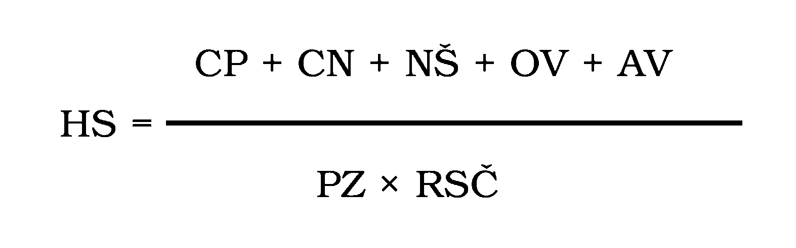

Príloha k nariadeniu vlády č. 374/2007 Z. z.

- VZOREC NA VÝPOČET ÚČTOVANEJ VÝŠKY VÝDAVKOV ORGÁNOV POTRAVINOVÉHO DOZORU

  - 1. Vzorec na výpočet účtovanej výšky výdavkov

  - UVV = HS x PH,

  - kde je

  - UVV účtovaná výška výdavkov,

  - HS hodinová sadzba,

  - PH počet hodín výkonu kontroly; hodinou výkonu kontroly každá aj začatá hodina práce inšpektora pri kontrole.

  - 2. Vzorec na výpočet hodinovej sadzby

- 

- kde je

- HS hodinová sadzba,

- CP cena práce všetkých zamestnancov podieľajúcich sa na kontrolách,

- CN cestovné náklady všetkých zamestnancov podieľajúcich sa na kontrolách,

- NŠ náklady na školenia všetkých zamestnancov podieľajúcich sa na kontrolách,

- OV náklady súvisiace s odberom vzoriek,

- AV náklady súvisiace s analýzou vzoriek,

- PZ počet zamestnancov podieľajúcich sa na kontrolách,

- RSČ ročný služobný čas.
